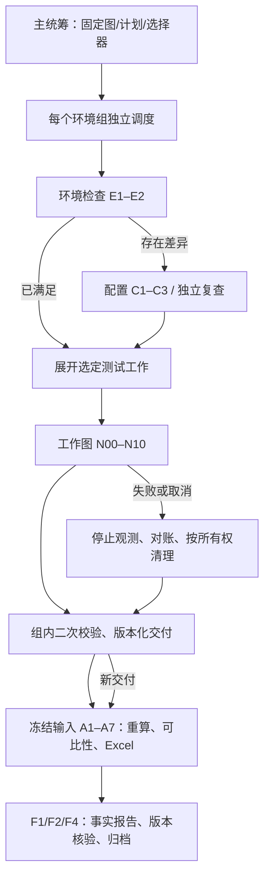

# Sandbox Graph

面向 CubeSandbox、Kuasar、AgentENV 的选型测试工程。需求、详细设计、测试契约和实施任务统一维护在 [OpenSpec change](openspec/changes/sandbox-evaluation-workflow/tasks.md) 中。

五阶段由真实 LangGraph 调度。确定性脚本负责执行、证据校验和计算；模型负责解释、提出变更和处理需要推理的问题。图状态保存版本及交付引用，原始日志、采样和表格独立封存。



安装与验证：

```bash
python3 -m venv .venv
.venv/bin/python -m pip install -r requirements.lock
.venv/bin/python -m pip install --no-deps -e .
.venv/bin/python -m pytest -q
```

版本化用例入口及离线复核：

```bash
.venv/bin/python -m sandbox_bench.runner case --case case.yaml --config environment.yaml --output run-directory
.venv/bin/python -m sandbox_bench.runner verify run-directory/evidence
.venv/bin/python -m sandbox_bench.runner recompute run-directory/evidence
```

`case.yaml` 按 `CaseContract` 填写真实环境、产品版本、规格、方法、完成终点、负载和有限预算；`environment.yaml` 需要对应来源证据及适配配置。测试夹具中的地址、参数和数值不能作为真实实验配置。缺少采样、来源、恢复或终点证据时明确拒绝或输出缺口。

编排运行入口、PostgreSQL 与 worker 配置见 [部署与恢复](docs/orchestration/setup.md)。单机执行账本使用文件锁和持久提交意图；正式多 worker 编排使用 PostgreSQL，二者不混为已验证的同一后端。

实现说明：

- [测试方法、生命周期与验证](docs/benchmark-scenarios.md)
- [发压、完成条件、预算与中断](docs/benchmark-load.md)
- [CLI 环境适配配置](docs/benchmark-wiring.md)
- [资源、指标计算与横向对比](docs/benchmark-resources.md)
- [分析与报告图接线](docs/analysis-report.md)
- [需求覆盖及未交付项](docs/orchestration/requirement-coverage.md)
- [实施与验证记录](docs/orchestration/progress.md)
- [最终回归证据和剩余缺口](docs/verification/README.md)

当前代码包含本地受控协议、公式和恢复测试。真实三产品性能、Linux 采集权限与 PostgreSQL 多进程故障验收需要对应环境；测试通过不等于候选产品性能已验证。缺口保留在任务清单中，change 不自动归档。
