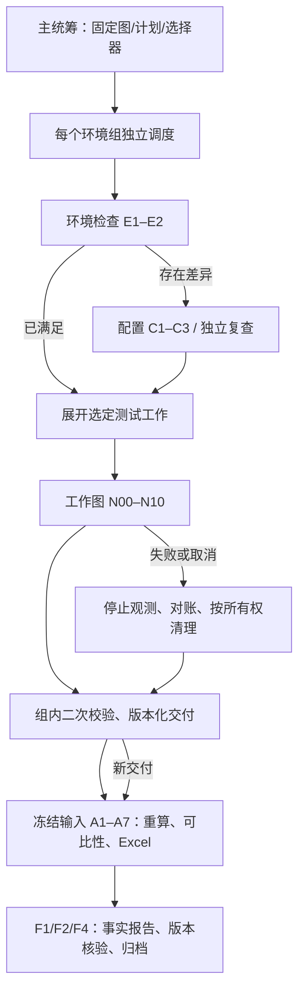

# Sandbox Graph

面向 CubeSandbox、Kuasar、AgentENV 的选型测试工程。需求、详细设计、测试契约和实施任务统一维护在 [OpenSpec change](openspec/changes/sandbox-evaluation-workflow/tasks.md) 中。

它将不同沙箱的测试统一为可复核的实验：固定环境、规格、完成终点和负载，执行测试，保存原始证据，再计算延迟、吞吐、密度、PSS/CPU 和横向对比结果。适合验证基础功能、评估运行时性能和复查选型结论。

## 从哪里开始

| 你要做什么 | 阅读入口 |
| --- | --- |
| 第一次使用、让智能体执行测试 | 本文的“首次使用”和“交给智能体的提示词” |
| 配置真实环境、来源、规格和采集器 | [执行配置说明](docs/benchmark-wiring.md)、[环境适配实现进度](docs/environment-adapters.md) |
| 运行多环境组、配置数据库和恢复任务 | [编排部署与恢复](docs/orchestration/setup.md) |
| 增删改测试、节点、环境或计算方法 | [维护指南](docs/maintenance.md) |
| 查看设计中的节点、子流程及自动化边界 | [节点工作流](openspec/changes/sandbox-evaluation-workflow/node-workflows.md)、[节点自动化职责](openspec/changes/sandbox-evaluation-workflow/node-automation.md) |
| 判断当前哪些已实现、哪些尚未验收 | [交付记录与缺口](docs/verification/README.md)、[任务清单](openspec/changes/sandbox-evaluation-workflow/tasks.md) |
| 在真实 PostgreSQL / 三产品 / 特权机验收 | [真实环境验收操作手册](docs/acceptance-manual.md) |
| 查可选指标与可调背景条件、逐场景规格 | [逐场景详细规格](openspec/changes/sandbox-evaluation-workflow/scenario-spec.md)（指标目录 RT-44/BCD-15、条件矩阵 RT-45/BCD-16） |
| 审阅编排图引擎差距与覆盖 | [差距清单](docs/orchestration/gap-analysis.md)、[ORC 覆盖账本](docs/orchestration/orc-coverage.md)、[来源语义审计](docs/source-audit/alignment.md) |

## 当前可用范围

- **单用例执行**：`sandbox_bench.runner case` 接入真实环境配置，执行、校验和封存证据；`verify`、`recompute` 用于离线复核。需要部署证据、来源和对应能力，方法出现在目录中不等于该部署已验证支持。
- **CLI 子命令**：`run`／`cleanup`（配置驱动发压／清理）、`case`（单用例 N00–N10）、`verify`／`recompute`（离线复核）、`resolve`／`build`（来源只读解析／B00 构建）、`endpoint`（创建端点拓扑解析）、`topology`（拓扑→声明组件清单）、`restore`（测试间环境还原）、`scenario`（指标/条件选择与背景条件校验）。退出码：`0` 成功；`2` blocked／incomplete／unverified；`1` 异常。
- **完整编排组件**：已有五类 LangGraph、选择器、持久状态与 Worker 接口。正式运行需要 PostgreSQL 和实际环境服务装配，当前没有一条 `sandbox_graph start` 命令可自动部署并运行全部环境。
- **验证边界**：已有本地协议、计算和恢复测试；尚无三产品真实性能结果。具体安装配置脚本、部分方法和故障验收仍未交付，详见上述缺口文档。

### 环境检查与配置实现进度

环境适配 OpenSpec change 已完成一部分通用底层：声明/报告/动作契约、SSH transport、访问与主机探测、密钥和鉴权处理、配置文件原子事务、修复计划、受限动作执行接口、远端操作 journal，以及 Linux 进程 inventory。对应任务进度、验证边界和未实现清单见 [环境适配实现进度](docs/environment-adapters.md) 与 [OpenSpec tasks](openspec/changes/implement-sandbox-environment-adapters/tasks.md)。

**这不是可直接执行的三产品环境准备能力。** CubeSandbox、Kuasar、AgentENV 的产品级环境检查、配置/安装/修复适配，以及环境图/CLI 接线尚未完成；当前没有能够自动完成三种沙箱环境检查和配置的端到端入口。不要据此对真实节点执行安装或宣称环境 ready。

## 工作流程

五阶段由真实 LangGraph 调度。确定性脚本负责执行、证据校验和计算；模型负责解释、提出变更和处理需要推理的问题。图状态保存版本及交付引用，原始日志、采样和表格独立封存。



主 agent 统筹整次实验，一个组统筹 agent 负责一组环境，工作 agent 只接收所属节点的任务和证据引用。运行状态由账本、checkpoint 和交付件维护，不能只依赖对话记忆。智能体工具中的子 agent 与本项目的图运行时需要实际接线，不会因为打开编辑器而自动启动。

## 首次使用

### 1. 安装并验证本地代码

在克隆的仓库根目录执行。项目声明 Python 3.11–3.14；实际验证版本和平台见交付记录。以下为 POSIX shell 命令：

```bash
python3 -m venv .venv
.venv/bin/python -m pip install -r requirements.lock
.venv/bin/python -m pip install --no-deps -e .
.venv/bin/python -m pytest -q -rs
```

这一步验证工程代码；`skipped` 要查看原因，不能算真实数据库或真实沙箱验收通过。仅运行已有测试不需要 OpenSpec CLI 或智能体 skill。

### 2. 准备一组真实环境和一个小用例

先按 [执行配置说明](docs/benchmark-wiring.md) 收集环境信息，按 [CaseContract](sandbox_bench/contracts.py) 填写用例。至少核实以下内容：

- 环境组、单节点/集群、节点角色、产品及部署版本、API 地址和凭证环境变量名。
- 来源模板/快照/镜像及其证据；目标 CPU/内存规格及实际生效证据。
- 方法、完成终点、请求总量、并发、超时、TTL、清理范围及有限预算。
- 若测资源：真实进程 inventory、节点/组件归属、采样权限、采集器与稳态判据。

首次建议选一个已经核验支持的创建方法，例如 `B01.TEMPLATE`，使用 `STATE_READY`、请求总量 3、并发 1。这只是起步范围建议，不能代替真实来源、部署证明和安全容量。创建成功以约定状态为准，不强制执行命令。

环境、凭证引用和产物可放在已忽略的 `artifacts/` 下，或仓库外受控目录；凭证值通过环境变量提供。原始证据需要单独持久备份，Git 忽略目录不等于归档备份。仓库没有可直接用于你环境的 `case.yaml` 或 `environment.yaml`，测试夹具也不能当真实配置。

### 3. 执行、校验和重算

下面路径都是占位路径，须替换为上一步准备的真实文件和本次独立输出目录：

```bash
.venv/bin/python -m sandbox_bench.runner case --case case.yaml --config environment.yaml --output run-directory
.venv/bin/python -m sandbox_bench.runner verify run-directory/evidence
.venv/bin/python -m sandbox_bench.runner recompute run-directory/evidence
```

`case.yaml` 按 `CaseContract` 填写真实环境、产品版本、规格、方法、完成终点、负载和有限预算；`environment.yaml` 需要对应来源证据及适配配置。测试夹具中的地址、参数和数值不能作为真实实验配置。缺少采样、来源、恢复或终点证据时明确拒绝或输出缺口。

先检查执行状态、证据缺口、真实 ready 数量和清理结果，再解读延迟与吞吐。缺失资源采样不能补成 0，也不能把提交成功数当作实际成功创建数。

### 4. 扩展为多用例或多环境组

先通过目录和预览检查选择范围：

```bash
.venv/bin/python -m sandbox_graph catalog
.venv/bin/python -m sandbox_graph preview selection.json
```

`selection.json` 的结构与合成示例见 [部署与恢复](docs/orchestration/setup.md)。支持按环境组、沙箱类型、优先级和测试用例等条件选择，依赖和能力仍需校验。预览不会提交远端实验。

正式启动使用 `RunService.preview/start`、PostgreSQL、注册服务和 Worker，按部署文档完成装配。单机执行账本使用文件锁和持久提交意图；正式多 worker 编排使用 PostgreSQL，二者不混为已验证的同一后端。

### 5. 环境还原与指标/条件选择

- **测试间环境还原**：删除只按本轮 `metadata.run_id` 归属，**小批量多轮**、删后核验残留，并排除预热／空闲／基线实例（Kuasar 预启动 runner 单元、Cube TAP/cgroup 池、AgentENV 设备池；审计见 [alignment §10](docs/source-audit/alignment.md)）：

  ```bash
  .venv/bin/python -m sandbox_bench.runner restore --config environment.yaml --output restore.json
  ```

  配置 `restore: {batch_size, batch_gap_s, max_rounds}`；残留非空为 `incomplete`，不报告为完成。
- **指标/条件选择**：每个场景的**需测指标（R）／可测（O）**与**需声明条件（R）／可选（O）**见 [逐场景详细规格](openspec/changes/sandbox-evaluation-workflow/scenario-spec.md)。用例经 `declared_metrics`／`declared_conditions`／`background` 声明后校验：

  ```bash
  .venv/bin/python -m sandbox_bench.runner scenario --case case.yaml --output scenario.json
  ```

  缺 R 项为合同错误；O 未选标 `not_selected`；不默认笛卡尔积。
- **真实环境**：PostgreSQL／三产品／特权机的逐项先决条件、命令与验收判据见 [真实环境验收操作手册](docs/acceptance-manual.md)。

## 交给智能体的提示词

在 OpenCode 或其他具备仓库读写、终端执行能力的智能体中，可以从下面开始；具体工具和 skill 以你本机安装情况为准：

```text
请在当前 sandbox_graph 仓库启动首次真实沙箱测试。
先读 README.md、docs/verification/README.md、docs/benchmark-wiring.md，
按需读 docs/orchestration/setup.md，不要一次加载全部文档或重新审计全部上游源码。
先运行本地验证，区分已实现、合成测试通过和真实环境验证通过。
检查已有环境记录，只向我询问缺失的连接、版本、角色、来源、规格和执行范围信息。
先选择一个已核验支持的创建用例，建议 B01.TEMPLATE / STATE_READY / Q=3 / 并发1。
用真实证据生成配置，按需调用 resolve、build、endpoint、topology、restore、scenario 与 case、verify、recompute 入口；每场景的**需测指标/需声明条件**以 scenario-spec.md 为准。
缺少适配或部署证据时说明具体阻塞；不要编造 evidence_ref、测量值或安装成功记录。
未知提交先对账，清理仅限本次明确拥有的资源；需要安装或扩大负载时先列出具体变更范围。
将配置引用、状态、产物路径、问题和下一步落盘，不用对话记忆替代运行账本。
最后给出真实成功数、延迟、吞吐、资源指标覆盖、清理结果和证据路径。
单用例运行不能宣称完成了多组 LangGraph 编排。
```

需要修改能力或流程时，使用 [维护指南中的变更流程和提示词](docs/maintenance.md)。克隆仓库不会自动安装原开发机的全局 OpenSpec skills。

## 项目目录与详细文档

| 目录 | 职责 |
| --- | --- |
| `sandbox_graph/` | 图、选择器、状态、数据库、调度和服务接口 |
| `sandbox_bench/` | 沙箱适配、测试方法、负载、采样、计算和证据 |
| `tests/` | 契约、协议、场景、编排、恢复及集成测试 |
| `openspec/` | 需求、详细设计、测试设计及实施任务 |
| `docs/` | 使用、维护、源码审计及验证记录 |
| `scripts/` | 工程校验脚本 |

详细说明：

- [测试方法、生命周期与验证](docs/benchmark-scenarios.md)
- [发压、完成条件、预算与中断](docs/benchmark-load.md)
- [CLI 环境适配配置](docs/benchmark-wiring.md)
- [资源、指标计算与横向对比](docs/benchmark-resources.md)
- [分析与报告图接线](docs/analysis-report.md)
- [需求覆盖及未交付项](docs/orchestration/requirement-coverage.md)
- [实施与验证记录](docs/orchestration/progress.md)
- [最终回归证据和剩余缺口](docs/verification/README.md)
- [真实环境验收操作手册](docs/acceptance-manual.md)
- [逐场景详细规格（指标 × 条件）](openspec/changes/sandbox-evaluation-workflow/scenario-spec.md)
- [编排图引擎差距清单](docs/orchestration/gap-analysis.md)、[ORC 覆盖账本](docs/orchestration/orc-coverage.md)
- [三产品来源语义与创建端点审计](docs/source-audit/alignment.md)

当前代码包含本地受控协议、公式和恢复测试。真实三产品性能、Linux 采集权限与 PostgreSQL 多进程故障验收需要对应环境；测试通过不等于候选产品性能已验证。缺口保留在任务清单中，change 不自动归档。
