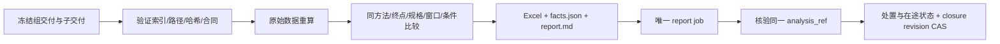

# 分析与报告图接线

`sandbox_bench.workflow_services.AnalysisReportServices` 为 A3、A4、A7、F1、F4 提供确定性 handler，与 `WorkflowHandlers` 的 A1、A2、A5、F2 及真实 LangGraph 组合。

| 节点 | 脚本执行 | 模型／人工边界 |
| --- | --- | --- |
| A1/A2 | 固定 analysis input，核验精确 delivery/review 版本和原始附件 | 缺失合同通过变更流程补充，不能猜测 |
| A3 | 物化被交付清单引用的文件、摘要复算、逐轮指标、可比性判断 | 不生成原因推断或候选排名 |
| A4 | 同输入导出事实 JSON、Excel、Markdown，复核计算与导出一致 | 不允许手工覆盖测量值 |
| A5 | 校验不可变返工单，按注册动作派发一次重算；缺适配动作明确阻塞 | 模型可提出补测建议，不能直接重发未知操作 |
| A7 | 幂等创建绑定同一 analysis_ref 的 report job | 无模型依赖 |
| F1/F2 | 事实报告组装，证据及分析版本核验 | 可选解释层带 fact_refs，始终与事实层分开 |
| F4 | 收口显式处置、在途检查、版本 CAS、完整或部分归档 | 缺少覆盖或未知在途不能宣布完整完成 |



工作图的 `delivery_finalizer` 在发布前再次验证 N10 封存输入未变，把全部文件复制到不可变 artifact store，并建立 `case_index_ref`。A3 只读取冻结交付中列出的附件，拒绝跨作用域引用、路径越界、重复 case、版本不符或摘要无法复算；不读取目录中的 `latest`。

模块配置：

```python
services = AnalysisReportServices(repository, review_service, artifact_store, deadline=deadline)
handlers = WorkflowHandlers(
    repository, deadline=deadline, review_service=review_service,
    node_services=services.mapping(),
).mapping()
```

实际集成还需将环境 handler、工作图 `work_handlers` 和 T2 条件验证器提供给 `runtime.bootstrap.build_job_handlers`。每次 handler factory 使用 Driver 当前 lease token；不得复用过期 token。

T2 可使用 `bindings.RegisteredBenchmarks.validate_conditions`。部署注册 `templates={ref: {"case": CaseContract字段, "config": 环境和wiring配置}}`；选择器条件为 `{"case_template_ref": ref}`。展开后填入当前 `work_id/plan_ref/repeat_id`，其余测量参数固定；每种规格和并发条件注册独立模板，多轮可选用同一模板并在目录 Case 中指定不同 repeat_id。会话目录由 opaque work ID 的 hash 生成。缺模板项持久标为 blocked，其余项可以继续派发。

`analysis_results` 保存输入引用、manifest digest 集合、facts EvidenceRef 和缺口；`analysis_exports` 保存同版产物；`report_facts` 绑定分析版本。原始数据和完整表格不进入模型上下文。缺条件或不合格数据保留测量事实，横向比较标记不可比，并列出原因。

`tests/benchmark/integration/test_analysis_graph.py` 使用真实 LangGraph、公式、artifact 校验和 Excel，但仓储及数据明确为合成夹具。它不是 PostgreSQL 或真实沙箱测试证明。

### Excel 在哪里产出、为何有时看不到

- **产出**：A4 `export` 调 `export_comparison(..., xlsx=True)` 写 `facts.xlsx`（工作表 facts/cases/comparability[/coverage]，`openpyxl` 为**硬依赖**，见 `pyproject.toml`）。Excel 字节立即 commit 到内容寻址 artifact store，引用落在 `analysis_exports[analysis_ref].files['facts.xlsx']`。
- **归档**：把 Excel 计入"交付"的是 **F4** `seal_archive(artifact_refs=export['files'] 全部)`，归档行记录 `facts.xlsx`/`facts.json`/`report.md`/`comparison_manifest.json`。
- **看不到的常见原因**：
  1. **F4 被阻塞**（如 `ANALYSIS_STALE`）⇒ 没有 `archives` 行 ⇒ 交付/证据摘要里没有 Excel。**能力本身没缺**，Excel blob 仍在 store 中。
  2. **只看 `artifact_refs`**：F1 现在已把 export 全部文件（含 `facts.xlsx`）列入 `artifact_refs`，并在 `output` 给出 `excel_ref` 与 `files`；在此之前 F1 只列 `report.md`。
- **取回**：已提供只读 CLI：`python -m sandbox_graph export-analysis --run-id RUN_ID --artifacts-root <root> --out <dir>`（或 `--analysis-ref`）；写出 `facts.xlsx`/`facts.json`/`report.md`/`comparison_manifest.json`，多版本按前 12 位分子目录。内部实现 `sandbox_graph/analysis_dump.py`（`store.verify` 校验摘要，篡改/缺失直接报错）。它只取回已校验产物，**不月经 F4 归档，不能作为交付完整性证明**。

版本切换后的复用保留原始 case、plan、delivery 和 raw 身份。`ReuseService` 只发布指向已验收原交付的 projection；新交付不复制旧作用域的附件冒充新证据。A3 经授权校验 projection 后读取原始封存，按原 delivery 与 case hash 去重。`case_aliases` 将每个当前工作映射回原 case，进入 JSON、事实报告和 Excel 的 coverage 表；两个工作复用一份测量不会增加样本数或吞吐分子。F4 同时校验处置的 run/plan、冻结输入、引用文件和最终在途状态。

复用不缺省开启。生产者可配置：

```python
finalize = delivery_finalizer(
    sessions, artifact_store, repository=repository, script_ref=registered_script,
    reuse_policies={
        work_id: {
            "case_hash": case.digest(),
            "valid_until": approved_expiry,
            "evidence_ref": approved_freshness_policy_ref,
        }
    },
)
```

有效期是经确认的策略输入，代码不替用户设定。只有成功且数据有效的交付才封存 `reuse_contract` 和策略附件。规格、完成终点、方法版本及观测时钟来自实际会话；脚本和条件身份必须匹配注册 WorkKey。`RegisteredBenchmarks` 持久保存 `measurement_bindings`；测量合同摘要包括全部 CaseContract 参数，仅排除 work/group/plan/contract 四个图身份字段。因此同名模板变更并发、缓存、来源或产品版本也不能沿用旧证据；重复轮次同样分开。缺少生产者绑定、原始字节、明确源作用域授权或有效期证明时，保留缺口。
