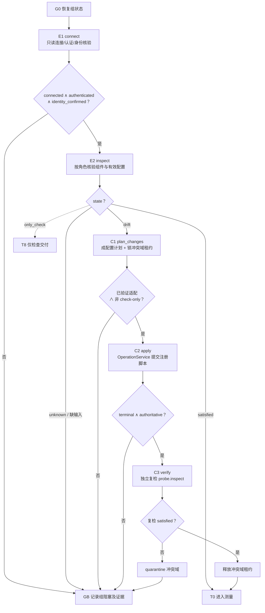

# 环境适配输入与角色示例

环境声明是版本化输入。当前实现以 JSON/YAML 作为数据读取，不执行 YAML tag、shell 或模型生成命令；拓扑例子见 `docs/examples/environment/`。样例中的 `.example.invalid` 地址不可连接，适合只读 schema/profile 校验。它们没有安装制品摘要，**不能用于 apply 安装或调参**。

## 现状：环境检查（E1/E2）与环境配置（C1–C3）到底做了什么

> 本节只描述**已实现且有受控测试**的能力与**未实现边界**，不代表真实三产品节点可被自动检查或配置。进度以 [tasks.md](../openspec/changes/implement-sandbox-environment-adapters/tasks.md) 勾选为准；包含真实验收的任务不因本地测试通过而勾选。

### 图编排职责（`sandbox_graph/services/environment.py` 的 `EnvironmentHandlers`）

| 节点 | 职责 | 关键判据 |
|---|---|---|
| **E1 connect** | 只读连接/认证/身份核验，产出 `EnvironmentSnapshot{connected, authenticated, identity_confirmed, state}` | 任一为假 → `blocked` + `continuation='GB'` |
| **E2 inspect** | 按角色核验组件与**有效配置**，采集对象/依赖/在位证据 | `check`→`T8`；`satisfied`→`T0`；`drift`→`C1`；否则 `GB` |
| **C1 plan_changes** | 由 E2 的 drift 快照 + 冻结 plan 的 `conflict_domains` 形成配置计划，并原子领取冲突域租约 | 缺已验证适配（`verified/script/operations`）或 `check-only` → `blocked` |
| **C2 apply** | 经 `OperationService` 提交**注册脚本**操作（`script_ref`，不执行任意命令）；重入用同 `operation_id` 对账 | 非 `terminal+authoritative` → `blocked`/`GB` |
| **C3 verify** | **独立复检**（再次 `probe.inspect`）；通过则释放域，否则 `quarantine` | 复检通过才 `→T0` |

**红线**：测量运行中 **E1/E2 必经**（组图 `G0→E1→E2` 无条件）；**C1–C3 仅在 drift 时触发**；`check-only` 不允许配置；`C2` 不执行未注册命令。

运行流程（连接→探测→差异→计划→注册脚本→独立复检→释放/隔离）：

### 已实现的产品无关公共底层（受控协议测试）

| 能力 | 模块 |
|---|---|
| 严格合同（声明/观察/修复计划/receipt/验收） | `contracts.py` |
| 引用摘要、依赖 DAG、角色适用性、可探测缺口合并 | `declarations.py` |
| 三产品 profile/version/arch + 制品 **digest 锁定** | `catalog.py` |
| **SSH transport**（OpenSSH argv、严格 known_hosts、限时限输出、安全 quoting） | `transport.py` |
| 访问探测（网络/身份/认证/执行权限/工具事实） | `probes/access.py` |
| **宿主探测**（CPU/内存/架构/内核/KVM/存储/网络/systemd/cgroup/观测权限） | `probes/host.py` + `scripts/environment/probe_host.py` |
| **鉴权探测**（无 key/错 key/正确 key 的正反例，区分健康与真授权） | `probes/auth.py` |
| **Linux 进程 inventory**（角色/组件、PID+start ticks、PSS/CPU、cgroup） | `probes/inventory.py` + `collect_inventory.py` |
| 配置解析 + 覆盖来源跟踪（file<env<CLI；`file_only` vs `runtime_effective`） | `config.py` |
| **原子文件事务**（预期摘要、symlink/归属、权限保持、CAS 补偿、受限备份） | `file_transaction.py` |
| 确定性修复计划（故障决策表 + DAG） | `planner.py` |
| 参数规则（`preserve/exact/relax_for_plan`、单位、有限预算） | `parameters.py` |
| 远端 journal（锁、原子持久、完整输入身份、进程/boot 记录） | `journal.py`、`remote_agent.py` |
| 环境执行网关（提交/查询/对账/逐动作 receipt） | `execution.py` |
| ExecutionGrant/nonce 握手（PG issuer） | `permits.py`、`grant_service.py` |
| 秘密存储（`secret://`、scope/version）、AuthBinding lifecycle | `secrets.py`、`auth.py` |
| 持久化前隔离/脱敏（哨兵秘密不泄漏） | `evidence.py` |
| 注册动作边界 | `scripts/authorized_key.py`、`service_action.py`、`product_install.py` |

### 当前实现与剩余边界

三产品 profile、发现/锁定安装 recipe、配置/鉴权资产、独立验证器、environment:1 图和全部 env CLI 已有代码；独立准备入口与保留的测量组图分别使用各自版本。具体调用见 [环境命令](environment-workflow-cli.md)。默认缺配置、注册、鉴权或 cleanup 证据时保持 blocked。

远端 helper 的显式 bootstrap、离线资产投递和 helper_paths 接线已实现，见[首次部署与恢复](environment-bootstrap.md)。尚需补齐部分运行时参数、动态产品归属发现、产品级镜像加载/恢复及完整故障矩阵；真实 Linux/PostgreSQL 与产品验收另行执行。不是所有缺口都由环境阻塞。组 5/6/7 未整项勾选不表示其中所有代码不存在。

## 当前实现与未完成范围

以 [当前能力账本](orchestration/lifecycle-status.md)、[任务清单](../openspec/changes/implement-sandbox-environment-adapters/tasks.md) 和 [继续实施记录](verification/agent-lifecycle-runtime/continuation-20261024.md) 为准。环境图、CLI、产品规则、live harness 已有代码；本地测试和真实验收必须分开。此前 521 项的结果是早期快照，不再称为最新全仓结果。

## 2026-10-24 后续配置与验收增量

- `scripts/environment/tune_config.py` 将审计过的 Cubelet/CubeAPI、Kuasar conductor、AgentENV scheduler 参数写入新的私有资产；保留未知字段，不改变 sandbox_spec。合同包含 schema_version=1、product/component/source/output/remote_path/targets/budgets。targets 采用 TargetValue；relax_for_plan 的 budget_ref 必须在 budgets 中逐项解析，值包含同一 budget_ref、minimum/maximum/step/unit。输出 manifest 含 recipe file step、digest 和以远端路径为键的 expected_before，交由现有 grant/CAS 执行。当前未登记的组件参数明确拒绝，不能称为完整产品调参覆盖。
- CubeAPI 配置按真实环境变量/CLI 读取；记录 CLI 覆盖来源、callback 优先和静态鉴权模式，不把通用 --config 文件作为它的启动约定。配置证据与 runtime effective 仍分开。
- 管理观察按 Cube QuotaMem=MiB、QuotaCPU=mCPU 做单位换算；relax 检查使用明确 budget_ref 的 minimum/maximum，不借用同名参数的别的预算。
- `probe.inventory.v1` 读取当前 machine/boot/PID/start_ticks、PSS/CPU/cgroup。Kuasar 同名 node-ctl/cluster-ctl 按 argv 子命令分角色；不公开原始 argv。未匹配、歧义与缺 PSS 不作为零开销。
- CanaryRequest 可携带 control_routes，每项指定选中控制 API 节点的 endpoint_ref 和当前 boot_id。创建仍落在计算节点；删除前通过独立控制入口验证该原实例及缺失/错误凭据拒绝，功能和清理证据关联相同资源。非 API 管理角色使用 management_dependencies、当前服务/启动配置证明和组 canary，明确标为 group_dependency；不虚构它们的沙箱 API。
- 三产品 × 单机/多机 opt-in harness 位于 tests/environment/live/test_products.py；必须提供专用数据库和明确目标合同，未提供时 skip，实际未执行。

### Kuasar 集群 group 准备

`python scripts/environment/prepare_kuasar_groups.py --input <private-input.json> --manifest <private-manifest.json>` 读取 ManifestKey 的 secret ref、已观察 placer 配置和全部 source 的 group 快照，生成私有 generation、CAS 配置步骤和匹配客户端。输入字段见脚本 render 的 required 集合；输出步骤注册到固定 recipe catalog，再由 env plan/apply 使用既有 action binding。源目录或新 generation 漂移时拒绝切换。脚本不负责跨主机传送资产，也不伪造 placer 导入/下发成功。

`kuasar_cluster.credential` 与 api_secret_env 互斥，包含 auth_ref/auth_scope/auth_version/server_credential_version/secret_store_path；执行器临时解析 APISecret 并按产品 MAC 协议签发令牌。ManifestKey 和 APISecret 不能互换。最终必须通过正确/缺失/错误凭据保护对象验证与原 canary 清理。

源码边界：当前审计版本 `kuasar-components/orchestrator/internal/orch/cluster.go::putClusterKeyPair` 明确拒绝 ref delivery；placer 只规范化引用/fingerprint，并不提供节点 secret resolver。新建配置采用已实现的 inline/派生协议；既有外部 ref 保留但不声称其已下发成功。此项属于产品能力缺口，不能通过编造管理命令补齐。

Kuasar 部分安装修复会沿声明角色的依赖重新执行配置校验，再启动或重启受影响的服务。补回 unit 时先执行 daemon-reload；共享二进制影响所有依赖角色，单角色配置不重启其他角色。需要注册并授权新 recipe 摘要，仍由 C3 复检确认生效。unknown 原步骤不能通过重新生成计划跳过对账。

动态采集、镜像加载、受管容器恢复、ublk 和原操作私有日志的新接口见 [运行证据与恢复说明](environment-runtime-evidence.md)。本轮持续实施状态见 [补齐记录](verification/agent-lifecycle-runtime/remaining-20261024.md)。
