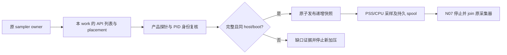

# 动态资源归属、安装恢复与私有日志

2026-10-24 的代码增量；下面的命令和本地测试不代表已在三产品环境安装成功。现场仍需显式环境组、资产、凭据和授权。

## 动态 inventory

`python scripts/environment/collect_inventory.py --discovery discovery.json --snapshot-context context.json --output /absolute/inventory.json` 可执行一次只读刷新。discovery 精确字段是 `product`、`roles`、`runtime_root`；context 精确字段是 `environment_ref`、`node`、`inventory_ref`、`work_id`、`cohort_ids`。`--proc-root` 和 `--machine-id-file` 指向采集目标的实际观察域。不能在测试主机读本机 proc 后标为远端数据。

N04–N07 的 `wiring.sampler.kind=collector_procfs` 可追加 `discovery` 对象：`product`、`roles`、绝对 `runtime_root`、绝对 `machine_id_file`。必须同时声明 `wiring.cohort` 的 `owned_api` 及节点/placement/完整列表证据。每次采样前在原 sampler executor 中完成 API 归属/放置核对、进程发现和原子快照；复用原 N07 停止与 join 生命周期。仍可不配置 discovery，使用独立采集器提供的显式快照。

| 产品 | 实际归属依据 | 资源统计边界 |
| --- | --- | --- |
| Cube | shim 的 `-id`、runtime_root 下的 cwd、shim.pid 与 vmm.pid 均匹配当前 PID | 当前源码 VMM 在 shim 内；单列 shim_vmm，不重复计费 |
| Kuasar | cloud-hypervisor 的 `--api-socket ROOT/sandboxes/SID/ch.sock`；核对实际父链 | VMM 与 sandbox-ctl/node-ctl run-sandbox 分进程采集、同 incarnation |
| AgentENV | firecracker 的 `--api-sock`、cwd、只读 GET /mmds 的 instanceID | 不从随机 workdir 名猜 SID；不导出其他 MMDS 字段 |

出处是 `CubeSandbox/CubeShim/shim/src/common/utils.rs::record_pid`、`kuasar-components/orchestrator/internal/nodepath/path.go`、`kuasar-components/sandboxer/pkg/sandbox/ch.go`、`AgentENV/src/sandbox/firecracker/instance.rs`、`mmds.rs`。输出 `generation_kind=observed_process_incarnation`，由 machine/boot/PID/start_ticks 计算；它不是上游业务 generation。重复归属、进程消失、PID 复用、缺 PSS、陌生节点及超时均保留缺口。快照 scope 和 boot 不可变，版本单调递增，独占锁防止两个刷新者覆盖。

## 安装和参数恢复

AgentENV 的 config/assets/account/ownership/setup/service 及 Cube 纯管理 binary/config/unit/proxy 的部分修复具有依赖闭包。已确认完成的无关步骤不会重做；未知步骤必须对账原操作。修复已运行服务的输入后使用 restart，unit 变更先 daemon-reload。

AgentENV 控制容器由 `owned-container` primitive 激活。`expected_before` 必须显式包含 `container:aenv-gateway` 或 `container:aenv-scheduler` 的原容器 ID（已确认不存在时为 null）。替换校验受管标签并按原 ID 删除；启动 `--pull=never`，随后复检实际容器/image ID。外部已有但无受管标签的容器不会被接管。

固定镜像可用 `repo@sha256:...` 或本地 `sha256:...` 内容 ID。可选资产 `image:gateway`、`image:scheduler`、`image:cubeproxy` 是路径/sha256 锁定的 docker archive。加载前验文件摘要，加载后独立 inspect；Cube control profile 需提供 `proxy_image`，Compose 的 cube-proxy 镜像必须匹配并声明 `pull_policy: never`。Docker 变更后失去确认返回 unknown，不按失败重发。

`python scripts/environment/tune_ublk.py --target 1024 --output /absolute/ublk.conf --manifest /absolute/ublk-recipe.json` 仅准备配置资产；已有目标文件必须传 `--before-sha256`。该有限数字只是语法示例，不是推荐容量。recipe 写 `/etc/modprobe.d/sandbox-graph-ublk.conf` 后，仅在模块未加载且 `modinfo -p` 确认支持 `ublks_max` 时固定执行 modprobe，再读 sysfs 复检。已加载值不符则返回需要维护，不卸载模块。`targets.host_attributes.ublks_max` 在 server 角色使用固定远端 `probe.ublk.v1`，当前值与下次加载目标分开。

参数证据分为 rendered_only、startup_bound、runtime_effective。当前直接运行值覆盖 Cube 上报容量/并发/配额、Kuasar registry capacity 和 AgentENV 宿主 ublk 上限。其他 limiter/pool/scheduler 参数具有源码规则、配置 CAS 和启动绑定；本 profile 尚无对应直接运行值探针，返回带源码和组件清单的 unsupported；未登记字段或观察暂不可用仍为 unknown。不能以配置文件或“服务 active”证明这些值生效。

## 原操作私有日志

`python scripts/environment/export_logs.py --input private-log-request.json --output /absolute/private.log` 通过 SSH 从原 journal 导出 sealed stdout/stderr；input 精确字段为 `ssh`、`helper_path`、`machine_id`、`log`。log 包含 `operation_id`、`input_hash`、整数 `stream`（0 stdout、1 stderr）、`sha256`、`offset=0`、`limit`（1–65536）。使用步骤 receipt 的 operation_id，不是父 recipe ID。

只允许 completed/failed/cancelled 的完整日志；活跃/未知操作、截断或 hash 不符拒绝。单流最多 8MiB，0600 私有文件落地，不覆盖已有文件；公开报告只收摘要和身份。SSH 用户本就拥有该 journal，导出不会赋予新修改权限。日志内容不自动进入模型上下文。

## 宿主原语独立验收

`python scripts/verify_host_primitives.py --input /absolute/host-acceptance.json` 执行 EAT-30 的只读 SSH/身份/proc/systemd/KVM/PSS 检查。精确输入为 `schema_version=1`、`ssh`（address/port/user/known_hosts/identity_file）、`helper_path`、`machine_id`、`role`、`require_pss`、新私有 `output` 目录和 0–30 秒内的正数 `timeout_seconds`。测试入口使用 `SANDBOX_GRAPH_TEST_HOST_PRIMITIVES` 指向此文件。

内部顺序：身份/boot → 宿主事实 → 再次身份/boot → 控制端重算角色要求 → 原始观察摘要和私有报告。退出码 0 仅代表宿主原语通过，2 表示 blocked；不会安装、加载模块、创建 VM 或改密钥。ARM 的 CPU Features 缺少 vmx/svm 不能据此判定无虚拟化；ENODEV 等打开错误保留 unknown，不能错误调度“授予权限”修复。实际 guest 创建仍由产品 canary 验收。

Cube compute 只要求源码中实际存在的 cubelet/shim 制品。VMM 运行在 shim 内，独立 cloud-hypervisor 文件不属于该 profile 的安装前置。one-click 的已完成步骤若输入资产失效，需要原安装对账；禁止恢复 staging 后静默跳过安装，禁止把重放完整 `--mode=install` 当成无损修复。

## Kuasar 显式密钥对

`prepare_kuasar_groups.py` 在原 `manifest_key_ref` 之外可选 `api_secret_ref`，两者必须属于同一 scope 和版本；省略时保持官方派生算法。引用在本机受限 SecretStore 内解析，只有私有 generation 资产包含 inline 密钥，输出的客户端合同仍为秘密引用。上游 `internal/orch/cluster.go::putClusterKeyPair` 明确拒绝直接 secret ref 下发，因此不会把本项目的 `secret://` 引用原样发给节点；既有 foreign source 不被自动改写。格式/版本校验与真实导入/受保护 canary 是两种不同证据。
