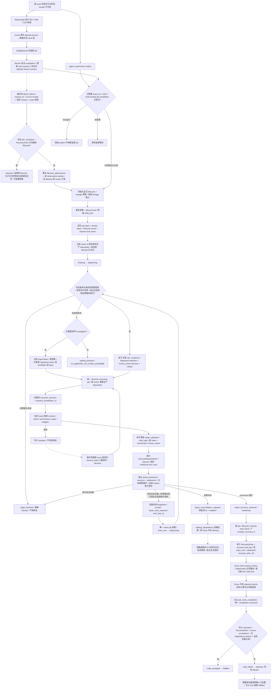

# 工作级持久生命周期监督

本批接通显式授权失败 work 的确定性监督入口：真实 Worker / Driver / StateGraph / NodeExecutor 的首个失败，经原尝试收尾、处置、确定性诊断、现代修复和 RecoveryPlan，再消费 Driver 的源节点专属验收。它是默认关闭的可选装配，已覆盖工作级已知规则和不同策略的受控组合；不代表 43.5 / 44.5 / 45.1 的所有现场能力、测量重入或其他层级监督已经完成。

## 实际内部流程

实线为本批已接通路径，虚线表示仍需明确的外部依赖或操作员入口。所有修复仍需现有服务核验权限、版本、派发 gate、共享 work 锁和双层预算。



## 显式启用和授权时序

`build_job_handlers(..., lifecycle_bindings=None)` 是默认值。传入绑定列表才注册 `handlers['lifecycle']`；`Worker` 从该 handler 获取事务消费者，也允许显式传入 `lifecycle_supervisor`。未绑定的正常路径保持现有行为，健康图不会创建 diagnosis、supervision 或 remedy job。

每条绑定必须显式提供 `binding_ref`、`run_ref`、`work_ref`、`node_id`、`policy_ref`、`authorization_ref`、`principal`，及全部预算字段：

| 字段 | 必须提供的值 |
| --- | --- |
| `limits`、`lineage_limits` | `repair_attempts`、`diagnosis_calls`、`candidate_revisions`、`tokens`、`child_jobs`、`observations`、`cost`，均为正整数有限上限 |
| `safety_limits`、`lineage_safety_limits` | `stop_calls`、`query_calls`、`cleanup_calls`、`cost`，均为正整数有限上限 |
| `deadline`、`lineage_deadline` | 显式绝对 wall-clock 截止时间 |
| `safety_deadline`、`lineage_safety_deadline` | 覆盖业务期限的显式安全期限 |
| `cost_unit` | 操作员明确指定的最小成本单位，与 policy 匹配；不生成价格或默认成本 |

绑定在调度第一条监督 job 时持久冻结到 `lifecycle_bindings`，以 `lifecycle_binding_refs` 连接 lifecycle。budget 初始化复用现有 lineage 记录，不因新 job、上下文或 retry 重置额度。监督、决策消费、恢复编译、恢复 work 和完成消费也计入 `child_jobs`；需为整个有限路径明确留足额度。已知规则路径不调用模型，也不消耗模型 tokens/cost；无适用规则时只有显式配置的 AgentTeam 可以在原预算内发起 investigator。

**此入口面向已经失败并完成收尾的 work。** `_publish_completion` 会改变 work row revision；`repair_authorizations.work_revision` 必须对应此次完成后的真实 revision。开始测试前对旧 revision 的授权不会自动适配此变化。应在原 attempt 的 `completion:<job_id>` 事件与当前 closure facts 提交后，由授权边界登记 exact principal/run/scope/plan/graph/contract/revision、动作、权限、有效期及未撤销状态，再启用本入口或继续既有绑定。调度器不会猜测未来 revision、复制权限、更新授权、扩展期限，或放宽源 work 冻结版本。

原来的 `agent_supervision` 可能已被默认关闭状态下的旧 Worker 消费；仅装配新 handler 不会重新消费这个历史 delivery。对已经完成的失败，必须调用公开的 `LifecycleSupervisor.attach_failure`。它接受明确的 request_id、binding/run/work/node、原 job/receipt、预期 work revision、principal 和已有 authorization_ref，在同一事务保存不可变命令和新的 `lifecycle_attach_requested` outbox，不删除旧 delivery，也不改写或重新运行旧 review。

实际装配可以调用下列函数；`binding` 和版本/来源参数来自操作员明确输入，`handlers` 是先前以真实 adapters 构建的集合。policy 已通过 `LifecycleService.register_policy` 登记，exact 授权已由操作员的认证边界登记在 `repair_authorizations`；此入口不创建或改写任何授权，也不替用户生成预算：

```python
from sandbox_graph.runtime.lifecycle_supervisor import LifecycleSupervisor
from sandbox_graph.runtime.worker import Worker

def attach_failed_work(repository, handlers, *, binding, request_id,
                       original_job_id, source_receipt, expected_work_revision,
                       operator_principal, lease_seconds, worker_policy):
    supervisor = LifecycleSupervisor(repository, bindings=[binding],
                                     lease_seconds=lease_seconds)
    attached = supervisor.attach_failure(
        request_id=request_id, binding_ref=binding['binding_ref'],
        run_ref=binding['run_ref'], work_ref=binding['work_ref'], node_id=binding['node_id'],
        original_job_id=original_job_id, source_receipt=source_receipt,
        expected_work_revision=expected_work_revision,
        principal=operator_principal, authorization_ref=binding['authorization_ref'],
    )
    worker = Worker(repository, dict(handlers, lifecycle=supervisor), policy=worker_policy)
    return worker, attached  # 必须检查 status；accepted 有新 intent_ref，rejected 指向原 lifecycle
```

首次命令要求原 job 确为该 work 当前完成的 attempt，原 activation、receipt、graph 结果、首失败、completion 事件和当前版本 closure facts 相符，且没有更新的 work job 待执行。它检查原 job/receipt 的 scope/plan/graph、当前 work revision、run/gate、期限及 exact action permission，拒绝其他 scope、旧 attempt、旧 revision 或错误 principal。消费新 outbox 时，在创建 job/预算之前再次核验当前事实和冻结的 binding hash、授权 revision、原 job/receipt hash；变化产生具体 blocker，原 intent 保持未 delivery。

相同 request_id 和相同命令重放返回原持久 accepted 回执；同 ID 不同内容报冲突。恢复完成导致 work revision 改变后，该回执仍是历史 acknowledgment，不是新授权。不同 request_id 指向同一失败来源也复用同一个首轮诊断 job，不额外扣 child_jobs。

**已经归属生命周期的恢复子 attempt 不能通过 attach 变成新的根失败。** 即使操作员对它完成后的最新 work revision 重新登记动作授权，该授权也不能重建局部预算或重置同失败计数。入口从实际 job/receipt 和 `activation_jobs`、Driver activation、`recovery_starts`、不可变 `recovery_plan_activations` 反查并验证 RecoveryPlan 内容摘要及其 context/order/原 lifecycle。检查不是只读 job payload 的 `recovery_plan_ref`；删除 payload 乃至 activation 的该标志，仍会被持久的启动/分配链识别。身份或 plan 内容不一致时拒绝，不把不完整的归属证明当成新根许可。其他 work 的独立首次失败仍可使用自己的 exact 授权和原 lineage 额度正常 attach。

已验证的恢复子链返回 `status='rejected'`、`reason='lifecycle_owned_recovery_attempt'`、**原** `lifecycle_id` 和 `source_receipt`、本次 `attempted_source_receipt`、`recovery_plan_ref`、`recovery_entry` 与 `resume_entry`。拒绝回执按 request_id 保存于 `lifecycle_attachment_rejections`，相同请求重放不会创建 attachment outbox、lifecycle 或预算。已有原 source、order、计数、预算、回执和 blocker 均保持原值。它只告知应查看原 lifecycle/blocker；合法继续必须保留原 source、attempt 历史和局部/lineage 额度，并另经明确的阶段、权限及剩余或经授权调整的预算检查。当前 `attach_failure` 不执行此类 continuation，`resume_intent` 也只适用于 diagnosing 中被拒绝的 decision，不能用它重开 draining 的失败恢复链。

旧版本如果已错误保存恢复子链的 accepted attachment 但尚未消费，新消费者在任何 job/预算分配和 job 复用前也做上述归属核验，另存拒绝结果到 `lifecycle_attachment_rejections`、`lifecycle_intent_results` 与 `outbox_errors`，保持原 accepted request/outbox 不变且不标 delivery。公开入口重放这种历史请求时返回拒绝结果，而非把旧 accepted 回执当成重建预算的许可。

若绑定已存在但权限缺失、scope 错误、过期、gate 关闭或 work revision 不同，服务持久记录 blocker，保持原决策和回执。对于已经被拒绝且 lifecycle 仍在 diagnosing 的 decision，操作员可在同一授权边界明确更新授权，再调用：

```python
supervisor.resume_intent(
    blocker['intent_ref'], request_id=operator_resume_request_id,
    principal=operator_principal, authorization_ref=operator_authorization_ref,
)
```

该入口要求当前 exact scope/revision/principal 的有效绑定授权，保留同一 decision，使用新的有界 consumer job 和原 lineage 预算；同 request_id 内容重放返回原 job。真正下单仍由 `request_remediation_in` 复核动作权限、gate、处置与预算。它不能清除隔离、替换 order、修改生命周期阶段、扩大预算或替换原失败；模型诊断和未知效果也不能通过这个入口伪装成已批准普通修复。完整的产品授权生命周期、CLI 入口和迁移尚未包含在本批。

## 持久消费、重放和故障入口

`agent_supervision` 在原 work job 仍 running/draining，或 completion 元数据尚未提交时保留，避免冻结收尾前 revision。按工作图节点顺序选择本 attempt 首个失败；现代 remedy/recovery 的问题仍归原 lifecycle，避免子 job 重新创建额度。相同 work 的所有节点与监督、修复及恢复共用 `work_execution_leases`。

诊断 job 的唯一身份取自 lifecycle 和本轮之前的 repair order；首轮使用稳定的 source 标记。draining → diagnosing 的 revision 变化不创建新诊断轮。首次 agent_supervision、显式 attach、lifecycle_observed、lifecycle_advanced 和相同 retry 事件复用同一 job，第二个 Worker 在观察提交后或 decision 提交前消费事件也不多扣 child_jobs。下一笔已提交 repair order 才界定下一轮诊断。

`decision_ready` 的消费在同一事务写下 order、预算预留、job、known_action 事件和 `lifecycle_decision_consumptions`。网络不在事务内。决策先落盘、尚未入队时断开可以再次消费；order 入队、outcome 提交、恢复 work 入队或 node acceptance 提交之后的重复消息不会增加 repair attempt。已入队的恢复任务返回原 plan/job，不重编译或延长旧 proof。Driver 启动仍重新核验其全部事实。

本模块使用的新增账本为 `lifecycle_bindings`、`lifecycle_binding_refs`、`lifecycle_attachments`、`lifecycle_attachment_rejections`、`lifecycle_dispatch_results`、`lifecycle_blockers`、`lifecycle_intent_results`、`lifecycle_resumptions` 和 `repair_strategy_selections`。处置 proof 通过共享 `LifecycleService.bind_evidence_in` 保存到 `lifecycle_evidence_bindings`，允许同一真实 work proof 绑定不同 lifecycle；旧 global evidence 只按原归属读取，不覆盖。沿用通用 `orchestration_records(kind,key,...)`，没有另造非持久队列。`outbox_delivery` 仅表示意图已事务交给唯一 durable job，不证明业务成功；失败 job 的 blocker 和结果仍保留。完成 job watchdog 会把超时/取回次数耗尽/派发取消写成可读 blocker，并保守结算其原 child job 额度，不产生无限替代 job。

| 现象 | 持久事实和处理 |
| --- | --- |
| 没有配置新意图的消费者 | `outbox_errors.status=waiting_dependency`，带配置恢复入口；原 outbox 不标 delivery |
| 没有匹配的可信规则，或动作不可用 | 有显式 AgentTeam 才发起有限 investigator；未配置模型时 `waiting_decision`，原因 `no_applicable_rule_model_unavailable`；不因 available 自动修复 |
| repair 有界失败 | 持久 `next_due_at` 的唯一 timer job；到期 `timer_due` 后重新诊断，允许最后一次额度内成功 |
| 预算/同策略无进展耗尽 | `repair_blocked` 与具体原因；不新建第三次修复来绕过预算 |
| 远端效果未知 | 保留 `repair_isolations`、原 operation refs 和 `repair_reconciliation_required`；`lifecycle_intent_results` 记录 `waiting_dependency`，原意图不标 delivery |
| 未取得原 operation ID | 不虚构 ID，不强行发出 unknown 状态迁移；lifecycle 保留 remediating，blocker 标记 `operation_binding_missing` 的 waiting_dependency |
| 源节点专属验收拒绝/依赖失败 | 读取 Driver 持久 activation 的 `recovery_acceptance` 和 `recovery_dependency_failures`，node_failed 回 draining 并保留原因；N10 交付成功仍不能 fulfilled |

未知效果的 `recovery_entry=LifecycleSupervisor.consume_in` 指向保留原 outbox 的入口，`intent_ref`、`operation_refs`、isolation 与具体 blocker 可由明确装配的 [原 ID 有限安全消费者](lifecycle-reconciliation.md) 继续。单独传入普通 `OperationService` 仍只启用已有通用 cleanup/reconcile handlers；现代续办另需 `reconciliation` 服务、精确独立安全授权和原双层安全预算。未装配时继续保存 waiting_dependency，`resume_intent` 不能以普通授权绕过。实际 sampler 停止采用[版本化原 session 停止合同](sampler-lifecycle.md)；没有可信 adapter 停止证据的 observation 仍保留依赖 blocker。这里的 waiting_dependency 是调度 blocker 状态，lifecycle 保留合法阶段。

本地组合测试使用明确的 MemoryRepository、受控外部操作账本和真实 StateGraph/Driver/NodeExecutor/Worker。PostgreSQL 进程崩溃、真实沙箱/runner/provider、候选构建、跨所有节点的策略替换及生产授权生命周期仍需后续验收。


## 可信适用性和不同策略

`RepairApplicabilityRule` 是 `schema_version=1`、严格类型、禁止额外字段的受信部署合同。`source_error` 精确匹配原失败 receipt 的错误码；`repair_failure` 还要求同一 lifecycle 上一笔已确认失败的 order、其 action_ref 和真实 receipt 错误码。`postcheck_rejected` 独立匹配上一笔已确认的后验拒绝，必须绑定 predecessor action 和其已注册 postcheck_ref，且不得携带执行错误码；执行 succeeded / error=None 的事实保持不变。规则只能引用该节点已注册且可用的动作。适用性不授予权限：policy、exact authorization、共享 work 锁、当前 disposition 和原双层预算仍由下单和执行服务逐次验证。

选择器优先匹配明确消费修复失败或独立后验拒绝的新规则，再考虑原失败规则；不会按 policy.actions 的排列取首个 available。`repair_strategy_selections` 与 decision / decision_ready 在同一事务写入，保存规则全文、action、原 issue fingerprint、证据引用、输入摘要和同失败次数。下一轮 B 的 decision 和输入 manifest 会引用 A 的真实失败 receipt，同时保留原 source receipt。manifest 按内容寻址，旧 manifest、order、outcome、raw 和 receipt 均不可变。

`RepairOutcomeService` 在独立检查后生成严格版本化 `RepairPostcheckEvidence`，以内容 hash 保存至 `repair_postchecks`，绑定 producer、lifecycle、order、action、postcheck、真实 receipt hash、disposition 和 effect/status。此证据与失败 fingerprint、outcome、预算结算和后继意图同事务提交。后验拒绝规则验证实际 evidence / outcome / execution visit / 原处置身份；缺失、错配或 unknown 不构成普通修复许可。B 的 decision/manifest 同时引用原失败、A 的真实执行 receipt 和该后验证据，不能把独立拒绝改写为执行错误。

完整输入 manifest hash 仍保护全部证据；`strategy_input_hash` 额外固定原 source / input_refs，避免仅追加 evidence_refs 就清零同动作失败计数。失败计数在原 lineage 内按 action、原问题 fingerprint 和稳定输入累计，历史旧记录仍按原 input_hash 读取。达到 max_same_failure 后，只有另一个仍适用且未耗尽的注册策略可以继续；所有策略均受原 repair_attempts、child_jobs、deadline 和 backoff 约束。没有替代策略时保留 no_progress blocker；最后一次已授权 attempt 成功仍可进入 RecoveryPlan 和源节点验收。

`build_job_handlers(..., repair_catalog=catalog)` 是受信应用装配入口。catalog 由部署代码构建，不能来自模型提案或 job payload；GraphJobHandler / Driver、LifecycleSupervisor、NodeRemediationService、LifecycleRepairWorker / RepairOutcomeService、RecoveryService 源验收、AgentTeam 和安全对账共用它。已有 model_team / reconciliation 必须持有相同实例，装配器会拒绝混用。`RecoveryService.finalize_acceptance_in(..., catalog=...)` 使用已接受 order 的动作后验，不能以任意节点的通用 accept 代替动作专属验收。模型仍只能提议 registered action / candidate / input，不能提供 Python handler。

标准目录仍只有 `case.reconcile@1` (N01)、`evidence.seal@1` (N07)、`resource.cleanup@1` (N09) 可用；默认确定性规则仅识别已有 benchmark adapter 的 `BENCHMARK_STEP_FAILED` / `BENCHMARK_STEP_BLOCKED`。其他错误或质量拒绝走有限 investigator / input。N02 等动作继续 unavailable，未增加现场脚本或授权。有效 performance_status=fail 本身不会创建修复。

`test_work_strategy.py` 的 ALI-01 组合已参数化原始失败源 N01 / N02。N02 路径真实执行 N00→N01→N02 失败→N07→N08→N09→N10，再在同一 lifecycle 上诊断 A、执行 A 失败、backoff 到期、用 A 的真实失败 receipt 诊断 B、第二次且最后一次修复成功；RecoveryPlan 重验 N01/N02/N03，执行新收尾后由 Driver 独立接受源 N02 才 fulfilled。另一组使用独立 fixture、raw、operation 和 input_refs，在 A 的退避期完成，且不改变原组的 lifecycle。两种 policy 动作排列均得到同一 A→B 路径。

两个 N02 动作只在测试受信目录注册，采用 N02 固定 NodeExecutor route 和显式 `fixture.repair_owned` 授权；所有服务传递同一个目录。N02 独立 postcheck 读取真实文件，要求 N02 review、该 work 的确切 N02 operation 及 authoritative completed 状态、有效的 lifecycle_safety disposition 和已关闭资源；不调用 N01 的后验。测试逐节点验证共享 work owner，并实际拒绝竞争线程获取同一 work 锁。原失败 receipt / review、A 的 order / receipt / outcome / 后验证据 / failure fingerprint / manifest / decision / selection 保持不变；局部及 lineage 精确累计 repair=2、child_jobs=9、model diagnosis=0、reserved=0，重复消费不再执行。

负例覆盖 B 返回 succeeded / error=None 但文件仍未修好的独立后验拒绝，不创建 RecoveryPlan；另一个精确 N02 负例在修复后验 accepted、恢复源 N02 执行和 review 成功、N10 成功后改变文件，最终源 N02 后验仍拒绝，node_failed 回 draining，不能 fulfilled。以上满足 ALI-01 指名 N02 的受控本地组合验证范围；生产目录的 `fixture.repair@1` 仍 unavailable，真实远端适配、PostgreSQL、measurement generation、T6 和其他 scope 不在此验证范围。
