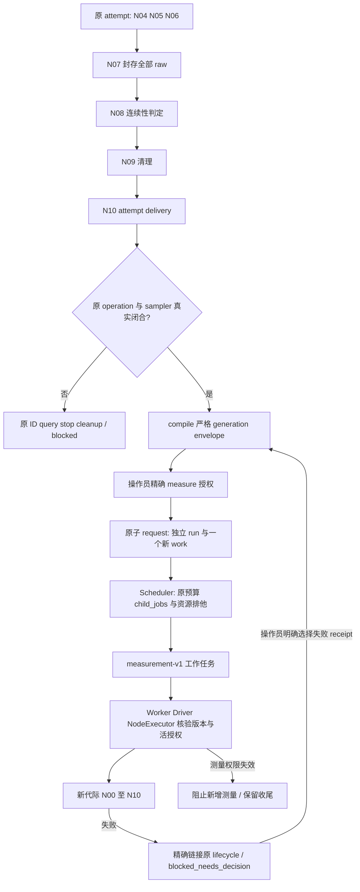

# 测量连续性与显式新代际

`MeasurementContinuityService` 在实际 `NodeExecutor` 中执行。第一次进入 N04–N06 会绑定原 work、activation 和输入证据；新的 activation 不能重开同一 work 的测量。旧 observation、测量 receipt，以及响应丢失但已留存的测量 operation，也构成已开始证据。N01/OperationService 可以查询原 operation ID；N07/N09/N10 的封存、清理、交付不受重新测量禁令限制。

fixture 输入变化、跨时钟段和已记录 insufficient 会阻止后续负载；N08 保留 insufficient，原 Q、分母、raw 和失败 receipt 不改写。有效的 performance fail 不触发 repair 或重测。当前采用保守边界：进入 N04 后跨 activation 的新 baseline 也必须申请新代际；本模块不增加同代际 baseline 重启能力。既有 RecoveryPlan 在首次测量前的 N01–N03 重验证仍可继续原测量。

## 实际 API

```python
service = MeasurementGenerationService(repository)
plan = service.compile(
    lifecycle_ref,
    target_plan_ref=previously_frozen_plan_hash,
    authorization_ref="measure/grant-1",
    token=current_lifecycle_and_work_owner,
)
# 受信操作员入口，principal 来自应用认证边界；不向模型开放。
service.authorize(
    "measure/grant-1", plan.hash, principal="operator",
    expires_at=absolute_deadline, permissions=("measure",),
)
target = service.request(
    "request-1", plan.hash, authorization_ref="measure/grant-1",
    principal="operator", token=current_lifecycle_and_work_owner,
)
SchedulingService(repository).dispatch_work(
    target["run_id"], plan.source_key.group_id,
    token=scheduler_lease, max_concurrency=1, deadline=absolute_deadline,
)
# 可独立撤销；后续业务节点拒绝新增测量，已开始 attempt 仍可收尾。
service.revoke("measure/grant-1")
```

`compile` 只冻结，`authorize` 只授予精确计划权限；`request` 在同一仓储事务中验证当前 lifecycle/work owner、授权 revision、来源证据/版本及真实闭合，建立独立 run 和恰好一个 work。数字 generation 由来源 WorkKey 计算，不是请求参数。缺授权、错身份、过期、撤销、未知现场、冲突域未释放均拒绝；没有普通 work 派发。相同 request 输入幂等；同一个立即来源 work 的第二个 successor 被拒绝；已失败的 successor 可被明确选择为下一次来源。

目标 work 保留原 method/version、resource/endpoint、实验 condition 和 condition_hash，只用 WorkKey.measurement_generation 区分代际。源 run/plan/work/raw 不变，目标 run 通过 `supersedes_run_id`、work 通过 `source_work_ref` 和 `measurement_successors` 留下关系。目标计划含其他 case/group 时，执行视图只暴露被授权的一条原 condition。

## 版本与派发边界

`MeasurementGenerationPlan(kind="measurement-generation.v1", schema_version=1)` 是严格 envelope，内嵌旧格式 Plan 原件及其 hash，并冻结来源 work/receipt/node/lifecycle/revisions/lineage、目标计划、授权引用及初始 revision。它以自己的 hash 存在 `plans`，目标 run.active_plan_ref 指向 envelope；原 Plan/Case 的编码和摘要没有增加字段。

`load_plan` 只在六个执行读取点识别扩展：Scheduling 两处、Workflow 两处、Environment 一处、Worker 资源唤醒一处。`GenerationPlanView.hash` 始终是 envelope hash。旧 Plan 解析器会拒绝 envelope，旧 Scheduler 无法展开 generation 1。RunService.start 仍只接受旧 Plan；RevisionService 拒绝直接激活扩展或改写 generation run。

所有目标 run 的新任务（包括唤醒和 continuation）由 TaskBackend 按持久 `run_generation_bindings` 编为 `measurement-v1:<kind>`。新版 Worker 解码已知版本并核对真实 run/plan/graph/work binding；未知版本不执行。`business_job_kind` 只做版本归一化，不授予 cleanup/query 权限。安全处理器仍校验原 operation/work 和真实 lease；关闭 dispatch gate 或撤销 measure 不妨碍原 ID 查询、取消和清理。原 activation 的 checkpoint 恢复可执行收尾，业务节点逐次检查活授权。每个新 operation 还在 permit/submission_started 的同一事务中复核 grant、expiry、冻结 work/binding 与来源 disposition：撤销先于 admission 时没有 gateway submit；admission 先发生时该原 ID 可以完成或查询，后续新 ID 仍被拒绝。安全 submission 只沿原有许可和 N07/N09/N10 尾部边界。

旧源码兼容测试使用仓库内固定 `2dfe8aee` 来源及 hash 的旧类 fixture，无运行时 Git/控制器快照依赖；实际运行旧 Scheduler 与旧 Worker 的 run/group/work/resume/graph:all 路径，证明它们拒绝本版本入口。部署仍需支持此版本的 Worker：旧 Worker 可能把不认识的任务标 blocked，不保证混合二进制集群的可用性或自动迁移。

## 预算和后续精确返工

本模块不 initialize lifecycle 或 lineage 预算，不调整 deadline/额度。真实派发一个新 work 时，原 lifecycle 和 lineage 各消费一个 child_jobs；仅创建计划或 work 不消费 observations。观测调用继续遵守已有观测协议；此处没有推断新的测量次数额度。

新 work 的失败通过 `generation_failure_links[receipt_ref]` 精确绑定原问题并标为 `blocked_needs_decision`，不新建 lifecycle，不对旧 work 静默发 repair。`LifecycleService.observe_failure` 拒绝把该失败重新包装为新生命周期。供 T6 使用的入口是上述 compile/request 与精确 failure link；T6 review 路由不在本模块。v1 每个立即来源 work 只允许一个 successor。失败子代际保持待决；操作员可显式选择其精确 `source_failure_ref`，以新授权申请下一代，不能自动形成重测循环：

```python
next_plan = service.compile(
    original_lifecycle_ref,
    target_plan_ref=legacy_experiment_plan_hash,
    authorization_ref="measure/grant-3",
    source_failure_ref=exact_failed_child_receipt_ref,
    token=current_original_lifecycle_and_failed_child_work_owner,
)
# 随后对 next_plan.hash 另行 authorize + request，再由 Scheduler 派发。
```

`source_failure_ref` 必须解析到真实 `generation_failure_links` 和失败 receipt。服务逐级验证实际 `measurement_successors`、原 envelope/run/work binding，直到原 lifecycle 的 work；不借用旧 grant 的有效期。原 `source_lifecycle_ref` 和 lineage 不变，立即来源可以是 generation 2、3 等失败 work。`source_material_hash` 冻结 `generation-failure.v1` 来源证明（含精确 link 和祖先关系），`generation_source_bindings` 保留其不可变原件；现有 envelope 的字段及根来源编码没有变化。request 仍要求立即来源当前 work owner、真实闭合和资源释放，新 grant 与新 envelope 精确绑定。已存在授权 successor 的立即来源不得再分叉。

归档检查对已知 `measurement-v1:` job kind 做同一归一化，因此 pending/running/draining 的 work/cleanup/reconcile 等仍阻挡本 run 归档；其他 run 不被误计。新分析冻结也会取消本计划已过时的 pending 版本化 report，running report 仍由其执行端判断。归一化不使未知版本取得权限。



本组组合测试使用内存事务仓储、实际 StateGraph/Driver/Worker/NodeExecutor 和明确无 sampler 副作用的受控 handler；原 sampler bridge 回归另行运行。它们不代替真实 PostgreSQL 并发、远程 adapter、主机 sampler 或生产部署验收。

## 本地回归门禁

```bash
python scripts/check_measurement_generation.py
```

固定执行本能力及相邻运行/归档/采样回归，失败、错误、跳过、空结果或缺失JUnit都不通过；结果保存至 `artifacts/gates/measurement-generation/<本次ID>/`。初版176项通过，[证据和验收范围](../verification/agent-lifecycle-runtime/generation-local-gate-20261023.md)。按用户要求采用TDD与测试门禁，不再追加agent审查。

2026-10-23 后续合同修复：门禁加入N07原用例、sampler生命周期及session兼容回归，现为12个文件、210项通过。此前176项报告保留为历史快照。
