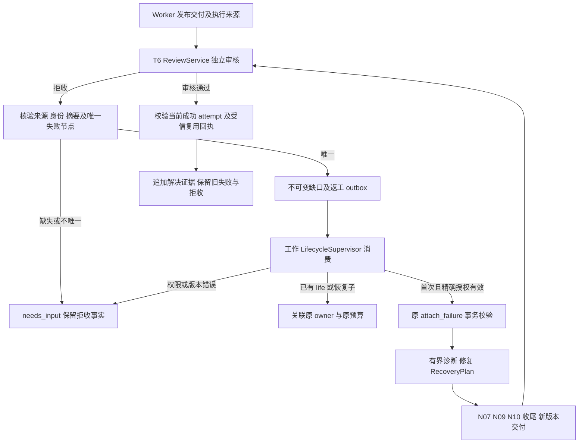

# 证据复用与有限返工公共合同

本页补充 `contracts.md`。Repository 的生产实现是 PostgreSQL；下述本地测试的 MemoryRepository 和 InMemorySaver 仅为显式合成夹具。

## Producer 绑定和复用

`ReuseContract` 包含 `schema_version=1`、`environment_ref`、`spec_hash`、`method_ref`（`method_id:method_version`）、`completion_event`、`time_domain`、`script_ref`（注册 ScriptRef 的 canonical hash）、`condition_hash`、`measurement_contract_hash`、`valid_until`。两个 hash 字段允许为空以读取旧候选，但实际投影要求非空且匹配 producer 证据，不能以默认值启用复用。新旧合同除 `valid_until` 外必须完全相等，接受时间必须早于双方有效期和候选截止时间。

`measurement_bindings[work_id]` 是不可变记录，字段为 `work_id, run_id, plan_ref, case_hash, measurement_contract_hash, script_ref`。RegisteredBenchmarks 在注册实际 case 时写入；measurement contract hash 是 CaseContract JSON 去除 `work_id/group_id/plan_ref/contract_ref` 四个身份字段后的 canonical hash，仍包含实际规格、产品版本、来源、缓存、负载和 repeat。旧数据缺少该绑定不可猜测为兼容。仅模板名称相同不足以复用。

根桥接层仅在显式部署 reuse policy、最终结果 succeeded/valid，且实际 case/script 与 binding 相符时，将 `ReuseContract.model_dump(mode='json')` 封入原 WorkDelivery 的 `result.output.reuse_contract`。默认不生成可复用合同；这不是已完成真实产品数据验收的声明。

公共服务：

- `ReuseService(repository, review_service).consider(work_id, delivery_ref, old_contract=..., new_contract=..., deadline=..., allowed_source_scopes=...)` 登记有界候选和显式源权限。原交付已 accepted 才记候选 accepted；这仍不是新工作完成状态。首次冻结的 review 引用保持不变，新 accepted review 不覆盖旧引用。
- `can_measure(work_id)` 仅对无候选或显式 remeasure 处置返回 true。`expire(work_id, policy='blocked'|'remeasure')` 要求 waiting 已到期限；绝不自动扩大测量范围。
- `project_accepted(work_id, token=...)` 校验当前 fence/计划，原始单 work 身份、生产绑定、方法版本、条件和 repeat、环境、源 review 和全部原文件；创建新范围的引用型 WorkDelivery 并独立复核，之后才将目标 work 标 delivered。不存在测量 job 或新的 operation。它拒绝复用 alias 链，必须引用最初的测量。
- `validate_projection(projection_ref)` 独立重新验证 proof 摘要、目标身份、源身份与原文件，返回 `projection/source_delivery/source_review`。历史有效期按被冻结的 accepted_at 核验，不假装历史接受发生于当前时间。
- `SchedulingService(..., review_service=...).materialize_reuse(run_id, group_id, token=...)` 在 G0 和 T5 使用。G0 若目标 producer binding 尚未由 T2 建立，保留 pending；T5 绑定建立后投影。证据失配显式 blocked，不转成新测量。晚到源 review 的 outbox 向候选的精确 group 发布事件，沿既有 WaitRecord 恢复原激活。

新交付 `evidence=()`，不复制旧范围 EvidenceRef；`output.reuse_projection_ref` 指向不可变 `reuse_projections`。proof 包含新 work/run/plan/scope、原 delivery/review/hash/plan/contract/work refs、显式授权源 scopes、old/new compatibility、accepted_at/deadline、sample_identity，以及自身 projection_ref 和新 delivery_ref。旧原始文件、旧样本 case_id、旧 work/plan/contract 保持不变。

`ReviewService.resolve_analysis(ref)` 在每组增加 `measurement_sources`：

```python
{
    'logical_delivery': new_or_original_manifest,
    'logical_review': frozen_logical_review,
    'projection': validated_projection_or_none,
    'source_delivery': original_measurement_manifest,
    'source_review': frozen_original_review,
}
```

普通交付的 source 就是 logical。A2、分析物化时重新验证；下游按 `(original_delivery_ref, raw_case_hash)` 去重，不按内容 hash 合并不同重复实验。`case_aliases[target_work_id]` 保存原始 case_id、source_delivery_ref、projection_ref；JSON、报告、Excel coverage 保留新选择范围，样本数不增。组交付冻结新 work 和新 review 引用，原始测量身份不会被重写。

## R6 / A5 返工

`ReworkOrder` 是冻结模型，字段：`schema_version=1, run_id, plan_ref, graph_ref, kind, action_ref, issue_type, evidence_refs, affected_work_refs, scope_changed=False, max_dispatches=1, deadline, analysis_input_ref=None`。kind 只能是 recompute/supplement/remeasure；证据和受影响 work 列表非空；预算严格整数且只能为 1。

`ReworkService.register(order)` 按 canonical hash 写不可变 `rework_orders` 并返回引用。`dispatch(ref, token=..., run_id=..., plan_ref=..., graph_ref=...)` 验证 fence、原计划、截止时间、选定范围和实际动作合同；R6/A5 调用同一服务。带 rework_ref 的根激活由 R3 路由 R6；不带该引用不会推断返工。

当前注册的 `analysis.recompute:1` 要求 kind=recompute、完整且被接受的精确 AnalysisInputManifest，受影响 work 必须属于该 run/plan 且包含于该输入。它在同一事务写一项真实 `job_kind=analysis` 和 `rework_execution`，由现有五图 Worker 消费；payload 使用 `source_rework_ref`，不携带再次触发返工的 `rework_ref`。同一 order 重放不会增加任务。完成 outbox 写精确 `rework_results`，保留完成/失败/阻塞状态及实际 job 引用。

这是对显式冻结输入的分析重算，可能包含计算对照所需的同组数据；不新增测量工作或样本。只有 A7 的展示局部重算尚无单独执行器。supplement/remeasure 和未知 action 当前直接返回并记录 `ADAPTER_MISSING` blocked；扩围返回 `REPLAN_REQUIRED`；输入不完整返回 `EVIDENCE_INSUFFICIENT`。不会为这些缺合同动作生成无人消费的任务。修改合同必须创建新 order，不能改写已记录处置。

专项证据：`unit/test_reuse_projection.py`、`unit/test_rework.py`，以及根代理的 `tests/benchmark/integration/test_analysis_graph.py` 和 `test_work_graph_session.py`。其中返工测试实际经 Worker、LangGraph、AnalysisReportServices、公式和 Excel 生成结果；没有用成功节点桩替代计算。真实 PostgreSQL、外部测量重跑及完整故障矩阵仍未验证。


## T6 精确交付返工（2026-10-23 本地实现）

Worker 在交付发布事务中写入独立的 `work_delivery_sources`，绑定实际 job、activation、
result_refs 和 delivery hash。T6 独立审核后，通过 DeliveryReworkService 冻结
schema_version=1 的 `delivery_rework_gaps`（run/group/plan、不可变 review/delivery 摘要、
原节点/receipt/visit/job）。旧交付缺少此来源或存在多个失败来源时保留 needs_input，
不能从 findings/gaps 文本猜测节点。旧 DeliveryManifest/Plan hash 不变。



组 agent 只记录缺口，不授予 work/measure 权限。工作监督者使用既有操作员精确授权，
重复审核不刷新预算，恢复子失败只关联原生命周期。RecoveryPlan 明确允许的旧回执复用
须验证冻结映射与摘要。`delivery_reviews` 是最新投影，不能替代缺口引用的历史 `reviews`。
解决依据追加于 `delivery_rework_resolutions`；最新状态在 `delivery_rework_status`。
解决后迟到 outbox 不再次开工。pending 缺口阻止归档，未解决输入缺口阻止 complete 归档，
显式 partial 归档保留缺口引用；原有活跃 lifecycle、采样、未知操作和隔离门禁仍有效。

来源核验、去重、权限、排队、预算、恢复及复审均脚本化；来源不明确、策略未知或授权缺失
需要模型诊断/人工补充。T6 不自动申请新测量代际，A/F 计算返工仍走原独立入口。

`tests/orchestration/graphs/test_delivery_rework.py` 的11项专项测试使用真实 Worker、
StateGraph、NodeExecutor、ReviewService，以及明确的合成 runner。覆盖 N07/N09 正例、
缺授权、错误/模糊来源、同名 group 跨 run 隔离、恢复子预算、归档、新版本解决和迟到重放。
本地固定门禁278项通过，无 skip；证据为
`artifacts/gates/measurement-generation/20261023T151506Z-ee60f986`。
尚不代表真实 PostgreSQL、产品沙箱现场或45.4全部跨 scope cancel/supersede验收。
