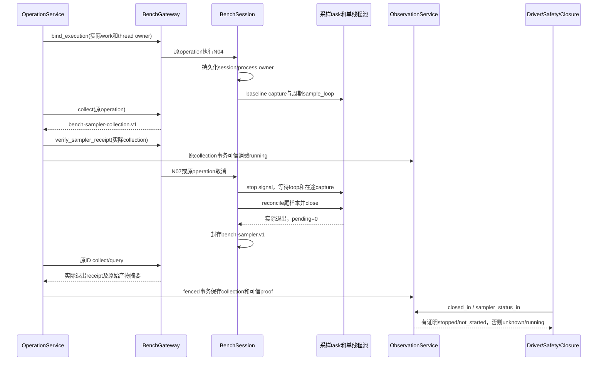

# 进程内 sampler 生命周期证据

N07 未启动观测时的成功返回合同为 `status=completed` 和 `sampler_receipt.state=not_started`。此处 no-op 指不启动采样线程、不采样、不调用采样器 close；仍写入一次可核验的未启动证据，供后续收口使用。重复调用复用同一 receipt，不重复产物。不能为兼容旧的单字段测试断言而删除该证据，也不能把未启动记为已停止。

本子链接现有 `BenchSession` / `ResourceSampler`，只覆盖本地主机进程内采样任务。真实远端 sampler、PostgreSQL 多进程崩溃、多 scope、补测 generation 授权、T6 和策略 A/B 仍需各自验收。

`BenchSession._N04` 在提交 baseline 前记录 `sampler_owner`；未经过 N04 的 mandatory N07 也必须在任何 native close 前冻结相同 owner。即使 baseline 超时也保留 running 产物和原 concurrent future。重入原 N04 只返回历史结果或 unknown，不开新采样。`_N07` 只在自身 loop 已退出、所有 capture future 完成、单线程池尾样本 reconcile 无 pending 且 close 返回、`shutdown(wait=True)` 实际 join 该 sampler 线程池后产生停止产物；close 的实际 worker native ID 与 capture worker 记录保存在产物中。async task 已 cancelled/done 也不能掩盖底层 native capture；只有 concurrent future、close 和线程池 join 都完成才可出具 receipt。取消受理、停止超时、线程仍运行或尾样本未确认都没有停止 receipt。已提交完成的 future 以计数保留，运行内存不按采样次数积累 future。

本地 receipt 使用 `bench-sampler.v1`，collection 外层使用 `bench-sampler-collection.v1`。绑定包含真实 run/group/work/scope、原 operation、measurement generation、case/config 摘要、plan/graph/contract、实际 thread lease owner 与当时可见的 running job IDs。运行证据包含主机名、Linux boot ID、PID、`/proc/<pid>/stat` start ticks、独立 session epoch、实际命名 task、capture 完成计数和 close worker ID，以及封存样本文件摘要。这里证明的是本进程所属任务和线程工作的结束，不是终止独立 sampler 进程，也不证明被观测的产品进程已退出。

`OperationService` 从实际 repository work 与 lease 生成绑定；模型输入只有原有 step/case 字段，不能指定 scope、generation 或停止布尔值来生产 proof。部署注册的 `BenchGateway` 只核验该存活 producer 实际签发、文件内容仍一致、属于该 collection operation 的完整 receipt。未知版本、额外伪造字段、错 scope/generation/run/case/operation、错 producer、丢失或改写的产物均拒绝。`ObservationService.consume_sampler_in` 在相同 collection/fence/work-owner 事务重验原 operation 与当前 work 绑定并保存不可变 `sampler_receipts`，不是接受 caller 的 stopped/children_stopped。

普通 N04/N07 handler 主动 collect；有限安全续办的原 operation query/stop 也经过同一 OperationService collection 和已有 safety guard。首次停止由原 operation 的 stop 调用或原 mandatory N07 提交，并持久化版本化 sampler_stop_intents；安全 stop 必须关联实际 reconciliation call 与双层预算预留。close 与 join 在该原动作中提交，超时后的 query 仅观察已有 future 和结果，不因 session cancelled 标记首次启动 close。query 重验原 intent 身份、期限与安全 stop provenance，不重发测量。安全消费者仍使用原 stop/query 类别、原双层预算和原 job/thread/work fences；没有通用新 sampler 启动接口。

`ObservationService.stop` 保持原序列记账语义，不产生物理停止 proof。`Driver`、`LifecycleSafetyService`、`LifecycleReconciliationService` 和 `ClosureService` 统一通过 `closed_in` / `sampler_status_in` 读取；旧账本 stopped 或 caller booleans 继续 unknown/blocked。原 raw、missing、interrupted 和 gap 不因物理停止变 complete。没有采样的实际 session 可以产生 not_started 证据；mandatory N07/N09/N10 路线保留。

已经核验并入账的历史 receipt 按原 operation、collection 和不可变 producer 链读取，不要求旧 PID 仍存活，不因新进程出现使已关闭 isolation 复活。相反，重启前尚未被可信服务核验的本地文件不能独自升级为 proof：新 session epoch 即使 PID 相同，也不能确认旧 loop/capture 是否退出。当前适配器没有远端 host/process owner 查询、服务接管或跨进程未验证产物恢复能力；这类现场有界 blocked，保留原 ID/spool，不重新测量。部署还需 Linux boot/start identity 可读、原持久 session 目录和受信 registry/服务装配。测试使用受控只读 sampler 及临时 proc/SQLite spool，不代表真实沙箱或远端部署验收。

原 N04 outcome 与停止结果分开：failed 保持 failed；unknown 只有在真实停止已确认时可成为明确的 authoritative cancelled，附原不可变 unknown 和 insufficient。停止状态位于独立 sampler_stop，N07 completed 不会被用来宣布原 baseline 成功。
