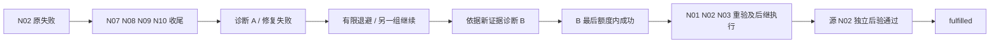

# N02 工作级修复循环验收

2026-10-23，`.worktrees/agent-lifecycle`。ALI-01 明确指定的 N02 原始失败组合已通过实际图测试及独立规格／代码质量复审，45.1 已勾选。本轮只增加测试与监督文档，生产运行时没有新增修改；生产 N02 修复适配仍 unavailable。

受信测试目录注册两个具有真实文件效果的 N02 动作，并在实际 Worker、StateGraph、NodeExecutor、RepairOutcome 和 RecoveryPlan 中执行：



断言包括精确事件和节点序列、真实 work 锁排他、相反 policy 动作顺序仍选择 A→B、原回执／失败证据／raw不变、原双层预算不重置、环境组证据不共享。两类负例分别验证 B 执行成功但文件仍坏时不恢复，以及恢复 N10 成功但源 N02 独立后验拒绝时不能 fulfilled。

命令：

```bash
python -m pytest tests/orchestration/graphs/test_work_strategy.py tests/orchestration/graphs/test_work_remediation.py tests/orchestration/graphs/test_work_recovery.py tests/orchestration/graphs/test_work_safety.py tests/orchestration/unit/test_repair_strategy.py tests/orchestration/unit/test_repair_execution.py tests/orchestration/unit/test_recovery_plan.py tests/orchestration/unit/test_remedy_leases.py -q --tb=short
```

结果：179 passed，16.56秒，无 skips，退出码0。独立审查通过且无发现项，未重复执行该批测试。原件：[日志](n02-loop-20261023.log)、[两文件摘要](n02-loop-20261023-sourcehashes.json)。与此前438项回归有重叠，不相加称独立测试总数。

本地效果为真实临时文件和受控操作账本，Repository为Memory；这证明45.1的本地图编排合同，不证明远端沙箱、生产N02脚本、PostgreSQL、测量generation、T6或多scope已完成。
