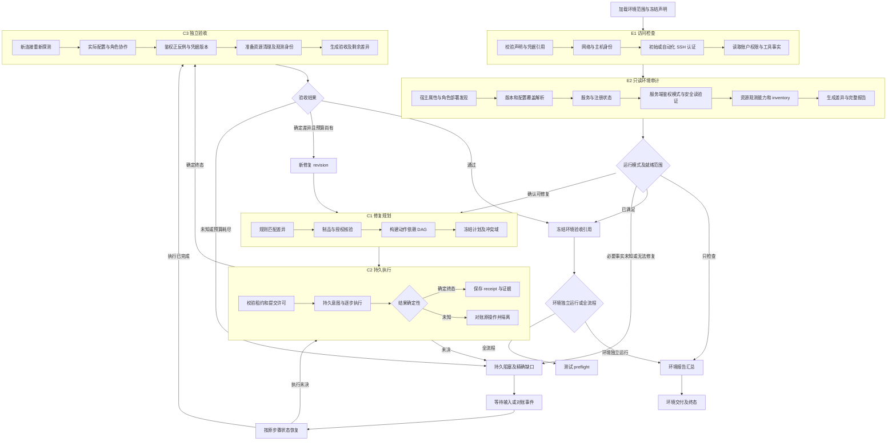
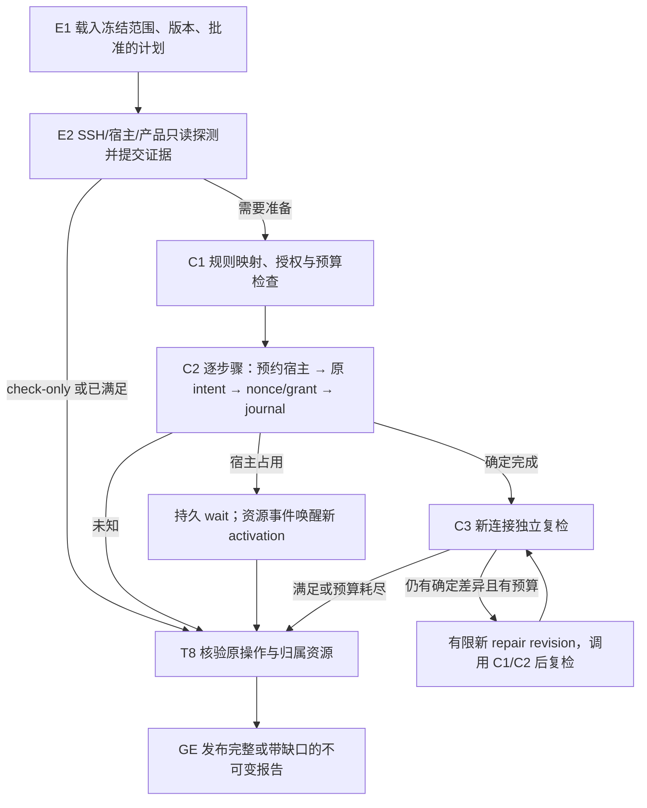

# Design

## Context

动机和交付范围见 [proposal.md](proposal.md)，行为合同见 [spec](specs/sandbox-environment-adapters/spec.md)。本设计需要跨模块数据合同、远端持久执行、凭据配置及旧图兼容，因此 design 的条件成立。本文所有新接口、命令和目录均为拟实施设计，不能当作当前已存在入口。

当前代码依据：

- [EnvironmentHandlers](../../../sandbox_graph/services/environment.py) 只有 `EnvironmentProbe.connect/inspect` 协议和摘要；C1 从测试 Plan 的 cases 提取资源域，C2 只提交一个聚合配置操作，C3 独立 probe 后进入 T0。
- [OperationService](../../../sandbox_graph/runtime/runner.py) 已有 intent、submission_started、unknown 对账、注册 ScriptRef 与 fencing；缺远端安装步骤的真实持久执行器。
- [PlanCompiler](../../../sandbox_graph/planning/compiler.py) 即使 stage=check 仍检查 Case 的 capability，空 Case 不能形成环境准备计划。[组汇总](../../../sandbox_graph/services/workflows.py) 当前偏向测量子交付，需新增明确环境交付分支。
- [bootstrap](../../../sandbox_graph/runtime/bootstrap.py) 固定五图工厂；传入 graph_ref 目前只是匹配标签，新增行为必须选择对应不可变定义及 handler 集，不能只换字符串而复用被改写的旧定义。
- [环境专项测试](../../../tests/orchestration/graphs/test_environment.py) 的 probe/gateway 是受控对象，没有实际三产品安装。[现有 benchmark adapter](../../../sandbox_bench/adapters.py) 从 `api_key_env` 注入 `X-API-Key`，实例执行另用 `envdAccessToken`，并未配置服务端 key。
- 原 change 的 [ENV-01—24](../sandbox-evaluation-workflow/specs/environment-readiness/spec.md) 是通用合同。本 change 增加产品落地合同 EAD-01—28；原任务 8.1 只完成 handler 边界，不能覆盖本次产品代码验收。

## Goals / Non-Goals

**Goals:** 固定版本/角色/profile 下，交付实际可执行的检查、修复、安装、调参、鉴权配置与独立复检；兼容环境已安装、部分安装及尚未安装三种起点；实现可重入、最小上下文和可追溯报告；独立环境准备不依赖预先伪造方法能力。

**Non-Goals:** 不修改上游产品，不改变基础性能测量口径；不默认创建云主机/Kubernetes 集群、替换宿主内核、格式化磁盘或关闭鉴权。不是覆盖所有历史版本/部署方式的通用运维工具；明确支持矩阵外的现有环境必须被发现并输出缺口，不能误改成支持的形态。没有真实凭据时仍实现代码和受控测试，真实部署验收单列待运行。

## Decisions

### D01. 源码与版本证据

继续使用已有审计锁定的 checkout，不更新上游。profile 适用范围必须绑定下列 commit 或经单独审计的发布版本，不能宣称支持浮动 main。规则保存 `source_ref + file + symbol + rule_version`；产品制品另存自身 manifest/digest，不把源码 commit 当成二进制证明。

| 标识 | 源码依据 | 直接影响实现的事实 |
| --- | --- | --- |
| C-I | [Cube 安装器](https://github.com/TencentCloud/CubeSandbox/blob/b25e416e990e6ba0641b4609974c53c61ee568f0/deploy/one-click/install.sh)及同目录 `install-compute.sh` | install 会重置已有配置；upgrade 保留配置；compute 包装器固定计算角色；control 包含运行时，不等于纯管理 |
| C-Q | [Cube 节点容量](https://github.com/TencentCloud/CubeSandbox/blob/b25e416e990e6ba0641b4609974c53c61ee568f0/Cubelet/pkg/cubelet/node_status.go)、[实际调度限制](https://github.com/TencentCloud/CubeSandbox/blob/b25e416e990e6ba0641b4609974c53c61ee568f0/CubeMaster/pkg/localcache/export.go) | 零值回退、容量上报、管理侧并发和数量计算必须共同核验 |
| C-C | [CubeMaster config](https://github.com/TencentCloud/CubeSandbox/blob/b25e416e990e6ba0641b4609974c53c61ee568f0/CubeMaster/pkg/base/config/config.go) | `overcommit_ratio` 已忽略；配置解析成功不代表使用了该值 |
| C-A | [Cube 鉴权](https://github.com/TencentCloud/CubeSandbox/blob/b25e416e990e6ba0641b4609974c53c61ee568f0/CubeAPI/src/middleware/auth.rs)、[限流](https://github.com/TencentCloud/CubeSandbox/blob/b25e416e990e6ba0641b4609974c53c61ee568f0/CubeAPI/src/state.rs) | callback 优先于静态 key；Bearer 优先于 X-API-Key；无配置可匿名；rate=0 被提升到 1，并非无限 |
| K-I | [Kuasar 部署](https://github.com/kuasar-sandbox/kuasar-sandbox/blob/ba218fc5f20973621277484b9144a8e838ffe840/docs/deployment_zh.md)、[conductor unit](https://github.com/kuasar-sandbox/orchestrator/blob/c14da165ecc14de0e5c0afbfba2e1b737d64ee7c/deploy/node-ctl.service) | conductor 与 proxy 独立；存储/cache 按来源选择；集群管理角色有独立服务 |
| K-Q | [Kuasar config](https://github.com/kuasar-sandbox/orchestrator/blob/c14da165ecc14de0e5c0afbfba2e1b737d64ee7c/config/config.go)、[traffic config](https://github.com/kuasar-sandbox/orchestrator/blob/c14da165ecc14de0e5c0afbfba2e1b737d64ee7c/config/traffic.go) | sandbox.capacity=0 无数量上限；准入 rate/burst=0 回填 4/16；builder 显式 max_builds<=0 非法；预热池 size 不是并发数 |
| K-A | [Kuasar HTTP 鉴权](https://github.com/kuasar-sandbox/orchestrator/blob/c14da165ecc14de0e5c0afbfba2e1b737d64ee7c/internal/api/api.go)、[租户校验](https://github.com/kuasar-sandbox/orchestrator/blob/c14da165ecc14de0e5c0afbfba2e1b737d64ee7c/internal/orch/auth.go)、[管理命令](https://github.com/kuasar-sandbox/orchestrator/blob/c14da165ecc14de0e5c0afbfba2e1b737d64ee7c/cmd/node-ctl/manifestkey_cmd.go) | 普通 API 解析 key 格式后由业务验证 MAC/归属；exec 签发入口仅 X-API-KEY；租户密钥对通过本机管理 socket 配置 |
| A-I | [AgentENV 安装器](https://github.com/kvcache-ai/AgentENV/blob/49684233698d40dd800c1d0edba15ab30a745eeb/scripts/install.sh)、[集群配置](https://github.com/kvcache-ai/AgentENV/blob/49684233698d40dd800c1d0edba15ab30a745eeb/deploy/docker-compose.yml) | 默认安装器取 latest；server 运行专用非 root 账户、配置 KVM/ublk/network；集群另有 scheduler/gateway |
| A-Q | [AgentENV 调度配置](https://github.com/kvcache-ai/AgentENV/blob/49684233698d40dd800c1d0edba15ab30a745eeb/services/shared/config/config.go)、[调度过滤](https://github.com/kvcache-ai/AgentENV/blob/49684233698d40dd800c1d0edba15ab30a745eeb/services/scheduler/internal/filter.go)、[节点默认配置](https://github.com/kvcache-ai/AgentENV/blob/49684233698d40dd800c1d0edba15ab30a745eeb/config/default.toml) | 可选阈值 nil 为无约束，显式 0 仍是阈值；无节点报告时过滤器放行不等于环境验收；node 配置为 TOML |
| A-A | [AgentENV key 来源](https://github.com/kvcache-ai/AgentENV/blob/49684233698d40dd800c1d0edba15ab30a745eeb/src/api_key.rs)、[节点鉴权](https://github.com/kvcache-ai/AgentENV/blob/49684233698d40dd800c1d0edba15ab30a745eeb/src/api/impls/auth.rs)、[gateway key 加载](https://github.com/kvcache-ai/AgentENV/blob/49684233698d40dd800c1d0edba15ab30a745eeb/services/gateway/cmd/main.go) | X-API-Key；环境变量优先于外部文件、节点本地生成文件；gateway 不会自行生成；health/metrics 不是鉴权证据 |

制品解析在有界下载阶段完成并冻结，之后安装离线消费同一套文件/镜像摘要。第三方 apt/rpm/容器依赖同样记录版本和仓库/镜像身份。上游脚本若有隐式在线下载，必须列出并锁定其输入；无法锁定的 profile 不能标为 reproducible。

### D02. Profile 与角色支持矩阵

选择显式 profile，拒绝用端口猜产品或通过“single_node=true”推导全部角色。物理节点 `machine_id` 与逻辑环境组分开，同一机器上的多个角色只采一份宿主事实。

| profile（拟议 ID） | 安装及修复交付 | 角色/拓扑 |
| --- | --- | --- |
| `cube.oneclick.v1` | 固定 one-click 包；新装用 install，已安装版本更新用明确 upgrade；局部配置差异不运行整套安装 | control+compute 共置单机；同一控制节点加 N 个 compute；仅 compute 对已有管理端点 |
| `kuasar.native.v1` | 固定聚合发布包与匹配组件，安装所需 systemd units、网络及源资产 | 单机 conductor/proxy/runtime；多机 compute，加 registry/router/placer；可分离 storage/cache 角色 |
| `agentenv.native.v1` | 固定 server/CLI/runtime 制品，分解执行官方本机安装步骤；集群控制服务使用固定镜像或对应源码构建摘要 | 单机 server；多机 native server + 独立 scheduler/gateway；支持控制角色共置或分离 |

控制服务容器由每台控制机上独立 Compose 项目管理，静态节点端点来自声明；不复制 AgentENV 示例中仅在单一 Docker 网络可解析的 `agentenv-a/b` 名字到跨主机环境。Compose 是容器角色执行后端，不改变 native server 身份。镜像以 digest 固定，若发布物没有 scheduler/gateway，则以锁定源码、Dockerfile、依赖及基础镜像构建并记录结果，不假设存在官方 release 二进制。

现有 Kubernetes、Kuasar workbench、定制控制面等首先做只读部署发现、属性与可访问服务检查；没有匹配 mutation profile 时 `unsupported_profile`，不擅自切换为 native/one-click。首次交付不安装新的 Kubernetes 集群或适配任意 chart 版本。发现 pure-control Cube 节点时不得调用会安装计算能力的 one-click control；需要精确部署 profile 才可修改，保留这一支持边界。

这些默认是工程实现选择，不是已完成部署。支持状态按 profile/version/arch 分列 `source_audited / implemented / contract_verified / live_verified`。三种基线单机及多机组合均有实现任务，不以一个通用 Protocol 或声明 supported 验收。

### D03. 数据合同与状态粒度

新模块使用现有 Pydantic 严格模型风格，所有引用有完整性摘要。新增公开 schema 使用 `schema_version=2` 或独立 `kind/version`，不改变旧 `Model.schema_version=1` 的含义。

| 合同 | 必要字段及行为 |
| --- | --- |
| `EnvironmentDeclaration` | declaration_id/version、group_id、product/profile、source_set、nodes、dependencies、targets、auth、artifacts、policy、budgets；拒绝重复节点、依赖环和凭据明文 |
| `NodeDeclaration` | node_id、声明 machine identity、roles、SSH address/port/user、known-host reference、initial/automation credential refs、privilege policy、runtime namespace、paths；允许同节点多角色 |
| `TargetPolicy` | 单独的 host attributes、platform limits、sandbox spec、performance policy；每字段 `preserve/exact/relax_for_plan`，携理由和实验预算引用 |
| `AuthBinding` | plane、mode、credential_ref/version、server targets、header carrier、tenant/group scope、provision=`reuse/create_if_absent/rotate`、TLS/trusted transport ref；没有实际 secret 值 |
| `CheckObservation` | check_id、rule_ref、node/component、status、observed/value/unit、expected、assertions、observed_at、boot_id、evidence_refs、repair_code；状态枚举 satisfied/missing/mismatch/unknown/unsupported/not_applicable |
| `EnvironmentReport` | declaration/source/profile hashes、每节点所有观察、依赖和 readiness（access/install/config/auth/functional/observability）、limitations、secret refs、cleanup、validity、artifact manifest |
| `RepairPlan` | plan hash、report ref、目标声明、依赖 DAG、ActionSteps、授权摘要、冲突域、revision/round、总 deadline、repair budgets；本轮没有动作也应可解释 |
| `ActionStep` | stable step_id、registered action+version+digest、node、input_hash、expected_before、pre/postconditions、secret_refs、dependencies、reconcile rule、timeout、retry class、compensation、ownership |
| `StepReceipt` | plan/step/attempt、remote op handle、started/finished、boot/process identity、input/output/artifact refs、effect certainty、结果、证据和恢复入口 |
| `ExecutionGrant` | grant_id、operation/step/input_hash、machine identity、完整 resource domains 与各自单调 generation、run/thread/owner_epoch、remote challenge nonce、not_after、journal handle；一次使用，走可信 SSH 通道，不作为可复用命令参数 |
| `EnvironmentAcceptance` | report manifest、冻结版本、通过的具体范围、有效期/触发失效字段、功能验证/清理引用、credential version refs；可直接供测试 preflight 消费 |

`environment_ref` 从自由字符串变为实际声明 ArtifactRef 的逻辑标识；声明加载器在使用前验证 digest 与 scope。group state 只保存上述 refs、简短计数和失败码。实际机器列表、原始 stdout、配置快照不放入 agent messages。

物理冲突域使用已核验的机器稳定身份和共享服务身份，不能依赖可随意改名的 group/node label。DNS 别名指向同一机器也必须冲突；无法判定身份先阻塞修改。host boot_id 用于新鲜度而不是永久机器身份。

### D04. 模块和调用接口

```text
sandbox_graph/environment/
  contracts.py       catalog.py          declarations.py
  transport.py       secrets.py          evidence.py
  probes/host.py     probes/access.py    probes/inventory.py
  products/cubesandbox.py
  products/kuasar.py
  products/agentenv.py
  parameters.py      auth.py             planner.py
  execution.py       remote_agent.py     verification.py
  reporting.py       bindings.py         service.py
scripts/environment/
  probe_host.py      authorized_key.py   file_transaction.py
  service_action.py  product_install.py  collect_inventory.py
tests/environment/
  unit/  protocol/  integration/  live/  fixtures/
```

Python 为计划、配置解析、证据及动作执行主体；固定 shell 包装只用于上游要求 shell 的入口。避免每个产品复制一套 SSH、账本和脱敏实现。schema 不接受任意 command/import/module/path 作为执行插件；注册清单按动作摘要固定代码与模板。

关键拟议接口：

- `DeploymentAdapter.inspect(node, declaration, transport) -> observations`：只读；各产品提供真实命令/文件/HTTP 解析。
- `DeploymentAdapter.plan(report, targets, auth, budget) -> ActionStep[]`：纯计算；未知版本返回缺口。
- `DeploymentAdapter.verify(report, receipts, fresh_observations) -> Acceptance`：独立断言；不直接相信安装器总结。
- `ParameterRule.resolve(current, target, budget) -> ConfigPatch + EffectiveAssertion`：表驱动默认/无限制/单位/重载语义。
- `CredentialResolver.resolve(secret_ref, scope, version)`：仅执行进程使用；模型和报告只接收 ref。
- `EnvironmentProbeAdapter.connect/inspect(scope, environment_ref)`：兼容现有入口并封存完整报告，`source_ref` 指向已校验 ArtifactRef，不再接受伪造证明。
- `EnvironmentRunnerGateway.submit/reconcile/cancel/collect/cleanup`：实现现有 RunnerGateway，操作输入绑定冻结 RepairPlan；每个真实步骤可追溯。

不把全套安装交给一次无法对账的 `ssh bash install.sh`。上游安装器允许作为一个粗粒度步骤，但它的未知退出必须保留未知，不凭最终组件存在推导其所有副作用完成；能拆分的动作优先拆分。

### D05. 真实连接、属性探测与文件修改

控制端复用系统 OpenSSH，采用异步 subprocess 的 argv，禁止拼接用户提供的 shell 片段。远端使用受控、固定 bootstrap/探测脚本及结构化 stdin 输入；SSH 远端仍有 shell 解释层，固定入口必须经过严格引用，秘密和用户值不进入远端命令字符串。检查账户需要可用 Python 3（最低版本由脚本实现测试固定）；缺解释器明确报告，不在只读检查中装依赖。

- SSH 使用已有 known_hosts/指定 host key，不自动 TOFU；InitialCredential 和 AutomationCredential 分开。默认 key/agent，密码初始化若需要，使用专门 secret FD/askpass bridge，不将密码放 argv、日志或普通 env dump。
- 探测 OS release、uname、CPU topology、meminfo、boot_id、mount/filesystem、磁盘可用空间、路由/监听、cgroup version、systemd state、容器 inspect、设备属性及必要工具版本。KVM 使用实际 open/ioctl 能力探测而非仅文件存在；read-only probe 不创建 VM。
- 使用 systemd MainPID/cgroup、容器 ID/init PID、可执行文件 realpath/hash、PID start_ticks 及 mount/PID namespace 确定进程归属。预先不存在的 sandbox 只交付发现规则，不生成未来 PID。
- 可修复的设备/目录权限按角色精确配置；不默认 chmod 全局可写，不关闭 SELinux、宿主防火墙或校验规则以绕过失败。缺硬件、内核版本不足或冲突网络由明确修复能力/授权决定，未知保持阻塞。
- 所有读操作有 command deadline、stdout/stderr byte limit、返回结构版本；错误和截断是证据状态，不是解析成空的“正常”。不收集整份进程环境，按允许字段读取并在远端脱敏。
- 文件修改先检查当前摘要、类型、owner/mode 和允许根路径，备份受控原件；临时文件同目录写入、fsync、原子替换，保留非目标字段。YAML/JSON/TOML 使用结构解析；controller 可使用 tomlkit 保留注释（实施时固定依赖并测试），远端只收预渲染内容和校验摘要。禁止配置中嵌入任意 shell；对必须 source 的 Cube .env 生成受限 quoted literals。
- 若文件涉及秘密，公开报告存脱敏视图的摘要及本地密封备份引用；不得公开原 secret 文件或其低熵可猜值摘要。恢复前仍做当前值 CAS，避免覆盖第三方修改。

### D06. 三产品安装、属性与修复路径

#### CubeSandbox

1. **发现**：从声明和 systemd unit 定位 toolbox 实际根、`.one-click.env` 的角色、Cubelet 静态 TOML/动态 YAML、CubeMaster YAML、CubeAPI 启动环境、容器依赖及制品 manifest。配置读入器必须保持白名单，不能 source 不可信已有文件。
2. **属性检查**：control profile 核验 CubeOps/CubeMaster/CubeAPI/Proxy/模板服务和所选 DB/Redis；compute 核验 Cubelet、shim/VMM、guest kernel、网络运行时、设备权限及存储路径。control one-click 实际包含 compute，应声明二者；纯管理 profile 无依据时不强装。
3. **新装**：验证包文件清单、digest、架构和磁盘 → 固化 env 输入 → 确认目标无冲突安装 → 调用固定 `install.sh --mode=install` 或 `install-compute.sh --mode=install` → 保存退出与分步来源日志 → 独立探测。已有部署不选择 install；仅版本变更且受授权才用 upgrade，保留数据目录和既有配置。
4. **修复**：文件缺失且确定对应制品时恢复该文件；服务停止则启动；注册错址只修正 CubeOps/CubeMaster 地址和节点身份；配置漂移只修改精确字段并重启对应服务。拓扑、schema迁移或数据损坏未知时阻塞，不以删除 DB/数据目录修复。
5. **协作验证**：每节点实际角色、CubeOps 注册结果、CubeMaster 所见新鲜节点指标、模板可用性及所选 API/data 路由。控制服务局部健康不代替计算节点已注册。

#### Kuasar

1. **发现**：以固定聚合发布 manifest 验证 node-ctl、sandbox-ctl、connector、guest-runtime 与按需 accelerator 组件一致性；读取实际 unit ExecStart 和 conductor/proxy/cluster 配置路径。
2. **属性检查**：compute 需要 KVM、systemd D-Bus/cgroup 权限、connector 网络能力、kernel/runtime/overlay 输入、run_root/base_root 一致性；管理角色检查 registry/router/placer 端点及集群身份，不附加 compute 硬件要求。
3. **新装**：校验/展开匹配制品 → 安装版本目录和可执行入口 → 建立授权目录/网络 → 根据来源初始化 store generation/cache → 安装所需 units → conductor → proxy 注册。集群依赖以 registry/placer/router 配置及 node-link 握手为准，允许先启动监听再等待有界注册，不能建立“双方健康后才各自启动”的死循环。
4. **配置校验**：使用所选版本 `node-ctl config conductor --config ... --resolve` 等官方解析入口；解析结果是 resolved_config 证据，运行实例生效仍需配置 hash、启动身份及只读状态/运行行为证据。
5. **修复**：修正 UDS/run_root/base_root 错配、缺注册、具体源资产、被确认未运行的服务及明确参数；不通过删 node DB、checkpoint 或重建存储 generation 自动“修复”。受保护 source/key 属于原环境，复用须有归属。

#### AgentENV

1. **发现**：server 版本与实际 binary hash，systemd/容器的 config/home/runtime 路径，TOML、环境覆盖、运行账户、设备及 ublk daemon。控制角色另读 JSON、实际 node ID/endpoint/报告。
2. **属性检查**：Linux 及所选发行版本必要内核功能、KVM/PVM 模式与架构、ublk、capability、MEMLOCK/NOFILE、网络 CIDR、storage/snapshot 后端与运行资产。仅版本号不能代替设备及能力探测。
3. **新装**：固定 server/CLI/ublk/deps 包 → 以官方脚本为依据建立专用非 root 用户、配置/数据目录 → `server --setup-only` 和 `--setup-host --runtime-user ... --runtime-group ...` → 配置受控 service/EnvironmentFile → 启动与复检。所有 setup 所需资产/下载也必须固定；官方 latest 下载外壳不直接执行。模块配置写入和当前已加载参数分开验证；现有 ublk 被使用时不能强卸载模块来生效。
4. **集群**：运行节点就绪并注入一致的 API credential → 控制节点启动已固定镜像的 scheduler/gateway，显式静态端点和 node IDs → 节点 report endpoint → 双向通信/新鲜度验证。必要时用启动配置先建服务，再等待报告，不依赖匿名 health 判断注册。
5. **修复**：配置/环境覆盖、受限设备权限、服务账户目录、指定网络注册、停止服务及角色报告；保留已有 snapshots、镜像缓存、secret 和 API key。重启遵守上游 `KillMode=process` 等生命周期行为，不用 kill -9 快速通过检查。

### D07. 参数规则目录与确定性目标计算

每条 `ParameterRule` 包含 product/profile/version、role、scope、路径/键、类型/单位、覆盖优先级、default/absent/zero/negative 语义、上下界、作用函数、重启策略、验证证据及 rollback。用户输入 `relax_for_plan` 先映射到有限实验预算；不直接设置 INT_MAX，也不默认关闭资源控制算法。

| 产品与字段 | 真实语义与目标规则 | 生效验证 |
| --- | --- | --- |
| Cube `host.quota.mcpu_limit/mem_limit/mvm_limit` | 0/空可回退推导；按实验 Q、规格、已占用及已声明超分政策设显式上限，单位分别核验；物理容量单独保存 | Cubelet 当前配置、实际上报值、管理侧缓存新鲜度 |
| Cube `creation_concurrent_num` 与 `cubelet_conf.create_concurrent_limit` | 计算端 0 不设额外 engine 限制，但管理侧仍有默认；后者 0 加载为 100；实际函数合并上报与管理侧值 | 两侧值、实际调度路径、上报身份 |
| Cube `node_max_mvm_num`、按类型配置、reserve percent | 当前调度函数优先有效节点上报，零回退路径可得 3000；实际阈值还应用比例，不简单取两个配置的最小值 | 以源码黄金向量复算有效值并核对节点视图 |
| Cube `ignore_redis_allocation`、旧 `overcommit_ratio` | 前者改变调度记账语义；后者已忽略。前者仅在显式实验策略下改变，后者不能作为调优动作 | 有效策略证据及比较标签 |
| Cube API `rate_limit_per_sec` | 默认 100，0 经 `.max(1)` 得 1；按测试到达率/并发和实际 key 数设置正整数余量，无无限制语义 | 启动参数/环境解析、只读观测及有界验证；不能为了绕过限流切换匿名/Bearer 模式 |
| Kuasar `sandbox.capacity` | 0 表示数量无上限；不等于绕过资源控制准入 | resolved config、conductor 节点状态/集群上报 |
| Kuasar `resource_listen.admission.rate/burst/queue_max_depth` | 0 回填 4/16/256；保留开启状态；按显式实验限额设置正值，finite queue/TTL 不删除 | 官方解析与 resource status；记录资源控制模式 |
| Kuasar `builder.admission.execution/registration` | execution 缺省 max_builds=2，registration 可继承；显式 max_builds<=0 拒绝；只有精确理解空块语义时才采用空块 | 官方解析器、builder 状态及角色配置 |
| Kuasar `sandbox.resources.capacity` 与 allocatable/startup | guest capacity 与宿主预算不同；2v2G/2v4G 固定容量不等于设置所有宿主阈值为该数 | 实际实例 metadata/detail 和必要配置来源 |
| AgentENV `scheduler.node_resource_limit.*` | nil 阈值不限制，显式 0 仍参与 `>` 比较；运行/starting/including_paused 各自处理；不把旧 JSON null 补丁等同成功清除已有进程值 | 完整重载配置及有效 node reports/调度证据 |
| AgentENV `machine.vcpu_count/mem_size_mib` | 节点默认仅是默认，模板/请求及实际实例仍需独立核验；MiB 与 GiB 转换严格 | 有效模板与实际实例规格证据 |
| AgentENV `template_build.max_concurrent_builds`、ublk 设备上限/池配置 | 构建并发、设备容量和空闲池目标不同；不能把池大小作为准入上限或把 ublks_max 设 0 当无限 | 官方配置解析/进程参数、模块当前值、实际池状态 |

Cube API key 是限流 key 的组成部分：Bearer-only 请求在已审计限流 middleware 中会归入 anonymous 桶，不能用不同 carrier 做未声明的性能对比。所有鉴权、quota、缓存、pool、预热、超分策略进入环境/比较 fingerprint。

### D08. SSH 与产品鉴权完整设计

源码调查结论：这三套审计版本的控制入口主要使用 **X-API-Key（大小写不敏感）**，不是统一的 `x-api-token`。若现场反向代理引入 `x-api-token`，它是独立网关适配，需要核验转发/校验规则，不能归因于产品本身。

| 凭据层 | 配置与证据 |
| --- | --- |
| 控制机到宿主 SSH | InitialCredential、AutomationCredential、known_hosts；公钥幂等写入和独立新连接检查；访问通过不证明 API 认证 |
| Cube 管理 API | CUBE_API_KEY 静态 key 或 AUTH_CALLBACK_URL；callback 优先；已有 callback 保留，不自行部署/替换身份系统。新建独立测试环境默认显式静态 key |
| Kuasar 管理 API | APISecret/ManifestKey 对在匹配租户/组作用域注册；e2b-key-ctl 签发 key。普通 API 可兼容 Bearer，但统一基线用 X-API-KEY；exec-session 要求该 carrier |
| AgentENV 管理 API | AENV_API_KEY 优先，其次 `/run/secrets/api-key`，运行节点再回退 managed key；gateway 只接受环境或外部文件，无自动生成回退。按声明一个组的 gateway/节点绑定同一 key 版本 |
| 实例命令/数据入口 | envdAccessToken→X-Access-Token；流量 token 按产品协议（如 e2b-traffic-access-token）使用；绑定 sandbox identity/generation。不能把 API key 当实例 token |
| 构建/存储/镜像凭据 | registry、store、ManifestKey 等各自作用域，不能复制成访问 API 的 token；先复用已配置 secret refs |

生命周期实现：

1. E1 检查 secret ref 可解析性及权限，E2 检查服务端模式和来源，只记录 source/version/ref；读取秘密时经执行器保密通道直达 CredentialStore，不作为 probe stdout 返回。
2. `reuse` 验证既有凭据，不修改；`create_if_absent` 先在受控 SecretStore 以 plan+scope 唯一键原子持久生成，再配置服务端；重入取同一值。生成后到写入前崩溃不能产生第二个 key。首次生成后不把值显示给 agent。
3. Cube 更新经过核验的 service env/私有 EnvironmentFile 后重启对应 API；环境文件来源、CLI override、外部 callback 均需识别。不能只设置测试主机 env。
4. AgentENV 新环境预先配置 shared key，避免节点各自随机生成；已有 managed key 可以授权导入秘密存储并绑定客户端，不能随意覆盖。gateway 与节点直连均验证。格式遵守 32–256 个允许字符；空环境变量是错误而非“回退文件”。
5. Kuasar 单节点使用管理 UDS/SO_PEERCRED 接口或固定 `node-ctl manifest-key` 命令（secret 走环境/FD，不走 argv）先 check 再 add，避免重复 add 刷新 TTL。APISecret/ManifestKey/存储加密 key 不混用。cluster profile 依照 [placer group source](https://github.com/kuasar-sandbox/orchestrator/blob/c14da165ecc14de0e5c0afbfba2e1b737d64ee7c/internal/placer/groups.go) 原子配置受控 group JSON 目录，以及 placer 的 `import_groups` 中 `source_type=file`、`source_id`、`path`；不臆造 `cluster-ctl group` 管理命令。校验跨 source 的 group 唯一性、密钥对的 inline/ref 格式及 fingerprint、组范围和策略，保留非本次管理的记录；原子更新后验证 placer 导入与节点密钥下发确认，再经 router 验证目标租户。上游允许从 inline ManifestKey 派生 APISecret，采用该路径时记录派生规则与版本；ref 模式不能假设文件后端自动解析本项目 `secret://`。签发结果经保密通道存储，日志只有合法 fingerprint/ref。不能只登记某个 node 就宣称全组通过。
6. 凭据配置验证采用 protected read 的正确/缺失/错误三组请求；health 不参与证明。Kuasar 外层仅检查格式，列表 200/空也不能证明 MAC 已注册，必须组合本地 allowlist 检查及受保护的已有 owned 对象验证；若无 owned 对象，准备阶段用独立有界 canary 验证，check-only 报 `auth_format_checked/ownership_unverified`，不创建对象。
7. `rotate` 仅显式请求执行：冻结旧/新版本和依赖者、配置服务端、验证新客户端、再处理旧绑定。Cube/AgentENV 静态单 key 不假设双 key 无停机；中断窗口必须记录。未授权撤销其他使用者的 key 不执行。未知提交先对账，不能重生成/回滚另一版本。
8. 测试绑定生成 `auth_ref` 与兼容的 `api_key_env` 名称；执行器在工作进程环境临时注入值，文件只含变量名。新的 benchmark preflight 验证 auth evidence 的产品/环境/端点/租户/版本/有效期；旧配置仍可显式兼容，但不能冒充已验证新合同。

秘密存储：首个后端可使用受限目录（目录 0700，秘密文件 0600）和 `secret://` 引用，允许对接外部 store；目录位于证据归档和 Git 之外。同步多 worker 必须用共享受控 store 或明确可解析的分发机制，不能把某台机器本地路径当全局 secret。不在账本中存 key 值、Authorization、完整 `/proc/environ`、含秘密的 curl argv 或未脱敏 API 响应。远端返回秘密使用独立捕获通道，立刻送 secret sink；错误输出、安装日志、响应、JSON/XML/Excel/最终模型摘要都纳入泄漏测试。

数据面凭据由实际创建/详情或已审计签发协议获得，绑定实例身份并安全恢复。STATE_READY 创建验收不为了验证命令 token 消费 FIRST；数据面验证只在所选场景需要时准备独立 canary。鉴权模式不能为了追求吞吐而关闭。

### D09. 故障分类和修复决策表

`planner.py` 只消费有来源的 observations 与已声明目标，使用注册的产品动作工厂生成 DAG。动作输入通过严格 schema；模型输出不能作为 shell 或执行动作输入。不同原因不共用一个“安装失败，重试安装”的分支。

| 观察 | 自动计划的条件和动作 | 不可直接执行的情况 |
| --- | --- | --- |
| DNS/路由/SSH 超时 | 有限只读重探，输出访问诊断 | 不推断软件缺失，不写远端文件 |
| 主机身份变化/初始认证失败 | 阻塞访问，列出需要补全的身份或 credential ref | 不自动接受新 host key、不猜密码 |
| 新自动化公钥缺失 | 初始认证有效且已授权时，CAS 添加公钥并独立连接验证 | 不删除其他 authorized_keys 条目 |
| 依赖工具/模块缺失 | profile 支持且制品已锁定时安装对应包或加载模块 | 硬件无虚拟化、需重启/换内核、正在使用的模块须另行明确范围 |
| 产品确认未安装 | 计划 D06 对应产品与角色的固定安装 DAG | unknown/版本不支持/残留归属不明不能当新装 |
| 已安装但服务停止 | 验证制品、配置和状态归属后启动指定服务 | 配置未知、版本不匹配不盲目启动 |
| 参数或启动覆盖漂移 | 结构化补丁→官方解析→必要 reload/restart→独立复检 | 不覆盖未知字段、不用改变测试规格来消除资源差异 |
| API 无鉴权/服务端 key 缺失 | 按 D08 的产品模式配置并验证服务端及客户端 | 保留已有 callback；不修改未纳入本次范围的租户 |
| API 401/403/404/429 | 区分格式、MAC、归属、模式、限流及业务不存在；有具体差异才修复 | 不将任何错误都归因为 token 错误或自动重生成 key |
| 注册缺失/上报陈旧 | 核验端点/节点身份，修正对应角色配置并有限等待上报 | 不能用控制面健康掩盖计算节点缺失 |
| PSS/进程观测权限不足 | 已授权最小权限配置并以采集账户重新验证 | 不用全局关闭安全机制、RSS 或零值替代 PSS |
| 部署部分完成或响应丢失 | 根据原 op/step receipt 对账后继续未发生步骤 | 不重跑未知的安装、密钥生成或资源创建 |

每条修复携带原 observation ID。规划结果包含 planned、already_satisfied、blocked 三类原因；只要必要依赖仍 blocked，不能将部分成功报告为整组 ready。与测试无关的选中节点也保留结果，但不扩大本次通过范围。

### D10. 持久执行、重入与清理

复用现有 OperationService 的控制端 intent/fence 协议；增加真实 `EnvironmentRunnerGateway` 和远端 helper，而不是令 SSH 返回码充当持久操作状态。

1. C1 冻结 RepairPlan、来源报告摘要、制品、授权、冲突域与有限预算。物理宿主和共享控制服务域由身份映射产生；配置与正式测量共享同一冲突目录。
2. C2 为每个 action 持久化稳定 operation/step/attempt identity，再取得当前 gate、lease epoch 和提交许可。远端 journal 以完整输入摘要拒绝同 ID 不同输入；秘密只保存 ref/version。
3. 每个动作独立提交。远端 helper 使用文件锁、原子写入及 fsync 保存 accepted/started/terminal；记录实际子进程 PID/start-time/boot-id 和安全日志引用。后台动作在 SSH 断开后仍可对账，不由控制端超时直接判定失败。
4. 新步骤及后续副作用子步骤须验证当前 fencing token。租约过期后不自动执行剩余 DAG；已经运行且不能安全暂停的安装步骤保留隔离并等待终态。控制端新 epoch 不能仅凭超时绕开尚未确认结束的旧操作。
5. `reconcile(handle)` 优先读取原 journal 并核验对象/文件/进程；“组件现在存在”不足以证明某次操作已成功。journal 丢失、主机重启或效果无法归属时输出 unknown，保留 quarantine。只有证明未提交或已进入可重试失败终态才能产生新 attempt。
6. 远端 exit=0 仅表示执行终态。C3 从新连接独立检查实际版本、文件解析、服务身份、注册、鉴权和观测权限；不接受 C2 自报成功替代 C3。
7. 文件回滚只在已保存 before/after 摘要仍匹配、本动作拥有文件且产品支持恢复时执行 CAS 补偿。密钥轮换、数据库、store generation 不应用通用“恢复所有旧文件”。未知状态不自动 rollback。
8. canary 是注册的独立副作用动作，有 owner、资源 ID、预算和清理 receipt；不隐藏在只读 inspect 内。已安装环境仅缺 canary 证明时生成准备验证动作，不重装。创建未知时先对账；未清理资源阻塞底噪/密度和相应资源域释放。
9. 取消包含 requested、remote_stopped、cleanup_verified 三个事实。收到 cancel ACK 不代表后两者完成；清理只处理明确归属的资源。预算包括每步骤超时、总 deadline、最大 attempts 和有限 repair rounds。

同一计划重入始终复用原 credential version、artifact digest、step identity 和已完成 receipt。新增需求形成新 plan revision，并显式继承仍有效的只读证据，不修改正在执行的冻结计划。

**执行许可的实际传输与校验：** 现有 `RunnerGateway.submit(Operation)` 不含 lease token，不足以直接满足第 4 点。新增版本化 gateway 协议，由 OperationService 在提交路径传入当前 token 给 `ExecutionPermitIssuer`，不能依赖全局变量或在 Operation 中伪造 epoch。旧 gateway 保留原接口与旧图使用范围。

- helper 启动后只做只读核验，获取按机器/资源域排序的远端锁，发出绑定 boot_id 与输入摘要的随机 ready nonce，并给出单调时钟接收截止时刻；尚未获得许可不能写配置或启动 installer。
- issuer 在同一个 PostgreSQL 事务内校验当前 thread fence、dispatch gate、全部 resource reservations 和 operation 的可提交状态，生成 `ExecutionGrant` 并持久化为未决许可。每个资源使用独立单调 generation，不能比较来自不同 thread 的 owner_epoch 大小来判断先后。
- grant 由当前已认证 SSH 会话的结构化 stdin 返回 helper，绑定其 nonce、machine、operation、输入、资源 generation 和过期时刻。nonce 只用一次；不经 argv、环境日志或模型转发。远端先持久化 grant/accepted，再执行副作用。
- 用有界时钟往返校验估计控制端与宿主的偏差上界；`not_after` 不超过当前 thread lease 到期及动作提交窗口，远端按该上界保守换算为单调截止时间。无法建立偏差上界、超过 nonce 截止、重启或时钟异常均拒绝开始。只存一个 epoch 而不验证过期不满足合同。
- 远端持久化各域 generation 高水位，拒绝旧 generation；子进程继承或由持久 supervisor 持有资源锁直到终态，不能 SSH 退出就释放。已经 grant 的 operation 及 reservation 不随 thread lease 超时自动释放；新 controller 只能对账，在旧许可/动作终态证明前不能发冲突许可。
- PostgreSQL/控制端失联导致无法新发 grant 时，拒绝新步骤；已被接受的单个不可中断动作可以完成并保存 journal。后续步骤重新握手。取消 gate 也不能撤销已接受的外部动作，只能请求停止并等待证据。

这里新增的是 controller/SSH helper 的小型执行协议，不要求目标宿主反向连接 PostgreSQL 或开放新的管理 HTTP 端口。EAT-16/EAT-17 必须实测“旧 SSH 请求延迟到租约过期后才抵达”、issuer 无法访问 PostgreSQL、nonce 重放、不同 thread epoch 以及旧子进程仍持锁等失败路径。

### D11. 工作节点内部流程与图版本

维持五个大颗粒节点；E1/E2 属于环境检查，C1/C2/C3 属于环境配置。以下为新增版本的逻辑图，箭头不代表把外部副作用塞进 LangGraph state。主 agent/环境组 agent/节点 agent 只接收本 scope 的状态及 artifact refs；观察、决策表和执行均由确定性代码完成。



图中子图的失败均可直接产生 GB，不要求后续节点先执行。只检查的 T8/GE 必须保留未就绪和 blocked 范围，完成“检查作业”不能改写为“环境通过”。C3→revision→C1 需要明确有限计数和新的 report/plan 引用，不直接将失败路由回旧 E2 无限循环。

新增不可变 `environment:1` 图定义和相应 handlers；全流程使用新的 group graph 版本接入它的合同。旧 run/group graph 定义和 handlers 保留，用原 graph_ref 恢复。图注册必须实际选择工厂/handler 版本，不只比较一个字符串。兼容旧 `EnvironmentProbe` 的摘要 adapter 不能产生新 schema 的 verified 报告。

| 节点 | 确定性实现 | 模型职责 | 需要人工的信息/决定 |
| --- | --- | --- | --- |
| G0/E1 | 声明校验、连接、身份/认证、引用解析 | 解释缺失字段及访问失败 | 不可探测连接凭据、首次信任身份 |
| E2 | 角色探测、配置解析、API 读验证、差异、观测 inventory | 汇总已知事实和未支持部署 | 未明确的目标 profile/实验策略 |
| C1 | 规则选取、依赖排序、制品校验、预算和资源域 | 解释修复影响；提出尚未注册的适配需求 | 新增修改范围、迁移、换内核等决定 |
| C2 | SSH 公钥、安装、结构化调参、服务端凭据、重载、canary、对账 | 看护步骤交付；不代写即时命令 | 仅超出既有授权的动作，不逐步重复审批 |
| C3 | 新连接独立复检、正反例、清理、有效期/失败分类 | 审阅未解决差异 | 无确定性修复路径时的后续范围决定 |
| T8/GE | JSON/Markdown 报告、摘要计数、完整性和秘密检查 | 面向用户解释结论及限制 | 无常规人工步骤 |

### D12. 环境独立入口、接线与测试消费

新 `EnvironmentScopePlan` 独立于测试 `Plan.cases`，存入版本化 `environment_plans`，以 selected groups/nodes/roles 计算范围和资源域。不构造虚假 Case，也不把 capability 标记 supported 来突破旧 PlanCompiler。

拟议 CLI 由 `python -m sandbox_graph env ...` 提供（实施前不存在）：

| 命令 | 行为及存储要求 |
| --- | --- |
| `check --environment FILE --output DIR` | 只读远端，写本地脱敏观察和报告，可不启动 PostgreSQL；输出明确检查退出状态 |
| `plan --environment FILE --report REF --output DIR` | 校验报告/新鲜度和已声明范围，冻结修复计划；不修改远端 |
| `apply --plan REF --request-id ID` | 要求现有持久 PostgreSQL/ArtifactStore/SecretStore，幂等建立环境 run/group job；不使用临时内存模式执行安装 |
| `worker` | 装配实际 transport、产品 adapter、gateway 和 `environment:1` handlers，处理持久作业 |
| `status / reconcile / report --run-id ID` | 查询、对账已提交动作及渲染归档；reconcile 不成为重新提交命令的别名 |

CLI `plan` 产出的本地 artifact 在 apply 前必须入库并校验 digest、来源和时效。后续复检发现过期则重新 check/plan；不在 apply 中悄悄改变冻结计划。客户端退出不取消远端运行。

环境组继续复用 `job_kind=group` 及既有恢复外壳，通过 graph_ref 选择专用工厂，不调用依赖测试 Plan 的旧 `_plan()`。根级 EnvironmentRunService 根据声明中的各组创建 group jobs，汇总 EnvironmentDelivery；没有 measurement children 也能完成检查报告。唤醒/资源释放查询须支持环境计划与测试计划两类来源，避免只在测试 cases 中找冲突域。恢复已完成 C2 操作时必须推进 C3，而不是反复 replay 已保存的未知节点结果。

全流程将 EnvironmentAcceptance 作为 T0 输入，按产品、版本、scope、boot identity、配置/策略摘要、credential version、有效期和 cleanup 状态验证。缺失/过期只使依赖范围失效。准备完成不解除测试方法自身的 capability gate；例如成功部署不证明克隆或快照方法已对齐。

### D13. 交付报告与资源映射

单次交付为不可变 manifest，引用 declaration、source lock、完整 observations、before/after 配置的脱敏视图、逐步 receipts、服务端与客户端鉴权验证、inventory、cleanup 和 acceptance；每个引用有类型、摘要、scope 和采集时间。JSON 为权威合同，Markdown/Excel 摘要由同一 JSON 渲染。原始敏感材料留在私有存储，不随公开 manifest 导出。

inventory 区分管理进程、计算节点管理进程、共享依赖、实际 sandbox/VMM/guest 归属；保存 host boot_id、PID+start-time、exe hash、cgroup/container identity、观测账户与 PSS/CPU 权限。预先只交付已存在对象，实际创建后更新 runtime inventory。底噪去 guestOS、PSS 分摊及稳态/峰值测量仍由测试采样代码按已有口径完成；环境阶段不生成伪测量值。

鉴权策略、header carrier、已知 API 限流桶、预热/池/缓存、资源控制器、配额与超分进入比较条件；credential version 关联证据但秘密值不进入比较维度。已有环境只有在位证据时明确写 `installation_history=unavailable`，不得补造安装日志。失败、未知和未选范围都保留，不仅输出成功节点。

### D14. 测试设计与独立判据

采用现有测试栈，新增 `tests/environment/`。单元层执行真实 parser/planner/renderer，协议层执行真实 transport/gateway/client，仅替换外部 SSH/HTTP/命令端点；禁止把被测产品适配本身 mock 成 success。golden 数据注明源码行/符号和适用 commit，不由被测函数生成期望值。新增生产行为先有失败契约测试，再实现。

| ID | 测试文件（拟新增，相对 tests/environment）与输入 | 独立验收判据 |
| --- | --- | --- |
| EAT-01 | unit/test_declarations.py：单节点兼任、外部管理、多节点、环和缺失字段 | 范围/依赖明确；缺口精确；明文 secret 和冲突身份拒绝 |
| EAT-02 | unit/test_catalog.py：已审计版本、未知版本、错误架构、制品 digest | 未知版本不能修改；浮动下载未冻结不能执行 |
| EAT-03 | protocol/test_ssh.py：网络通但认证失败、host key 变化、超时 | 分类不混淆；失败后无任何写调用；argv/remote quoting 不执行输入内容 |
| EAT-04 | protocol/test_authorized_key.py：公钥已存在/缺失、写后认证失败 | 不重复、不删旧条目；新连接失败不放行 |
| EAT-05 | unit/test_host_rules.py：管理无 KVM、计算权限不足、硬件缺失 | 角色适用性正确；缺硬件不伪造软件修复 |
| EAT-06 | unit/test_config_evidence.py：文件匹配而环境覆盖/旧进程未重载 | target/file/resolved/effective 分开，不能误判通过 |
| EAT-07 | protocol/test_file_transaction.py：预期 hash 不匹配、symlink、崩溃 | CAS 拒绝漂移；失败不留下半文件；补偿不覆盖他人修改 |
| EAT-08 | unit/test_planner.py：服务停止、确认未安装、unknown、权限缺口 | 分别计划 start/install/block/最小权限；DAG 稳定无环 |
| EAT-09 | protocol/test_cube_install.py：单机、compute-only、部分安装 | 执行真实命令构造及解析，角色依赖正确，部分安装不再次重置配置 |
| EAT-10 | unit/test_cube_parameters.py：上报/管理并发、数量、0、弃用字段 | 黄金向量覆盖默认回填、max 合并、比例和弃用语义 |
| EAT-11 | protocol/test_kuasar_install.py：conductor、proxy、源资产和集群角色 | 匹配 binary/config/run_root；缺 proxy/注册不 ready；可选 store 不强装 |
| EAT-12 | unit/test_kuasar_parameters.py：capacity=0、admission=0、builder 缺省/零 | capacity 无限与 rate=4/burst=16/queue=256 分开；非法 builder 在写前拒绝 |
| EAT-13 | protocol/test_agentenv_install.py：native、控制容器、已有 ublk | 专用账户/权限/固定资产；跨主机真实端点；不强卸载在用模块 |
| EAT-14 | unit/test_agentenv_parameters.py：nil/0/paused、模板与规格 | nil 与显式零不同；所有集合阈值覆盖；不改变 2v4G 请求 |
| EAT-15 | unit/test_target_policy.py：有限预算与放宽策略 | 不用 INT_MAX；保留资源控制、预热等比较政策；单位换算正确 |
| EAT-16 | protocol/test_durable_execution.py：提交前/后断连、journal 丢失、nonce 重放/过期、时钟偏差无法界定 | 未知不重提；同 ID 不同输入拒绝；旧请求延迟到期后不能执行；原 receipt 恢复 |
| EAT-17 | integration/test_fencing.py：租约更替、共享宿主别名、PG 失联、不同 thread epoch、旧子进程持锁 | 新旧 executor 不能并发修改；未知状态持续隔离；需真实 PostgreSQL |
| EAT-18 | protocol/test_cancel_cleanup.py：cancel ACK 后仍运行、canary 未知 | 不释放资源、不删除无归属对象；清理证明独立 |
| EAT-19 | protocol/test_verification.py：安装 exit0 但服务错、重复残差 | 独立复检失败阻塞；repair rounds 到限停止 |
| EAT-20 | unit/test_inventory.py：PID 复用、共享进程、PSS 无权限 | 身份分离，不重复归属，不使用 RSS/零替代 PSS |
| EAT-21 | unit/test_reports.py：既有无日志、集群部分失败、秘密输出 | 完整保留节点；无虚构历史；公开产物秘密扫描为零 |
| EAT-22 | integration/test_environment_graph.py：零测试 Case、check-only 失败 | 环境图仍可启动；报告收口保留失败；旧图恢复不变 |
| EAT-23 | integration/test_resume.py：C2 已完成后 controller 崩溃 | 仅对账后进入 C3，无重复安装/生成密钥；依赖资源正确唤醒 |
| EAT-24 | unit/test_benchmark_binding.py：版本/配置/凭据漂移、过期证明 | 依赖测试阻塞；方法能力未验证仍不能运行 |
| EAT-25 | protocol/test_cube_auth.py：static/callback/none、双 header、rate=0 | callback 优先、正确/错误/缺失有区分；0→1；Bearer 桶差异记录 |
| EAT-26 | protocol/test_agentenv_auth.py：env/file/managed、空值、gateway 多节点 | 覆盖优先级和格式按源代码；组内 key 一致；直连及 gateway 均验证 |
| EAT-27 | protocol/test_kuasar_auth.py：格式合法但 MAC 错、未登记、已有租户、重复 group/source、密钥对格式、文件更新后导入失败 | 不以空列表 200 验收；单机 check-before-add 不刷新既有 TTL；集群验证实际文件导入/下发而非臆造管理命令 |
| EAT-28 | protocol/test_secret_lifecycle.py：生成后崩溃、重复 apply、轮换 | 一次生成，同版重入；旧客户端拒绝；未知不重复轮换；秘密不入 argv/日志 |
| EAT-29 | protocol/test_instance_credentials.py：实例 token、重建/恢复、错误实例 | API key 与数据 token 分离；绑定 generation；STATE_READY 不消费 FIRST |
| EAT-30 | integration/test_linux_primitives.py：实际 SSH/systemd/proc/KVM 可用性 | 测真实文件权限、service/进程身份；无所需条件为 skip，不当 pass |
| EAT-31 | live/test_cube_profiles.py：空主机/已有/部分失败、单机+多机 | 按真实 release 完成检查安装调参、服务端鉴权、重入、canary 清理和报告 |
| EAT-32 | live/test_kuasar_profiles.py：原生节点+集群+租户密钥 | 同 EAT-31，额外验证 proxy 注册、MAC/归属、匹配源资产 |
| EAT-33 | live/test_agentenv_profiles.py：原生节点+gateway/scheduler | 同 EAT-31，额外验证 shared key、ublk、节点报告与跨主机通信 |
| EAT-34 | unit/test_planning_assets.py：新旧 change、链接和源规则映射 | 验证器发现本 change；不再只硬编码旧节点/任务数量 |
| EAT-35 | protocol/test_cli.py：check/plan/apply/status/report | help 与参数可执行；check 不写远端；apply 缺持久存储拒绝；重复 request-id 唯一 |

黄金值至少含：Cube rate=0→1、CreateConcurrentLimit 默认回填与上报 max 选择；Kuasar admission 0→4/16/256，显式 builder max_builds=0 错误；AgentENV 未配置阈值不限制、显式 0 对正使用量拒绝、等于阈值时 `>` 判据不拒绝。每条源规则独立构造至少正常、边界、非法/缺失三组输入；不是只断言渲染文件存在。

真实部署验收必须记录固定制品、实际环境、命令退出、服务身份、正反例证据、最终报告和未清理资源。没有 Linux、PostgreSQL 或用户提供的目标环境时，分别记录对应测试未运行原因；不得将受控协议验证标注为真实安装成功。回归运行现有 orchestration 与 benchmark suite，重点保护原 graph ref 恢复、STATE_READY/FIRST、资源锁和秘密脱敏。

### D15. 方案取舍

- 选择显式版本/profile 的内置 adapter，而非把上游任意安装脚本交给模型选择：安装、默认参数和鉴权差异能够形成稳定测试合同；代价是每次上游变更须重新审计。
- 选择固定入口的 SSH helper 和结构化 stdin，而非模型生成远端 shell：复用现有 SSH 可达环境，保留可审计动作和远端步骤身份。不能只用本地 subprocess 返回码完成分布式恢复。
- 选择独立环境计划并复用 group 作业外壳，而非临时伪造 test Case 或改掉旧 Plan 合同：没有方法能力的全新环境也能准备，旧 run 恢复保持可解释。
- 选择结构化参数规则加官方解析器验证，而非统一“0=无限制”：保留各产品真实语义；不把不能直接观察的生效值伪装为已测值。
- 选择明确的秘密存储和服务端/客户端双向配置，而非仅设置 benchmark 主机环境变量：减少配置看似成功而 API 实际匿名或鉴权失败的假阳性。

## Risks / Trade-offs

- 上游发布包与源码不一致 → 同时锁源码与制品，验收实际 binary/container identity；未核验组合不升级到 live_verified。
- 部署入口内部仍隐式下载或重置配置 → 按 profile 分解步骤并固定所有输入；已有安装采用差异计划，不重复新装。
- 原生安装需要真实 Linux/systemd/KVM，当前开发宿主未必具备 → 测试分层，受控端点不替代真实验收，缺条件报告 skipped。
- 集群角色启动依赖互相等待 → 区分 listener_started 与 peer_registered，使用有界握手和明确 DAG，不以双方 ready 为各自启动前置条件。
- 服务端单 key 轮换可能中断正在测量的请求 → 使用共享冲突域、冻结版本并记录窗口；不假设产品支持无停机双 key。
- 对运行时有效参数观测不足 → 标记证据等级及缺口，按场景阻塞，不补造生效证明。
- installer 中不可中断操作可能超过租约 → 远端持久 journal 与 quarantine 保留独占，后续动作重新获得许可，不启动并行替代安装。
- 独立环境计划增加恢复路径 → 专项检验空 Case、旧 graph_ref、新图 resume 和环境资源唤醒，避免仅正常路径通过。

## Migration Plan

1. 新增严格合同、规则与 fixture；旧公开 schema 和图定义不变。增加环境声明样例，秘密使用 ref。
2. 完成 transport/helper/secret store 与三产品真实 adapter、配置和鉴权实现；按层级推进验证状态，不先把目录标为 supported。
3. 新增环境图、CLI、worker factory、恢复和报告；用空 Case 合同检验独立准备，完善旧 stage=check 的真实失败交付。
4. 新版全流程显式消费 EnvironmentAcceptance；旧 run 继续使用原图/handler。旧摘要只能重新检查后获得新验收，不能自动信任迁移。
5. 更新 README、maintenance、父 change 相关设计与 tasks 交叉引用，说明真实入口、支持边界、凭据配置、skip 条件和恢复步骤。
6. 分产品执行隔离环境的真实验收并保留证据；缺目标凭据不阻塞代码实现，但 live 验收任务保持未勾选。

回退时停止新版本接收新 run，保留新版本处理未决操作和清理；不能删除其 handler、journal 或 secret refs 后将旧代码强行用于恢复。已发生的环境变更仅使用对应计划的可验证补偿，软件回退不等于环境自动回滚。

## Open Questions

仅以下运行输入留待实际环境声明提供：各组机器/角色/地址和可信 host identity、初始与自动化 credential refs、实际制品版本/摘要及获取方式、外部存储/镜像凭据、实验规格/预算和现有 callback 的验证契约。这些不改变上述设计和任务拆分；缺失时输出具体字段并继续可独立实现的代码与受控验证。

## Apply 状态说明（2026-10-21）

本设计已进入实施阶段，当前进度以同目录 [`tasks.md`](tasks.md) 勾选为准。已完成项覆盖声明/输入合同、SSH 与主机探测、凭据/鉴权、配置文件事务、修复规划、有限参数、远端 journal、OperationService gateway、注册式动作等底层范围。

D06 已有角色发现、锁定 recipe、配置/鉴权资产和复检代码，环境 LangGraph/CLI 已接线；未完成项按 tasks 和当前能力账本逐项追踪。真实部署验收仍未完成，不能以公共合同、图运行或单元测试通过替代三产品现场验收。

### D14. 2026-10-24 环境图实际接线

`workflow.py` 冻结 `EnvironmentScopePlan`，`handlers.py` 实现 E1/E2/C1/C2/C3/T8/GE，`remote_runner.py` 将产品 recipe 展开到逐原语的 `OperationService`，`handshake.py` 和 `transport.py::request_granted` 实现同一 SSH 会话的锁/nonce/grant 协议。新环境运行使用专用 `job_kind=environment`，按 `environment:1` 选择工厂；保留既有 group/测试图定义，环境 worker 限定领取此类任务。该专用入口取代 D12 中“环境作业复用普通 group handler”的初稿描述，避免进入依赖 Case 的旧 `_plan()`。

环境步骤的 token 由取得真实租约后的 handler factory 注入专用 runner，不从 Operation 的可填写字段读取。授权、租约、资源 generation 和 grant 必须在步骤提交时重验；只查询原 journal 不生成新 nonce，不消费安装额度。C3 的新修复轮次有独立 plan hash，并受 scope 的累计步骤及 revision 限制。



模型不参与 E1—GE 中的数值、执行状态或 ready 判定。模型可以诊断未登记问题并提出候选方案；新的可执行动作需进入注册目录和门禁。用户提供连接/制品/权限、确认有限放宽范围及凭据轮换。默认 probe 不能独立证明配置生效/注册/鉴权/canary 时必须 blocked；后续产品验证器的实现状态单列，不能以图能运行替代它们完成。

实现证据及未完成接线见 [实施增量](../../../docs/verification/agent-lifecycle-runtime/implementation-increment-20261024.md)。

### D16. 管理角色证明与 Kuasar 集群导入实施接口

- `products/kuasar.py::cluster_group_recipe` 接收完整已观察 file source、目标 group、私有密钥对和 placer 配置 before digest。先拒绝跨 source 重名、既有密钥/记录冲突；保留其他 source 和本 source 既有记录。公开计划只带私有 asset 路径/摘要。
- `products/group_generation.py::publish` 在 0700 临时目录写 0600 JSON、fsync 后发布摘要命名的不可变目录。已存在目录必须逐文件一致，不能覆盖。`activate` 在配置 CAS 前复核原 source 和新 generation，再调用 `replace_file` 产生可补偿 receipt。所有 source 写入者须遵守宿主冲突域，不声称跨主机文件系统事务。
- 后续固定步骤是 `cluster-ctl config placer --config <path>` 和 `systemctl restart cluster-placer.service`；没有虚构 group 管理命令。目录未激活或校验失败时保留原请求和差异，按 receipt 恢复/补偿，不盲重放。最终仍须 router/节点保护对象正反例、当前服务证明和 cleanup，不能据文件成功签发 ready。
- `scripts/environment/prepare_kuasar_groups.py` 生成 recipe 和 `kuasar_cluster.credential`；APISecret 只存 SecretStore，版本与 ManifestKey 绑定，冲突拒绝。既有 `api_secret_env` 显式兼容，两种来源互斥。
- `CanaryRequest.management_dependencies` 冻结非 API 管理节点和 boot，必须同时声明真实 control route、计算节点及宿主预约。`RemoteEnvironmentProbe.management_dependency` 重新检查身份/boot、实际产品服务和启动配置。报告保留 group_dependency 层级，不声称单个管理进程处理了该请求。ProductVerification 和 AcceptanceService 消费同一功能/清理证据，boot 变化或缺服务证明拒绝。
- RuntimeRegistrationProbe 不把纯管理节点当计算节点查询；已知参数按源码规则的角色适用性输出 not_applicable，真正适用但无运行时值仍为 unknown。

门禁代码为 `test_kuasar_group_deployment.py`、`test_canary.py`、`test_registration.py`、`test_server_auth.py`，覆盖实际本地 CAS/权限、前后漂移、重复请求、密钥版本、管理 boot 变化、无探针和失败清理。真实 systemd/placer 导入、节点下发及多机验收仍由 live harness 验证。

### D17. 部分安装修复的运行中服务依赖

Kuasar 的 partial recipe 必须从确认缺失的原语沿依赖闭包补齐后续动作。共享 `node-ctl` 修复影响已声明的 conductor/proxy；共享 `cluster-ctl` 影响已声明的 registry/placer/router。单角色配置和 unit 只影响该角色。配置校验必须重新执行，unit 补回后必须 daemon-reload；运行过的服务执行注册的 restart，明确 stopped/missing 的服务仍执行 start。顺序保持原 recipe 的先后关系，每个 step 只出现一次。

确定性代码负责闭包、顺序和 argv，模型不得补命令。新 recipe 摘要仍通过原授权、宿主预约、逐步 journal 和 C3 独立复检。原观察含 unknown/mismatch 时不生成新修复。AgentENV 的 setup/容器重建和 Cube 一键安装不据此视为可安全重放，需要各自的动作合同。

门禁：`test_product_rules.py` 使用共享二进制、单角色配置、unit 缺失、全部满足和单服务停止五类输入，断言校验/重启依赖、reload 顺序及无关角色不受影响。它证明计划语义，不代替真实 systemd 生效验收。

### D18. 初始 SSH bootstrap 与离线资产

`bootstrap.py` 构造私有 bundle（manifest + 按 SHA-256 保存的 blobs），`bootstrap_remote.py` 为仅依赖 Python 3.11–3.14 标准库的固定接收器。SSH 仍严格校验 known_hosts，远端命令只含仓库固定代码；机器身份、路径、请求 ID、摘要及秘密走有界 stdin。没有 helper 的节点无需先调用 helper 才能安装 helper。

bootstrap 属于部署管理员使用初始账户的显式准备入口，不在 check 中自动运行，不代替 PG ExecutionGrant，不执行产品 recipe。目标必须预先提供 Python/venv/ensurepip；没有则报告失败而不联网安装。bundle 包含全部固定 wheel、grant key、recipe catalog 及资产，pip 使用 isolated/no-index/no-deps，随后 pip check 和真实 helper 自检；错误不回退在线源。大资产分块传输，禁止 tar 解包、用户命令和路径穿越。

接收器验证机器身份、入口 CAS 和私有目录后，取得 bootstrap 锁及现有宿主执行锁。原 request ID 绑定整个输入摘要，最多三次独立构建尝试；子进程继承锁，中断后仍运行则拒绝第二次构建。失败尝试及私有有界日志保留，新尝试不复用未知半成品。完整 ready 目录校验后原子切换 `root/bin/sandbox-graph-remote-agent`，旧目录不删除。切换与最终 receipt 之间崩溃时，从 ready 记录及入口内容恢复；同 ID 改输入、旧入口 CAS、制品漂移均拒绝。既有 grant key 不允许通过版本升级隐式轮换。

运行配置 `helper_paths` 将 SSH 地址绑定到 bootstrap 返回的绝对入口，普通探测和 grant 通道都使用相同入口。私有资产固定放在 `root/objects/<sha256>`，供预渲染 recipe 引用；投递本身不等于安装或 Docker load。输出只含版本/入口/资产路径和步骤状态，不输出秘密或安装 stderr。

EAT-36 门禁：真实本地离线 wheel 安装与 helper 进程自检、固定 SSH argv/stdin 传输、重复请求复用、错机器/坏摘要/密钥冲突/入口 CAS 拒绝、失败与中断重入、私有日志上限、helper_paths 接入。测试使用明确标记的合成 wheel；真实目标 SSH 和三产品安装仍属于 EAT-30—33。

## D18. 动态归属与原操作恢复补齐

实现接口和节点 Mermaid 见 [运行证据与恢复说明](../../../docs/environment-runtime-evidence.md)。E2/C3 调用固定产品/ublk 探针；N04–N07 可配置 `collector_procfs.discovery`，在原 sampler executor 中完成 scope/placement→源码归属→PID 复核→递增快照→采样。Cube shim/VMM 同进程合并计费，Kuasar 父链逐进程计费，AgentENV 使用只读 MMDS instanceID；generation 明示为观察到的进程 incarnation。脚本决定全部边界，模型不猜 PID/ID/缺失样本。

C2 的 AgentENV/Cube 部分修复按输入依赖传播到校验、reload、restart。控制容器属于独立 `owned-container` primitive，原 ID、受管标签及 image ID 均必须匹配；离线镜像由 `docker-image` primitive 校验 archive sha 和内容身份后加载。两者复用原 journal 子操作与宿主锁。变更后无法确认时保持 unknown。

ublk primitive 将持久配置与当前模块值分开。只在已确认未加载、modinfo 声明参数支持时加载并读 sysfs；当前模块不符要求独立维护，禁止强卸载。在服务器角色直接核验 `host_attributes.ublks_max`。其他未具备直接运行值探针的参数保留 unavailable，不用静态配置替代。

私有日志导出经原 operation/input hash/stream/sha 绑定，无任意路径参数；原 journal 所有者通过既有 SSH 读取完整终态流。64KiB 分块、8MiB 总额、0600、no-clobber 与最终摘要检查，内容不自动进入公开报告/模型上下文。确定性工作全部脚本化；模型只解释失败来源，尚未授权的新维护范围由用户确定。

### EAT-37 门禁

- `test_dynamic_inventory.py`、`test_runtime_discovery_wiring.py`：三产品路径/进程证据、PID 复用/双归属/MMDS deadline、自动版本、work/boot/placement 拒绝。
- `test_container_action.py`、`test_product_rules.py`、`test_ublk.py`：部分依赖闭包、原 ID 替换、镜像无 pull、变更后未知、模块在位不卸载及远端当前值。
- `test_log_export.py`、`test_evaluation_deployment.py`：原操作身份/权限/摘要/大小、输出冲突、helper 路径接线。现场验收仍使用 EAT-30–36，不把合成 proc/受控 Docker 边界计为真机。

### D19. 宿主原语验收和产品真实组件修正

EAT-30 增加独立只读 `testing/host_acceptance.py` 与 CLI，冻结 SSH/machine/role/helper/timeout，身份与 boot 前后夹住宿主事实，控制端重算前置条件并保留 0600 原始观察。此证据不证明 guest 创建成功。ARM CPU flags 未知不套用 x86 缺虚拟化结论；非权限的 KVM 打开失败返回 unknown，避免错误修复。

Cube compute 的 VMM 与 shim 同进程，不要求不存在的独立 CH 制品。one-click 依赖失效传播到安装步骤；完整安装不是可盲重放的原语，返回原动作对账，不产出空修复成功。定向用例位于 test_product_probe/test_product_rules/test_host_rules/test_host_acceptance。


D19 鉴权补充：group 准备脚本接受可选独立 api_secret_ref，与 manifest_key_ref 同 scope/版本；使用私有解析与 inline generation 保持上游节点兼容，省略时派生，不外泄 stdout。对应先红后绿测试覆盖独立密钥、版本冲突、重入与秘密不进入 manifest 文本。上游直接 ref 下发缺能力不伪报成功。
