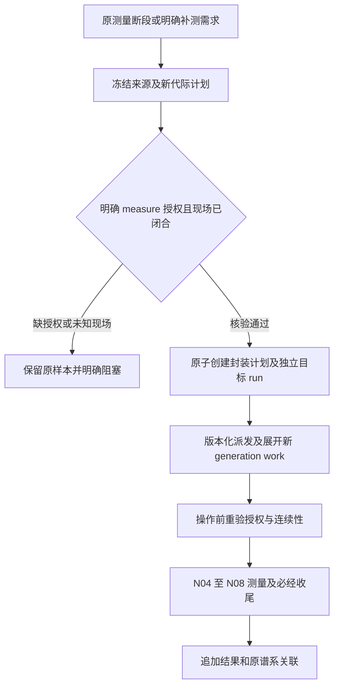

# Agent 生命周期与工作流演进详细设计

2026-10-24 最新子交付：ALD-11 的统一 inventory、writer 处置版本、有界停止任务、迟到失败挂接与证明校验已落地，stop-local 514 项通过；固定门禁脚本及 14 个 PG/硬杀用例已提供，PG 实跑因缺 DSN blocked。详见[实施记录](../../../docs/verification/agent-lifecycle-runtime/stop-workflow-20261024.md)。以下较早的待实现描述为设计目标；tasks 45.4 未整项完成，候选晋级仍独立验收。

2026-10-24 设计补充后继续实施：provider 取消测试的错误目标定位已修正并通过两种子任务未终结反例；相关187项及测量/T6门禁278项通过。取消、drain、版本替换及收口的完整接口与事务仍以 ALD-11 / ATG-08 为待完成合同，局部门禁不代表全部验收。

## Context

2026-10-24，implementation_status=in_progress。生命周期、预算、角色任务、候选编码/review、可信门禁、晋级/发布观察/回退与操作 CLI 已有实现；实际测试和未完成代码见 [当前账本](../../../docs/orchestration/lifecycle-status.md)。本文是 [design.md](design.md) 与编排 D21 的实施附件，需求为 WF-04/06/07/21/34–36/39；门禁见 [ATG](agent-lifecycle-test-gates.md)，完整交付见 [tasks 42–49](tasks.md)。原文历史验收数字只描述当时提交，不表示当前缺少已经接线的 coder/reviewer 或 CLI。

### ALD-01. 首批实现前代码审计与实施差额

2026-10-22 首批实现前审计基线如下；已落地差额见 ALD-10 与 [proposal 当前实施范围](proposal.md#当前实施范围2026-10-23)，表内缺口不是所有能力截至今日仍缺失的声明。

| 已读代码 | 审计基线可复用部分 | 审计时识别的差额 |
|---|---|---|
| runtime/node_agent.py、graphs/executor.py | 节点脚本调用、规则 review、receipt、失败 outbox | review 拒绝与 execution 失败分别触发问题；节点级上下文身份；工作级互斥与处置确认 |
| runtime/agents.py | DiagnosisProposal、字段与证据范围校验、模型调用边界 | 为每个 node 建独立监督上下文；预算从 context hash 改为持久 lifecycle/lineage 账本；usage 未知仍扣预留量 |
| services/remediation.py | N01/N07/N09 注册动作、有限 attempt、remedy job | 当前读次数后另开写事务、无 request_id 合同、固定 dispatch_generation=1；改为所有权/预算/去重/入队同一事务 |
| runtime/worker.py 的 supervision/remedy | 失败记录消费、节点重执行、继续任务 | review 写入与 remedy 入队之间可中断；input_refs 未透传、result_refs 为空；补持久决策 outbox、RecoveryPlan、统一租约与资源域 |
| runtime/bootstrap.py | 五类真实图与网关注入点 | 同一 graph_ref 的诊断、修复、候选构建与门禁 worker 注册；模型与宿主 bridge 明确启用条件 |
| services/revisions.py、interfaces/service.py | 版本谱系、gate、激活 CAS、计划预览 | 候选代码/依赖摘要、门禁证明、目标 plan/contract/auth 及 worker 可用性必须绑定并在事务内复核；当前后继固定继承旧 contract_ref/auth_ref，需显式扩展 |
| tests/orchestration/unit/test_remediation.py | 7 个现有规则/受控路径测试 | 增加真实失败→诊断→不同修复→重验→继续的组合，以及预算竞态、代码候选和门禁反例 |

以上是静态代码核对，不是本轮测试通过声明；旧任务勾选不代表本增量已完成。

## Goals / Non-Goals

**Goals:** 节点能持续看护自己的生命周期，在有界预算内修复问题；能力缺失时可委派编码 agent 在隔离工作区实现候选、运行测试并按授权发布。脚本负责可确定的检查、动作和验收，模型负责诊断、方案与候选代码，所有上下文可从证据重建。

**Non-Goals:** 不在正在测量的进程中热替换代码；不为获得好看的性能结果反复采样；不承诺任意故障都能成功。未提供宿主 API 时不声称接入该宿主的 agent team。现有测量方法和三产品安装能力不在本增量重新设计。

## Decisions

### ALD-02. 三条执行路径及派发主体

采用已有 TaskBackend + Worker，不新建一套并行任务系统。主 agent 的派发能力由应用服务承载，工作 agent 只获得按授权裁剪的 dispatcher；宿主工具接入使用显式 bridge。相比直接让父模型在内存中 spawn 子模型，这保留跨进程恢复、资源互斥及统一预算。

| 路径 | 脚本 S | 模型 M | 人工 H |
|---|---|---|---|
| 正常执行 | 节点执行、状态观察、规则复核、产物校验 | 无常规模型轮询 | 无 |
| 运行时修复 | 处置、取证、策略、派发、执行注册动作、后验、恢复 | 对未知问题作诊断和动作选择；已知可修复规则可直接进入 S | 缺信息、超出现有授权或策略要求的新决策 |
| 候选演进 | 隔离工作区、diff、测试、门禁、版本与资源切换 | 调研缺失能力、修改候选代码/图/测试，解释失败并继续修订 | 风险规则要求且既有授权未覆盖的变更批准 |

生产节点不写活动代码。编码 agent **可以在候选工作区写代码、改图和编写测试**，不是只能出文字提案。代码写入、测试执行和发布分别由不同能力控制。编码 agent 不修改可信测试基线、门禁规则、授权和生产证据。

~~~mermaid
flowchart TD
    RUN["原图节点执行"] --> VERIFY{"规则验收"}
    VERIFY -->|通过| NEXT["继续原图"]
    VERIFY -->|失败或质量缺口| DRAIN["停止新增副作用并收尾本 attempt"]
    DRAIN --> SAFE{"处置或隔离证据就绪"}
    SAFE -->|否| WAIT["对账或持久等待"]
    WAIT -->|期限内| SAFE
    WAIT -->|观察预算耗尽| BLOCK
    SAFE -->|是| TRIAGE{"已有确定修复规则"}
    TRIAGE -->|有| POLICY["修复范围/预算/许可校验"]
    TRIAGE -->|无| AI["节点监督 agent 诊断"]
    AI -->|注册动作| POLICY
    POLICY -->|允许| REPAIR["持久修复任务"]
    REPAIR --> POST{"独立后置检查"}
    POST -->|通过| PLAN["编译 RecoveryPlan 并重验依赖"]
    PLAN --> RUN
    POST -->|失败且效果已确定/预算允许| AI
    POST -->|效果未知| WAIT
    AI -->|需改代码或图| BUILD["隔离候选编码任务"]
    BUILD --> TEST["可信门禁 runner 测试"]
    TEST -->|失败且候选预算允许| BUILD
    TEST -->|通过| PROMOTE["风险审查和授权核验"]
    PROMOTE -->|缺授权| HUMAN
    PROMOTE -->|证明失效| TEST
    PROMOTE -->|允许| NEW["新版本 worker 就绪后创建后继 run"]
    AI -->|缺信息| HUMAN["必要人工等待"]
    POLICY -->|预算耗尽或无许可| BLOCK["blocked，保存恢复入口"]
    TEST -->|预算耗尽| BLOCK
~~~

每次失败回环必须消耗预算并追加不同 attempt/候选 revision。成功的最后一次预算内尝试可以验收；只有申请**下一次**动作时才检查剩余次数。相同 action + 输入摘要 + 失败指纹达到策略必填 max_same_failure 次且无新证据时，停止同策略重试，改候选策略或阻塞。暂态错误可按明确 backoff 及下次执行时间等待，不以等待期间反复调用模型实现重试。

### ALD-02a. 持久阶段与事件合同

| 当前 phase | 允许的事件 → 下一 phase | 必需检查 |
|---|---|---|
| draining | disposition_confirmed → diagnosing；effect_unknown → reconciling | 原 attempt 收尾事实；相同 work 租约 |
| reconciling | effect_known → 校验后的 resume_phase；observation_due → reconciling；budget_exhausted → blocked | 同 operation 查询，有限观察；隔离域未释放前不得现场修复 |
| diagnosing | known_action → remediation_pending；needs_code → candidate_building；needs_input → waiting_decision；no_safe_route → blocked | 注册动作/证据/权限；模型缺失不妨碍确定性规则 |
| remediation_pending | claimed → remediating | 原子额度、许可、claim 与 work lease |
| remediating | postcheck_pass → reentering；postcheck_fail_with_budget → diagnosing/backoff；postcheck_fail_exhausted → blocked；unknown → reconciling | 后验与效果确定性；下一次预算不足转 blocked |
| backoff | timer_due → diagnosing | next_due_at、绝对 deadline 和未取消状态 |
| reentering | node_accepted → fulfilled；node_failed → draining | RecoveryPlan 和新 attempt 验收；后继业务仍由原图执行 |
| candidate_building | revision_frozen → candidate_verifying；provider_unknown → reconciling；budget_exhausted → blocked | 候选独立隔离；provider operation 与现场 operation 分域记录 |
| candidate_verifying | tests_fail → candidate_building；tests_pass → promotion_pending；environment_missing → waiting_dependency | 新修订才消耗 revision 额度；等待不得改写 failed 结果 |
| promotion_pending | approved_and_ready → superseded；needs_authorization → waiting_decision；worker_missing → verified_waiting_worker；proof_invalid → candidate_verifying；nonruntime_candidate_accepted → diagnosing/blocked | G0–G4/G5/G6.pre 对应证明；仅文档产物接受后回 diagnosing 或无后续路线时 blocked，无需后继 run |
| verified_waiting_worker | ready → promotion_pending；proof_expired → candidate_verifying | 旧派发未提前关闭；不在等待中重复编码 |
| waiting_decision / waiting_dependency | valid_decision/dependency_ready → 账本保存的 resume_phase；deadline → blocked | 决定/依赖覆盖原身份；不重置预算 |
| 任一非终结 phase | cancel → cancelling；owner_lost → 原 phase 等待接管；irrecoverable_contract_error → failed | 停止普通派发，保留处置权限；接管不产生新 attempt；failed 必须确认处置闭合 |
| cancelling | disposition_closed → terminal_intent；unknown → blocked | 用户取消的 terminal_intent=cancelled；超期/预算耗尽的 terminal_intent=blocked，保留授权恢复入口；未知资源继续隔离 |
| 任一非终结 phase | deadline/budget_exhausted → blocked 或 cancelling/reconciling | 无在途效果且处置可验才直接 blocked；有在途任务先取消/对账，不能继续普通派发 |
| blocked | authorized_resume → 原 resume_phase；close_partial → blocked_closed | 修改预算须追加授权；close_partial 不删除未知效果/隔离记录 |

首次 observe_failure 原子创建 draining 并绑定失败 receipt。业务额度耗尽后的 cancelling/reconciling 使用独立且预留的有限 safety_budget（停止/查询/清理次数、费用和绝对期限），不能借此诊断/测量；safety_budget 耗尽后追加隔离证明并 blocked，未知效果继续保留，后续操作必须另有处置授权。停止决策原子保存 stop_reason 与 terminal_intent：explicit_cancel→cancelled，deadline/budget_exhausted→blocked；收尾动作本身叫取消不改变原因。显式取消优先于超期，超期优先于新动作申请；完成回执始终可写事实，但不能绕过过期的发布授权。provider/现场对账以 operation_kind 区分，进入 reconciling 时记录 resume_phase；已知 provider 结果回原候选或诊断阶段，不能重发现场动作。

fulfilled/superseded/blocked_closed/cancelled/failed 是生命周期终结，不能代表 performance=pass。failed 仅用于确定不可恢复并已完成处置的合同错误；预算不足使用 blocked。禁止其他未列出的状态跳转；每个事件保存 event_id、来源、expected_revision 和 evidence refs，相同事件幂等，陈旧事件拒绝。隔离期间的离线诊断/候选是受限旁路 job，主 phase 保持 reconciling，不能借旁路改变现场状态；其终结结果只保存待用候选，解除隔离后才进入 promotion_pending。G6 激活前证明与激活后观察分别记录，后者不能作为尚未激活的前置条件。

### ALD-03. 模块与接口

下列接口是拟议 Python 合同；优先扩展现有服务，不迁移全部历史任务。模块路径相对 sandbox_graph。

| 模块 | 接口/类型 | 责任 |
|---|---|---|
| domain/agent_lifecycle.py（新） | LifecycleKey、RepairPolicy、RepairRequest、RepairDecision、RecoveryPlan | 严格模型；未知字段拒绝、预算正值/单位/版本明确 |
| services/agent_lifecycle.py（新） | observe_failure(receipt_ref)、advance(id,event,expected_revision,token)、compile_recovery(id,receipt_refs) | 持久阶段、工作级互斥、问题去重、从可信事实决定路由 |
| services/remediation.py（扩展） | request_remediation(request,principal,token)、record_outcome(order_ref,outcome,token) | 受限派发、原子预留额度、action/版本/权限复核、结果与后继 outbox |
| catalog/repair_actions.py（新） | resolve(action_id,version,node_id) | handler、输入 schema、副作用/权限/冲突域、后验/reconcile/cleanup、重入方式、验证状态 |
| runtime/agent_bridge.py（新） | capabilities()、submit(envelope)、lookup(request_id)、status(handle)、cancel(handle)、collect(handle) | 统一应用内 ModelGateway 与可选宿主 dispatch/team 协议；不依赖宿主私有对话 |
| runtime/agents.py、node_agent.py（扩展） | diagnose(packet)、证据读取 capability | 分节点上下文、结构化建议、统一预算预留、记录 usage 和模型版本 |
| domain/evolution.py（新） | ChangeProposal、CandidateRevision、GateManifest、PromotionRecord | 候选身份、风险、审查与测试绑定 |
| services/agent_team.py、runtime/agent_team.py（已实现子交付） | request_role / query / observe / cancel | 持久单层角色、真实 investigator、冻结模型额度、原ID有界观察和一次性安全预算取消；coder/reviewer 工具依赖仍 blocked |
| services/lifecycle_reconciliation.py、runtime/lifecycle_reconciliation.py（已实现子交付） | authorize / consume_in / resume；reconcile job handler | 原 ID 现场/provider 安全续办、双预算、实际 owner 核验、不可变关闭证明、原业务授权下的恢复意图 |
| services/evolution.py（新） | propose_change(...)、create_revision(...)、evaluate_gates(...)、promote(...) | 修订循环、diff 影响判定、测试选择、晋级决策 |
| runtime/candidate_worker.py（新） | build_candidate(job)、run_gate(job) | 独立工作区/隔离执行、受限工具、测试产物收集，禁止接触生产凭据 |
| runtime/worker.py、bootstrap.py（扩展） | supervision / remedy / candidate_build / candidate_verify / promotion handlers | 统一 claim/续租、checkpointer、outbox、取消和版本绑定 |
| services/revisions.py、closure.py、interfaces/service.py（扩展） | 受门禁保护的激活、生命周期查询/决策/取消 | 沿用 D14、收口不能漏正在修复/演进的 work |

应用内 ModelGateway 提供诊断；编码 provider 提供隔离工具调用及补丁结果。宿主 bridge 若 capability 不含幂等 request_id、按 request_id 查询提交结果、持久 task handle、状态查询、取消、scope 限制或可核对 usage 上界，则禁止用于相应自动路径并返回具体缺口；仍可使用满足合同的应用内 provider。实现公开 provider 配置和 HTTP/RPC bridge 的**本项目协议**，不猜测 OpenCode/Codex 的未公开端点。具体宿主部署验收单独标 adapter_verified。提交响应丢失先按 request_id 查询，查不到且无法证明未接收时保留 unknown，禁止换 ID 重提。取消返回 accepted 不代表结束；须查询终结回执并确认子任务已停止。

### ALD-04. 数据合同、身份和最小上下文

| 对象 | 必需字段 | 持久约束 |
|---|---|---|
| LifecycleKey | run_ref、scope_kind、scope_ref、node_id、lifecycle_id、lineage_budget_ref | 同一失败 receipt 只建立一个问题；现有 owner_agent_id 保留，新增 node_supervisor_id 区分节点 |
| LifecycleRecord | key、graph/plan/contract refs、policy_ref、phase、revision、owner_epoch、source_receipt、issue_fingerprint、attempt_refs、decision_ref、next_due_at、stop_reason、terminal_intent、resume_phase | CAS 更新阶段；历史事件追加；phase 不覆盖 NodeResult 分离状态 |
| RepairPolicy | actions、max_repair_attempts、max_diagnosis_calls、max_candidate_revisions、token_limit、child_job_limit、max_depth、max_concurrency、deadline、backoff、max_same_failure、max_observations、safety_budget、postcheck_ref | 不提供无限默认；实测值由运行合同给出，示例值仅测试夹具 |
| ContextPacket | node_supervisor_id、task_role、版本引用、失败摘要、事实/假设、证据读取范围、已用预算、工具 capability、evidence_mode、最新处置 receipt | 不含父会话/其他组日志/明文秘密；读取路径和字节预算由服务校验。旧记录缺 mode 时保持 live 语义；显式 offline_sealed 仅能读取可信封存证据，无现场 capability，不以缺少处置 receipt 放行现场操作 |
| RepairRequest | request_id、lifecycle_id、source_receipt、expected_revision、action_ref、input_manifest_ref、proposal_ref、授权引用 | attempt 号、owner、dispatch_generation、剩余额度由服务算，模型不能自报 |
| ResourceDispositionReceipt | work/operation refs、stopped/admission 状态、sampler 状态、owned/residual 集合、隔离域、观察时间、expiry、producer/version | 替代调用方传入的 resources_disposed=True；使用前重验时效与实际账本 |
| RepairOutcome | order_ref、operation_refs、effect_certainty、execution/data/cleanup、postcheck_ref、raw_refs | exit=0 不等于修复成功；未知效果不得重发 |
| RepairApplicabilityRule | schema_version、rule_ref、node_id、action_ref、predicate、error_codes、preceding_action_ref、preceding_postcheck_ref | 受信目录注册；source_error / repair_failure / postcheck_rejected 分开，不允许模型提供可执行谓词 |
| RepairPostcheckEvidence | lifecycle/order/action/postcheck、receipt_ref/hash、disposition、effect、producer | 独立后验实际生产、内容寻址封存；执行成功可同时后验拒绝，不改原 receipt |
| RecoveryPlan | immutable ref、graph/contract/input hash、work_revision、source_attempt、entry_node、revalidate_nodes、reuse_receipts、invalidated_refs、resource_proofs、measurement_generation | 不允许 agent 自选 resume_from；仅确定性编译器生成，driver 启动时重验 |
| ChangeProposal | source key、base code/graph refs、failure evidence、facts/hypotheses、目标行为、文件/节点/合同范围、acceptance_refs、scope_auth | 提案不是可执行适配，不写活动状态 |
| CandidateRevision | proposal_id、revision、parent_revision、base_commit、tree/patch/graph/lock hashes、changed_paths、risk、workspace_ref、budget_ref、target_plan_ref/hash、target_contract_ref/hash、target_auth_ref/revision | 内容变更创建新 revision，已测试候选只读；每次冻结即不可变；修改必须新 revision，同摘要可重用适用测试证据 |
| GateManifest | candidate hash、target plan/contract/auth refs 与摘要、trusted_suite hash、policy hash、required_gates、实际 case 集合、环境/runner 版本、逐项结果、日志摘要、producer_identity | 由可信门禁服务发布；模型给出的“测试通过”文本不予受理 |
| PromotionRecord | request_id、candidate_ref、gate_manifest、review_ref、authorization_ref、worker_bundle_ref、target_plan_ref/hash、target_contract_ref/hash、target_auth_ref/revision、expected_predecessor_revision、expiry | 同输入幂等；代码/策略/授权/环境变化要求重验 |

新增 ledger kinds：agent_lifecycles、lifecycle_events、lifecycle_budgets、repair_requests、repair_orders、repair_outcomes、recovery_plans、change_proposals、candidate_revisions、gate_manifests、promotion_records。复用 Repository 的事务/fence；不可变记录与可变 revision 索引分离。旧 agent_reviews/remedy_orders 保留，不按新 schema 重写。

预算按 lifecycle + lineage 双层扣减，策略版本、context hash、模型身份、candidate revision 或后继 run 均不能自动刷新额度。只允许有明确授权的 budget adjustment 追加账本，不清零历史。模型调用前在同一事务锁定 lineage 与 lifecycle 预算行并预留可强制的最大输入/输出费用；同 request_id 重放复用原 reservation。实际 usage 已知只释放未使用的预留，未能证明调用未发生时不得全退；usage 缺失记 unknown 并消耗全部预留量，不能按 0 计。provider 无法执行调用上限时不进入自动循环。job 数、模型请求数、修复动作次数和 candidate revision 分开计数；接管同一个 operation 不另耗修复次数，但消耗观察调用/时间额度。

### ALD-05. 修复与派发事务

1. 原图写失败/质量缺口 receipt 及 outbox。受控确定性收尾保持 N07/N09/N10 必经；N10 交付本 attempt 的事实，若 lifecycle 未终结，只是 attempt delivery，不宣称 work 完成。
2. lifecycle 服务核验 run/group/work/node 归属、版本、当前 owner、失败事实和处置证据。当前 work 的原图执行、收尾、修复和恢复共享互斥键；不能因 remedy 使用新 thread 就并行修改相同资源。
3. 已知规则可直接产生带规则版本的 RepairDecision；未知才派 diagnosis job。诊断结果持久化时同时写 decision_ready outbox；消费者以 source_receipt + decision_revision 幂等入队，避免“review 已写入但修复丢失”。
4. request_remediation 的**单事务**：检查 request_id/input hash → owner fence 与 work revision → dispatch gate/授权/动作能力 → 未知 operation/冲突域 → 预算原子预留 → 分配 attempt → order+job+outbox+request receipt 一起提交。不得先读 attempts 再在另一事务覆盖，也不得硬编码 generation。
5. worker 用真实 job claim 与共享 work lease，按 D11 写 operation intent、许可和 submission_started。DB 事务外执行动作。响应丢失由相同 operation 对账；只有可证明未提交时允许首次发送。原图 drain 许可仅能做其 scope 的停止/封存/清理，不允许借关闭的 gate 新建测量。
6. 完成事务绑定租约、输入和候选版本，写 outcome、独立后验、预算结算及下一事件。后验失败且效果明确、仍有预算且存在新方案，回 diagnosing/backoff；缺动作可去 candidate_build；未知进入 reconciling；必要输入进入 waiting_decision；预算耗尽 blocked。重复 outcome 返回原决定。
7. 后验成功编译 RecoveryPlan；恢复任务启动时重新核验工作 revision/授权/资源域/依赖身份。如果原图已清理 fixture、采样已断或数据已封存，禁止沿用失效对象；重新准备或形成新 generation。旧 result_refs 与新 attempt 结果显式合成可追溯快照，不置空、不重放无关节点。
8. cancel/supersede/lease loss 均停止新普通派发，保留有限 cleanup/reconcile。closure 查询 lifecycle、候选任务、操作和冲突域；只有已明确 fulfilled/superseded/failed/blocked_closed/cancelled 且满足 scope 处置条件的作用域可收口，不能把 waiting 当完成。superseded 还必须有 successor lineage 和旧操作 drain/隔离交付证明，不能仅凭候选激活回执跳过资源检查。

正常 attempt 的失败路由仍负责安全收尾；后续 lifecycle 的继续意图由 outbox 承接，不在两个 driver 中同时推进同一 WorkGraph。处置无法确认时允许离线读取已封存证据/准备候选，但禁止产生现场副作用；此例在 phase 中保留 reconciling 并持续有限 watchdog。

已知策略选择现由 `select_strategy_in` 读取实际原始错误、上一修复失败或独立后验拒绝证据。`postcheck_rejected` 必须绑定前一注册动作及其确切后验合同，核验实际 receipt、visit、处置与 outcome；unknown 不匹配。选择记录、RepairDecision 与 outbox 同事务提交；后验证据、failure fingerprint、outcome、预算结算与后继意图也同事务。稳定的 `strategy_input_hash` 来自原 source/input，不因追加失败证据刷新同策略计数；完整 input_hash 仍保护新增证据。无适用规则才进入有限 investigator，未配置模型保存明确等待原因。44.5 已本地验证；生产目录仅 N01/N07/N09，受控 A/B 动作不作为新增产品能力。

### ALD-05a. 原 ID 安全续办的落地事务边界

2026-10-23 子交付已本地验证并通过独立复审；具体装配、权限和阻塞入口见 [安全对账合同](../../../docs/orchestration/lifecycle-reconciliation.md)。该子交付不替代43.5/45.4完整验收。

- 会话身份固定为原 site order 或 provider request，安全授权独立于普通 repair/measure 授权。每次 query/stop/cleanup 的原ID意图与 lifecycle/lineage 双预算同事务预留；网络前和事实提交前均核验实际 job/thread/lifecycle/work owner。未知 cleanup 不通过换job、outbox或资源集合重发。
- 现场关闭保留原 unknown outcome 与 isolation，追加不可变 resolution 和重新后验；关闭事实、后继 outbox、成功 job result 同事务提交。旧版本已经存在的 closed 但缺 job result 记录，只能核验原关闭来源后只读重放，不能重新闭合或将 closed 改成 blocked。历史关闭证明不依赖未来合法 work revision 保持不变；当前新增未知效果独立阻塞。
- provider 只对账原 investigator 请求，terminal 且 children_stopped 才关闭原并发槽位。迟到 usage 追加事实，不改写已满额结算的未知费用。对账意图先于原 job finish 被看到时保留 waiting_dependency；单项身份/权限/schema错误阻塞该项，不能使共享 outbox pump 退出。
- 追加 accepted 只产生恢复意图。RecoveryPlan 仍重验原 action 后验、raw/operation身份、当前处置和原业务授权；安全 grant 不授予新测试权限。
- 现 Runner cleanup 协议缺原清理请求查询身份，丢响应保留 unknown/隔离；ObservationService 的旧账本 stop 仍非物理停止证据。本地 in-process 采样器现已通过可信 producer/collection 合同证明 capture/close/executor 退出，见 [采样生命周期](../../../docs/orchestration/sampler-lifecycle.md)；远端接管和未核验产物跨进程恢复仍缺适配合同，不能只归因于部署环境。

### ALD-06. N00–N10 的修复与恢复策略

表中动作名是待注册逻辑合同；必须有版本匹配的 handler、后验和验证证据才能启用，不因写入表格而变可执行。所有 45 个持久节点均有 lifecycle policy 条目；下表细化测量节点，其他节点继承匹配 scope 的公共合同，缺具体修复能力时仍可诊断/候选演进。

| 节点 | 可脚本化修复/验收 | 恢复边界 |
|---|---|---|
| N00 | 重验来源明确的合同；语法修复提案，未知参数不补猜 | 合同改变需新计划；保持原合同失败记录 |
| N01 | case.reconcile：核对原 operation、资源及版本 | 已知状态才续接；unknown 隔离，禁止新 create |
| N02 | fixture.repair：已注册 recipe 补建/复验本人 fixture | 重验 N01/N02/N03，复用对象必须身份、规格、TTL、缓存成立 |
| N03 | preflight.recheck：功能/断言配置修复后重检 | 不放宽断言；改变语义走候选版本 |
| N04 | observation.repair：权限/collector 的授权修复与采样校验 | 测量前重建完整 baseline；已有测量断段不得拼成连续窗口 |
| N05 | resume_owned_operation：接管原有限发压，或修复 adapter 的候选代码 | 原 operation 可安全接管才续接；新测量需新 generation 和范围预算；有效性能 fail 不触发修复 |
| N06 | steady.reobserve：原 sampler 连续且窗口合同未变时继续观察 | 采样中断/基线失效则保留 insufficient，必要补测单独授权 |
| N07 | evidence.seal：补传、flush、验证保存的原始 spool | 不制造缺失事件；新 manifest 版本引用原证据 |
| N08 | analysis.recompute：修复后的版本化公式处理冻结 raw | 公式变更走候选发布/可比性复核，结果新 revision，不改 raw |
| N09 | resource.cleanup：仅本人对象的清理和残留核验 | 清理后禁止跳回依赖被删对象的测量步骤；原始证据永不清理 |
| N10 | delivery.republish：补交可核对产物/复核 | 幂等交付，重发不增加样本；组级拒绝继续关联原节点缺口 |

环境 E/C 节点复用 grant、probe/plan/apply/recheck；未知安装效果先对账，不能让模型重新安装。R/G 节点只能用自己 scope 的调度 capability；A/F 节点修复纯计算或产物，不能借 work capability 发起新性能测试。T6 拒收以具体缺口关联原节点，避免全图重跑。

### ALD-06a. 新测量代际的版本边界

2026-10-23 45.3 已完成本地TDD门禁验收，真实后端仍单独验收。保留旧 `Plan`/`Case` 原始编码及 canonical hash，不直接加入带默认值的 generation 字段。新 `MeasurementGenerationPlan` v1 封装冻结的旧格式目标计划原件及摘要、原 work/receipt/lifecycle/lineage、method/resource/condition、目标授权及 revision、由服务分配的 generation；封装以自身摘要存入计划账本，独立目标 run 引用该摘要，原 run/plan 不改写。

新受信 `load_plan` 仅为经过核验的封装提供执行视图，执行身份始终为封装摘要；展开限于明确的目标 case/condition。旧 `Plan.model_validate` 必须拒绝封装，不能忽略扩展字段并退回 generation=1。run/group/work/continuation 的可达派发入口均带受支持的版本身份，不能仅保护 work job 而让旧 group 再展开普通 work；原普通启动／版本激活入口不因计划存在就绕过专门的新测量授权。实际混合旧 worker 的可用性须单独验证，不从“字段可解析”推断可安全部署。

新代际的 measure 授权是受信操作入口，不能继承 cleanup/repair 的权限；启动及现场操作前重验当前授权、处置、冲突域和冻结身份。失败关联原 lifecycle 和原双层预算，不能创建新局部额度，也不能误派原 work 修复。实际新增子任务扣原 child_jobs；只有实际观察调用消耗 observations。T6 已接通精确原生命周期返工接口，不能通过组审核自行批准测量。 对失败的新代际，默认保持等待明确决策；受信调用者可以指定已闭合的直接前代及其不可变失败关联，在取得新精确授权后申请下一代。每个直接前代至多一个后继，整个链仍消耗最初生命周期和谱系的原预算，不自动重试，也不以重新 attach 刷新额度。

### ALD-07. 候选编码与 agent team

初版使用有界团队：node supervisor → investigator/coder/reviewer 三种可选角色，子任务默认不再 spawn；需要更深委派必须匹配显式版本化 delegation policy，整体计入同一预算。reviewer 与 coder 的任务/上下文独立；模型复核不能替代确定性门禁或必要授权。

1. dispatch_candidate 先冻结 base commit、当前图/合同、失败证据、目标及允许路径；工作区只从该基线建立，不能包含未登记的用户未提交改动。用户脏工作区需显式形成候选输入快照，或保持未纳入；不得自行 stash/reset。
2. 编码 provider 得到候选根目录和受控工具：读取范围内源码、写入允许路径、调用注册测试计划；无生产密钥、SSH agent、主工作树可写挂载、发布 token 或门禁数据库写权限。worktree 只解决代码隔离，执行不可信候选仍用独立沙箱/进程权限与网络限制；所需隔离能力不足则候选测试 blocked。
3. coder 可新增修复脚本、adapter、图节点和测试，但只能写候选；执行工具检查路径规范化、symlink/越界、允许 argv、超时和产物大小。敏感路径/合同变化提升 risk，不允许模型自己降低级别。
4. 新修订重新计算 tree/patch/dependency/graph 摘要；测试失败记录失败用例、日志范围和原因，再给 coder 最小差异上下文。保持失败候选不可变。预算内可修多轮，最后一轮通过允许晋级；相同失败无进展或预算耗尽 blocked。
5. 非 R0 候选按 GateManifest 需要的完整套件重新验证；只重用输入/环境/可信套件均兼容的门禁证明。编写者不得通过删除断言、添加 skip/xfail、修改收集规则或选择测试子集来获得通过。
6. 候选通过后做独立 review 和授权判定，产出 code bundle + graph_ref + 依赖锁摘要。激活不自动刷新宿主技能、不改活动代码、不发布到 GitHub；外部合并/部署是单独已授权发布动作。

风险沿用 D21 R0–R3。R0/R1 必须证明不影响行为；测试/CI、依赖或门禁自身修改若可能削弱验收或改变执行，应提升到 R2/R3，不能只按文件后缀判低风险。已有 DecisionRecord 覆盖相同候选范围和约束时复用，不重复问人；新合同、越权范围或不兼容候选必须取得对应授权。权限扩张不能由代码测试通过替代。

### ALD-08. 晋级、版本切换与验证证明

PromotionService 在同一事务中重验候选内容身份、GateManifest producer/完整性、激活前必需 gate（G0–G4 的适用项、G5 授权决定、G6.pre）的 pass、review、authorization、policy 版本、有效期及 predecessor revision，然后调用既有 RevisionService 的事务内激活逻辑。缺少任一项拒绝；禁止仅在调用方先检查一次后直接调用无门禁 activate。所有通向 GraphService/CLI 的候选激活入口使用相同检查，不能绕过。

目标运行合同是候选身份的一部分：create_revision 冻结 target_plan_ref/hash、target_contract_ref/hash、target_auth_ref/revision；未改变者明确记录继承引用，不允许在激活时读取一个未固定的“最新值”。测试/复核/批准绑定这些目标，修改任一目标产生新 revision 并重算可比性、必需 gate 和证据复用范围。target_auth_ref 是后继运行权限，promotion authorization 是发布批准，二者分别核验，不能互相替代。

扩展 RevisionService 的事务内入口为 activate_revision_in(tx, ..., target_plan_ref, target_contract_ref, target_auth_ref, promotion_ref)。先核验目标存在、scope/计划/合同与已批准范围相容、权限未撤销、bundle 支持目标合同，再创建 RunRecord；active_plan_ref/contract_ref/auth_ref 使用冻结目标，旧 run 三个引用保持不变。任何代码、图或合同执行语义变化都必须走后继 run 分支，不能进入现有 graph_ref 相等时原 run 改计划的分支；计划选择的原有同版本调整仍按其原合同独立处理。缺新授权不得自动回退继承旧授权来发布。ALU-19/ALI-07/08 覆盖 R3 新合同及授权撤销反例。

候选测试状态分 pass/fail/blocked/not_applicable；必需 gate 的 skipped、xfail、零收集或报告缺失均不算 pass。不适用由可信影响分类器和 policy 计算，不由候选声称。详细规则见 ATG-01–06。

发布阶段先生成并校验版本固定的 code bundle，worker 注册 bundle/graph/contract 摘要与可用 handler 后标 ready；只有 ready 的 worker 才能领取该版本任务。无新 worker 时保留 verified_waiting_worker，不关闭旧派发。满足条件才按 D14 原子产生后继 run，并对旧操作 drain/隔离。仅文档/纯测试 R0 产物不改变运行图，无须制造空的新 run；候选接受不表示原失败节点修复成功，回到诊断或无后续路线时 blocked；任何可执行 bundle 改变即新 graph_ref。

旧图/代码仍保留到其操作、等待、资源处置和受影响生命周期闭合；回退也是新的候选版本/后继 run，不能退回旧 checkpoint 覆盖事实。原 run 在候选构建期间按原策略继续无关任务或收尾，候选测试不得占用正在测量的同一冲突域。

### ALD-09. 验收判据、状态查询及迁移

工作节点成功是“指定 node contract 的必需断言有效 + 对应交付可验”，不是统一要求 performance pass。work/group/root 分层验收继续按各自规则；清理 unknown 保留 partial，模型不能代填成功。

QueryService 暴露 lifecycle_id、当前阶段、owner/node_supervisor、尝试与预算、原失败和最新证据、候选与门禁、恢复计划及具体阻塞。公开命令拟为 python -m sandbox_graph lifecycle status/request-repair/request-change/decision/cancel，均调用同一服务；副作用命令必需 request_id、expected_revision 和授权上下文。模型/宿主不可用明确报告原因，生命周期任务不得无消费者地排队。

迁移步骤：
1. 新 ledger/schema 和策略默认关闭，新增字段不重解释历史记录；旧 graph worker 可继续 drain。
2. 原有 N01/N07/N09 动作逐个注册并完成门禁；禁止将旧 remedy_orders 静默视作新合同授权。
3. 合成图开启 lifecycle；旧单元测试与新 unit/graph 门禁同时运行。baseline 中 7 个测试覆盖不足的部分增补，不删除历史反例。
4. 在真实 PostgreSQL 运行双 worker 竞态和硬杀；接入选定的模型/编码 provider；宿主 bridge 验证为单独 capability。
5. 按限定环境/动作开启生产修复；再启用隔离候选和 R0/R1 自动晋级。具体配额、provider 地址及沙箱镜像是部署参数，不阻塞通用接口实现。
6. 关闭自动诊断/演进不终止清理和对账。回滚服务版本保留新 ledger 的只读访问和旧 bundle 恢复入口，直到所有工作处置完毕。

## Risks / Trade-offs

- 原图收尾和 remedy 同时修改资源 → 共享 work lease、处置 receipt、RecoveryPlan 三处检查。
- 修改 prompt/context 或换后继 run 绕过预算 → lifecycle/lineage 双层预留，不按上下文摘要重置。
- 改代码时同时改测试导致虚假通过 → 可信基线套件与候选测试分别执行，门禁报告由独立 runner 生成。
- CI 通过但实际运行版本不一致 → 绑定 bundle/graph/lock/worker 摘要，在派发与激活再次复核。
- 未知外部效果 → 能确定才继续；不能恢复的记录保留 unknown/隔离，不宣称 exactly-once。
- 新门禁阻塞发布 → 未受影响旧任务继续；阻塞 scope、缺失 gate 和所需输入均可查询。

## Migration Plan

按 tasks 42→43→44→45，42→46，46→47，44/45/47→48→49 实施；每组实现同时交付对应测试和服务文档。本文实施中；CLI 的 planning complete 与实际门禁 pass 分别记录。

### ALD-10. 交接审阅落实与第一实施批次

依据根目录 HANDOFF-review-for-codex.md 的 C1–C4/G1–G8。C1 禁止的是未经验证的入口，而不是 resume_from 字段名称；只有受信 RecoveryPlan 可产生恢复入口。G1 同时检查独立 NodeReview.decision 和 NodeResult.review_status，不能混为一个字段。

新增 L1：RemedyJobHandler 手工用 job owner_epoch/owner 名拼 LeaseToken，任务 claim 并非线程租约；MemoryTransaction 用 owner 作为 lease_id 且旧测试手工预取得租约，掩盖生产拒绝执行。线程 token 必须来自实际租约获取；本批使用仓储事务 tx.acquire_thread 返回的 token，work 互斥由 43.4 另行绑定；heartbeat 失败取消执行，完成与 outcome/继续任务写入均核验 fence，finally 仅释放自身仍有效的租约。测试夹具改为独立 UUID lease_id，不得靠预取得租约使 handler 测试通过。

| 审阅项 | 实施任务 | 验收 |
|---|---|---|
| L1 真实租约 | 43.6、45.1 | ALU-21；真实 PG 仍由 ALI-03/04 验证 |
| C1/G3 依赖和快照 | 45.2/45.3 | ALU-10/11、ALI-02 |
| C2/G2/G4 原子派发/决策/互斥 | 43.1/43.2/43.4 | ALU-07/08、ALI-03/04 |
| C3/C4 持久预算/处置 | 43.3/43.4 | ALU-05/09 |
| G1/G5/G6 复审/上下文/无进展 | 42.1、44.1、43.5、45.1 | ALU-02/06、ALI-01 |
| G7/G8 候选/provider/门禁 | 44、46–49 | ALU/ALI 按 ATG 完整清单 |

实施从已有基础扩展，旧 ledger 只读保留；新增强合同不可退回旧的无验证路径。先跑 lease/派发/恢复的闭环，再启用 candidate/provider 自动路径。缺环境只阻塞相关真实验收，不将未实现任务勾选。

### T6 实现补充（2026-10-23）

Worker 在交付发布事务中写入独立的 `work_delivery_sources`，绑定实际 job、activation、
result_refs 和 delivery hash。T6 独立审核后，通过 DeliveryReworkService 冻结
schema_version=1 的 `delivery_rework_gaps`（run/group/plan、不可变 review/delivery 摘要、
原节点/receipt/visit/job）。旧交付缺少此来源或存在多个失败来源时保留 needs_input，
不能从 findings/gaps 文本猜测节点。旧 DeliveryManifest/Plan hash 不变。

具体节点拓扑、授权边界、解决证据和验收限制见 [返工合同](../../../docs/orchestration/reuse-rework.md)。

### ALD-11. 停止、版本替换与收口的实施合同（2026-10-24）

#### 1. 范围、现状和返工原因

本节收紧 45.4 的剩余交付，并确定 45.5、46–48 必须复用的停止接口；不重写已验收的测量算法或 T6 来源协议。现有 `services/lifecycle_stop.py` 已完成下述 R1–R3 局部修复，完整 ST-01–20 尚未验收，不能直接作为目标设计的 oracle。

2026-10-24 R1–R3 的实际实现边界：

- `AgentTeamService.request_role` 在上下文构建前、入队/预算预留事务内分别检查原 run/plan/graph 的停止命令；已有同内容请求先返回原引用，不重复预留。
- `inventory_in` 沿 provider envelope → lifecycle → run/typed scope/work membership 汇总父 run/group 的子请求；同名其他 run 不计入。父停止消费者只等待原子生命周期对账，不继承子请求身份、预算或授权。统一所有 ledger 的 InventorySnapshot 仍待完成。
- 同版本停止命令合并为 cancel 优先于 drain。drain 保留原现场操作/provider，在 lifecycle 与原请求较早期限前只查询；停止预留及网络调用前再次检查。自然完成后的采样停止/资源清理仍按原安全授权进行，不发旧版本 retry/recovery。
- 原期限到达记录 `deadline`，不伪造 `explicit_cancel`；显式 cancel 可覆盖 drain。原有限安全预算和期限不重置，预算不足仍明确阻塞并保留隔离。
- `RevisionService` 的不可变激活回执新增原 run/plan/graph 绑定。旧效果、任务、资源、隔离和租约全部关闭且验证该后继后，由受信停止服务发 `version_drained` 事件转 `superseded`，不改历史 NodeResult；到期停止原因也保留。该事件要求实际 scope/work 所有权、处置证明和后继引用，显式取消不能走此事件；缺少前任绑定的历史激活回执保持等待，不能猜测迁移为通过。

实现与门禁证据见 [R1–R3 修复](../../../docs/verification/agent-lifecycle-runtime/stop-fixes-20261024.md)。上述局部实现没有替代下文尚待完成的全 scope、事务版本及持久化验收。

已观察到的返工分为两类：测试准备错误（无效 artifact scope、handler 属性名用错、缺 dispatch gate、假定一次 Worker 执行必然到指定阶段）；设计遗漏（恢复交付复用旧 receipt、取消时遗漏无 operation 引用资源、代际 safety job 被替换、总清理绕过原安全预算）。前者应由夹具合同检查提前发现，后者应由接口和集成用例在实现前固定。TDD 的预期失败不包含“尚未进入目标行为就因夹具错误失败”。

该失败已定位：`context_service` 同时创建 N02/N09，`scan(...)[0]` 选中了其他生命周期的 closed 状态。测试现按 request_id+lifecycle_id 绑定 stop_ref；原 provider 在取消 accepted 且 children_stopped=False 时仍 waiting，真实终结回执后 closed。新增 running/cancelled 父状态两种反例、未终结不产 proof、原证据不变、只提交/停止一次及无恢复派发断言。预期未放宽，生产取消逻辑无需为这个失败修改；验证见[修复证据](../../../docs/verification/agent-lifecycle-runtime/provider-stop-fix-20261024.md)。

#### 2. 行为边界与状态

| 意图 | 截止后允许 | 截止后禁止 | 收口依据 |
|---|---|---|---|
| cancel | 保存已发生事实；原操作的查询、停止、清理及必需交付 | 新测量、新修复、新诊断/provider submit、新候选修订 | 所有原子任务与资源已处置；明确取消的未终结生命周期最终 cancelled |
| drain | 截止前已进入 submission_started 的原操作，在原版本和原期限内完成；保存结果及收尾 | 新业务操作、重试、恢复重入、新模型调用；仅取得 permit 但未开始提交不算在途 | 原操作完成或期限触发安全停止，并完成处置；不能一开始就强制当 cancel |
| supersede | 是版本关系，必须另带 drain/cancel policy；旧版本对账持续可用 | 用新版本重发旧 operation；以 successor 创建成功代替旧资源关闭 | successor 引用与旧版本处置证明齐全后才可标 superseded |

仅原计划选择变更允许现有同 graph_ref 的原 run 分支；代码/图执行语义变化仍必须新 graph_ref、新 run。所有 stop 命令冻结旧 run/plan/graph/generation，后继不匹配旧 stop。用户显式 cancel 优先于版本 drain；旧 fulfilled 等终结事实保持原样，停止投影单独记录是否仍有残留。

StopStatus 与 LifecycleRecord.phase 分开。目标 StopStatus 为 pending → waiting_owner/waiting_effects/needs_input → closed；明确授权保留未知效果的部分归档另记 partial_disposition，不伪装 closed。状态保存 reason、remaining_refs、next_due_at、恢复入口。业务生命周期仍沿用 ALD-02a；drain 期限耗尽时由监督器提交有证据的停止事件，而非 pump 偷换原因。

#### 3. 逐文件职责及拟议接口

下表中标“拟新增”的模块尚不存在；接口是目标合同，不是可用 API。

| 文件 | 接口 | 唯一责任 |
|---|---|---|
| domain/agent_lifecycle.py | StopCommand / StopTarget / StopStatus / StopProof（拟新增类型） | 严格模型，意图与终结状态分开；身份/版本/截止序号/原因/证明必填 |
| services/lifecycle_stop.py | request_in(tx, command)、attach_in(tx, command_ref, lifecycle_id)、advance_in(tx, target_ref, token)、assert_admission_in(tx, identity, action, original_ref) | 原子记录截止和停止任务；控制状态；普通动作与安全续办分别授权 |
| services/lifecycle_inventory.py（拟新增） | collect_in(tx, identity) → InventorySnapshot；resolve_owner_in(tx, item) → owned/foreign/ambiguous | stop、closure、legacy cleanup 共用归属规则；只读，不发起清理 |
| services/agent_lifecycle.py | observe_failure / persist_transition_in 的停止挂接 | 迟到失败创建生命周期时，同事务挂接匹配的 stop；不得再排普通诊断 |
| runtime/worker.py | pump_outbox；既有 TaskBackend/Worker handler 注册 | pump 只做持久任务路由/ACK，不做外部 I/O 或长期收尾；任务有 due_at、有限重试与 fence |
| runtime/lifecycle_reconciliation.py、services/lifecycle_reconciliation.py | 原 query/stop/cleanup handler；原安全授权及预算 | 查询原 operation/provider，持久化真实终结及子任务停止回执 |
| services/revisions.py、interfaces/service.py | activate_revision / RunService.cancel | 同一事务提交旧派发截止、StopCommand、版本 CAS、outbox；返回 accepted 而非已停止 |
| services/remediation.py、agent_team.py、recovery.py、measurement_generation.py、runtime/lifecycle_supervisor.py | 所有实际准入与执行前检查调用 assert_admission_in | 覆盖申请、入队和提交；事实回执与已发生费用结算不被 cutoff 拒绝 |
| services/closure.py | seal_archive 复用 InventorySnapshot 与 StopProof 校验 | 从持久事实判定归档；不能只相信生命周期 phase 或调用方 inflight=False |

避免把这些规则分别复制到 RunService、Worker、ClosureService。也不新建独立队列：停止推进复用 TaskBackend，外部处置复用原 reconciler。

#### 4. 数据与资源归属

StopCommand 至少绑定 `schema_version, request_id, reason_kind, policy, run_ref, plan_ref, graph_ref, dispatch_generation, cutoff_revision, principal_ref, authorization_ref, deadline, successor_ref?`。实际值从受信运行记录和授权读取，模型不能自填。相同 run/request_id 同内容返回原命令，异内容冲突。

StopTarget 绑定 command_ref、lifecycle_id、source_receipt、scope_kind/ref、原 thread/版本；target 身份以 command_ref+lifecycle_id 去重。兼容历史无 lifecycle 的 operation 时，建立显式 legacy target，不能借任意 lifecycle 的额度清理。

InventorySnapshot 覆盖 operations、jobs、provider requests 及其子任务、resources、observations、work/resource leases、repair/candidate isolations、未消费的相关效果/失败事件。每项保存引用、revision/hash、归属理由和关闭证据。空列表不是“未知效果不存在”的证据。

归属规则：

1. 先核验显式 run、原 operation、provider envelope.lifecycle_id、work instance 等受信身份之间的一致性；互相矛盾为 ambiguous，不用某个字段静默压过冲突。
2. 一致身份指向其他 run 才为 foreign。同名 group/node 不能单独证明归属；node 名必须绑定原 activation/work/group。
3. run 汇总其全部 group/work/lifecycle 子任务；group 汇总该 run 下组成员；节点目标收集自身效果，资源冲突域另行聚合。不能只查“与父 lifecycle_id 相等”的 provider。
4. 缺 operation 引用但确定属于本 scope 的资源必须计入；只有共享名称的历史项保留 ambiguous。只阻止相关域收口，不执行猜测性删除。
5. unresolved unknown、取消 accepted 未确认 children_stopped、仍运行 sampler、未释放 lease 均是 blocker。不得通过删除账本行消除 blocker。

控制协调 job 自身不作为无法结束的在途效果；其身份必须精确排除。它拥有的 provider/现场任务仍需计入。run/group 聚合目标不重复清理同一 operation，原 effect owner 唯一；父目标只等待原关闭证明。

#### 5. 事务、执行顺序与幂等

| 事务/边界 | 原子读写 | 中断后的行为 |
|---|---|---|
| T1 截止 | 校验请求/权限/版本 CAS，写命令与旧 generation 截止，绑定已有目标与 outbox；版本切换一并写 successor 关系 | 回滚无半个截止；提交后相同请求返回原结果 |
| T2 路由 | outbox → 去重 stop job 并 ACK；observe_failure 迟到挂接同样原子 | crash 重放不重复 job/预算；普通诊断不逃逸 |
| T3 推进 | 获取真实原线程/资源域 lease，复核 epoch、stop 与 inventory，写停止事件及需要的原 reconciler intent | 活 owner 不抢占；lease 丢失拒绝发布；父目标不取代子 owner |
| T4 外部处置 | 原 reconciler 在调用前原子复核 safety grant、原身份、双预算及 deadline，写 submission_started；I/O 在事务外 | 回应丢失按原 ID 查询；不重新 submit，不刷新额度 |
| T5 事实结算 | 原回执、费用、资源处置、后继 outbox 同事务；迟到回执允许记录，不能自动恢复业务 | 重投只结算一次；已取消仍不能启动 recovery |
| T6 关闭 | fence + 当前归属版本复核，写不可变 StopProof、生命周期合法终结事件与 closed 投影同事务 | 失败不留可消费的成功证明；重复执行返回同一证明 |

普通提交在 `submission_started` 的原子准入处与 cutoff 线性化。先提交 start 的视为潜在在途，即使尚未收到远端响应；先提交 cutoff 的拒绝新 start。事务外 I/O 无法保证“取消后远端绝无迟到创建”，这类效果必须保留原身份并对账。

StopProof 绑定 command/target、scope 版本、cutoff、原证据集及其摘要、owner epoch、处置结果、producer。每个会增加或改变归属效果的写入（包含迟到 receipt/新 lifecycle）必须使该域 disposition revision 变化；seal 在事务内重验 revision 并确认无未消费的相关效果事件。旧证明保留审计价值，不能用于关闭新版本事实。仅给 stop consumer 加锁而让其他 writer 不参与同一 fence，无法满足该门禁。

不在每次 pump 中扫描全部历史 stop × 全部 lifecycle。正常挂接通过事件事务触发；历史迁移使用带游标、批量上限和独立进度的修复扫描。未完成迁移的相关域禁止 clean seal。

#### 6. 权限、预算和兼容清理

`assert_admission_in` 按动作区分 `ordinary_submit / ordinary_schedule / evidence_commit / safety_query / safety_stop / safety_cleanup`，禁止用单一“所有网络都不允许”拦截必要停止。evidence_commit 仍需原身份/fence，且不附带新业务派发。safety 动作只有原目标、原有效 grant、原 lifecycle/lineage 预算、原 deadline 全部成立才可运行；动作名称包含 cleanup 不构成授权。

Run-wide legacy cleanup 逐目标分类：已受生命周期管理的交给其原 reconciler；legacy 有明确归属、原授权和处置协议才执行；ambiguous/缺授权生成可查询缺口。不能按裸 scope 名跳过整组，也不能把任意 versioned cleanup/reconcile 全部升级为授权动作。`business_job_kind` 只用于分类，随后仍验证完整 payload/bundle/version。

需要新授权时保持 needs_input/blocked；模型可以解释证据，不能决定资源已停止。清点、准入、停止/查询、证明、归档均脚本化；只有无法从持久事实解析的归属或缺失处置权限需要人工提供信息/授权。

#### 7. 工作节点内拓扑

~~~mermaid
flowchart TD
    CMD["cancel / supersede 请求"] --> CUT["T1 固化旧版本 cutoff 和命令"]
    CUT --> ROUTE["T2 为原目标投递去重 stop job"]
    LATE["迟到失败或效果回执"] --> ATTACH["原事务挂接 stop 并更新处置版本"]
    ATTACH --> ROUTE
    ROUTE --> OWN{"原 owner / fence 可用？"}
    OWN -->|否| WAIT["持久等待：原因 / due_at / deadline"]
    OWN -->|是| INV["统一归属与效果清点"]
    INV --> AMB{"归属或原操作身份缺失？"}
    AMB -->|是| INPUT["needs_input，保留隔离"]
    AMB -->|否| POL{"policy 与在途效果"}
    POL -->|drain 且在期限内| OBS["观察原操作完成"]
    POL -->|cancel 或 drain 超期| SAFE["原授权和安全预算下停止 / 清理"]
    OBS --> RECEIPT["T5 记录原 ID 事实与子任务终结"]
    SAFE --> RECEIPT
    RECEIPT --> INV
    POL -->|无效果 / 无未结子目标| PROOF["T6 同事务生成证明与合法终结状态"]
    PROOF --> SEAL["归档再验处置版本 / 所有子目标"]
    WAIT -->|到期事件或证据变化| ROUTE
~~~

#### 8. 后续模块依赖及本批停止条件

45.5 的环境、统筹、分析、报告节点通过同一 typed identity 注册监督，不能复用伪造 work。A/F 只允许原冻结输入下重算/重渲染；E/C 安装 unknown 必须查询原安装 operation，不盲重装。每类节点须提供 failure source、scope resolver、action registry、postcheck、recovery entry；缺一项标 unavailable，不称全节点自愈。

46 候选编码复用 StopTarget/provider 终结协议；47 可信 runner 复用不可变证据合同；48 晋升只消费同候选 GateManifest 和 ready worker，并通过 T1 创建旧版本停止意图。具体候选、门禁、晋级合同继续见 ALD-07/08；先验收 45.4 再展开这些服务，避免同时改三条链路。

本批退出条件：ATG-08 离线固定集合全通过且无漏收集；真实持久化门禁单独登记。45.4 未满足整条验收不得勾选。任何会改变上述行为/事务的新增问题先补精确反例和受影响设计段，不扩大为全库审查，也不循环启动 agent 复审。

### 根目录装配增量（2026-10-24）

普通 env/eval worker 提供独立 --lifecycle-runtime，按精确 run/scope/node 绑定看护。配置不改变测试 runtime 的冻结摘要，不自动注册授权，不加载任意 Python 工厂。模型 bridge 凭据通过 private secret ref 解析。coding/review 的服务级委派进入 EvolutionCoordinator；CLI 的完整候选可信套件装配仍未完成。

候选冻结先写 revision 私有 staging，核对树和补丁摘要，再原子发布。metadata 提交中断可核对同一 revision 后继续；不同 graph_ref 或树身份不得覆盖。operator decision/change 在 claim 和候选准备后再次核验原控制授权。GateCase 的配置摘要纳入 suite_hash。环境配置资产先做确定性转换与单位/预算检查，再走原 CAS/grant，不把文件写入当生效证明。

### ALD-12. 已接线的候选与操作控制

`CandidateWorkspace.create` 的 Git 导出限制时间、归档字节及成员数，在发布前校验整棵树；coding 上下文按总字节和最多 256 个文件裁剪。`CandidateGateRuntime` 冻结候选身份，`BoundIsolation` 在 rootfs 校验完成、实际进程启动前重新执行原生命周期权限检查。拒绝启动保留 proven_not_started 与 cleanup 证明。

`controller-pytest.v1` 在候选外的受信套件目录运行 collect/run/JUnit/逐阶段对账，只把隔离进程 JSON 作为观察输入；拒绝可被其他身份写入的目录、改动过的 suite、缺失/重复 nodeid 和 skip。候选新增测试以独立原请求执行，其成功不能覆盖受信测试失败。

`LifecycleRolloutService` 用 request_id/CAS/精确 run-scope-node 授权维护 off/actions/scoped/candidate。开关只进一步约束 policy，不生成新权限、不刷新预算。无开关记录的旧显式绑定保持兼容；未配置生命周期的普通 worker 仍不调用模型。`RollbackService` 消费实际发布失败证据，等待匹配旧 bundle 的 ready worker 后创建新 run/thread；waiting 也持久化，重入不能替换原请求。

上述执行主体是应用 TaskBackend/Worker；主模型没有隐式宿主 dispatch 权限。真实隔离、provider、PostgreSQL 与发布回退的现场验收保持独立。

离线门禁交付边界校正：49.1 的离线执行生成固定 nodeids、版本、日志、JUnit/phase 和 local_only 记录，不签发生产 GateManifest。生产身份的签发与 G4 隔离证据由 47.2/49.3 单列；这保持 ATG-09 的信任边界，不放宽 required IDs/反例/收集核验。
