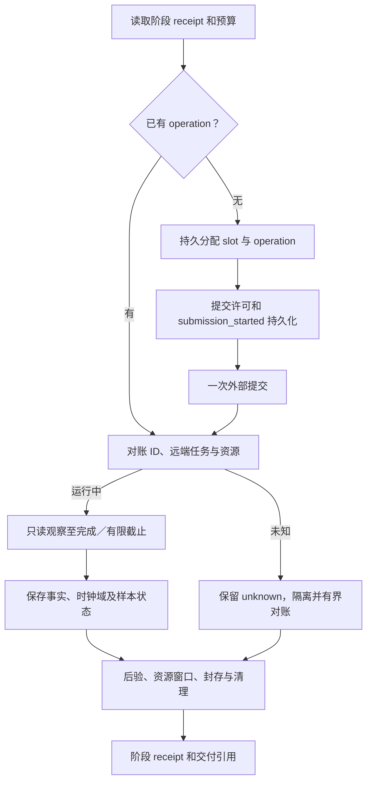
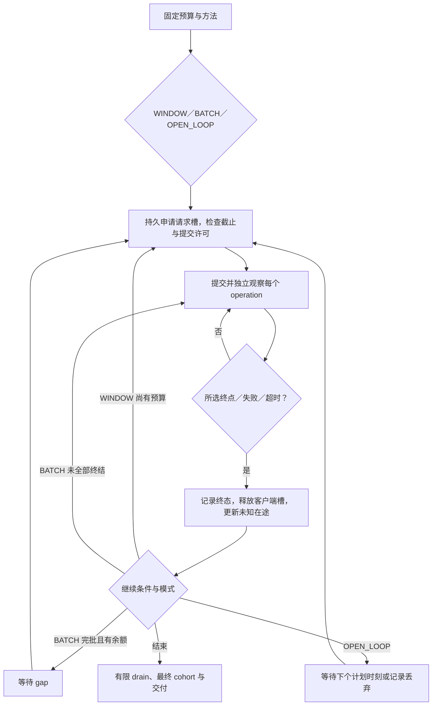

# 沙箱测试执行代码设计

## Context

本文把 [场景节点合同](test-nodes.md) 落实到代码模块和可执行协议，作为 [主设计](design.md) 的附件。覆盖十类基础场景、六类低优先级扩展的执行器、三产品适配、资源采集和指标计算；对应代码的验证设计见 [benchmark-contract-design.md](benchmark-contract-design.md)。所有新能力初始为 planned，源码入口存在不代表已适配或已实测。

现状：`sandbox_bench/` 有 transport/adapters/measure/density/observe 草稿；无 runner，既有 `tests/test_runner.py` 引用缺失模块。`create_sync` 强制 exec 完成，与当前状态完成合同冲突；observe 只有宿主统计，没有组件 PSS。复用需逐函数验证，不整体继承旧行为。旧 `align-sandbox-benchmarks` 的执行任务不再作为实施入口，统一由本 change tasks 管理。

## Goals / Non-Goals

**Goals:** 让工程师能够按方法 ID 实现测量循环、适配和独立 oracle 测试；保证不同产品使用相同方法而非仅同名指标；原始失败和不完整证据可恢复、可审查。

**Non-Goals:** 不预设用户的真实规格、并发、窗口、SLO 和 Guest OS 扣除边界；不给不可观测内部阶段造时间；不把受控服务验证称为真实产品测试。环境安装由环境阶段负责，测试器消费经核验环境报告，不在测量中静默修改系统配置。

## Decisions

### BCD-01 模块和接入边界

采用现有 Python 包 `sandbox_bench`，逐步替换草稿。每种方法只实现一套通用算法，产品差异由 Adapter 实现；不复制三套压测脚本。相比直接调用官方脚本，统一实现可控制所有权、计时和证据，官方公式／协议保留为有版本的兼容方法。

| 模块（拟定） | 接口／职责 | 所属工作节点 |
|---|---|---|
| contracts.py | CaseContract、CompletionContract、ResourceContract、EvidenceEnvelope 的严格解析与 hash | N00/T2 |
| registry.py | 方法、产品 profile、能力／适配状态和源码证据版本 | R1/T0/T2 |
| source_resolution.py | resolve_source／method_for_source／source_from_resolution：按产物 kind、启动路径与成本范围路由方法身份 | N00/N05（B00–B02） |
| runner.py | BenchSession.apply_step(step_id,input_hash)、reconcile、cancel、collect；CLI 单次任务入口 | N01–N10 |
| journal.py | request_slot、子 operation、阶段 receipt、资源所有权、序列化持久事件 | N01/N05/N07/N09 |
| transport.py / protocols/ | 有界 HTTP／流，首头、完整 body、首数据、终态事件；envd codec | N03/N05 |
| adapters/{base,cubesandbox,kuasar,agentenv}.py | 产品生命周期、build、状态、分页、规格、placement、资源发现 | N02/N03/N05/N06 |
| completion.py / logs.py | 只读状态观察／服务端事件解析、关联、deadline、完成分类 | N05 |
| fixtures.py / guest_probe.py | 源产物、内容／内存标记、真实触页、冷态声明、首次命令资格 | N02/N03/N06 |
| load.py | 闭环滑窗、分批、开环、预算、在途及补槽轨迹 | N05 |
| scenarios_build.py（迁移目标 scenarios/{build,...}.py） | B/E 方法阶段机；动作、断言、资源和恢复。迁移前保持扁平模块，不建 `scenarios/` 包 | N05/N06 |
| observe/{inventory,procfs,cgroup,sampler,cohort,steady}.py | 动态角色组件映射，PSS／CPU／辅助指标，窗口和覆盖 | N04–N06 |
| metrics/{latency,throughput,resources,capacity,quality}.py | 同一纯计算库供局部和全局复算，MetricValue 带来源 | N08/T8/A3 |
| evidence.py / cleanup.py | 原子封存、完整性、所有权清理、迟到资源 | N07/N09/N10 |

包路径迁移时不同时保留同名 `adapters.py` 与 `adapters/` 或 `observe.py` 与 `observe/`。兼容入口显式转发并测试，无法保持旧语义则清楚升级版本。各脚本入口使用固定模块＋结构化合同文件，不接收模型临时拼接任意命令。

N04 的采样 session 跨 N05/N06 存活；N07 才停止。BenchSession 是持久 runner 管理的 session，并非节点函数退出即销毁的线程。图仍负责各节点状态与 agent 责任；session 仅持有执行上下文和受限操作权限。首次本地实现可用持久作业进程，正式并发入口接 D11 RunnerGateway；所有创建／取消／清理均经过同一 operation 账本和 D14 提交许可，不能另建无 fencing 的生产调度器。

runner 的测量子操作以 `(work_id, stage, request_index, child_index, generation)` 分配稳定身份。journal 适配正式业务仓储；离线测试可用隔离文件账本，不能以此替代 PostgreSQL 并发验收。数据库不可用停止新副作用；采集可在有限本地 spool 内继续，恢复上传按序列去重，满额标采集不完整并按合同停止。已运行操作按原有限 deadline 对账。

### BCD-02 合同、事件和存储

CaseContract 必含：method/version、product/backend/source_sha、runtime_version、work/plan/graph_ref、环境快照、规格单位与来源 digest、placement、初始 N、有限请求／时间预算、C 或 λ、warmup、TTL／续期、completion、validation、cache_profile、sampling、cleanup、授权及运行上限。不同方法有 discriminated 子 schema；bool 不能充整数，拒绝 NaN/Inf、负周期、未知字段；资源单位规范到 bytes／cores／seconds，保留输入单位。

未确定的值是 MissingContract，不随意填默认规模。性能阈值可不提供并输出 not_evaluated；需要阈值的 SLO_VERIFY 则缺项阻塞。Guest 净值合同缺失仅使净值不可用，原始 PSS 继续采集。

原始事件 JSONL，清单及摘要 JSON，未来列存只能是派生优化。记录 `event_id, seq, work_id, operation_id, parent_operation_id, request_index, stage, event_kind, clock_domain, process_epoch, monotonic_ns?, wall_ns?, source_event_time?, observed_at, payload_ref, validity`。大 stdout 和日志存外部 blob，令牌仅凭据引用。单一 operation 完成事件按语义键去重，冲突重复拒绝而非取最后值。

MetricValue 为 `{name,value|null,unit,status,reason,scope,window,cohort_ref,sample_count,formula_version,evidence_refs}`。状态区分 valid/invalid/insufficient/unavailable/not_applicable；0 仅有完整观察证明时写入。工作层 execution/function/data/performance/cleanup 仍分列。

### BCD-03 持久提交与恢复



请求预算以持久 slot 分配消耗，区分 allocated、sent、accepted、completed，发送前失败记录 unsent；分配后崩溃不无条件退回额度。只有证明尚未提交，才能继续同一 slot 的首次提交。写入 submission_started 后结果丢失则 unknown，禁止盲目再 POST；若服务支持已验证的幂等键，只能同键同输入重放。查询／日志读取不消耗创建额度，但计观测流量。

单调时间不得跨 runner process_epoch 相减。进程恢复能接管事实、后验和清理，不能补造原始时延；断续负载标 interrupted。新完整性能重复使用新 repeat/generation；不重置旧预算。客户端 timeout 释放客户端槽但不证明服务端操作停止，另有 unresolved_external 上限；达到上限停止新增提交并对账，避免无限积累隐形在途。

### BCD-04 完成观察与三候选适配

Adapter 接口：`capabilities(profile)`, `prepare_source`, `submit(action, request, operation)`, `inspect(handle)`, `list_owned(cursor)`, `observe_resource_inventory`, `effective_spec`, `execute_stream`, `reconcile`, `cancel`, `delete_owned`。返回 ProductObservation 含 raw_ref、状态映射版本、身份、只读性和 evidence_strength；不能用默认 running 填补未知状态。

CompletionObserver 消费 API_COMPLETE / STATE_READY / SERVER_TERMINAL / EXEC_COMPLETE 四种合同。API 成功是接纳；STATE_READY 使用同一种轮询节奏及同一客户端单调时钟，首次成功观察记录后不可改；SERVER_TERMINAL 内部 duration 与采集器观察时刻分开；EXEC_COMPLETE 真正执行完断言才释放槽。状态方法的后验通常在测量批次后，流式后验标干扰。超时／失败不进入成功时延分布，迟到完成单列。

| 适配 | 已核验接口和特别处理 | 拟定契约验收 |
|---|---|---|
| CubeSandbox | POST /sandboxes；GET detail 的 state；create.clientID 不是目标 node，detail/list 的 host 映射另验。模板 build cpu 是 millicores，memory MiB。实例 list 的 nextToken 未接入，不能假分页；单节点归属＋已知 ID 对账。 | 单位、状态 unknown、缺完整列表、错误 placement、部分 fork、清理共享源均拒绝伪成功 |
| Kuasar | create 201 后仍 starting；GET detail 至 running；资源使用 metadata JSON 字符串或规定 header，detail 全局默认不作实例生效证据。pause(memory)/connect/export，keepSource 显式。 | 日志及状态双证据不混时钟；超时不重复创建；runtime 有效规格证据缺失阻止同规格结论 |
| AgentENV | 模板继承规格；镜像 /sandboxes-cold；resume/connect；fork 数组；snapshot capture+publish。list 从 X-Next-Token 翻页，metadata 双层编码；TTL/续期显式。 | 返回 ready 仍保留客户端统一观察；配置额度不作实测；数据面 codec 先握手验证，未知 codec 不假成功 |

每种 adapter 的 read-only inspect 不得走可自动恢复的 connect 或数据面。能力状态与适配实现状态独立；未知版本 fail-closed 到该 profile，不宣称产品永远不支持。实际定位管理进程、runtime、cgroup、挂载、netns 的规则来自环境报告及版本化受控探测；仅按进程名匹配不够，须关联节点、boot、sandbox generation 和实际 runtime metadata。

Kuasar 日志 parser 匹配 `sandbox launch terminal`、sid、产品 run_id、kind=create/resume、profile、result 与 starting_total_duration，原记录和 parser 版本保存；失败、重复、关联歧义、无 AcceptedAt 起点证据均不产生有效内部成功值。Cube/AgentENV 不编造等价内部字段。

### BCD-05 镜像构建的补充源码证据

本轮补查发现 Kuasar 已有可用于 B02.FULL 的公共 builder 路径，早期“完整准备入口未确认”不再作为源码缺口：

- [builder.image.sh](https://github.com/kuasar-sandbox/orchestrator/blob/c14da165ecc14de0e5c0afbfba2e1b737d64ee7c/test/e2e/cases/builder.image.sh)：注册后 POST `/v2/templates/{tid}/builds/{bid}`，fromImage；ready 取得 e2b-img，再创建并等 running。
- [builder_client.sh](https://github.com/kuasar-sandbox/orchestrator/blob/c14da165ecc14de0e5c0afbfba2e1b737d64ee7c/test/e2e/lib/builder_client.sh)：POST `/v3/templates` 返回 templateID/buildID；GET `/templates/{tid}/builds/{bid}/status`，building/ready/error；ready 的 templateID 是持久产物身份，不是注册阶段临时 ID。
- [API](https://github.com/kuasar-sandbox/orchestrator/blob/c14da165ecc14de0e5c0afbfba2e1b737d64ee7c/internal/api/api.go)：registerTemplate / buildStatus；[build_action.go](https://github.com/kuasar-sandbox/orchestrator/blob/c14da165ecc14de0e5c0afbfba2e1b737d64ee7c/internal/api/build_action.go)：取消及删除。

执行设计：注册→触发 fromImage 固定 digest→等待 ready→核验 kind=img 和规范 portable ID→创建→所选终点。builder 资源与最终 sandbox 规格分别记录。计时从注册前开始；内部 pull/flatten 无独立证据则只输出可观测总段。同一 builder 证据也是 B00.TEMPLATE_BUILD 的基础：构建阶段可单列为独立场景，构建成本只计一次，不计入 B01/B02 创建时延。原仓库 fixture 建网络／systemd／builder pool 的脚本不直接运行在用户环境；这些是环境准备，不在统一脚本中照抄。实际部署未启用 builder 或版本不符时 blocked。此证据是本地源码审计，尚未跑通目标环境。

### BCD-06 发压引擎

`LoadEngine.run(schedule, operation_factory, observer, journal)` 输出逐请求事件与压力轨迹，不调用模型。C 是未达到所选终点且未被客户端终结的工作槽位，普通操作每请求一个；clone 的 C 按 child，父HTTP请求另记 parent_request_budget。原生 fork 一次产生 K 个 child，提交前原子预留 K 个 child 槽及 child_budget 和一个父请求名额。K>C或余额<K直接合同错误，不静默拆分；容量暂不足等待。部分失败逐child释放槽，响应丢失时K个槽记录为未知占用，按有限deadline终结客户端槽但保留K个外部未知额度，禁止再fork补成功。另跟踪服务器未知在途和实际存量 N。

- WINDOW：初始分配 min(C,Q)；任意请求完成／失败／截止即归还槽，预算允许立即补下一个；201 不提前归还状态完成槽。记录 refill_gap、active_slots 和 generator_lag。不是 asyncio.gather 一整批后再补。
- BATCH：每批最多 B 个，内部不超过 C；全部终结后等待 gap，再下一批。最后不足 B 只发余额，最后一批无 gap。B>C 明确批内限流；不能失败后补成 B 个成功。
- OPEN_LOOP：预生成有限 scheduled_at 序列（固定周期或指定 seed 的到达分布）；明确 max_inflight、max_queue、late_policy=drop 或有限 queue。记录 scheduled→actual 延迟、drop 数和服务耗时，不在压力超限时无限追赶或静默改闭环。
- 停止：全局 deadline、预算、已授权资源止损或 unknown 上限；停止新发压后有界 drain、seal、cleanup。生成器自身 CPU／队列和观测开销单列；未达到目标速率不得归因于产品。



### BCD-07 B01–B08 方法实现矩阵

所有方法共用 N00–N10，不将请求变成图节点。表中“后验”除明确属于完成合同外不加回主时延；方法错误保留原始值及独立断言，不删样本。

| 方法 | 执行代码与测量边界 | 关键断言／重入 |
|---|---|---|
| B00.TEMPLATE_BUILD / SNAPSHOT_BUILD | build.py：提交构建／捕获 job→轮询状态→ready/error 终点；产物身份持久化 | job ID 持久对账；产物 kind 与 digest 入账；与 B02.FULL 准备阶段、B08 捕获边界不重复计税 |
| B01.TEMPLATE / SNAPSHOT.DISK / SNAPSHOT.MEMORY | create.py：验证 artifact_kind/digest/spec；submit→selected completion；按产物 kind 与启动路径拆方法 | 新 ID；来源内存／文件继承按合同；`artifact_kind` 与 launch path 入账；已取得 ID 只观察，不再次 create |
| B02.FULL / PREPARED | create.py：FULL 含各候选构建／转换／发布，PREPARED 验现成产物后起表；共享构建 K 子实例另 profile | build ID 持久对账；冷态无证明标 unknown；独立完整作业与共享成本不混算 |
| B03.PAUSE | lifecycle.py：写状态标记→pause→只读 paused；另测停止／释放；后验恢复 | 内存／磁盘／freeze 分组；网络无响应不等暂停；已 paused 不重测近零 pause |
| B04.MEMORY / DISK | lifecycle.py：已暂停 fixture→resume→selected completion→FIRST_WORK | 同实例；内存 token 保留且不能靠磁盘重建，文件 hash；磁盘路径允许重启但不声称内存连续 |
| B05.FULL / PREPARED / NATIVE | clone.py：父操作与 child operation 分层，capture/publish/fanout 分段；FULL 源继续运行合同包含恢复成本 | child 新身份及隔离写入；源/兄弟原值不变；201 中每项单判；部分失败不重放整个 fork |
| B06.RUNNING / PAUSED | lifecycle.py：DELETE→完整 API→逻辑不存在→逐拥有资源释放 | 鉴权错误不当404；共享模板引用不误删；再次删除只属对账，不补首次时延 |
| B07.FIRST / STEADY / OUTPUT / ERROR | command.py：固定 cmd/args/env/cwd/user/PTY/connection；流式 start、首字节、end及关闭 | FIRST 用未执行过验证命令的 fixture；bytes/hash/exit 全验；非零预期单列；超时查远端进程 |
| B08.LOCAL / PUBLISHED | snapshot.py：实际触页＋文件标记→capture→必要 publish→后验独立 restore | 本地／远端就绪分开；源状态副作用记录；逻辑与新增物理大小分列，无证据不推算 |

guest_probe 是固定、版本化的受控程序：生成随机 nonce 仅驻留进程内存，磁盘写另一独立标记，按 seed 实际写触每页，记录已触页 bytes；恢复后挑战读取原 nonce，避免新进程从文件回显伪连续。进程 token／内存检查所需 fixture 可在模板中准备，B07.FIRST 不通过执行预检提前污染实例。异常清理依据本次任务标签和进程启动身份，不用任意 pkill。

### BCD-08 B09/B10 算法与数字合同

B09.PLATFORM：运行服务、零测试实例基线；IDLE/PAUSED：基线后准备固定 cohort，等待已声明稳态，采样。净 Guest OS 扣除是一独立可选结果，缺 Q12 不阻止原始 PSS。暂停进程正常卸载只有生命周期与宿主对账证明才记零。

B10 方法均采创建事件、角色组件 PSS、CPU 秒／采样峰值与最终 cohort：

1. **GROWTH_LIST**：保持官方批次 API 完成→规定 gap→完整列表计数→净增长判停顺序；`gained_i=listed_i-listed_(i-1)`，连续低于 min_growth 达 stall_limit 停。新增成功与旧实例损失另算。原 Cube `created_any` 来自曾有 listed 存量，统一健康证据另列；草稿 ever_ready 不得替代原条件。域改为 owned、预算预先限制或插入健康等待都记录 compatibility_deviations。达到硬预算标 lower_bound；列表不完整 invalid，不拿截断当平台峰值。
2. **GROWTH_READY**：以本批独有新 ID 达健康合同数判停，旧 cohort 复验；不同轨迹独立实验，不能仅从一轮 GROWTH_LIST 日志改名得到该方法结果。
3. **PROJECTION**：固定 N，零实例服务基线 A0 与指定窗口 Amin 均来自同宿主 MemAvailable。兼容视图先各次读取截断到整数 MiB，再按原 awk `printf %.1f` 的锁定参考行为计算 d=(A0−Amin)/Nrequested；d>0.5 时 floor(Amin/d)。reference awk 版本／locale 固定，舍入边界用黄金数据，不直接假设 Python round 等价。统一视图用未舍入 bytes、全部目标达到健康的 N、cost=(A0−Amin)/N，total=floor((A0−R)/cost)，additional=max(0,total−N)；N>0、cost>0、A0>R。total<N 标模型／预算冲突，不包装有效容量。过渡／稳态 Amin 分列，预测与实测不同。
4. **SLO_VERIFY**：固定 N、已定义 SLO 及有限窗口，输出验证结果，不自动搜索最大容量。无新建的运行创建吞吐为 N/A；前置创建曲线标 preparation。
5. **FIXED_REQUESTS.WINDOW/BATCH**：每档 C 使用相同 Q，分别独立 fixture/cache；成功实例保留到最终 cohort。总请求、API成功、累计达终点、最终存活、健康与未知分别输出；不是最大容量。

所有方法保存真实实例集合，不只存数量；最终直接 PSS 均值只用相同覆盖集合。共享控制面按整个服务范围摊销一次。增长过程失败残留成本保留，不能只挑成功进程。

### BCD-09 资源采集与稳态实现

inventory 用 `(environment,node,boot_id,pid,start_ticks)` 或 cgroup generation 标识，记录 parent/role/component/sandbox/runtime-generation。同进程多角色标签可保留，但数值只加一次；线程不重复计地址空间。采集前后核验进程身份，读失败保存 reason 与时间区间。

PSS 读 smaps_rollup；需要映射归属再读 smaps，权限不足不退回 RSS 冒充 PSS。CPU 读 utime/stime 及本机 CLK_TCK，或声明去重范围的 cgroup usage/user/system，二者不重复相加；新 PID、计数回退、退出丢尾值分段并标覆盖。Linux 的 PSS／进程计数定义参考 [proc 官方文档](https://docs.kernel.org/filesystems/proc.html)，cgroup CPU 使用微秒口径参考 [cgroup v2 官方文档](https://docs.kernel.org/admin-guide/cgroup-v2.html)。

计算：cpu_seconds=Δcounter；cores=Δseconds/Δt；percent_one_core=100×cores，宿主归一化另列。采样峰值是各区间最大 cores；总体峰值先对齐后求和再取最大。不可证明时钟同步的节点不能生成“同时总峰值”，仅各域报告；有误差上界时记录对齐容差，缺失域不补零。

稳态算法显式配置 `window_s,min_samples,max_gap_s,cohort_stability,metric_bounds/slope_bounds,max_wait_s`。采用按时间顺序第一个满足全部规则的窗口，不能事后挑最好片段。PSS 时间均值按约定的分段常值积分；样本覆盖到下一点，超过 max_gap 不外推。CPU 区间按实际 Δt 加权。窗口内 cohort 变化则切段／重判稳，缺覆盖不能用完整 N 除部分资源。采样器自身开销、poll 流量、TTL 续期和丢样均单列。

GuestDeductionProof 输入精确定义的减项、同域映射、窗口、覆盖、方法和版本；`net_pss=raw_pss−guest_component_pss` 仅在同域且 0≤deduction≤raw 时定义，负值报矛盾不裁零。当前三产品均不预置减项估计常数。

### BCD-10 统计、吞吐及交付

逐请求成功时延分位数使用有版本的线性插值位置 `(n−1)q`，保存 n、repeat 和失败数；n=0 为 N/A，不用超时截止值补成功样本。批次 wall/N 是 amortized，不是逐请求延迟；多组 P99 不求平均当总 P99，需原样本同组重算。

创建吞吐：固定 observation 时钟域的一秒桶，内部边界采用半开 `[t0+k,t0+k+1)`。window_kind=fixed_deadline 时窗口整体为 `[t0,t_end)`，恰好截止事件归外部单列；window_kind=natural_drain 时 t_end 是最后终结事件，整轮包含该事件，最后一个非零时长桶右端闭合（整秒结束也归前一桶），不人为添加epsilon。两者必须带window_kind，零时长无法计算速率。分子是唯一 operation 的所选完成事件，重试／重复采集不加数；内部日志 duration 不造客户端完成时刻。记录桶长、coverage、count、rate；完整空桶=0，缺失桶=null。`overall=count_in_window/(t_end−t0)` 包含 batch gap；active 视图仅按实际发压／drain 区间并集计算，分子也限定同一并集，不把所有成功除任意缩短时间。迟到、最终存活分别计。

resource summary 按 test-nodes 2.4 的直接、平台摊销、增量、每窗口 CPU 秒／每沙箱核占用输出。原始数据和 formula_version 允许离线复算；N08 与 A3 调同一计算库，但验证测试的 oracle 不得调用它生成预期值。

交付目录含 case_manifest、operations/events、resource_series/cohorts、assertions、summary、cleanup_ledger、raw_refs。写临时文件→flush/校验→不可变 manifest→业务账本引用。F/A 的 Excel 服务消费此结构，模型只拿指标引用和异常摘要。

### BCD-11 低优先级扩展的可执行骨架

E01 固定工作量／seed／输入输出 hash；E02 baseline→变更→reset→内容验证；E03 有限合法生命周期序列、周期审计、分段；E04 压力阶梯→任务→撤压→恢复；E05 成对基线／干扰窗口→撤干扰；E06 已登记故障注入→观察→恢复→工作验证。实现共同 `ExtensionProfile`、step action registry、finite budget 和补偿栈，不能接受任意临时注入命令。

具体 profile 未获选择或缺产品适配时明确 not_selected/blocked，不默认运行。实现单元／受控合同和目录覆盖属于本轮代码任务；扩展真实负载及故障实验须有具体合同，不能为了“全覆盖”自行施加。清理／撤压步骤无论哪一步失败均可按持久记录恢复。

### BCD-12 来源产物语义与构建场景的可执行规格

来源身份 = `artifact_kind × launch_path × producer_step`，配合 `cost_scope` 决定 method_id。禁止按接口参数名称推断。具体脚本接口、文件骨架与路由见本节；独立测试见 [benchmark-contract-design.md](benchmark-contract-design.md) BCT-09。

#### 12.1 数据合同（`sandbox_bench/contracts.py`）

| 类型 | 取值 | 说明 |
|---|---|---|
| `SourceArtifactKind` | `image_artifact` / `sandbox_artifact` / `snapshot_manifest` | 来源产物实际形态 |
| `LaunchPath` | `cold_boot` / `memory_restore` / `disk_restore` | 解析出的启动路径 |
| `ProducerStep` | `pre_existing` / `build_job` / `capture_publish` | 产物生产步骤 |
| `CostScope` | `build_included` / `prepared` | 构建成本是否计入本次用例 |

`Source` 扩展（向后兼容，新增字段全部可选）：`artifact_kind`、`launch_path`、`producer_step`、`producer_ref`、`resolution_ref`。`CaseContract.validate_method` 追加：`method_id` 以 `B01.`／`B00.` 开头时前三个字段必填；`B01.SNAPSHOT.MEMORY` 只接受 `memory_restore`；`B01.SNAPSHOT.DISK` 只接受 `disk_restore`／`cold_boot`；`B01.TEMPLATE` 不接受 `snapshot_manifest`。

新增 `SourceResolution`（`schema_version='source.v2'`）：`product`、`product_version`、`parameter_name`、`declared_kind`、`artifact_kind`、`launch_path`、`producer_step`、`artifact_id`、`artifact_digest`、`producer_ref`、`spec_origin ∈ {request,inherited}`、`path_evidence`、`resolution_status ∈ {resolved,unverified}`。`unverified` 时 kind／path 允许为空，且下游不得当作已知。

#### 12.2 method 路由表（`source_resolution.method_for_source`）

| artifact_kind | launch_path | producer_step | cost_scope | method_id |
|---|---|---|---|---|
| image_artifact | cold_boot | build_job | build_included | B02.FULL |
| image_artifact | cold_boot | pre_existing | prepared | B02.PREPARED |
| sandbox_artifact | cold_boot | pre_existing | prepared | B01.TEMPLATE |
| snapshot_manifest | cold_boot | any | prepared | B01.SNAPSHOT.DISK |
| snapshot_manifest | disk_restore | any | prepared | B01.SNAPSHOT.DISK |
| snapshot_manifest | memory_restore | any | prepared | B01.SNAPSHOT.MEMORY |
| any | any | build_job／capture_publish（仅测构建） | 仅构建 | B00.TEMPLATE_BUILD／B00.SNAPSHOT_BUILD |

- `image_artifact + cold_boot + pre_existing + prepared` 在“模板族”用例下映射 `B01.TEMPLATE`，在“镜像族”用例下映射 `B02.PREPARED`；用例须在 `contract_ref` 声明族别，不得跨族合并。
- 未覆盖组合 → `ScenarioBlocked('unresolved_source_identity')`，不猜。
- `B00.SNAPSHOT_BUILD` 只承接产出 `snapshot_manifest` 的构建／捕获；从运行实例捕获另由 B08 承接，二者不互相顶替。

#### 12.3 文件骨架

```
sandbox_bench/
├─ contracts.py         # 改：Source 扩展、SourceResolution、枚举、条件校验
├─ registry.py          # 改：METHODS += B00.*、B01.SNAPSHOT.DISK/MEMORY
├─ source_resolution.py # 新：resolve_source / method_for_source / source_from_resolution
├─ scenarios_build.py   # 新：BuildScenario（B00 阶段机）
├─ adapters.py          # 改：Adapter.resolve_source（只读）、Adapter.build_source（B00 阶段机）
└─ scenarios.py         # 改：dispatch 增 B00.*，B01/B02 走 source_resolution 路由
```

放置约束（已核对现有代码）：

- `sandbox_bench/scenarios.py` 是**模块**（非包），被 `from sandbox_bench.scenarios import ScenarioExecutor` 引用；本组**不建 `scenarios/` 包、不改名**，新增逻辑放扁平模块 `scenarios_build.py`，`scenarios.py` 只做转发。包化属 BCD-01 的后续迁移，不在组 27。
- `sandbox_bench/adapters.py` 是现有模块；本组只改它，`adapters/{base,...}` 包化同样不在组 27。
- `source_resolution.py`、`scenarios_build.py` 当前不存在，无同名冲突；`B00` 在 `sandbox_bench/registry.py` 与 `sandbox_graph/catalog/registry.py` 均未出现，可直接新增。

#### 12.4 脚本接口（精确签名）

```python
# source_resolution.py
@dataclass(frozen=True)
class Resolution:
    artifact_kind: str; launch_path: str; producer_step: str
    artifact_id: str; artifact_digest: str | None
    producer_ref: str | None; spec_origin: str
    path_evidence: str; status: str            # 'resolved' | 'unverified'

def resolve_source(*, product: str, product_version: str,
                   parameter_name: str, declared_kind: str,
                   source_id: str, digest: str | None,
                   probe: Callable[[str], dict] | None,
                   evidence_ref: str) -> Resolution: ...

def method_for_source(res: Resolution, *, cost_scope: str,
                      measuring_build: bool = False,
                      family: str | None = None) -> str: ...

def source_from_resolution(res: Resolution, method_id: str) -> Source: ...
```

```python
# adapters.py（基类 + 三产品覆写）
def resolve_source(self, declared_source: dict, timeout: float) -> dict:
    """只读。禁止触发 build/capture。无法确认时返回 'unverified'，不按名称推断。"""

def build_source(self, run_id: str, timeout: float, *, handle: dict | None = None,
                 on_progress: Callable[[dict], None] | None = None) -> dict:
    """B00 阶段机。返回 {artifact:{kind,id,digest,size_bytes}, build_elapsed_s,
    terminal, cache_state, resource_peak, unresolved_external, handle}。
    丢失写响应不重试：先持久 handle，再对账。"""
```

`build_source` 必须支持在途恢复：调用方先 `journal` 持久 `handle{registration_id,build_id,triggered}`，重启后用同一 handle 轮询 status，`triggered` 未确认前不得再次触发。

#### 12.5 阶段机与终点

```
intent → register(receipt) → trigger(receipt) → poll(building)* → terminal{ready|error}
```

- `ready`：产物身份（kind／id／digest）持久化后才返回成功；Kuasar builder 必须 `kind=='img'` 且 ID 具 `e2b-img-` 前缀，否则 `error`。
- `error`／未知状态／超时：返回 `terminal='error'` 或 `unresolved_external>0`，走停采→封存→清理。
- 每次 register／trigger 前先写 `phase=intent`，收到回执写 `phase=receipt`；两阶段回执是幂等对账依据。

#### 12.6 产物身份、成本一次性与复用

- 产物身份写入 `target_bindings.json`：`{artifact_kind, artifact_id, artifact_digest, producer_step, producer_ref, cache_state, size_bytes}`。
- 成本一次性：同一 `producer_ref` 被多用例复用时构建成本只在归属用例计一次；后续用例记 `reuse_of` 并标“共享构建后创建”，不重复计税、不静默隐藏。
- 边界：`B02.FULL` 镜像准备、`B08` 实例捕获、`B00.*` 三者成本归属由 `producer_step`＋`cost_scope` 唯一确定，同一动作不得在两个场景重复报告。

#### 12.7 CLI 与输出

```
sandbox-bench resolve --case <case.json> --output <resolution.json>
sandbox-bench build   --case <case.json> --output <build.json>
```

- 与现有子命令 `run|cleanup|verify|recompute|case` 一致，**新增 `resolve`／`build` 两个子命令，不引入 `--mode`**；入口沿用 `sandbox-bench = sandbox_bench.runner:main`。
- 退出码沿用 `runner.main` 现有约定，不新增：`0` 成功；`2` `blocked`／`incomplete`／`unverified`（含 `unresolved_external>0`）；`1` 异常（含环境错误与合同非法）。细分原因写入 JSON 的 `status`／`reason`。
- 新子命令不走 `validate_config` 的 `source.kind ∈ {template,snapshot,image}` 与 `scenario=='create'` 分支（那是 legacy `run` 的约束）；它们从 `CaseContract` 读来源并按 BCD-12 §12.2 路由。
- `resolve` 只输出 `SourceResolution`；`build` 输出构建证据（artifact、`build_elapsed_s`、`cache_state`、`resource_peak{pss_bytes,cpu_seconds}`、`terminal`、`unresolved_external`）。
- 两者均不得写入 fixture 推导的默认值；缺证据字段标 `unavailable`，不填零。

#### 12.8 失败与重入

| 情况 | 行为 |
|---|---|
| 写响应丢失（register／trigger） | 持久 handle；重启后按 handle 对账；`triggered` 未确认前禁止再次触发 |
| status 未知取值 | `terminal='error'`（或 `unverified`），停止新增副作用 |
| ready 但产物 kind／前缀不符 | `error`，不降级接受 |
| 截止／预算耗尽 | 停采→封存→清理→交付，标 `unresolved_external` |
| 产物已被其他用例复用 | 记 `reuse_of`，不再构建 |

所有分支无论成功失败都进入封存与清理；构建失败不掩盖既有成功测量。

#### 12.9 B00 背景沙箱密度（新增）

B00 构建场景**不需要并发构建请求密度**（无请求并发/到达率轴）；但 SHALL 支持**背景沙箱密度**条件（RT-41）：先创建 N 个背景沙箱，再在背景存在下构建。

- 阶段：`PREPARE_BACKGROUND(create N)` → `BUILD`（现有阶段机）→ `INCREMENTAL_RESOURCE`。
- 资源取**增量**：构建期峰值 − 背景基线；背景沙箱不计入产物分母。
- N 来自 `CaseContract.background.background_count`；背景准备失败或数量不足→`blocked`，不静默降级。
- 输出写入 `build['background']={requested,actual,incremental_resource}`。

#### 12.10 构建期指标填充

`build_source` 返回的 `resource_peak{pss_bytes,cpu_seconds}`、`artifact.size_bytes`、`cache_state` 必须由实际采集或产物元数据填充，不得恒为 `None`/`unknown`（BCP-15 的 B-03/B-04/B-05、A-01/A-02）。缺证据标 `unavailable`（或 `cache_state='unknown'`），不补零。

### BCD-13 创建端点拓扑与就绪信号的可执行规格

端点身份 = `topology × product × endpoint_kind`，配合 `completion` 与 `readiness_signal` 决定是否轮询及端点归属。禁止按接口名称推断同步／异步。审计依据见 [alignment.md §9](../../../docs/source-audit/alignment.md)；独立测试见 [benchmark-contract-design.md](benchmark-contract-design.md) BCT-10。

#### 13.1 数据合同（`sandbox_bench/contracts.py`）

| 类型 | 取值 | 说明 |
|---|---|---|
| `Topology` | `router` / `node_direct` / `co_located_cli` | 创建入口所在面 |
| `EndpointKind` | `api_complete` / `state_ready` / `server_terminal` / `exec_complete` / `guest_ready` | 完成端点 |
| `ReadinessSignal` | `none` / `poll_state` / `ready_fd` | 就绪观察方式 |

`CaseContract` 追加可选字段：`topology`、`endpoint_kind`、`readiness_signal`、`endpoint_ref`。校验：`topology=='co_located_cli'` 时 `readiness_signal` 必须为 `ready_fd` 且 `endpoint_kind=='guest_ready'`；`topology in {router,node_direct}` 时 `readiness_signal ∈ {none,poll_state}`，不得为 `ready_fd`。

#### 13.2 端点决策表

| topology | 产品 | 创建返回状态 | 同步? | readiness_signal | completion | 端点说明 |
|---|---|---|---|---|---|---|
| router | Kuasar | running | ✅ | none | api_complete（≈state_ready） | 同步到 running；不得重复计就绪 |
| node_direct | Kuasar | starting | ❌ | poll_state | api_complete + state_ready 分列 | 201 受理 vs 轮询 running |
| router／node_direct | Cube | ready（含 probe） | ✅ | none | api_complete | 同步 |
| router／node_direct | AgentENV | Running | ✅ | none | api_complete | `api_complete==state_ready` |
| co_located_cli | Kuasar | guest ready | — | ready_fd | guest_ready | 白盒，不可横比 |

- `router` 行仅在部署核验含管理面/ingress 角色后可用；否则 `ScenarioBlocked('management_plane_unavailable')`。
- 未覆盖组合 → `ScenarioBlocked('endpoint_unresolved')`，不猜。
- 同一用例不得同声明 `api_complete` 与 `state_ready` 为两个独立延迟指标，除非产品确为异步。

#### 13.3 文件骨架

```
sandbox_bench/
├─ contracts.py      # 改：Topology/EndpointKind/ReadinessSignal + CaseContract 校验
├─ endpoint.py       # 新：resolve_endpoint / endpoint_requires_poll / endpoint_comparable
├─ readiness.py      # 新：ready_fd 读取（control_ready→ready→EOF），同机 CLI 注入
├─ adapters.py       # 改：Adapter.probe_topology（只读）、同步语义声明
├─ measure.py        # 改：create_sync 按 endpoint_kind 决定是否轮询；guest_ready 单列
└─ runner.py         # 改：新增 endpoint 子命令（不引入 --mode）
```

放置约束：`endpoint.py`／`readiness.py` 当前不存在，无同名冲突；不改 `scenarios.py` 模块类型；`contracts.py`／`adapters.py`／`measure.py`／`runner.py` 均为现有模块，只改不建包。

#### 13.4 脚本接口（精确签名）

```python
# endpoint.py
def resolve_endpoint(*, product: str, product_version: str, topology: str,
                     probe: Callable[[], dict] | None,
                     evidence_ref: str) -> "EndpointResolution": ...

def endpoint_requires_poll(res) -> bool: ...
def endpoint_comparable(a, b) -> bool: ...   # 仅同 endpoint_kind 且均黑盒才可比

# readiness.py
def read_ready_fd(fd: int, timeout: float) -> "ReadinessObservation":
    """读 control_ready→ready→EOF；超时／协议错→unverified，不补零。"""
```

`EndpointResolution` 字段：`product`、`topology`、`endpoint_kind`、`readiness_signal`、`synchronous`、`management_plane_present`、`path_evidence`、`status ∈ {resolved,unverified,blocked}`。

#### 13.5 端点与就绪信号阶段机

```
declare_topology → verify_management_plane(仅 router) → select_endpoint
  → [poll_state]* (仅异步) / [read_ready_fd] (仅 co_located_cli) → terminal
```

- router 入口：`verify_management_plane` 失败 → `blocked`，不静默回退到 node_direct。
- async 入口：受理立即记 `api_complete_s`，随后轮询到 `running` 记 `state_ready_s`。
- `ready_fd` 入口：记 `guest_ready_s`，标注早于 `state_ready`。

#### 13.6 端点归属与可比较性

- 分子分母必须同端点：不得用 `api_complete` 样本算 `state_ready` 分位数。
- `guest_ready` 永不与 `state_ready` 并入同列；报告须标白盒与范围。
- 跨产品比较前须对齐 `endpoint_kind` 与是否同步；名称相同不得视为等价。

#### 13.7 CLI 与输出

```
sandbox-bench endpoint --case <case.json> --output <endpoint.json>
```

- 新增 `endpoint` 子命令，**不引入 `--mode`**；退出码沿用 `runner.main` 约定：`0` 成功；`2` `blocked`／`unverified`／`incomplete`；`1` 异常。
- 输出 `EndpointResolution` 与是否轮询；缺证据字段标 `unavailable`，不填零。

#### 13.8 失败与重入

| 情况 | 行为 |
|---|---|
| 声明 router 但核验无管理面角色 | `blocked`，建议改用 node_direct，不静默替换 |
| 异步入口轮询超时 | 保留 `api_complete`，`state_ready` 标 unknown，不补零 |
| ready-fd 协议错／超时 | 标 `unverified`，不影响既有黑盒测量 |
| 跨端点误合并 | `endpoint_comparable==False`，分析层拒绝并入同列 |

### BCD-14 测试间环境还原的可执行规格

测试间还原 = 只删除**本轮运行标记归属**的沙箱，小批量多轮，删除后核验残留；预热池／空闲／基线实例永不删除。审计依据见 [alignment.md §10](../../../docs/source-audit/alignment.md)；独立测试见 [benchmark-contract-design.md](benchmark-contract-design.md) BCT-11。

#### 14.1 归属与排除

- 归属判据：创建时写入 `metadata.run_id == run_id`（三产品均支持）。
- 列表过滤：Cube 原生 `metadata=run_id=<r>`；Kuasar 客户端过滤；AgentENV 客户端过滤＋分页（`Adapter.list_owned`）。
- 排除集：`baseline_ids`（测试前快照的同 run_id 预存在实例）；预热／空闲／他轮沙箱因不带本 run_id 自然不在列表。

#### 14.2 文件骨架与接口

```
sandbox_bench/
├─ restore.py   # 新：select_batch / restore_environment
└─ adapters.py  # 复用：Adapter.list_owned（按 run_id 归属）、Adapter.delete
```

```python
def select_batch(owned_ids, *, baseline_ids=(), batch_size=1) -> list[str]: ...
def restore_environment(adapter, *, run_id, batch_size, batch_gap_s, max_rounds, timeout,
                        deadline, baseline_ids=(), sleep=time.sleep, clock=time.monotonic) -> dict: ...
```

返回：`{run_id, deleted, rounds:[{round,attempted,deleted,failures,remaining_before}], residual_ids, status ∈ {complete,incomplete}}`。

#### 14.3 算法（小批量多轮 ＋ 残留）

```
for round in range(max_rounds):
    ids = list_owned(run_id) - baseline       # 只本轮归属
    if empty: break
    delete first batch_size ids (serial; 单个失败记 failure)
    sleep(batch_gap_s) if not past deadline
residuals = list_owned(run_id) - baseline     # 异步 settle 后重列
status = complete iff residuals empty else incomplete
```

#### 14.4 删除语义适配

- Kuasar：删除异步（`deleting`→`dead`），残留核验前轮询 settle；`GET /v2/sandboxes` 分页。
- Cube：删除同步；列表原生 metadata 过滤。
- AgentENV：删除阻塞到删完；列表分页。

#### 14.5 CLI

```
sandbox-bench restore --config <cfg> [--output <json>]
```

- 新增 `restore` 子命令（不引 `--mode`）；退出码沿用 `0`／`2`（`incomplete`）／`1`。
- 缺 `run_id`／`batch_size`／`max_rounds` → 合同错误。

#### 14.6 失败与重入

| 情况 | 行为 |
|---|---|
| 单次删除失败 | 记 `failures` 并计入残留；不当作已删 |
| 异步未 settle | 轮间／核验前等待；仍未消失→`incomplete` |
| 预算耗尽 | 停删→输出已有 `rounds`→残留标 `incomplete` |
| 预热／基线实例 | 永不删除；不因其存在判失败 |

### BCD-15 可选指标目录与逐场景适用矩阵

指标 ID 与目录见 [runtime-evaluation RT-44](specs/runtime-evaluation/spec.md)。下表为逐场景标定：**R=需测**、**O=可测（选定才采）**、**—=不适用**。未列出的指标一律按不适用处理；“可测但未选定”不阻塞交付，“需测缺失”则该结论不可报告为已验证。

#### 15.1 方法实现场景（B00–B08）

| 场景 | 需测 R | 可测 O | 不适用 — |
|---|---|---|---|
| B00.TEMPLATE_BUILD / SNAPSHOT_BUILD | B-01、B-04、B-06、R-01、R-02 | T-03、T-04、S-01–S-05、B-03、B-05、A-01、A-02；**B-02 仅在并发构建条件下** | T-01/T-02/T-05、H-01–H-05、C-01–C-05（除非背景密度条件） |
| B01.TEMPLATE / SNAPSHOT.DISK / SNAPSHOT.MEMORY | T-01、T-02、T-05、H-03、R-01–R-06 | T-03、H-01、H-02、S-01–S-07、A-05（SNAPSHOT 另加 A-01） | C-01–C-05、B-01–B-06 |
| B02.FULL / PREPARED | T-01、T-02、T-04、H-03、R-01–R-06、A-02 | T-03、T-05、B-01、B-04、S-01–S-07 | C-01–C-05 |
| B03.PAUSE | T-01、T-02、R-05 | H-03、S-01–S-05、A-03 | T-05、B-*、C-* |
| B04.MEMORY / DISK | T-01、T-02、T-05、R-05、R-06 | H-03、S-01–S-05、A-05 | B-*、C-* |
| B05.FULL / PREPARED / NATIVE | T-01、T-02、H-03、R-01–R-06 | S-01–S-07、A-03、A-04 | B-*、C-*（除非密度 clone） |
| B06.RUNNING / PAUSED | T-01、T-02、R-05、A-03、A-04 | H-03、S-01–S-05 | T-05、B-*、C-* |
| B07.FIRST / STEADY / OUTPUT / ERROR | T-01、T-02、R-06、R-02 | T-05、H-03、S-01–S-05 | B-*、C-* |
| B08.LOCAL / PUBLISHED | T-01、T-02、A-01、A-02、R-05、R-06 | T-04、S-01–S-05、A-04、A-05 | B-*、C-* |

#### 15.2 底噪与密度（B09–B10）与扩展（E01–E06）

| 场景 | 需测 R | 可测 O | 不适用 — |
|---|---|---|---|
| B09.PLATFORM / IDLE / PAUSED | S-04、S-05、S-06、R-05 | S-01–S-03、A-03、A-04、C-04 | T-*（除准备）、B-* |
| B10.*（GROWTH／PROJECTION／FIXED_REQUESTS／SLO） | C-01、C-02、C-03、H-05、S-04–S-06、R-01–R-05 | H-01–H-04、C-04、A-04、S-01–S-03、S-07 | B-*（除非构建来源） |
| E01.WORKLOAD | 按选定 profile：T-01/T-02、H-03、S-01–S-05 | R-01–R-06、S-06、S-07 | B-*、C-* |
| E02.RESET | R-05、A-05 | T-01、S-01–S-05 | B-*、C-* |
| E03.MIXED_SOAK | T-01/T-02、H-03、S-01–S-05、C-05 | R-01–R-06、C-01–C-04 | B-* |
| E04.PRESSURE | S-01–S-05、C-01–C-03 | T-*、H-*、R-* | B-* |
| E05.INTERFERENCE | S-01–S-05、T-01/T-02、H-03 | R-*、C-* | B-* |
| E06.RECOVERY | R-01–R-06、T-01/T-02 | H-03、S-01–S-05、A-04 | B-*、C-*（除稳定性） |

#### 15.3 背景密度条件（新）

B00 构建场景**不需要并发构建请求密度**（无 B-02 为必需）。但 SHALL 支持**背景沙箱密度**作为条件：先创建 N 个背景沙箱，再在背景存在下执行构建：

- 需测：B-01、B-04、B-06，以及**增量** S-06（total − background baseline）与背景下的 S-03/S-05。
- 可测：B-05、S-01/S-02/S-04、A-02。
- 该条件轴复用 DensityController 的 cohort/baseline（RT-15/RT-20/RT-31），当前**未建模**（待补：合同字段＋规格＋详设＋TDD）。

### BCD-16 可调背景条件目录与逐场景适用矩阵

条件 ID 与取值见 [runtime-evaluation RT-45](specs/runtime-evaluation/spec.md)。下表逐场景标定：**R=需声明**、**O=可选**、**—=不适用**。同一维度未选不得静默放宽；实际生效值另存（SP-03）。

#### 16.1 方法实现场景（B00–B08）

| 场景 | 需声明 R | 可选 O | 不适用 — |
|---|---|---|---|
| B00.TEMPLATE_BUILD / SNAPSHOT_BUILD | **N-03 背景沙箱密度**、W-02 缓存冷热、SP-01 规格、D-01 产物大小、D-04 来源 kind | D-02/D-03、W-01、TL-01/TL-02、EP-01 | C-01–C-05（无并发构建）、L-01/L-02、N-01/N-02/N-04 |
| B01.TEMPLATE / SNAPSHOT.DISK/MEMORY | N-01 存量、C-01 并发或 C-02 到达率、SP-01、D-04、W-02、EP-01/EP-02 | C-03/C-04/C-05、SP-02/SP-03、W-01、TL-01–T04、DEP-01、N-04 | L-01/L-02、N-02/N-03（除背景） |
| B02.FULL / PREPARED | N-01、C-01/C-02、SP-01、D-01/D-04、W-02、EP-01 | D-02/D-03、TL-*、N-04 | L-01/L-02 |
| B03.PAUSE | N-01、N-04 状态、SP-01、D-02 | C-01、TL-01/TL-03 | C-02/C-03、W-*、L-* |
| B04.MEMORY / DISK | N-01、N-04、SP-01、D-02、D-03、EP-02 | W-02、TL-01 | C-02/C-03/C-04、L-* |
| B05.FULL / PREPARED / NATIVE | N-01、C-01、C-05、SP-01、D-02/D-03 | C-03/C-04、TL、W-02 | C-02、L-* |
| B06.RUNNING / PAUSED | N-01、N-04、SP-01 | C-01、TL-01 | C-02/C-03、W-*、L-* |
| B07.FIRST / STEADY / OUTPUT / ERROR | N-01、SP-01、L-01 负载、EP-02 | C-01、TL、W-02 | C-02/C-03/C-04、D-* |
| B08.LOCAL / PUBLISHED | N-01、SP-01、D-02、D-03、W-02 | TL、C-01、DEP-01 | C-02/C-03、L-* |

#### 16.2 底噪与密度（B09–B10）与扩展（E01–E06）

| 场景 | 需声明 R | 可选 O | 不适用 — |
|---|---|---|---|
| B09.PLATFORM / IDLE / PAUSED | N-01 cohort、N-04、SP-01、DEP-01 角色、TL-01 | W-02、TL-02、L-01 | C-02/C-03/C-04 |
| B10.*（GROWTH／PROJECTION／FIXED_REQUESTS／SLO） | N-01/N-02、C-01、C-03、C-05、SP-01、TL-01/TL-03、DEP-01 | C-02/C-04、N-03/N-04、W-01/W-02、TL-02/TL-04、L-01 | L-02（除干扰场景） |
| E01.WORKLOAD | L-01、SP-01、N-01 | C-01、TL-01、W-02 | C-02/C-03 |
| E02.RESET | D-02/D-03、SP-01、N-01 | TL-01 | C-* |
| E03.MIXED_SOAK | N-01/N-02、TL-01、SP-01 | C-01、L-01、TL-02 | C-02/C-03 |
| E04.PRESSURE | C-01、N-02、SP-01 | C-02/C-03/C-04、TL | L-01（除干扰） |
| E05.INTERFERENCE | L-02、N-01、SP-01 | C-01、TL | C-02/C-03 |
| E06.RECOVERY | L-01、TL-01、SP-01、N-01 | C-01、TL-02 | C-02/C-03 |

#### 16.3 交互与依赖

- **N-01/N-02/N-03**：分别为测试前存量、目标密度与操作时背景存量；密度方法（B10）用 N-01/N-02，构建（B00）用 N-03，与 RT-15/RT-31 的 cohort/baseline 一致。
- **预热池 W-01**：Kuasar 为 runner 单元厚度、Cube 为 TAP/cgroup 池、AgentENV 为设备池（审计 alignment §10）；声明厚度但不得计入测试沙箱分母。
- **SP-01/SP-02/SP-03**：请求档位、来源（RT-40）与实际生效必须分列，不得互相替代。
- **C-01/C-02 二选一**：固定并发与固定到达率是两个负载模型（RT-14），不得同时声称。

#### 16.4 合同字段映射（`case.v1`）

`CaseContract` 以结构化字段承载背景条件；需声明条件缺字段=合同错误，可选缺省=`not_selected`。映射：

| 条件 | 字段 |
|---|---|
| N-01 存量 | `background.existing_count` |
| N-02 目标密度 | `background.target_count` |
| N-03 背景密度 | `background.background_count` |
| N-04 状态 | `background.instance_state` |
| C-01 并发 | `load.concurrency` |
| C-02 到达率 | `load.arrival_rate` |
| C-03 模式 | `load.mode` |
| C-04 批大小/间隔 | `load.batch_size` / `load.batch_gap_s` |
| C-05 预算 | `load.requests` |
| W-01 预热池厚度 | `background.warm_pool_depth` |
| W-02 缓存 | `cache_profile` |
| SP-01 规格 | `spec` |
| SP-02 规格来源 | `background.spec_origin` |
| SP-03 实际生效 | `background.effective_spec_ref` |
| D-01 产物大小 | `background.artifact_size_bytes` |
| D-02 脏页 | `background.dirty_bytes` |
| D-03 快照链深度 | `background.snapshot_chain_depth` |
| D-04 来源 kind/path | `source.artifact_kind` / `source.launch_path` |
| L-01 负载 | `workload_ref` |
| L-02 干扰 | `background.interference_ref` |
| TL-01 窗口 | `resources.window_s` |
| TL-02 轮次 | `repeat_id` |
| TL-03 TTL | `ttl_s` |
| TL-04 warmup | `background.warmup_s` |
| EP-01 入口 | `topology` |
| EP-02 端点 | `endpoint_kind` |

`validate_conditions(case)` 按场景 R 集检查上表字段存在；O 集缺省记为 `not_selected`。

### BCD-17 操作同步/异步终点映射与同步时延

每个操作按同步性决定是否轮询；同步操作 `API_COMPLETE == STATE_READY`，异步操作 `api_complete_s` 与 `state_ready_s` 分列。审计见 [alignment.md §11/§12](../../../docs/source-audit/alignment.md)。

| 操作 | Kuasar | Cube | AgentENV |
|---|---|---|---|
| create | router 同步 / node 异步 | 同步 | 同步 |
| pause | 同步 | 同步 | 同步 |
| resume | 异步 | 同步 | 同步 |
| clone | 无原生（`B05.NATIVE` unsupported） | 同步 | 待实证 |
| delete | 异步 | 同步 | 同步 |
| snapshot | 待实证（export 先 pause） | 待实证 | 同步 |

#### 17.1 数据合同（`sandbox_bench/operation_sync.py`）

```python
def completion_plan(product, operation, *, topology=None) -> dict:
    """{'synchronous':bool,'endpoint':'API_COMPLETE'|'STATE_READY','ready_state':str,
    'poll_required':bool,'verified':bool}"""
async def await_operation(adapter, handle, plan, *, timeout, poll_interval, sleep): ...
```

#### 17.2 度量规则

- synchronous → 停表于 `API_COMPLETE`（= `STATE_READY`）；不轮询。
- async → `api_complete_s` 记受理，轮询到 `ready_state` 记 `state_ready_s`，以 `state_ready_s` 为完成时延；`ready_state='gone'` 表示删除轮询到逻辑不存在/`dead`。
- 分子分母同入口、同终点；同步与异步入口不合并。
- `verified=False`（待实证）不得用于横向对比，除非实测确认。

#### 17.3 接入

无新子命令；`case` 在 N05 按 `completion_plan` 决定是否轮询；Kuasar 创建的 router/node 入口分别记录。未确认同步性标 `unverified`，不默认。

### BCD-18 创建时延的客户端口径（对齐官方基准）

对齐 Cube 官方 `examples/cube-bench` 与 AgentENV E2B 基准的口径：**复用已预热连接 + 对同步入口在响应头停表**。审计：`CubeSandbox/examples/cube-bench/runner.go`（`client.Do` 返回即停表；`newHTTPClient`/`RunWarmup` 复用并预热）、`AgentENV/scripts/e2b/run-e2b-benchmark.sh`（E2B SDK 持久连接）。

#### 18.1 数据合同（`sandbox_bench/transport.py`）

```python
class Session:                      # 一个 run 内复用连接
    def __init__(self, *, max_per_host, idle_timeout_s): ...
    def request(self, method, url, *, body, headers, timeout) -> Response: ...
    def close(self) -> None: ...
# Response 现有字段：headers_s（响应头到达）与 complete_s（读完 body）；新增：caliber_version
```

- 连接按 `(scheme, host, port)` 复用（keep-alive）；`max_per_host >= 并发`，`idle_timeout_s` 显式；run 结束 `close()`。
- `caliber_version`：如 `create.header_stop.reuse.warmup.v1`，进入可比性键。

#### 18.2 度量规则

- 同步创建：`create_latency = headers_s`（响应头）；**`body_read_s = complete_s - headers_s` 分列**，不计入创建时延，不当作完成。
- 预热：正式测量前完成 `warmup` 次 create（或 create+delete）并**排除在统计外**；记录轮次与是否可用。
- 异步入口：仍轮询到目标状态停表（BCD-17），并记录轮询间隔（须足够密，见 RT-47）。
- 口径不同（未复用/计入握手/计入整包） **不得**混入同一时延列；按 `caliber_version` 分组，缺证据标 `unverified`。

#### 18.3 接入

`Adapter` 持有 run 级 `Session`（不再每请求新建连接）；`create` 同时返回 `api_headers_s` 与 `api_complete_s`；N05/统计以 `caliber_version` 标注，缺预热/复用证据标 `unverified`。不改方法、条件与端点身份。

### BCD-19 资源观测的声明、装配与缺失显式化（issue #8）

真实 runner 的资源采集**已具备**（`wiring.configured_session` → `CollectorResourceSampler`/`ResourceSampler`，`session` 在 N04→N06→N07 采样），但真实用例未声明 `ResourceContract`、未提供进程 inventory 与 collector 绑定，导致采样**静默跳过**、结果只给无来源的 `missing_resource_evidence`。审计：`sandbox_bench/contracts.py`（`CaseContract.resources` 默认 `None`；只 B09/B10 强制）、`sandbox_bench/session.py`（`resources is None → completed/not_requested`；声明后 `sampler is None → blocked/resource_sampler_required`）、`sandbox_bench/wiring.py`（`ProcfsBinding`/`SourceBinding` 装配与 boot/scope 校验）、`sandbox_bench/analysis.py`（缺序列 → `missing_resource_evidence`/`missing_guest_definition`）。

#### 19.1 数据合同

- `CaseContract.resources: ResourceContract | None`（默认 `None`）：`interval_s/window_s/max_wait_s/max_gap_s/min_samples/inventory_ref` 等（见 BCD-09、BCD-15）。
- wiring 绑定：`ProcfsBinding(kind=procfs|collector_procfs, inventory_path, inventory_sha256[, snapshot_path, proc_root, clock_ticks, max_pending])`；`SourceBinding(kind=collector_json, inventory_path, collector_ref)`；guest 扣减引用（`GuestDeductionProof`，BCD-09）。
- 真实进程 inventory 需含 `node/boot_id/processes[{identity, roles/components, sandbox_id, pss/cpu}]/evidence_ref`。

#### 19.2 强制与缺口显式化

- 需测资源的方法集（至少 B09/B10；B01 等 SHALL 声明资源或**显式声明放弃资源观测**）——未声明即写入 `evidence_gaps`（`resource_observation_not_requested`）。
- 声明后缺 sampler/inventory/collector 绑定 → `blocked`（保留既有 `resource_sampler_required`），**不得**退化为跳过。

#### 19.3 装配与度量

- `runner case` → `wiring.configured_session` 依绑定构造采样器并校验 boot/scope；`session` 在测量三段采样，`analysis` 汇入 `resources`。
- 缺 `resource_series` 时 `unavailable` 的 `reason` SHALL **带缺口引用**（未声明／未装配／样本不足），不掩盖原因；数值保持 `None`，不补零、不从夹具推默认（BCD-09 红线）。

#### 19.4 边界

不改方法／条件／端点身份；未配置真实 inventory/collector 时保持 blocked，**不得以 mock 采样器冒充真实采集**（区分 `implemented` 与 `environment_verified`）。短寿命场景窗口不足按 RT-48 标 `insufficient_samples`。

## Risks / Trade-offs

- Python 发压／采样开销可能影响高并发 → 保存发生器指标、界限和实际负载；先证明正确，必要时替换底层引擎而不改数据合同。
- API 无可靠幂等／查询关联 → 明确 unknown、停止新增及隔离；不承诺恰好一次外部效果。
- 部分产品只见聚合状态 → 证据强度入报告，缺 placement／完整 inventory 则相关密度结果无效。
- procfs 读取竞态与跨机时钟 → 身份双检、区间、覆盖和时钟域，禁止无依据补齐。

## Migration Plan

按 tasks 从合同／oracle、transport、adapter、load、场景、观测／统计到真实接入逐组实施。保留既有草稿失败案例，逐条判定兼容或替换；方法／schema 改动升版本，历史日志原样保留。实现通过本地契约后才取得 environment_verified，真实环境值不由测试夹具填入。

## Open Questions

Q1/Q2/Q4–Q8/Q10–Q12 保持运行合同输入。它们控制具体方法是否可运行及结果是否可比，不阻止实现严格 schema、算法、适配框架和缺项分支。Q12 未定义前只交原始底噪及 unavailable 净值；不能以框架支持扣除协议声称已经测得净底噪。
