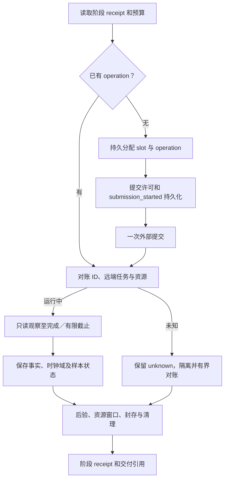
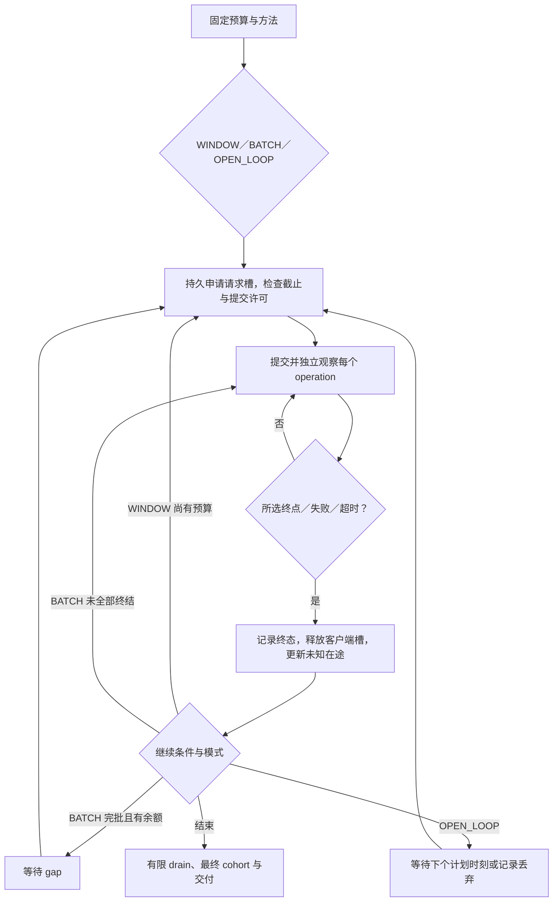

# 沙箱测试执行代码设计

## Context

本文把 [场景节点合同](test-nodes.md) 落实到代码模块和可执行协议，作为 [主设计](design.md) 的附件。覆盖十类基础场景、六类低优先级扩展的执行器、三产品适配、资源采集和指标计算；对应代码的验证设计见 [benchmark-contract-design.md](benchmark-contract-design.md)。所有新能力初始为 planned，源码入口存在不代表已适配或已实测。

现状：`sandbox_bench/` 有 transport/adapters/measure/density/observe 草稿；无 runner，既有 `tests/test_runner.py` 引用缺失模块。`create_sync` 强制 exec 完成，与当前状态完成合同冲突；observe 只有宿主统计，没有组件 PSS。复用需逐函数验证，不整体继承旧行为。旧 `align-sandbox-benchmarks` 的执行任务不再作为实施入口，统一由本 change tasks 管理。

## Goals / Non-Goals

**Goals:** 让工程师能够按方法 ID 实现测量循环、适配和独立 oracle 测试；保证不同产品使用相同方法而非仅同名指标；原始失败和不完整证据可恢复、可审查。

**Non-Goals:** 不预设用户的真实规格、并发、窗口、SLO 和 Guest OS 扣除边界；不给不可观测内部阶段造时间；不把受控服务验证称为真实产品测试。环境安装由环境阶段负责，测试器消费经核验环境报告，不在测量中静默修改系统配置。

## Decisions

### BCD-01 模块和接入边界

采用现有 Python 包 `sandbox_bench`，逐步替换草稿。每种方法只实现一套通用算法，产品差异由 Adapter 实现；不复制三套压测脚本。相比直接调用官方脚本，统一实现可控制所有权、计时和证据，官方公式／协议保留为有版本的兼容方法。

| 模块（拟定） | 接口／职责 | 所属工作节点 |
|---|---|---|
| contracts.py | CaseContract、CompletionContract、ResourceContract、EvidenceEnvelope 的严格解析与 hash | N00/T2 |
| registry.py | 方法、产品 profile、能力／适配状态和源码证据版本 | R1/T0/T2 |
| runner.py | BenchSession.apply_step(step_id,input_hash)、reconcile、cancel、collect；CLI 单次任务入口 | N01–N10 |
| journal.py | request_slot、子 operation、阶段 receipt、资源所有权、序列化持久事件 | N01/N05/N07/N09 |
| transport.py / protocols/ | 有界 HTTP／流，首头、完整 body、首数据、终态事件；envd codec | N03/N05 |
| adapters/{base,cubesandbox,kuasar,agentenv}.py | 产品生命周期、build、状态、分页、规格、placement、资源发现 | N02/N03/N05/N06 |
| completion.py / logs.py | 只读状态观察／服务端事件解析、关联、deadline、完成分类 | N05 |
| fixtures.py / guest_probe.py | 源产物、内容／内存标记、真实触页、冷态声明、首次命令资格 | N02/N03/N06 |
| load.py | 闭环滑窗、分批、开环、预算、在途及补槽轨迹 | N05 |
| scenarios/{create,lifecycle,clone,snapshot,command,density,noise,extensions}.py | B/E 方法阶段机；动作、断言、资源和恢复 | N05/N06 |
| observe/{inventory,procfs,cgroup,sampler,cohort,steady}.py | 动态角色组件映射，PSS／CPU／辅助指标，窗口和覆盖 | N04–N06 |
| metrics/{latency,throughput,resources,capacity,quality}.py | 同一纯计算库供局部和全局复算，MetricValue 带来源 | N08/T8/A3 |
| evidence.py / cleanup.py | 原子封存、完整性、所有权清理、迟到资源 | N07/N09/N10 |

包路径迁移时不同时保留同名 `adapters.py` 与 `adapters/` 或 `observe.py` 与 `observe/`。兼容入口显式转发并测试，无法保持旧语义则清楚升级版本。各脚本入口使用固定模块＋结构化合同文件，不接收模型临时拼接任意命令。

N04 的采样 session 跨 N05/N06 存活；N07 才停止。BenchSession 是持久 runner 管理的 session，并非节点函数退出即销毁的线程。图仍负责各节点状态与 agent 责任；session 仅持有执行上下文和受限操作权限。首次本地实现可用持久作业进程，正式并发入口接 D11 RunnerGateway；所有创建／取消／清理均经过同一 operation 账本和 D14 提交许可，不能另建无 fencing 的生产调度器。

runner 的测量子操作以 `(work_id, stage, request_index, child_index, generation)` 分配稳定身份。journal 适配正式业务仓储；离线测试可用隔离文件账本，不能以此替代 PostgreSQL 并发验收。数据库不可用停止新副作用；采集可在有限本地 spool 内继续，恢复上传按序列去重，满额标采集不完整并按合同停止。已运行操作按原有限 deadline 对账。

### BCD-02 合同、事件和存储

CaseContract 必含：method/version、product/backend/source_sha、runtime_version、work/plan/graph_ref、环境快照、规格单位与来源 digest、placement、初始 N、有限请求／时间预算、C 或 λ、warmup、TTL／续期、completion、validation、cache_profile、sampling、cleanup、授权及运行上限。不同方法有 discriminated 子 schema；bool 不能充整数，拒绝 NaN/Inf、负周期、未知字段；资源单位规范到 bytes／cores／seconds，保留输入单位。

未确定的值是 MissingContract，不随意填默认规模。性能阈值可不提供并输出 not_evaluated；需要阈值的 SLO_VERIFY 则缺项阻塞。Guest 净值合同缺失仅使净值不可用，原始 PSS 继续采集。

原始事件 JSONL，清单及摘要 JSON，未来列存只能是派生优化。记录 `event_id, seq, work_id, operation_id, parent_operation_id, request_index, stage, event_kind, clock_domain, process_epoch, monotonic_ns?, wall_ns?, source_event_time?, observed_at, payload_ref, validity`。大 stdout 和日志存外部 blob，令牌仅凭据引用。单一 operation 完成事件按语义键去重，冲突重复拒绝而非取最后值。

MetricValue 为 `{name,value|null,unit,status,reason,scope,window,cohort_ref,sample_count,formula_version,evidence_refs}`。状态区分 valid/invalid/insufficient/unavailable/not_applicable；0 仅有完整观察证明时写入。工作层 execution/function/data/performance/cleanup 仍分列。

### BCD-03 持久提交与恢复

请求预算以持久 slot 分配消耗，区分 allocated、sent、accepted、completed，发送前失败记录 unsent；分配后崩溃不无条件退回额度。只有证明尚未提交，才能继续同一 slot 的首次提交。写入 submission_started 后结果丢失则 unknown，禁止盲目再 POST；若服务支持已验证的幂等键，只能同键同输入重放。查询／日志读取不消耗创建额度，但计观测流量。

单调时间不得跨 runner process_epoch 相减。进程恢复能接管事实、后验和清理，不能补造原始时延；断续负载标 interrupted。新完整性能重复使用新 repeat/generation；不重置旧预算。客户端 timeout 释放客户端槽但不证明服务端操作停止，另有 unresolved_external 上限；达到上限停止新增提交并对账，避免无限积累隐形在途。

### BCD-04 完成观察与三候选适配

Adapter 接口：`capabilities(profile)`, `prepare_source`, `submit(action, request, operation)`, `inspect(handle)`, `list_owned(cursor)`, `observe_resource_inventory`, `effective_spec`, `execute_stream`, `reconcile`, `cancel`, `delete_owned`。返回 ProductObservation 含 raw_ref、状态映射版本、身份、只读性和 evidence_strength；不能用默认 running 填补未知状态。

CompletionObserver 消费 API_COMPLETE / STATE_READY / SERVER_TERMINAL / EXEC_COMPLETE 四种合同。API 成功是接纳；STATE_READY 使用同一种轮询节奏及同一客户端单调时钟，首次成功观察记录后不可改；SERVER_TERMINAL 内部 duration 与采集器观察时刻分开；EXEC_COMPLETE 真正执行完断言才释放槽。状态方法的后验通常在测量批次后，流式后验标干扰。超时／失败不进入成功时延分布，迟到完成单列。

| 适配 | 已核验接口和特别处理 | 拟定契约验收 |
|---|---|---|
| CubeSandbox | POST /sandboxes；GET detail 的 state；create.clientID 不是目标 node，detail/list 的 host 映射另验。模板 build cpu 是 millicores，memory MiB。实例 list 的 nextToken 未接入，不能假分页；单节点归属＋已知 ID 对账。 | 单位、状态 unknown、缺完整列表、错误 placement、部分 fork、清理共享源均拒绝伪成功 |
| Kuasar | create 201 后仍 starting；GET detail 至 running；资源使用 metadata JSON 字符串或规定 header，detail 全局默认不作实例生效证据。pause(memory)/connect/export，keepSource 显式。 | 日志及状态双证据不混时钟；超时不重复创建；runtime 有效规格证据缺失阻止同规格结论 |
| AgentENV | 模板继承规格；镜像 /sandboxes-cold；resume/connect；fork 数组；snapshot capture+publish。list 从 X-Next-Token 翻页，metadata 双层编码；TTL/续期显式。 | 返回 ready 仍保留客户端统一观察；配置额度不作实测；数据面 codec 先握手验证，未知 codec 不假成功 |

每种 adapter 的 read-only inspect 不得走可自动恢复的 connect 或数据面。能力状态与适配实现状态独立；未知版本 fail-closed 到该 profile，不宣称产品永远不支持。实际定位管理进程、runtime、cgroup、挂载、netns 的规则来自环境报告及版本化受控探测；仅按进程名匹配不够，须关联节点、boot、sandbox generation 和实际 runtime metadata。

Kuasar 日志 parser 匹配 `sandbox launch terminal`、sid、产品 run_id、kind=create/resume、profile、result 与 starting_total_duration，原记录和 parser 版本保存；失败、重复、关联歧义、无 AcceptedAt 起点证据均不产生有效内部成功值。Cube/AgentENV 不编造等价内部字段。

### BCD-05 镜像构建的补充源码证据

本轮补查发现 Kuasar 已有可用于 B02.FULL 的公共 builder 路径，早期“完整准备入口未确认”不再作为源码缺口：

- [builder.image.sh](https://github.com/kuasar-sandbox/orchestrator/blob/c14da165ecc14de0e5c0afbfba2e1b737d64ee7c/test/e2e/cases/builder.image.sh)：注册后 POST `/v2/templates/{tid}/builds/{bid}`，fromImage；ready 取得 e2b-img，再创建并等 running。
- [builder_client.sh](https://github.com/kuasar-sandbox/orchestrator/blob/c14da165ecc14de0e5c0afbfba2e1b737d64ee7c/test/e2e/lib/builder_client.sh)：POST `/v3/templates` 返回 templateID/buildID；GET `/templates/{tid}/builds/{bid}/status`，building/ready/error；ready 的 templateID 是持久产物身份，不是注册阶段临时 ID。
- [API](https://github.com/kuasar-sandbox/orchestrator/blob/c14da165ecc14de0e5c0afbfba2e1b737d64ee7c/internal/api/api.go)：registerTemplate / buildStatus；[build_action.go](https://github.com/kuasar-sandbox/orchestrator/blob/c14da165ecc14de0e5c0afbfba2e1b737d64ee7c/internal/api/build_action.go)：取消及删除。

执行设计：注册→触发 fromImage 固定 digest→等待 ready→核验 kind=img 和规范 portable ID→创建→所选终点。builder 资源与最终 sandbox 规格分别记录。计时从注册前开始；内部 pull/flatten 无独立证据则只输出可观测总段。原仓库 fixture 建网络／systemd／builder pool 的脚本不直接运行在用户环境；这些是环境准备，不在统一脚本中照抄。实际部署未启用 builder 或版本不符时 blocked。此证据是本地源码审计，尚未跑通目标环境。

### BCD-06 发压引擎

`LoadEngine.run(schedule, operation_factory, observer, journal)` 输出逐请求事件与压力轨迹，不调用模型。C 是未达到所选终点且未被客户端终结的工作槽位，普通操作每请求一个；clone 的 C 按 child，父HTTP请求另记 parent_request_budget。原生 fork 一次产生 K 个 child，提交前原子预留 K 个 child 槽及 child_budget 和一个父请求名额。K>C或余额<K直接合同错误，不静默拆分；容量暂不足等待。部分失败逐child释放槽，响应丢失时K个槽记录为未知占用，按有限deadline终结客户端槽但保留K个外部未知额度，禁止再fork补成功。另跟踪服务器未知在途和实际存量 N。

- WINDOW：初始分配 min(C,Q)；任意请求完成／失败／截止即归还槽，预算允许立即补下一个；201 不提前归还状态完成槽。记录 refill_gap、active_slots 和 generator_lag。不是 asyncio.gather 一整批后再补。
- BATCH：每批最多 B 个，内部不超过 C；全部终结后等待 gap，再下一批。最后不足 B 只发余额，最后一批无 gap。B>C 明确批内限流；不能失败后补成 B 个成功。
- OPEN_LOOP：预生成有限 scheduled_at 序列（固定周期或指定 seed 的到达分布）；明确 max_inflight、max_queue、late_policy=drop 或有限 queue。记录 scheduled→actual 延迟、drop 数和服务耗时，不在压力超限时无限追赶或静默改闭环。
- 停止：全局 deadline、预算、已授权资源止损或 unknown 上限；停止新发压后有界 drain、seal、cleanup。生成器自身 CPU／队列和观测开销单列；未达到目标速率不得归因于产品。

### BCD-07 B01–B08 方法实现矩阵

所有方法共用 N00–N10，不将请求变成图节点。表中“后验”除明确属于完成合同外不加回主时延；方法错误保留原始值及独立断言，不删样本。

| 方法 | 执行代码与测量边界 | 关键断言／重入 |
|---|---|---|
| B01.TEMPLATE / SNAPSHOT | create.py：验证 digest/spec；submit→selected completion；两来源分别计划 | 新 ID；来源内存／文件继承按合同；已取得 ID 只观察，不再次 create |
| B02.FULL / PREPARED | create.py：FULL 含各候选构建／转换／发布，PREPARED 验现成产物后起表；共享构建 K 子实例另 profile | build ID 持久对账；冷态无证明标 unknown；独立完整作业与共享成本不混算 |
| B03.PAUSE | lifecycle.py：写状态标记→pause→只读 paused；另测停止／释放；后验恢复 | 内存／磁盘／freeze 分组；网络无响应不等暂停；已 paused 不重测近零 pause |
| B04.MEMORY / DISK | lifecycle.py：已暂停 fixture→resume→selected completion→FIRST_WORK | 同实例；内存 token 保留且不能靠磁盘重建，文件 hash；磁盘路径允许重启但不声称内存连续 |
| B05.FULL / PREPARED / NATIVE | clone.py：父操作与 child operation 分层，capture/publish/fanout 分段；FULL 源继续运行合同包含恢复成本 | child 新身份及隔离写入；源/兄弟原值不变；201 中每项单判；部分失败不重放整个 fork |
| B06.RUNNING / PAUSED | lifecycle.py：DELETE→完整 API→逻辑不存在→逐拥有资源释放 | 鉴权错误不当404；共享模板引用不误删；再次删除只属对账，不补首次时延 |
| B07.FIRST / STEADY / OUTPUT / ERROR | command.py：固定 cmd/args/env/cwd/user/PTY/connection；流式 start、首字节、end及关闭 | FIRST 用未执行过验证命令的 fixture；bytes/hash/exit 全验；非零预期单列；超时查远端进程 |
| B08.LOCAL / PUBLISHED | snapshot.py：实际触页＋文件标记→capture→必要 publish→后验独立 restore | 本地／远端就绪分开；源状态副作用记录；逻辑与新增物理大小分列，无证据不推算 |

guest_probe 是固定、版本化的受控程序：生成随机 nonce 仅驻留进程内存，磁盘写另一独立标记，按 seed 实际写触每页，记录已触页 bytes；恢复后挑战读取原 nonce，避免新进程从文件回显伪连续。进程 token／内存检查所需 fixture 可在模板中准备，B07.FIRST 不通过执行预检提前污染实例。异常清理依据本次任务标签和进程启动身份，不用任意 pkill。

### BCD-08 B09/B10 算法与数字合同

B09.PLATFORM：运行服务、零测试实例基线；IDLE/PAUSED：基线后准备固定 cohort，等待已声明稳态，采样。净 Guest OS 扣除是一独立可选结果，缺 Q12 不阻止原始 PSS。暂停进程正常卸载只有生命周期与宿主对账证明才记零。

B10 方法均采创建事件、角色组件 PSS、CPU 秒／采样峰值与最终 cohort：

1. **GROWTH_LIST**：保持官方批次 API 完成→规定 gap→完整列表计数→净增长判停顺序；`gained_i=listed_i-listed_(i-1)`，连续低于 min_growth 达 stall_limit 停。新增成功与旧实例损失另算。原 Cube `created_any` 来自曾有 listed 存量，统一健康证据另列；草稿 ever_ready 不得替代原条件。域改为 owned、预算预先限制或插入健康等待都记录 compatibility_deviations。达到硬预算标 lower_bound；列表不完整 invalid，不拿截断当平台峰值。
2. **GROWTH_READY**：以本批独有新 ID 达健康合同数判停，旧 cohort 复验；不同轨迹独立实验，不能仅从一轮 GROWTH_LIST 日志改名得到该方法结果。
3. **PROJECTION**：固定 N，零实例服务基线 A0 与指定窗口 Amin 均来自同宿主 MemAvailable。兼容视图先各次读取截断到整数 MiB，再按原 awk `printf %.1f` 的锁定参考行为计算 d=(A0−Amin)/Nrequested；d>0.5 时 floor(Amin/d)。reference awk 版本／locale 固定，舍入边界用黄金数据，不直接假设 Python round 等价。统一视图用未舍入 bytes、全部目标达到健康的 N、cost=(A0−Amin)/N，total=floor((A0−R)/cost)，additional=max(0,total−N)；N>0、cost>0、A0>R。total<N 标模型／预算冲突，不包装有效容量。过渡／稳态 Amin 分列，预测与实测不同。
4. **SLO_VERIFY**：固定 N、已定义 SLO 及有限窗口，输出验证结果，不自动搜索最大容量。无新建的运行创建吞吐为 N/A；前置创建曲线标 preparation。
5. **FIXED_REQUESTS.WINDOW/BATCH**：每档 C 使用相同 Q，分别独立 fixture/cache；成功实例保留到最终 cohort。总请求、API成功、累计达终点、最终存活、健康与未知分别输出；不是最大容量。

所有方法保存真实实例集合，不只存数量；最终直接 PSS 均值只用相同覆盖集合。共享控制面按整个服务范围摊销一次。增长过程失败残留成本保留，不能只挑成功进程。

### BCD-09 资源采集与稳态实现

inventory 用 `(environment,node,boot_id,pid,start_ticks)` 或 cgroup generation 标识，记录 parent/role/component/sandbox/runtime-generation。同进程多角色标签可保留，但数值只加一次；线程不重复计地址空间。采集前后核验进程身份，读失败保存 reason 与时间区间。

PSS 读 smaps_rollup；需要映射归属再读 smaps，权限不足不退回 RSS 冒充 PSS。CPU 读 utime/stime 及本机 CLK_TCK，或声明去重范围的 cgroup usage/user/system，二者不重复相加；新 PID、计数回退、退出丢尾值分段并标覆盖。Linux 的 PSS／进程计数定义参考 [proc 官方文档](https://docs.kernel.org/filesystems/proc.html)，cgroup CPU 使用微秒口径参考 [cgroup v2 官方文档](https://docs.kernel.org/admin-guide/cgroup-v2.html)。

计算：cpu_seconds=Δcounter；cores=Δseconds/Δt；percent_one_core=100×cores，宿主归一化另列。采样峰值是各区间最大 cores；总体峰值先对齐后求和再取最大。不可证明时钟同步的节点不能生成“同时总峰值”，仅各域报告；有误差上界时记录对齐容差，缺失域不补零。

稳态算法显式配置 `window_s,min_samples,max_gap_s,cohort_stability,metric_bounds/slope_bounds,max_wait_s`。采用按时间顺序第一个满足全部规则的窗口，不能事后挑最好片段。PSS 时间均值按约定的分段常值积分；样本覆盖到下一点，超过 max_gap 不外推。CPU 区间按实际 Δt 加权。窗口内 cohort 变化则切段／重判稳，缺覆盖不能用完整 N 除部分资源。采样器自身开销、poll 流量、TTL 续期和丢样均单列。

GuestDeductionProof 输入精确定义的减项、同域映射、窗口、覆盖、方法和版本；`net_pss=raw_pss−guest_component_pss` 仅在同域且 0≤deduction≤raw 时定义，负值报矛盾不裁零。当前三产品均不预置减项估计常数。

### BCD-10 统计、吞吐及交付

逐请求成功时延分位数使用有版本的线性插值位置 `(n−1)q`，保存 n、repeat 和失败数；n=0 为 N/A，不用超时截止值补成功样本。批次 wall/N 是 amortized，不是逐请求延迟；多组 P99 不求平均当总 P99，需原样本同组重算。

创建吞吐：固定 observation 时钟域的一秒桶，内部边界采用半开 `[t0+k,t0+k+1)`。window_kind=fixed_deadline 时窗口整体为 `[t0,t_end)`，恰好截止事件归外部单列；window_kind=natural_drain 时 t_end 是最后终结事件，整轮包含该事件，最后一个非零时长桶右端闭合（整秒结束也归前一桶），不人为添加epsilon。两者必须带window_kind，零时长无法计算速率。分子是唯一 operation 的所选完成事件，重试／重复采集不加数；内部日志 duration 不造客户端完成时刻。记录桶长、coverage、count、rate；完整空桶=0，缺失桶=null。`overall=count_in_window/(t_end−t0)` 包含 batch gap；active 视图仅按实际发压／drain 区间并集计算，分子也限定同一并集，不把所有成功除任意缩短时间。迟到、最终存活分别计。

resource summary 按 test-nodes 2.4 的直接、平台摊销、增量、每窗口 CPU 秒／每沙箱核占用输出。原始数据和 formula_version 允许离线复算；N08 与 A3 调同一计算库，但验证测试的 oracle 不得调用它生成预期值。

交付目录含 case_manifest、operations/events、resource_series/cohorts、assertions、summary、cleanup_ledger、raw_refs。写临时文件→flush/校验→不可变 manifest→业务账本引用。F/A 的 Excel 服务消费此结构，模型只拿指标引用和异常摘要。

### BCD-11 低优先级扩展的可执行骨架

E01 固定工作量／seed／输入输出 hash；E02 baseline→变更→reset→内容验证；E03 有限合法生命周期序列、周期审计、分段；E04 压力阶梯→任务→撤压→恢复；E05 成对基线／干扰窗口→撤干扰；E06 已登记故障注入→观察→恢复→工作验证。实现共同 `ExtensionProfile`、step action registry、finite budget 和补偿栈，不能接受任意临时注入命令。

具体 profile 未获选择或缺产品适配时明确 not_selected/blocked，不默认运行。实现单元／受控合同和目录覆盖属于本轮代码任务；扩展真实负载及故障实验须有具体合同，不能为了“全覆盖”自行施加。清理／撤压步骤无论哪一步失败均可按持久记录恢复。

## Risks / Trade-offs

- Python 发压／采样开销可能影响高并发 → 保存发生器指标、界限和实际负载；先证明正确，必要时替换底层引擎而不改数据合同。
- API 无可靠幂等／查询关联 → 明确 unknown、停止新增及隔离；不承诺恰好一次外部效果。
- 部分产品只见聚合状态 → 证据强度入报告，缺 placement／完整 inventory 则相关密度结果无效。
- procfs 读取竞态与跨机时钟 → 身份双检、区间、覆盖和时钟域，禁止无依据补齐。

## Migration Plan

按 tasks 从合同／oracle、transport、adapter、load、场景、观测／统计到真实接入逐组实施。保留既有草稿失败案例，逐条判定兼容或替换；方法／schema 改动升版本，历史日志原样保留。实现通过本地契约后才取得 environment_verified，真实环境值不由测试夹具填入。

## Open Questions

Q1/Q2/Q4–Q8/Q10–Q12 保持运行合同输入。它们控制具体方法是否可运行及结果是否可比，不阻止实现严格 schema、算法、适配框架和缺项分支。Q12 未定义前只交原始底噪及 unavailable 净值；不能以框架支持扣除协议声称已经测得净底噪。
