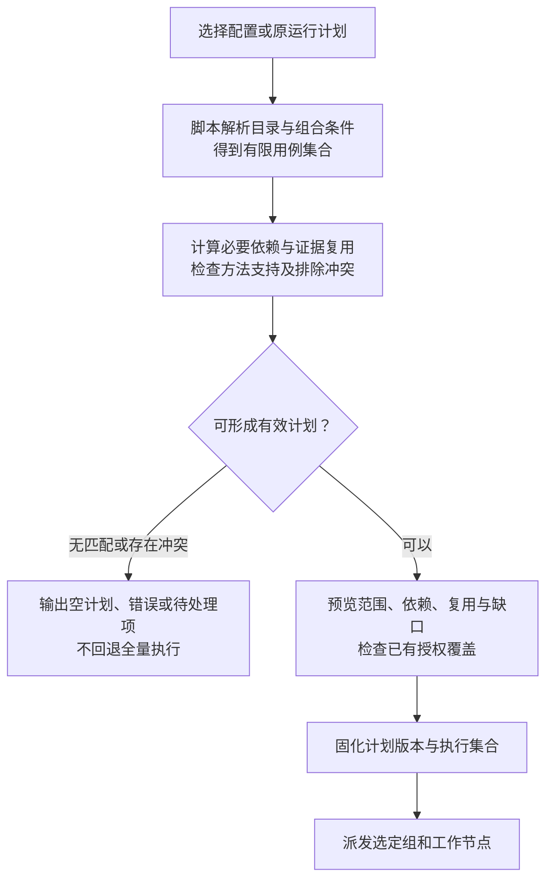
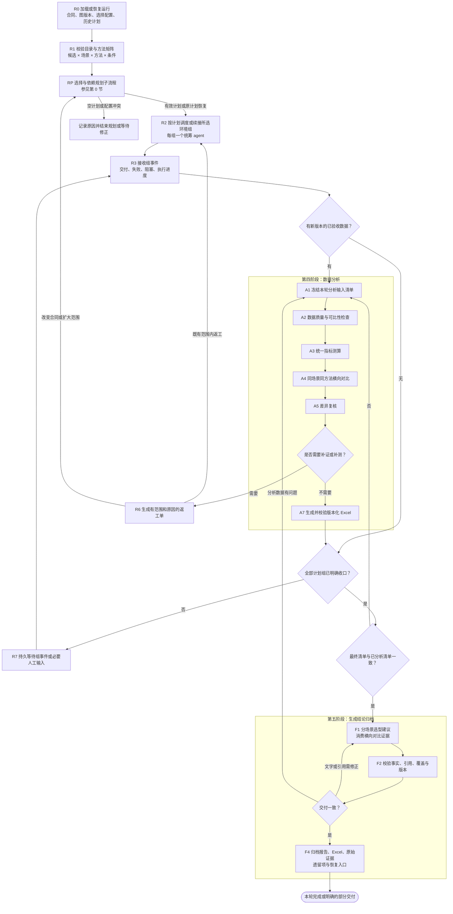
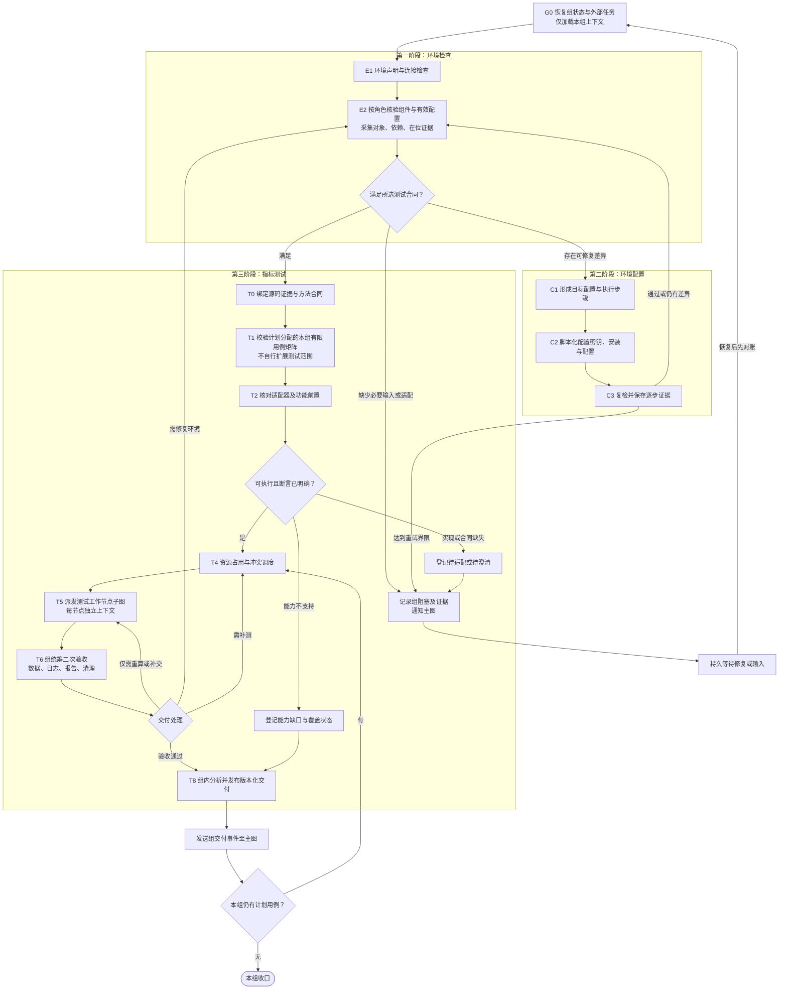
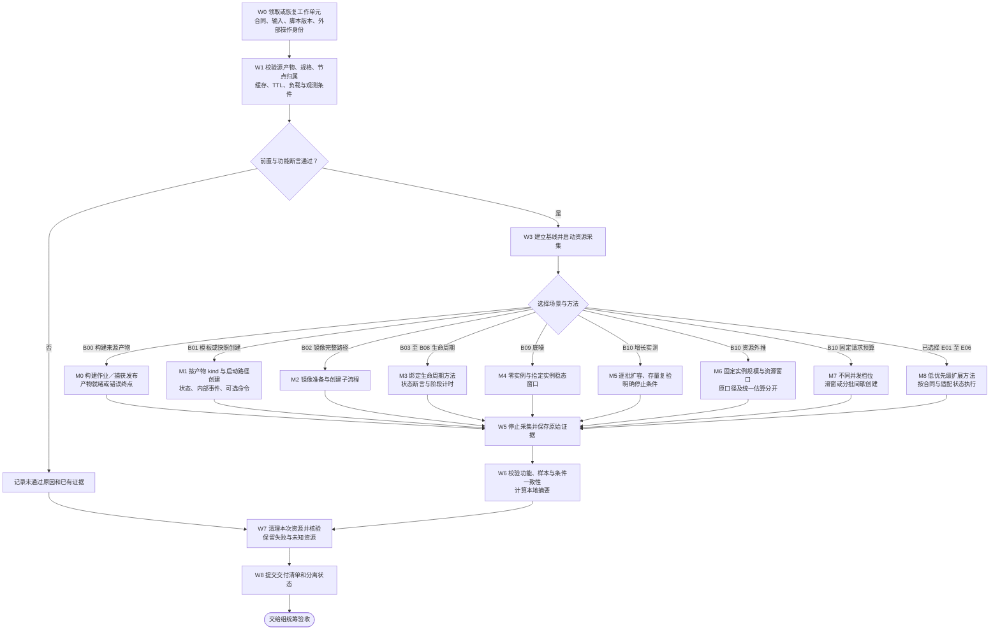
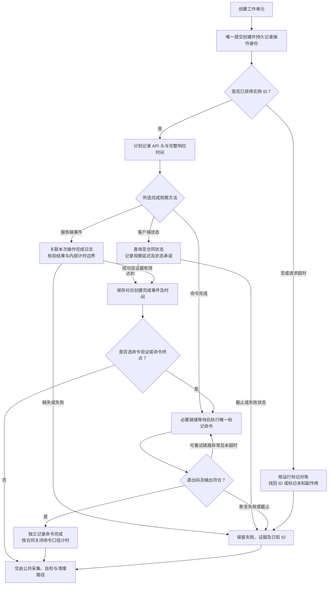

# Design

## Context

这是待审阅的 **Mermaid 工作流设计草案**，用于后续逐节点实现 LangGraph 调度；不是演示架构图，也不是已实现图的运行轨迹。当前没有端到端 LangGraph 实现。

用户已明确顺序：源码审计 → 测试方法与节点合同 → Mermaid 主图及子图 → 确认拓扑 → LangGraph 调度实现 → 接入确定性脚本 → 真实测试。此前提前创建的 `sandbox_bench/`、`tests/` 和 `align-sandbox-benchmarks` 实现草案暂停，不能反过来决定本图的节点边界。

需求依据：[proposal](proposal.md)、[工作流 spec](specs/evaluation-workflow/spec.md)、[环境 spec](specs/environment-readiness/spec.md)、[运行时 spec](specs/runtime-evaluation/spec.md)。
源码依据：[跨候选方法矩阵](../../../docs/source-audit/alignment.md)、[CubeSandbox](../../../docs/source-audit/cubesandbox.md)、[Kuasar](../../../docs/source-audit/kuasar.md)、[AgentENV](../../../docs/source-audit/agentenv.md)。

完整场景节点目录与合同见 [test-nodes.md](test-nodes.md)：展开 B00–B10、E01–E06、公共步骤及各场景子图。2026-10-21 用户修正创建完成判据：状态就绪和经核验的日志可作为完成证据，命令完成是独立可选终点／后验，不再强制合入创建耗时；早期审计的 exec 唯一主指标建议由本版合同取代。

全节点 S（脚本）／M（模型）／H（必要人工）职责与实现状态见 [node-automation.md](node-automation.md)，每个工作节点的内部 Mermaid 见 [node-workflows.md](node-workflows.md)。下方主图是节点间依赖；内部图定义节点内动作、分支、失败与重入，两者共同组成设计。

2026-10-21 进入代码详细设计：新增 [图编排代码设计](orchestration-design.md) 和 [图编排测试设计](orchestration-test-design.md) 作为本 design 的附件。前者定义模块、状态、执行与恢复协议，后者定义工程验证方法；`test-nodes.md` 仍负责沙箱性能实验设计。默认 schema 不独立跟踪附件状态，文件存在不代表实现或评审已通过。

## Goals / Non-Goals

**Goals:** 明确五阶段如何由主 agent、环境组统筹 agent、工作节点 agent 协作；将源码差异落实为测试分支；定义数据、状态、条件边、汇聚和恢复边，作为调度代码的依据。

**Non-Goals:** 本轮不编写 LangGraph 或测试执行代码，不以已有脚本草稿推定任何节点实现完成。详细设计提出数据库、任务后端和部署方案供评审，尚不代表这些技术选择已经获得用户确认或完成验证。

## Decisions

### 0. 可选择执行计划：先确定范围，再调度节点

用户已要求支持按优先级、环境组、沙箱类型、具体用例自选测试。下列为待审阅的选择与依赖规则；选择入口属于主图调度准备，不增加第六个业务阶段，也不改变五阶段定义。

**边界（选择 ≠ 改图）**：本节的选择是**不改图**的范围筛选（[选择器](../../../sandbox_graph/planning/compiler.py) 的 `Selection` + `PlanCompiler`；`python -m sandbox_graph preview` 只读预览）；新增测试能力、改变节点依赖或增删图节点属于**图版本变更**（[GraphService](../../../sandbox_graph/interfaces/service.py) `propose_patch`→`RevisionService.activate_revision`，新版本＋新 run，不热切换），见 D08/D14、WF-36/WF-38。

| 选择维度 | 含义与约束 |
|---|---|
| 优先级 | 选择目录中已标注优先级的用例；与“全部执行但高优先级先跑”的调度排序分开。具体枚举及逐项赋值待定 |
| 环境组 | 选择具体单节点环境或集群；机器角色继续由组统筹管理 |
| 沙箱类型及版本 | 在已选或已有授权范围内筛选候选部署；同类型可以对应多个环境组，不自动创建新环境 |
| 场景、方法、用例及工作节点 ID | 可选 B00–B10 的子集、密度增长法或外推法、精确用例实例；区分图节点定义与某组某条件下的工作实例 |
| 规格与负载条件 | 按既有条件 ID 选规格、实例数 N、并发 C、到达率 λ 等有限档位，不自动展开所有组合 |
| 执行阶段 | 允许仅做环境检查，或基于已有有效数据重做分析／报告；缺少输入时说明依赖，不默默扩为全量重测 |

建议的组合规则：同一字段多个值取并集，不同字段取交集，然后应用排除规则；字段省略表示不进一步限制**既有授权范围**。显式空集合、无匹配及未知标识分别报出，不视作“全部”。多套组合可以保存为有版本的选择配置，名称和序列化格式尚未冻结。基础功能与性能优先，低优先级扩展仍须显式纳入。

预览不修改环境；它是可审计产物，不要求每次已授权执行都重新请用户批准。遇到未授权动作或确实未定的取舍时才补充确认。能力不支持可作为已知缺口进入有效计划；必要合同、适配或输入缺失则阻塞对应工作，其余独立工作可继续。

依赖补齐只补必要动作。例如选择 B04 恢复性能，需要可核验的已暂停实例，可以复用适用实例或安排创建与暂停准备，但不因此执行 B01 创建和 B03 暂停的性能矩阵。准备、功能预检和正式测量边界分别记录。若明确排除了必需动作且无有效替代证据，输出冲突，不覆盖排除要求。资源采集、自检、组复核与清理属于交付依赖，不能通过选测绕过。

计划至少记录 `selection_ref`、`catalog_version`、`plan_id/version/hash`、图与合同版本、所选用例实例、依赖原因、复用证据及有效性、排除项、能力和适配缺口。确定性脚本负责解析、匹配、依赖计算、差异分析及覆盖核对；模型负责理解自然语言意图、解释冲突和证据，人工处理未明确的业务选择。

恢复使用原计划及实际执行记录；修改选择产生新计划版本，并计算新增、移除、可复用和失效节点。在途任务如何停止及清理必须显式对账，不能重新筛选一次便覆盖原状态；Q3 已确认采用旧任务原图收尾、新计划复用证据；图版本变化创建新的 run/thread，不热切换活动实例，具体激活边界见附件 D14。自选执行子集不修改图，新增测试能力或改变节点依赖仍走图版本变更。

报告以有效计划的环境组、用例、方法和条件作为覆盖分母，单列未选择及缺口。只选一个候选时给出该候选结果并注明跨候选比较不适用；选择多候选同方法时保留全部已选候选的支持状态，不能静默过滤掉不支持者。部分选测完成不能表述为全量选型完成。

### 1. 主图：调度环境组与统一分析

环境检查、环境配置、指标测试在每个环境组内执行；数据分析、生成结论归档由主 agent 侧统一执行。这是五阶段在多环境下的展开，不新增第六个业务阶段。主图接收组级交付事件，不读取全部子 agent 对话。

`R2` 不等待全部组结束才让 `R3` 工作：组运行和交付事件独立持久化，主图据事件增量推进。详细设计 D01/D02/D09 提议用持久任务表与事件 outbox 调度独立 GroupGraph/WorkGraph；不能把普通并行子图调用后的汇聚屏障误写为已实现流式增量分析。

`R5` 必须核对有效计划的所选组、用例集合及每组交付版本，未选择的组不参与等待。等待输入、仍在运行不自动算终态；失败、跳过和阻塞可以在明确处理决定后形成有缺口的最终交付，不代表对应测试已通过。补测回到具体组、具体方法与条件，不重新广播整个测试计划；需要扩大范围时回到 RP 形成计划新版本。

主图默认展示完整五阶段路径。阶段选测时按计划路由：仅检查在检查交付后汇入范围核对与归档；仅分析从已验收输入进入 A1；仅报告从有效分析版本进入 F1。关闭的阶段必须有适用输入或明确不适用原因，不经由缺失的组事件等待节点。分析阶段仍输出比较适用性，单候选不生成跨候选排名。

| `stage` | 执行路径 | 实际执行的阶段 | 必需输入 | 不执行 |
|---|---|---|---|---|
| `all`（默认） | R0→R1→RP→R2→（组：E1/E2→[C1–C3]→T0…T8/GE）→R3→R5→A1…A7→F1…F4 | 五阶段全量 | 选择配置/计划、授权组、组交付事件 | — |
| `check` | R0→R1→RP→R2（组：**仅 E1/E2**）→R5→F4 | 仅环境检查 | 环境声明、连接与授权 | 环境配置、测量、分析（F 仅做范围/历史核对） |
| `analysis` | 既有 run 已验收输入 → A1…A7 → F4 | 仅数据分析 | 精确 `source_run_id` + 冻结 `analysis_input_ref`（属 active plan、授权组匹配） | 环境检查/配置、测量 |
| `report` | 有效分析版本 → F1/F2/F4 | 仅报告 | 精确 `analysis_ref`（同 run/plan） | 环境检查/配置、测量、分析 |

- `stage ∈ {analysis, report}` 时 `compile()` 返回 `cases=()`：**不派发组/工作节点**（`RunService.start` 要求 `evidence.source_run_id`）；`check` 仅派发组以执行 E1/E2。
- 关闭的阶段必须有适用输入或明确不适用原因，**不得**经由缺失的组事件等待节点；缺输入则 `blocked`，不回退全量。

### 2. 环境组子图：一套环境一个统筹 agent

单节点与多节点集群使用同一个子图。机器角色是环境声明的字段，不是额外环境组；单节点是否含管理角色必须核验。

环境报告、能力缺口和测试交付使用不同类型；`TC → T8` 只允许生成覆盖状态，不允许伪装为性能样本。相同宿主、管理服务或存储有冲突的用例不能因属于不同 agent 就并行。

**环境检查/配置能否跳过**：在**测量运行**中 **E1/E2 是必经门禁**（组图 `G0→E1→E2` 无条件），**不可**通过选择跳过；**C1–C3 是条件性的**——仅当 E2 报告差异（`continuation='C1'`）才执行，环境满足时 `E2→T0` 直接进入测量，配置自然不执行。要完整绕过检查/配置/测量，只能选 `stage='analysis'|'report'`（从既有 run 重做）；重入是**快速复检**（读缓存证据，WF-18），不是跳过。若要新增“假定已就绪、跳过校验”的运行模式，属**图/合同变更**（WF-38），当前未实现，且不应默认提供（就绪必须核验）。

### 3. 测试工作节点子图：方法驱动，不按产品复制三套整图

一个实验工作单元由 `(group_id, scenario_id, method_id, condition_id, repeat_id)` 标识；重试另用 `attempt_id`，不能覆盖原测量。图中的每个持久工作节点绑定负责的 `agent_id`；一条 HTTP 请求、一次采样不是单独 agent。图节点与脚本内部步骤的最终划分仍待本图审阅后确定。

代码设计将上述语义身份细化为 WorkKey（含方法版本与补测 generation）及持久分配的 work_id；plan 关联与证据复用另记，详见附件 D04。WorkGraph 中每个节点仍有自己的 owner_agent_id 与最小上下文，不能把容器图共享状态直接当作全节点共享对话。

所有运行分支的异常、取消和超时都进入 W5/W7 的证据与清理路径；不能依赖仅成功路径的最后一个清理节点。实际 LangGraph 代码要把该条件显式实现。W7 对没有产生资源的前置失败是有依据的空清理。

本图为概览。细化后 W0–W8 对应 test-nodes 的 N00–N10：N06 的后态资源窗口／正确性检查在 N07 停采之前，N08 统计在封存之后；N05 依照所选 B/E 用例路由。M0–M8 不是覆盖全部细节的最终叶节点，具体方法、依赖、验收及失败恢复以节点目录为准。B09/B10 的 PSS、CPU 及真实数量平均见节点目录第 2.4、7 节。

### 4. 审计结论如何改变图节点

| 场景 / 方法 | 公共节点合同 | CubeSandbox 分支 | Kuasar 分支 | AgentENV 分支 |
|---|---|---|---|---|
| B00 构建来源产物 | 提交构建／捕获 → 观察作业状态 → 就绪或错误终点 → 记录产物身份 | 模板 build job（image→`tpl-`）；成本与创建分列 | builder 注册／触发／status（fromImage→`e2b-img` 持久 templateID） | `template_builder` sandbox → `publish_captured` 产新 SnapshotId |
| B01 等待创建完成 | 唯一提交 → 记录 API 头及完整返回 → 按产物 kind 与启动路径到所选状态或事件终点 → 可选命令后验 | 创建链同步等待，probe 有配置条件，状态承诺需记录 | 同一“模板”按 kind 分 `img`/`sbx`/`snp` 三条启动路径；201 为接纳，running 或经核验 terminal 才是更强完成证据，两种计时域分开 | 创建等待 ready 后提交 Running；`template_id` 实为 snapshot 恢复，与 image 冷启分列，客户端状态观察另计 |
| B02 镜像完整路径 | 同一完整起点，准备成本与启动成本分段 | 镜像到模板 build/job ready → 创建；预制模板分支另报 | OCI 到合法 artifact 的准备 → image profile 启动；已有 artifact 是另一方法 | 原生 `/sandboxes-cold`；模板创建不能冒充镜像冷启动 |
| B03 暂停 | 暂停前写状态标记 → 提交 → 验证 paused/停止语义 → 资源观测 | 区分 SDK 轮询与服务动作 | memory=true 捕获语义，不能仅称冻结 | 等待 pause 完成；保留持久化语义 |
| B04 恢复 | 已暂停前置 → 提交 → running/可执行 → 内存/文件连续性 | resume 后补命令验证 | connect 可异步，memory=false 单列冷恢复 | resume 后统一断言 |
| B05 克隆 | 源状态 → 捕获/发布（适用） → fan-out → 每个子实例验证 → 隔离断言 | SDK clone 含 snapshot；原生 fork 另列 | pause → export keepSource=true → 新实例；源恢复成本单列 | fork 数组逐项判断，201 可部分失败 |
| B06 删除 | API 返回 → 逻辑不可访问 → 资源回收 | 创建成功不能被删除失败抹掉 | 异步或延后回收独立观察 | 分运行和暂停来源验证 |
| B07 命令 | 相同命令/输出大小/用户，分别记录首条和稳态 | envd 协议 end/exit | envd 与 native exec 是不同方法 | 固定 envd 版本核验 codec |
| B08 快照 | 构造工作集 → 捕获 → 发布 → 新实例恢复断言 → 源副作用验证 | 区分本地及远端状态 | 高层 pause+export 为组合，不能假装源持续运行 | capture+publish；底层 pause benchmark 不等同完整快照 |
| B09 底噪 | 零实例服务基线 → 指定实例 → 稳态判据 → 分组件统计 | 新增统一采样合同 | idle workload 与清理后样本分开 | allocatedMemoryBytes 不能当实际占用 |
| B10 增长法 | 每批记录 attempts/accepted/listed/state-ready/可选业务健康/old-lost → 复验 → 判停止 | 原规则是连续两批**列表净增长**少于 10 | 同方法迁移，新增异步就绪和存量复验 | 同方法迁移，显式 TTL 防到期暂停/删除 |
| B10 外推法 | 空实例基线 → 固定 N → 同域资源窗口 → 有效性检查 → 两种公式视图 | 迁移资源外推方法 | 保留原 requested 分母及剩余容量公式，统一值另算 | 使用宿主同域数据，不能混用容器配额 |
| B10 固定请求数 | 每个 C 独立前置 → WINDOW 或 BATCH → 最终存活对账 → 资源窗口与真实平均 | 三者同方法映射；请求完成不止 headers | 槽位等所选完成点，201 不提前释放 | 明确 TTL、来源规格和实际归属；防止存量到期 |

上述是候选设计，不代表这些测试节点都已实现。每个原脚本方法保留 `origin_method_id`、测试层次、版本和计时边界。统一方法以同一 `method_id` 跨三组展开；底层运行时方法和完整 E2B 方法分层，不把不同链路直接混排。共享环境下两种密度方法默认先清理和复核再执行下一种，确切并行规则仍属 Q10。

### 5. 创建与密度的关键条件边

这里的“同步”是测试器等待所选完成判据，不是顺序发压。多个创建工作可并发，但每个样本都使用同一总截止时间，并发槽持有到所选终点。命令后验失败不覆盖已记录的创建状态结果。状态观察耗时包含轮询误差；服务端日志 duration 的起点须单独审计，不能与客户端起点混算，详见 test-nodes 第 3 节。

密度方法还须保留：新增成功与存量净增长分开；两次停滞仅证明协议停止，不证明物理极限；达到实验上限报告下界；资源外推是模型估算，不能用于宣称已运行的最大数量。原 Kuasar 公式与修正解释见源码审计，不在图中隐藏为一个“密度”数值。

创建入口还须区分入口拓扑与同步／异步语义（[benchmark-design.md](benchmark-design.md) BCD-13；审计 [alignment.md §9](../../../docs/source-audit/alignment.md)）：管理面/ingress 入口（Kuasar router）同步到 running，`API_COMPLETE` 即 `STATE_READY`；仅有数据面时 node API 异步返回 `starting`，须轮询到 running；同机 CLI `--ready-fd` 为独立白盒端点 `GUEST_READY`，早于状态就绪，不与黑盒端点同列。请求管理面入口前须核验部署含管理面/ingress 角色，否则不得假定其可用。

### 6. 节点输入输出与验收

| 工作节点 | 必需输入 | 输出与验收 | 失败或重入 |
|---|---|---|---|
| RP 选择与依赖规划 | 选择配置、版本化目录、既有授权范围、历史证据 | 有限执行计划、依赖原因、复用与缺口、范围预览 | 原计划恢复；变更生成新版本，冲突不扩大为全量 |
| R1 / T0 方法合同 | 需求版本、源码审计、能力映射 | 共同方法目录、产品适配绑定、不可比项 | 只使受影响方法失效，缺语义待澄清 |
| E1–E3 环境检查 | 环境声明、凭据引用、角色合同 | 观测快照、差异、观测对象清单 | 读取历史后快速复核，不能永久复用 |
| C1–C3 环境配置 | 明确差异及目标值 | 步骤日志、有效配置、复检证据 | 对账已做动作，局部重试 |
| T1–T4 用例准备与调度 | 方法目录、规格/N/C/λ、环境状态、资源依赖 | 有限用例集合、适配版本、占用记录 | 缺实现阻塞具体用例；不自动跳成成功 |
| M1–M8 方法执行 | 工作单元、脚本版本、断言、截止时间 | 逐操作事实、时序资源、产物及副作用 | 恢复前查外部操作，不直接重复创建 |
| W6 / T6 自检与复核 | 原始证据引用、合同、覆盖清单 | 局部有效性、组级复核记录 | 数据可用只重算；缺事件才补测 |
| A1–A7 统一分析 | 验收后的精确交付版本集合 | 同方法指标、可比性、横向对照、Excel | 补测针对具体缺口；旧分析版本保留 |
| F1–F4 报告归档 | 固定分析版本及业务目标 | 分场景推荐、引用校验、证据清单 | 文字改动只重写报告；数据改动回分析 |

### 7. LangGraph 状态与恢复映射（设计约束）

| 层 | 状态中保存 | 不默认注入上下文 |
|---|---|---|
| 主图 RunState | run_id、graph_version、contract_version、selection_ref、plan_ref、所选 group_ids、组状态引用、待处理事件、分析清单、决策引用 | 其他 agent 的完整对话、所有原始日志 |
| 环境组 GroupState | group_id、plan_ref、本组所选工作集合、environment_snapshot_ref、method_matrix_ref、工作单元状态、资源占用、复核与交付版本 | 其他环境组数据、主 agent 全量历史 |
| 工作节点 WorkState | work_id、agent_id、method/condition/repeat/attempt、script_ref、输入引用、操作身份、checkpoint、证据与问题清单 | 无关用例历史、全部源码 |

采用不同状态 schema 与显式输入输出映射来隔离上下文，而不是把同一个 `messages` 数组贯穿三层。[LangGraph 子图文档](https://docs.langchain.com/oss/python/langgraph/use-subgraphs)支持父子图不同状态及多层嵌套。

LangGraph 提供持久化图状态的机制；外部测试任务身份、幂等、资源对账和证据存储仍是本工程必须设计的合同，不能仅凭 checkpoint 宣称远端操作恰好执行一次。[持久化文档](https://docs.langchain.com/oss/python/langgraph/persistence)

每个工作节点分别持久记录：

- `execution_status`：pending / running / succeeded / failed / blocked / cancelled。
- `data_status`：unverified / valid / invalid / insufficient。
- `review_status`：pending / accepted / rejected。
- `performance_status`：not_evaluated / pass / fail / not_applicable。
- `cleanup_status`：not_needed / pending / complete / incomplete / unknown。

模型看护这些状态，但确定性转换由脚本与调度器校验；父级追加复核状态而不覆盖子级执行事实。并发更新按稳定工作身份和产物版本合并、去重，不能使用简单列表追加导致重放重复计数。

人工输入仅用于必要信息和未明确取舍。中断恢复要考虑节点重入，副作用前置于可恢复操作合同，而非放在可能重新执行的询问之前。[中断文档](https://docs.langchain.com/oss/python/langgraph/interrupts)

### 8. 实施次序与当前状态

1. 审阅本 Mermaid 拓扑及三套源码到方法节点的映射。
2. 审阅代码详细设计与测试设计，逐节点确定输入输出、验收、状态更新归属及重入条件；保留 Q1/Q2/Q4–Q8/Q10–Q12 未决范围；Q3 按新版本运行协议实施，任务拆解见 [tasks.md](tasks.md)。
3. 再编写 LangGraph 主图、环境组子图、工作节点子图，先用受控事件验证路由与状态恢复。
4. 按已确认合同接入确定性脚本；检查既有草稿是否符合合同，不预先认定可复用。
5. 接入用户环境，做功能验证与同方法实测，再形成横向对比。

当前仅有源码审计、需求 spec、此设计草案和提前产生的部分脚本草稿。脚本实现已停止；没有真实沙箱测试，没有可运行的端到端 LangGraph 图，也没有生成 Archify 图。

### 9. 工作节点内脚本与模型边界

| 工作节点 | 目标脚本化内容 | 模型／人工边界 | 内部图入口 |
|---|---|---|---|
| R0/R1/RP/R2/R3/R6/R7 | 恢复、目录校验、选择编译、派发、事件去重、局部返工和等待 | 新语义审计由模型；未定目标／扩围由人工 | node-workflows 第 1 节 |
| E1/E2/C1/C2/C3 | 环境声明核验、认证、角色探测、差异计划、密钥／安装／配置、独立复检及报告 | 模型处理未知形态；人工明确目标、身份冲突和新增范围；缺可执行适配不得直接执行模型方案 | 第 2 节 |
| G0/T0/T1/T2/T4/T5/T6/T8/TC/TB/GB/GW/GE | 本组恢复、方法绑定、有限矩阵、协议预检、资源锁、派发、复核、统计和事件 | 仅未知证据诊断或必要业务取舍升级 | 第 3 节 |
| N00–N10 | 合同、对账、前置、预检、采集、测量、后验、封存、自检、清理、交付 | 仅规则缺失或新语义参与模型；不逐请求调用模型 | 第 4 节 |
| B00–B10、E01–E06 的方法子图 | 所有确定性操作、完成观察、计数、PSS/CPU与每秒创建吞吐、公式及断言 | 新适配语义由模型；数值条件和 Guest OS 减项待明确 | 第 5 节及 test-nodes |
| A1/A2/A3/A4/A5/A7 | 固定输入、质量、归一化、统计、比较、规则复核和 Excel | 模型解释新语义／异常；人工明确必要业务偏好 | 第 6 节 |
| F1/F2/F4 | 事实装配、图表、数值／引用／版本检查、归档与恢复入口 | 模型撰写解释和语义复核；人工只解决未明确取舍 | 第 7 节 |

每行的具体节点各有职责表行和内部子图，不把一个宏观阶段笼统标成“自动化”。S/M/H 与 planned/draft/verified 是两组独立字段；本轮所有统一节点仍 planned，已有根目录代码只作为未验收 draft。

所有内部子图继承 GATE 的输入验证、外部对账、有限重试、资源处置和证据交付。路由菱形由脚本判断，不引入额外模型节点。持久等待前停止新发压、处理采样及预定撤压／恢复；保留资源有期限和预算，未知副作用隔离冲突域。新方法或脚本变更按版本评估失效范围，不能靠更新说明就继续复用旧测量。

### 10. 代码设计与工程测试设计入口

| 需要审阅的内容 | 设计位置 | 测试位置 |
|---|---|---|
| 模块、公开接口与三级执行拓扑 | orchestration-design D01–D03 | orchestration-test-design T01/T09 |
| 身份、状态、checkpoint 与业务账本 | D04–D06、D15 | T03/T05/T06 |
| 45 节点 handler、工作图正常／失败边 | D07 | T04/T05/T10 |
| 选测与依赖、持久任务、防丢唤醒 | D08–D09 | T04/T06 |
| 资源互斥、fencing、外部任务接管 | D10–D11 | T06 |
| 模型／人工边界及上下文预算 | D12 | T05/T07 |
| 分层验收、增量分析和最终版本闭合 | D13 | T07/T09 |
| 图修改、影响与证据复用 | D14；Q3 已确认 | ORC-054–056 |
| 工程用例与沙箱性能用例的边界 | D16 | T02/T08/T12 |

本次测试设计列出 ORC-001–070，均为待实现测试合同，不是测试通过记录。真实 LangGraph／持久数据库、双执行者和硬崩溃测试与纯逻辑夹具分层；设计文档校验不能代替这些验收。

## Risks / Trade-offs

- 三套候选的同名能力具有不同副作用 → 方法与子流程明确分开，支持原生/组合/不支持/待验证状态。
- 增量分析与并行调度容易混用交付版本 → 主图以明确事件和输入快照驱动，最终报告检查版本闭合。
- 以每个采样点启动模型会浪费 token → 模型绑定持久工作节点，采样和请求循环由脚本完成。
- 图重放可能重复外部操作 → 持久操作身份、外部查询、去重和尝试历史单独设计。
- 设计未确认便实现会固化错误边界 → 本轮只审图和节点合同，实施任务保持未开始或暂停。

### 代码设计扩展：测试执行与契约

[benchmark-design.md](benchmark-design.md) 将 B/E 方法落实到sandbox_bench模块、持久会话、三产品适配、发压／PSS／CPU／统计算法；[benchmark-contract-design.md](benchmark-contract-design.md) 定义60项BTC合同、独立oracle和实际测试代码目录。它们与ORC测试互补，任务见 [tasks.md](tasks.md) 15–26组。Kuasar镜像builder新证据见BCD-05，取代早期“完整准备入口未确认”的源码缺口描述；部署可用性仍需验证。
