# 工作节点内部流程图

2026-10-21，Mermaid 设计草案。本文与 [节点职责表](node-automation.md)、[场景合同](test-nodes.md) 共同定义节点；全局连线见 [design.md](design.md)。S 为确定性脚本，M 为模型判断，H 为必要人工输入。所有统一脚本尚为 planned，不表示本图已能执行。

图中的 subgraph 标题是工作节点 ID，内部小步骤不是另开一个 agent。每个节点有独立合同、状态和负责 agent；内部条件、循环、请求和采样由脚本完成。可复用工具不会扩大上下文；共享同一源码证据时传引用。

这些业务内图的代码映射、checkpoint／账本／外部操作恢复及队列委派见 [编排详细设计](orchestration-design.md) D02、D05、D07–D12；代码层的失败切点与断言见 [编排测试设计](orchestration-test-design.md)。本文件仍是业务步骤真源，不因代码模块划分而新增 agent 层次。

## 0. GATE：每个节点继承的执行、失败与恢复协议

下面所有节点的输入端继承 G0–G2，正常输出继承 G8–G9，任何内部步骤失败都走 GE。为便于阅读，不在每张业务图重复这些边。

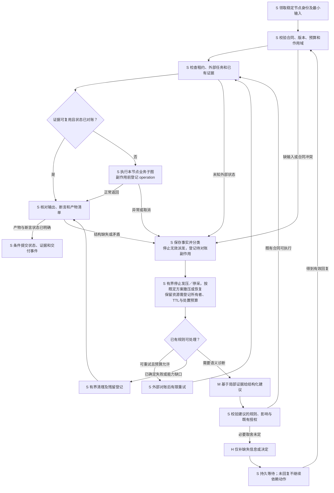

返回失败结果但证据完整时，G8 允许提交失败交付，不把它变成成功。租约丢失的旧执行者不能提交或再次发压；清理与补偿同样遵循资源所有权。无法确认外部副作用时保留 unknown 并停止依赖它的动作，不无限重试。自动重试预算耗尽进入明确失败／待输入，而不是反复调用模型。

进入 M 诊断或 H 等待前，执行器先按合同使本节点进入可等待状态：停新请求、处理采样器、按预定方案撤销压力／故障，记录仍在运行的任务和未决资源。保留实例必须有所有者、保留期限、续租预算及到期处置；不能无限占锁或无限续租。清理未完成时隔离冲突域，不能过早释放给其他实验。所有动作仍限于已授权处置，未知外部对象不猜测删除。若 G8 无法补齐产物，提交带缺口的最小失败清单，不再次无界循环；中断后的性能轨迹按分段记录。

## 1. 主图入口与调度内部

### R0、R1、RP：恢复、方法检查与选择计划

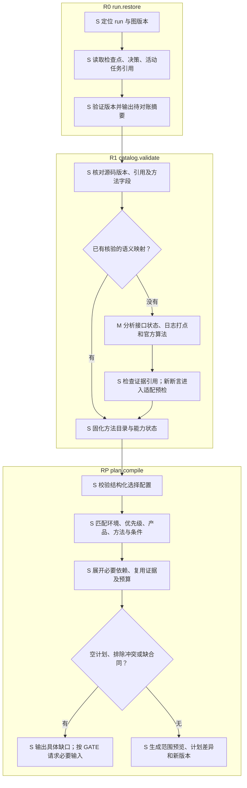

自然语言选择的 M 转换是 RP1 的可选上游输入，不替代 RP2 的确定性匹配。既有授权无需每轮人工确认。R1 新语义无法自动证明时保留待验证标签，不能因字段齐全判为真实可比。

### R2、R3、R6、R7：派发、事件、返工与等待

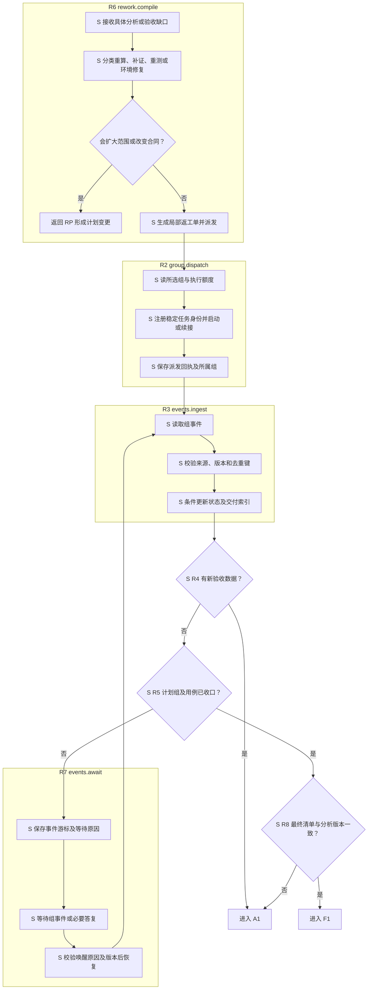

RX 将空计划／冲突登记后结束规划或等待修正，不进入全量执行。只检查、只分析、只报告按计划所需输入路由，不能等待未选择环境组的事件。R5/END 可形成明确部分交付，但未选择、不支持、失败和未知分别记账。

## 2. 环境检查与配置内部

### E1、E2：环境事实、连接、角色与报告

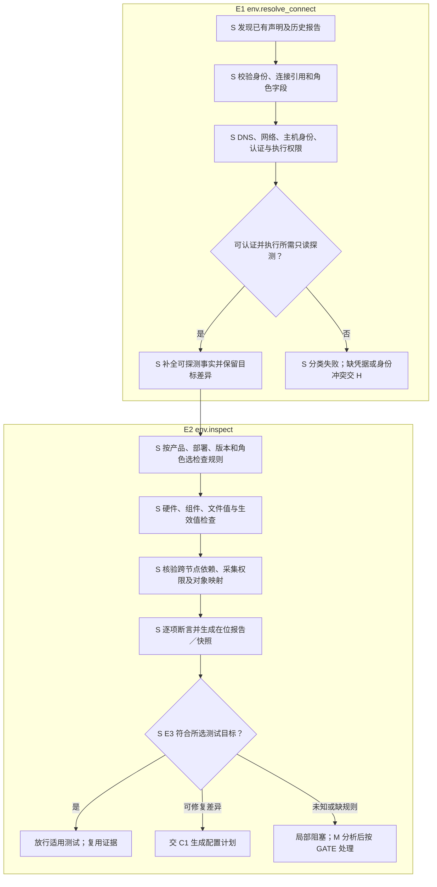

E1/E2 不隐藏写入公钥或安装。声明缺字段时先用已有证据和脚本探测；身份、角色意图或凭据无法获取才请求人工。历史安装日志不可得就如实标记，不影响当前在位检查事实。

### C1、C2、C3：配置计划、逐步执行与独立复检

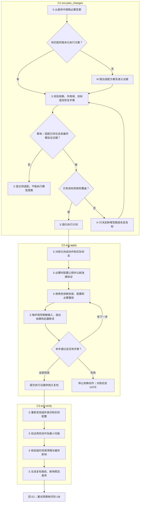

## 3. 环境组统筹内部

### G0、T0、T1、T2：恢复本组与准备方法

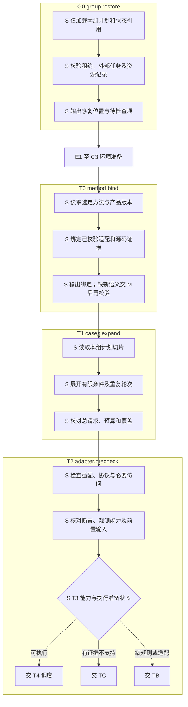

### T4、T5、T6、T8：调度、工作交付与二次验收

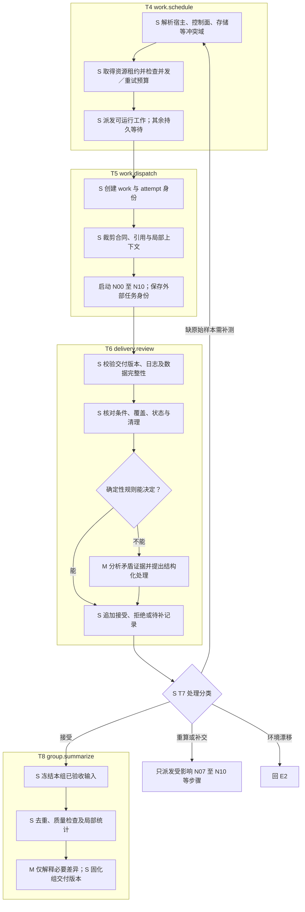

T6 的 M 建议必须通过 GATE 的影响与规则检查才执行；不存在“模型看着合理就接受”的隐含边。T8 对 TC 输入只能生成覆盖记录，不能伪造统计样本。

### TC、TB、GB、GW、GE：缺口、等待与发布

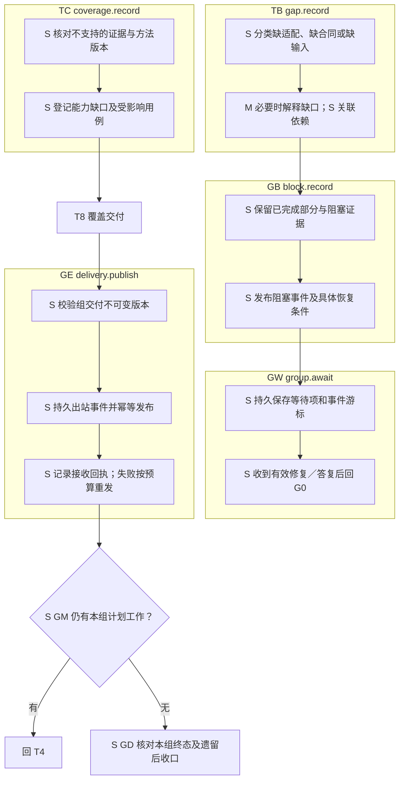

## 4. 指标测试公共节点内部

### N00–N03：合同、对账、准备与预检

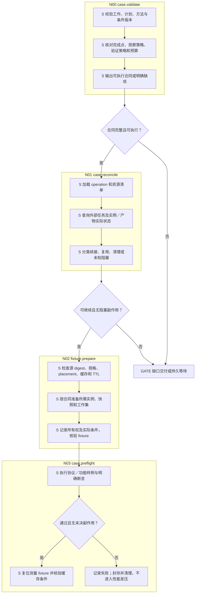

N02 准备来源产物、访问、节点和已有背景条件。需要零实例增量基线的 B09.IDLE/PAUSED、B10.GROWTH/PROJECTION/FIXED_REQUESTS 等方法，将**待测 cohort 的创建推迟至 N04 完成基线之后的 N05**；N03 用独立探测 fixture 并清理复位。B10 有非零 N_initial 时先建立该已声明背景，再测其基线，新增 cohort 仍在基线之后；不得把已经创建目标 N 的资源当零实例基线。

### N04–N06：采集、测量与后验

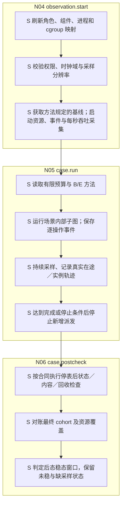

N052 与 N053 实际并行运行：采集在 N04 已启动，图中的连线表示交付依赖，不表示发压完了才开始采样。PSS/CPU 原始域、真实分母、日志观察时间、Guest OS 未决减项按 test-nodes 的合同处理；未冻结规则不交给模型自行计算。

### N07–N10：封存、局部测算、清理与交付

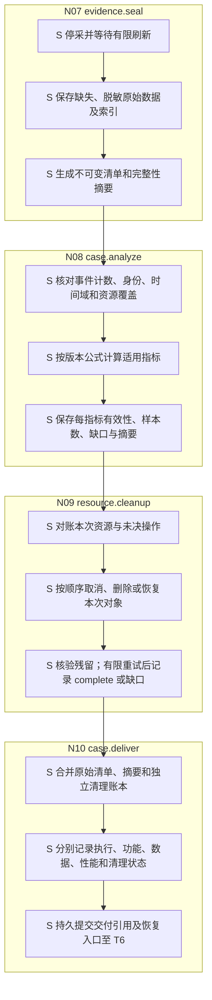

N09 的清理证据另行封存，不修改 N07 的原始测量快照。清理失败仍进入 N10；不能因执行失败而绕过交付，也不能因后续清理失败删除成功的创建测量。创建中未知副作用由 N01/N09 继续对账，清理不扩到非本次对象。

## 5. N05 的各场景内部子图

以下全部动作默认 S；源码语义、新适配判断和参数选择的 M/H 已在职责表逐项列明。输入继承 N02–N04，输出交 N06–N10；异常、取消、超时统一走 GATE，不把成功路线当唯一清理路线。

### B01、B02：模板／快照与镜像创建

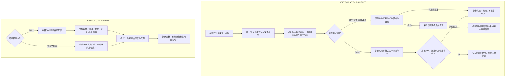

STATE_READY 的创建停表不含 B017；EXEC_COMPLETE 则将命令完成作为另一个方法终点。SERVER_TERMINAL 的内部 duration 与实际观察时间分开，实际补槽不能回溯。

### B03、B04：暂停与恢复

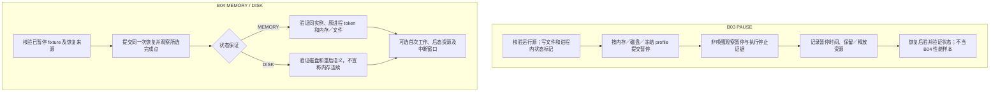

### B05、B06：克隆与删除

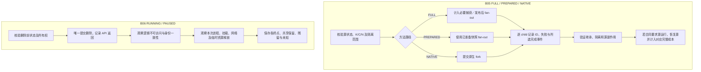

### B07、B08：命令与快照

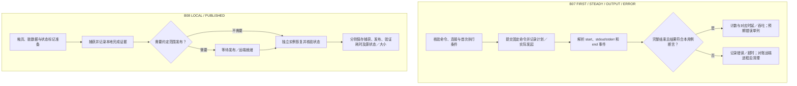

### B09：PSS 底噪

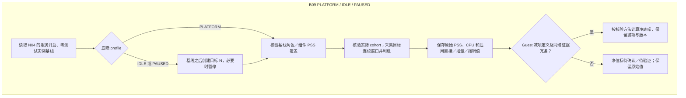

B095 的规则未定时 M 只能分析分离证据，H 只决定扣除目标；不能在图里默认减配置内存或把 Guest used 当宿主 PSS。

### B10：增长、外推、SLO 与固定请求预算

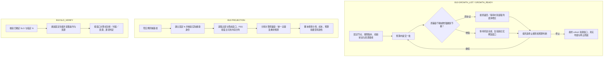

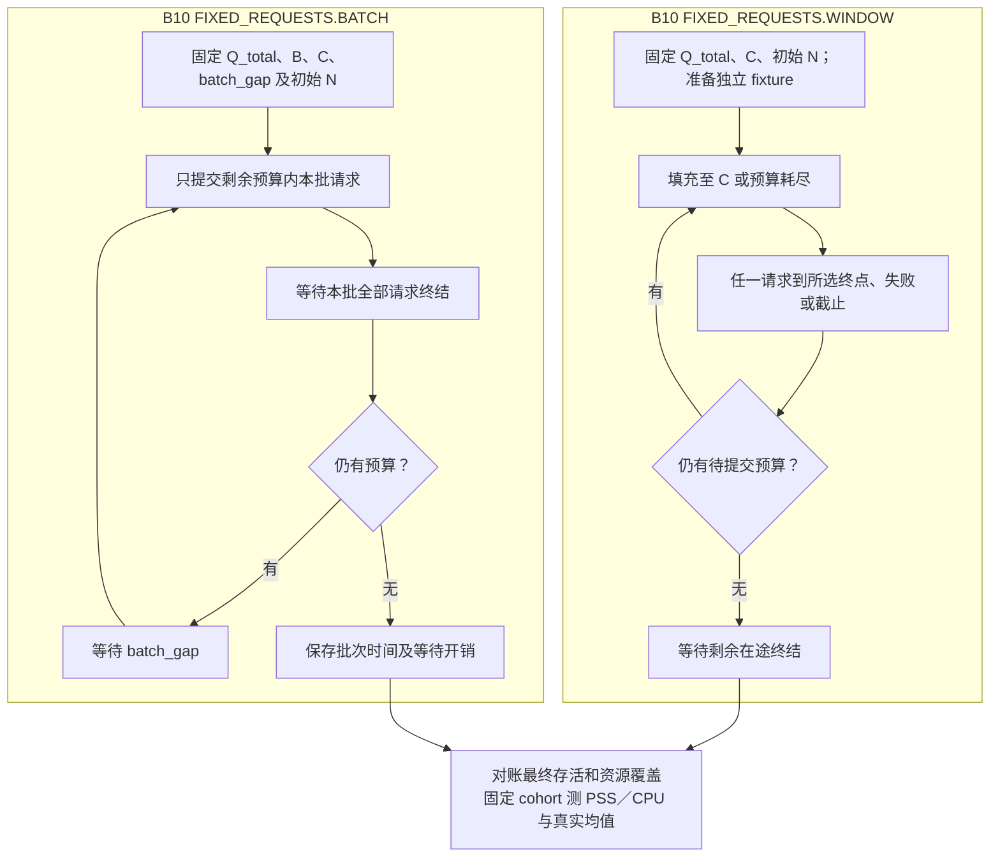

B10 全部方法都从 N04 起持续采集管理／数据节点各组件资源和创建事件。脚本按固定1秒时间桶输出实际发起、接纳及按合同成功创建的速率，连同整轮吞吐交 N08；状态／命令／内部终点不可混列，日志观察延迟单列。增长轨迹中的 CPU 成本与最终稳态平均不同；失败请求不补成成功数，未知副作用仍需对账。预算／取消边统一继承 GATE，不能循环到预算外。

### E01–E03：低优先级负载、重置与长稳

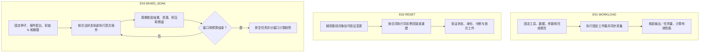

### E04–E06：压力、干扰与故障恢复

```mermaid
flowchart TD
    subgraph E04["E04 PRESSURE"]
        E041["核验已选压力对象、阶梯及预算"] --> E042["记录基线后施压并执行业务验证"]
        E042 --> E043["区分 guest／host OOM、准入与任务结果"]
        E043 --> E044["撤压并验证资源和业务恢复"]
    end
    subgraph E05["E05 INTERFERENCE"]
        E051["受害负载基线与共置证据"] --> E052["启用已确定干扰负载并运行配对窗口"]
        E052 --> E053["撤除干扰；计算相对基线变化和资源竞争"]
    end
    subgraph E06["E06 RECOVERY"]
        E061["核验故障对象、恢复方案及任务身份"] --> E062["注入已确定故障并记录事件"]
        E062 --> E063["观察不可用、积压、任务丢失或重复"]
        E063 --> E064["恢复对象并验证业务；保存恢复各终点"]
    end
```

E01–E06 均须显式选入计划且有适配；故障动作与撤销记录同样先登记身份，重入先查当前状态，不能重复注入。未知故障诊断交 M，是否扩大范围由 H 决定，不自动升级基础测试范围。

## 6. 全局数据分析内部

### A1–A3：输入快照、质量与计算

```mermaid
flowchart TD
    subgraph A1["A1 analysis.freeze_inputs"]
        A11["S 枚举已验收交付及计划覆盖"] --> A12["S 固定精确版本和原始证据引用"]
        A12 --> A13["S 保存不可变分析输入清单"]
    end
    subgraph A2["A2 analysis.quality"]
        A21["S 验证 schema、身份、单位、事件和资源覆盖"] --> A22["S 检查条件、完成点、时间域和公式输入"]
        A22 --> A23{"存在未核验的新语义？"}
        A23 -->|有| A24["M 审查差异；S 保留受限／不可比标签"]
        A23 -->|无| A25["S 按已核验规则分组并保存有效性"]
        A24 --> A25
    end
    subgraph A3["A3 analysis.compute"]
        A31["S 从原始样本及合法统计产物取数"] --> A32["S 去重并计算逐指标结果、样本量与波动"]
        A32 --> A33["S 绑定公式／窗口／分母／原始证据"]
        A33 --> A34["S 保存无效、缺测、失败与未定义结果"]
    end
    A13 --> A21
    A25 --> A31
```

A3 不平均各组 P99、不把缺值填零、不把请求数当实际存活分母、不合并不同起止时间。计算规则未确定时阻塞对应指标，不由模型算一个近似数写入 Excel。

### A4、A5、A7：横向比较、复核与 Excel

```mermaid
flowchart TD
    subgraph A4["A4 analysis.compare"]
        A41["S 匹配同方法、条件与可比候选"] --> A42["S 生成绝对值、已定义差值／比例及覆盖表"]
        A42 --> A43{"明确启用了评分规则？"}
        A43 -->|是| A44["S 检查完整性后按确定权重计算"]
        A43 -->|否| A45["S 保留分场景比较，不生成总排名"]
        A44 --> A46["S 输出可追溯对比产物"]
        A45 --> A46
    end
    subgraph A5["A5 analysis.review"]
        A51["S 规则化异常检查和数值溯源"] --> A52{"是否需要解释未覆盖差异？"}
        A52 -->|是| A53["M 基于证据提出解释或有限补证建议"]
        A52 -->|否| A54["S 核对已定义缺口及返工范围"]
        A53 --> A54
        A54 --> A55{"S A6 需补证／重算／补测？"}
        A55 -->|需要| A56["交 R6；扩围需回 RP"]
        A55 -->|不需要| A57["保存复核版"]
    end
    subgraph A7["A7 excel.render_verify"]
        A71["S 读取固定结果及展示模板"] --> A72["S 生成表、公式、图、单位与证据索引"]
        A72 --> A73["S 重读工作簿核对行数、值、公式与引用"]
        A73 --> A74["S 保存 Excel 版本和检查记录"]
    end
    A46 --> A51
    A57 --> A71
```

Excel 不能成为唯一原始数据库。模型可解释差异或提出表述，不能修改单元格数值使结果“合理”。未启用评分无需向用户索取权重；单候选标比较不适用，不自动添加产品。

## 7. 报告与归档内部

```mermaid
flowchart TD
    subgraph F1["F1 report.assemble_facts"]
        F11["S 冻结分析版本、事实表、图表与缺口"] --> F12["S 按模板装配数据和规则型结论"]
        F12 --> F13["M 撰写分场景解释、适用建议及限制"]
        F13 --> F14["S 保存草案与逐结论证据引用"]
    end
    subgraph F2["F2 report.verify"]
        F21["S 检查数值、单位、图表、引用、覆盖及版本"] --> F22["M 复核语义推断、因果和适用范围"]
        F22 --> F23["S 记录两类复核及问题归属"]
        F23 --> F24{"S F3 交付一致？"}
        F24 -->|文字／推断问题| F25["回 F1，只重写受影响内容"]
        F24 -->|数据问题| F26["回 A1 或相应分析节点"]
        F24 -->|符合| F27["允许归档，保留未完成范围"]
    end
    subgraph F4["F4 archive.seal"]
        F41["S 汇集报告、Excel、合同、源码／环境版本及原始证据"] --> F42["S 加入失败、清理、恢复入口和待决项"]
        F42 --> F43["S 检查完整性、引用可达及读取校验"]
        F43 --> F44["S 封存归档 manifest 与完整／部分交付状态"]
    end
    F14 --> F21
    F27 --> F41
```

有证据的报告解释属于 M；事实、公式、引用、模板填充及归档属于 S。业务意图确实缺失才经 GATE 请求 H。F2 数值校验通过不代表自动证明所有因果解释，语义复核记录必须单独保存。

## 8. 覆盖、状态及图变更

职责表中所有持久工作节点均在本文有内部子图；路由节点通过条件菱形或明确说明覆盖，不隐含额外模型节点。B/E 的变体由分支和共同合同覆盖，实际 case_template_id 仍可单独选择。

新增节点时同时补 node-automation 的 S/M/H 行、本文内部步骤／失败继承、test-nodes 的方法语义和对应 spec。更改内部脚本、完成判据、取数时刻或依赖时生成版本并判断旧证据失效范围。脚本实现完成必须另附代码与验证，本文图和引用检查只证明文档结构完整。

## 图版本变更的补充合同

RP 的版本激活内部图与确定性协议见 [orchestration-design.md](orchestration-design.md) D14，测试见 ORC-056，任务见 [tasks.md](tasks.md)。Q3 已确认：旧任务原图收尾，新图新 run/thread；同图选择变更使用计划 CAS。激活、派发截止、操作对账、资源门控和证据兼容校验属于 S；未知语义解释属于 M，尚未定义的范围／处置属于 H。默认策略已获确认，不逐次人工批准。节点仍为 planned。

## 执行代码与代码契约入口

本节点的执行模块、算法及恢复合同见 [benchmark-design.md](benchmark-design.md)；测试这些代码的独立断言、夹具与工程测试见 [benchmark-contract-design.md](benchmark-contract-design.md)，任务见 [tasks.md](tasks.md) 15–26组。运行时参数缺失只阻塞对应真实用例，不阻止严格合同和算法实现。Kuasar B02.FULL 已补查公共builder路径（BCD-05）；目标部署可用性及实际适配另行验收。
