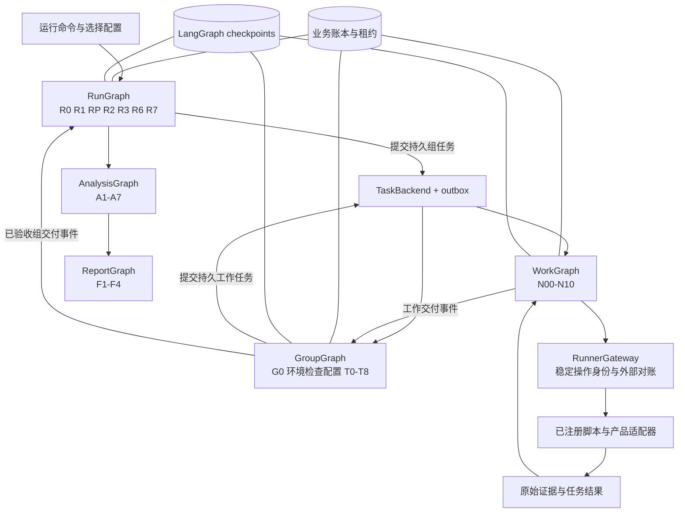
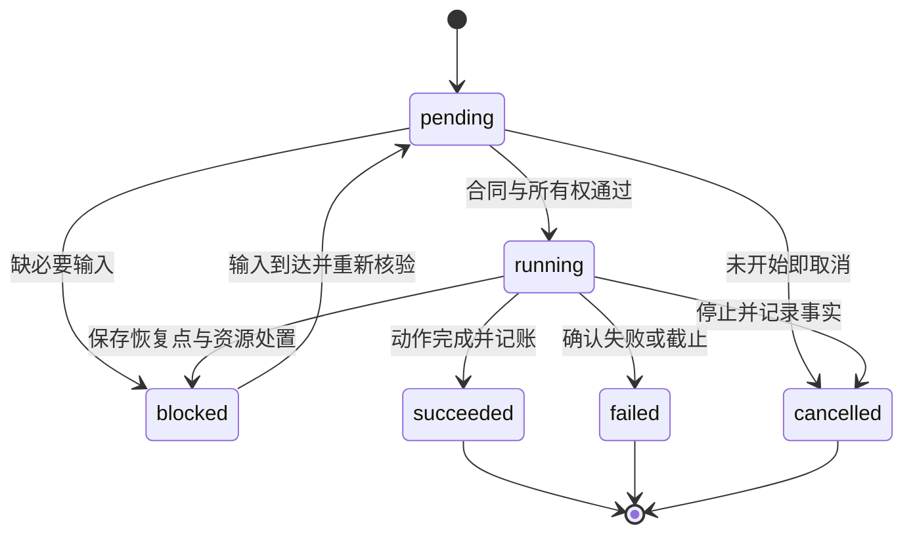
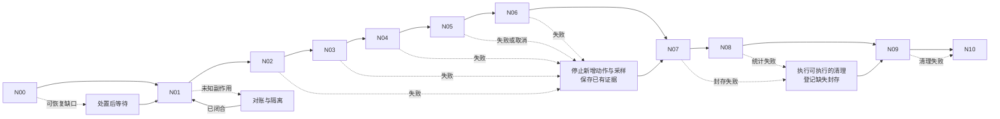
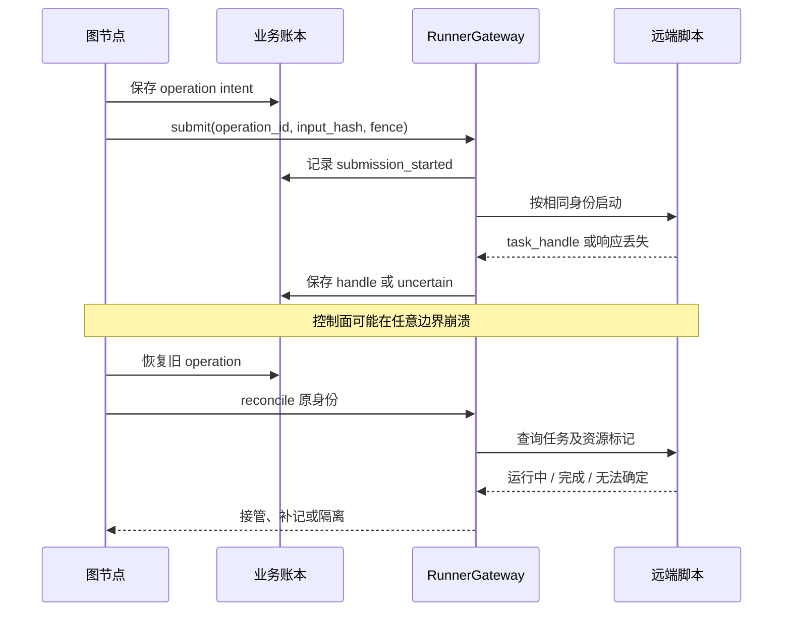
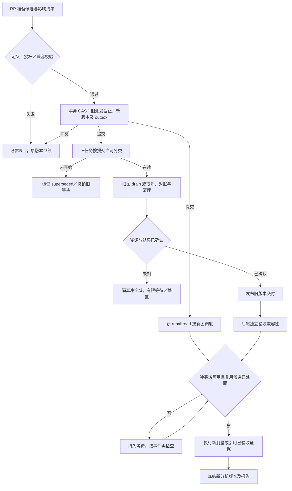
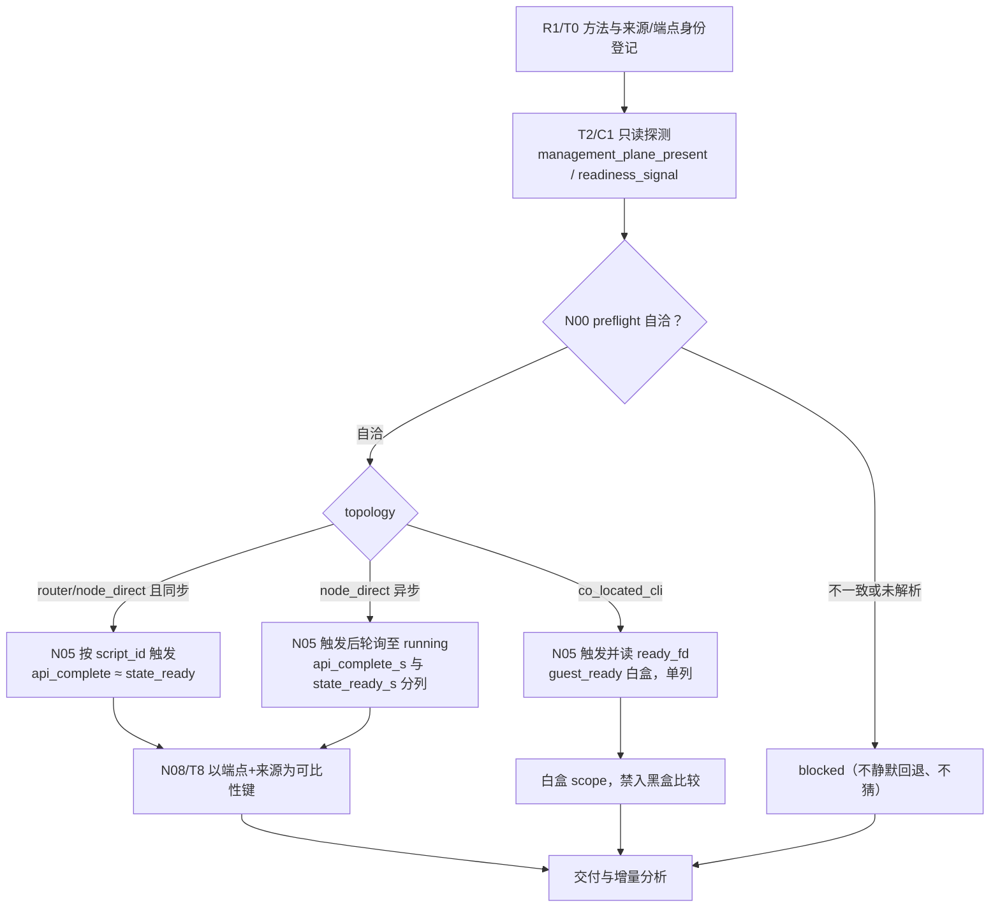

# 图编排代码详细设计

## Context

2026-10-21，设计草案，implementation_status=planned。本文是 [design.md](design.md) 的实现设计附件，测试设计见 [orchestration-test-design.md](orchestration-test-design.md)。当前没有实现本文描述的包、服务、数据库或测试。路径和接口名均为拟议代码合同。

需求来源：[工作流规格](specs/evaluation-workflow/spec.md)、[环境规格](specs/environment-readiness/spec.md)、[运行时规格](specs/runtime-evaluation/spec.md)。业务节点以 [node-automation.md](node-automation.md)、[node-workflows.md](node-workflows.md) 和 [test-nodes.md](test-nodes.md) 为准；本文解释如何把这些节点落实为可恢复的程序。

采用 OpenSpec explore 保存设计，brainstorming 做完整性与独立审阅。本文属于已有 design 产物的配套说明；默认 spec-driven 不单独追踪两个附件的完成状态。本轮通过 OpenSpec propose 补齐实施 tasks，不修改 schema；CLI 的 design=done 仅表示产物存在，不等于设计评审或工程验证通过。

## Goals / Non-Goals

**Goals:** 明确代码模块、状态与数据归属、LangGraph 映射、三级 agent 协议、持久派发、资源互斥、失败恢复、选测与图变更、增量分析及报告收口，达到可以据此拆解实现任务和验证的程度。

**Non-Goals:** 本轮不实现调度器、安装或测量脚本；不重复定义三套产品 API；不确定真实环境和测试规模；不把未澄清的负载、Guest OS 扣除或调优范围变成默认事实。脚本仅设计编排侧调用和恢复协议，其业务算法另行细化。

## Decisions

### D01. 基础实现方案与替代方案

以下是本次提出的工程选择，尚未作为用户已确认决策：

| 项目 | 拟议选择 | 理由与替代方案 |
|---|---|---|
| 编排语言 | Python，异步执行接口；实现时锁定支持的 Python 与依赖版本 | 与既有 Python 草稿及 LangGraph 接口衔接；草稿不直接视为合格实现 |
| 图引擎 | LangGraph StateGraph；LangChain 为可选模型接入层 | 状态和条件边用程序；不要求所有节点通过通用对话 agent 推理 |
| 正式持久化 | PostgreSQL：业务账本、事件、任务、租约；LangGraph 使用匹配版本的持久 checkpointer，独立表空间，且必须接入 D10 的事务内 fencing | 多执行者条件更新与持久任务使用一套数据库能力；SQLite 仅可作为开发替代，不能用它的测试代替正式后端并发验收 |
| 部署边界 | 初版控制面可单机运行，但将主图、组图、工作图作为独立逻辑任务；允许多个 worker 进程 | 逻辑三级 agent 不等于必须部署三层服务；无需先引入独立消息中间件 |
| 任务后端 | 数据库任务表、outbox 和消费游标；通知用于加速，定时扫表用于找回 | 避免只用进程内 create_task；替代的外部队列以后通过 TaskBackend 接口接入 |
| 大型产物 | ArtifactStore 接口，初版使用所有 worker 可访问的持久文件存储；不可变路径与 manifest | checkpoint 不存采样全集；扩为对象存储时维持同一发布／校验合同 |
| 模型调用 | AgentGateway，结构化输入输出、独立权限与预算；确定性路径零模型调用 | 不把数值判断、轮询和分支选择交给模型 |
| 测量执行 | RunnerGateway 提交可接管的外部任务，远端 runner 保存操作记录 | 控制面重启不会凭 checkpoint 重发整个实验 |

正式环境若不能提供 PostgreSQL 或持久产物存储，需要调整后端设计并重做相应恢复测试；不能静默换成内存实现。具体安装版本和资源规格在实施锁文件及部署合同确定，不在这里编造“已验证版本”。

官方能力与本工程选择分别记录：StateGraph 提供状态、节点和边；checkpoint 需要稳定 thread_id；持久 saver 用于重启恢复。[Graph API](https://docs.langchain.com/oss/python/langgraph/graph-api)、[Persistence](https://docs.langchain.com/oss/python/langgraph/persistence)

### D02. 三层职责与实际执行拓扑

`RunGraph → GroupGraph → WorkGraph` 是责任与委派关系。长生命周期的 GroupGraph/WorkGraph 由任务后端独立运行，父图仅提交任务并处理交付事件，不在同一个 super-step 内等待所有子图结束。主图因此可以先分析已验收组，其他组继续运行。

短小、无独立生命周期的分析与报告流程可编译为内嵌子图，通过 wrapper 显式映射输入输出；耗时脚本仍委派外部任务。全部图均在有界执行片段结束时持久让出；等待使用事件／计时器唤醒，不空转调用模型。



图中任务后端、gateway 和数据库不是新增业务阶段。业务仍为既有五阶段。官方子图支持不同 state schema 的显式映射；本工程的持久队列委派是额外实现，不把它称作 LangGraph 自动提供的跨进程子图调度。[Subgraphs](https://docs.langchain.com/oss/python/langgraph/use-subgraphs)

每个持久工作节点绑定 `owner_agent_id`，例如 `work_id/N04` 和 `work_id/N05` 是不同的节点看护身份。WorkGraph 是执行容器，不要求各节点共享对话：进入节点时生成只含该节点所需字段的 NodeContext。组统筹是其上级验收者；根侧 A/F 工作节点由主 agent 统筹。一个 HTTP 请求、采样点或条件边不创建 agent。

### D03. 拟议模块与公开接口

拟议代码根为 `sandbox_graph/`，既有 `sandbox_bench/` 保持待审计草稿身份。表中返回类型详见 D04–D06；接口是设计签名，不是已有函数。

| 模块 | 核心接口 | 责任及禁止跨越的边界 |
|---|---|---|
| `domain/models.py` | RunRecord、Plan、WorkKey、NodeResult、DeliveryManifest | 带 schema_version 的严格数据校验；不调用网络 |
| `domain/transitions.py` | `transition(current, event, expected_revision) -> StatePatch` | 合法状态转换与分离状态判定；不接受自由文本覆盖事实 |
| `catalog/registry.py` | `resolve_node(id, version)`、`resolve_method(id, version)` | 处理节点与方法定义、实现状态、接口摘要及来源 |
| `planning/compiler.py` | `compile(selection, catalog, auth, evidence) -> PlanPreview` | 有限匹配、必要依赖、复用、缺口；不执行远端动作 |
| `planning/changes.py` | `diff(old, new) -> ImpactPlan` | 变更及证据影响，不直接改活动图 |
| `graphs/factory.py` | `build_run/group/work/analysis/report(definition, services)` | 构造 StateGraph、注册固定 handler 和确定性路由 |
| `graphs/nodes/*.py` | `async handle(NodeContext) -> NodeResult` | 业务节点薄封装，调用服务和脚本；不用大段 shell 拼接 |
| `runtime/driver.py` | `start(Activation)`、`resume(Wakeup)` | thread 互斥、checkpoint 恢复、领域对账、执行片段让出 |
| `runtime/tasks.py` | `enqueue(JobSpec)`、`claim()`、`finish()` | 持久派发与租约接管，不把 claim 当操作成功 |
| `runtime/events.py` | `append(Event)`、`consume(Cursor)` | 可靠发布、去重、来源核验与事务性消费 |
| `runtime/leases.py` | `acquire_all(domains)`、`renew(token)`、`quarantine()` | 多冲突域原子领取、fencing 与隔离 |
| `runtime/runner.py` | `submit/reconcile/cancel/collect(Operation)` | 唯一提交、实际外部任务接管、超时与取消 |
| `runtime/agents.py` | `build_context()`、`diagnose()`、`review_semantics()` | 模型作用域、证据片段、预算与建议校验 |
| `runtime/waits.py` | `park(WaitRecord)`、`accept(DecisionEnvelope)` | 持久等待、输入身份与版本校验，不把沉默当批准 |
| `persistence/repository.py` | UnitOfWork、CAS、receipt、outbox | 业务事务，禁止图函数自行散写状态 |
| `persistence/checkpointer.py` | FencedPostgresSaver，对接锁定版本的 saver protocol | checkpoint 与 pending writes 写事务原子校验 owner_epoch，不直接使用无 fence 的 saver |
| `artifacts/store.py` | `stage/verify/commit/open_range` | 原子发布、不可变身份、授权范围、局部读取 |
| `services/reviews.py` | `review_delivery()`、`freeze_analysis()` | 分层验收、固定输入版本、受影响输出失效 |
| `services/closure.py` | `classify_scope()`、`seal_archive()` | 覆盖核对、完整／部分交付和资源遗留 |
| `interfaces/service.py` | RunService、GraphService、QueryService | CLI/API 共用服务；CLI 的具体外观不影响核心协议 |

RunService 提供 `preview/start/status/resume/cancel/retry/reanalyze/rerender`。GraphService 提供 `get/list/propose_patch/validate/diff` 及 `activate_revision(request_id, predecessor_run_id, expected_revision, candidate_plan_hash, disposition_policy)` 激活入口。查询返回节点定义、实际版本、状态、阻塞与证据；变更命令均需 request_id 幂等，不删除历史证据。

### D04. 身份模型与不可变数据

序列化原则：配置可用 YAML，进入程序后规范化为严格 JSON 模型；未知字段拒绝，单位明确，时间戳保留时钟域。规范化内容摘要不包含随机 ID、生成时间和秘密。大型集合通过 manifest 引用。

| 对象 | 最少字段 | 身份与版本规则 |
|---|---|---|
| RunRecord | run_id、root_thread_id、graph_ref、contract_ref、active_plan_ref、auth_ref、status、revision、lineage_id、supersedes_run_id、dispatch_generation | run_id 不由对话 ID 代替；graph_ref 创建后不可变；历史计划与前后继运行可查询 |
| GraphDefinition | graph_id/version/hash、state_schema_version、nodes、edges、route_registry、compatibility | 不可变；handler 只引用注册表，不允许配置内任意代码 |
| NodeDefinition | node_id、handler_ref、input/output_schema、effect_class、owner_role、retry_policy、reconcile_ref、cleanup_ref、implementation_evidence | 每个执行节点一条；条件菱形不强行制造工作节点 |
| Plan | plan_id/version/hash、selection_ref、catalog_ref、graph_ref、contract_ref、cases、dependencies、gaps、budgets、auth_ref | 预览与执行共用同一不可变 manifest；预览后变更不能偷偷执行新集合 |
| WorkKey | group_id、scenario_id、method_id/version、condition_hash、repeat_id、measurement_generation | 表示一次独立实验；追加重复使用新 repeat_id，补测使用新 generation |
| WorkInstance | work_id、WorkKey、run/plan_ref、environment_ref、phase、attempt_refs | 新计划引用旧有效结果时保存 reuse_from，不改旧 work 的归属 |
| NodeAttempt | work/thread、node_id、visit_id、attempt_id、owner_agent_id、owner_epoch、input_hash、revision | 同节点因循环再次执行要换 visit_id；崩溃重放同一动作仍用原 visit_id |
| Operation | operation_id、request_hash、script_ref、phase、task_handle、resource_refs、submission_state | operation_id 不包含接管者或租约 epoch；重放不换号 |
| EvidenceRef | artifact_id、uri、digest、size、media/schema_version、producer、scope、time_domain、source | digest 只证明内容身份；来源真实性和方法有效性另验 |
| DecisionRecord | decision_id、question_id、scope、plan/contract_version、actor、answer、expiry | 人工答复与模型建议分开；不兼容版本不能直接复用 |
| ReviewRecord | review_id、delivery_id/version、reviewer、rules_ref、findings、decision | 追加式，组级复核不覆盖节点自检 |

ID 使用持久分配的 UUID，业务去重使用单独唯一键。thread_id 保存为有界字符串，关联 `(run, graph_version, scope_kind, scope_id, generation)`，禁止依赖可变节点列表顺序或随机进程启动 ID。外部沙箱 ID 必须附运行代次，PID 附主机 boot_id 与进程启动身份。

### D05. GraphState、领域账本与更新责任

LangGraph checkpoint 保存执行位置和小型引用；领域账本保存权威的操作、验收、所有权和交付事实；ArtifactStore 保存大文件。这三个持久边界不能被当成一次原子提交。

| GraphState | 字段 | 独占写入者 |
|---|---|---|
| RunState | run_id、graph_ref、plan_ref、activation_id、ledger_revision、event_cursor、group_index_ref、analysis_ref、closure_ref、wait_ref | 主图 driver |
| GroupState | group_id、plan_slice_ref、environment_ref、activation_id、ledger_revision、work_index_ref、delivery_ref、wait_ref | 本组 driver |
| WorkState | work_id、attempt_id、node_cursor、visit_id、input_refs、operation_refs、result_ref、wait_ref | 本工作 driver |
| AnalysisState | analysis_id、input_manifest_ref、rules_ref、quality_ref、metrics_ref、comparison_ref、excel_ref | 该分析图 driver |
| ReportState | report_id、analysis_ref、facts_ref、draft_ref、verification_ref、archive_ref | 该报告图 driver |

所有 state 均无默认 messages 全历史字段。服务连接、模型客户端、凭据和进程句柄通过运行时 services 注入，禁止 checkpoint 序列化。必要摘要有字节／条数预算，完整状态列表分页放账本。

同一 thread 同时最多一个有效 driver，数据库 CAS 检查 expected_revision 与 owner_epoch。并行子任务仅发布事件，不写父 checkpoint。需要合并的 keyed 状态按 `(entity_id, revision)` 归并：相同版本相同摘要幂等；相同版本不同内容报冲突；低版本保留历史但不覆盖当前。不得对完成数做“收到消息就 +1”。

领域动作完成先提交 receipt，再由节点返回 checkpoint 更新。receipt 唯一键为 `(thread_id, node_id, visit_id, input_hash)`，包含结果引用和下一步决策。visit_id 在上一个领域转移／activation 事务中分配；checkpoint 重放同一输入查原 receipt。已提交 receipt 直接复用，未提交且可能产生副作用走 Operation 对账。循环返工由新领域转移生成新 visit_id，不能把真正第二轮误判为重放。

checkpoint 若落后账本，通过 receipt 重放恢复一致；checkpoint 引用缺失账本记录或摘要冲突则阻塞、保留诊断，不能盲目重新提交副作用。数据库账本和 checkpoint 用不同事务，所以这一恢复桥接必须做真实进程崩溃测试。

### D06. 分离状态与错误合同

节点采用以下互相独立的状态，不用单一 success：

| 维度 | 值域 | 判定责任 |
|---|---|---|
| execution_status | pending、running、succeeded、failed、blocked、cancelled | 本节点账本；timeout 在 outcome_reason 中区分 |
| data_status | unverified、valid、invalid、insufficient | 验证器，必须有证据与规则版本 |
| review_status | pending、accepted、rejected | 上级 ReviewRecord 的有效视图 |
| performance_status | not_evaluated、pass、fail、not_applicable | 指标／阈值脚本；fail 不自动重试 |
| cleanup_status | not_needed、pending、complete、incomplete、unknown | 对账及清理器 |
| coverage_status | selected、not_selected、unsupported、blocked、attempted、completed | 计划与能力证据，不等于性能通过 |

`blocked` 可恢复，不能仅凭该值计入最终收口。归档时用另一个 `scope_disposition=fulfilled/failed/skipped/blocked_closed/cancelled` 加处理记录；blocked_closed 必须由既定收口规则或明确决定产生，仍保留阻塞事实。



上图仅表示 execution。failed/succeeded/cancelled 尝试不可改写回 running；重试建立新 attempt，continuation_of 关联原尝试；对同一外部操作的接管不分配新 operation。执行终结后仍可追加 review 和 cleanup 记录，不掩盖原结果。

NodeResult 包含上述分离状态、assertions、artifact_refs、operation_refs、resource_refs、affected_scope、error、continuation。error 至少包含 `code/retry_class/effect_certainty/observed_at/evidence_refs`：

| 错误类 | 确定性路由 |
|---|---|
| INPUT_MISSING / CONTRACT_CONFLICT | 阻塞受影响节点；必要意图才人工 |
| CAPABILITY_UNSUPPORTED | TC，保留覆盖项，不运行性能脚本 |
| ADAPTER_MISSING / UNVERIFIED | TB，模型方案不能直接执行 |
| TRANSIENT_READ | 按次数、退避和总 deadline 有界重试 |
| EFFECT_UNKNOWN | 先对账，无法证明无副作用不重发；隔离冲突域 |
| EXECUTION_FAILED / FUNCTION_FAILED | 保留失败与清理；只按合同补测 |
| EVIDENCE_INSUFFICIENT | 可补交则补交，否则保留旧样本并提出新测量 |
| PERFORMANCE_FAIL | 正常进入有效分析；不重试到通过 |
| CLEANUP_FAILED / LEASE_LOST | 撤销派发，保留任务与隔离信息 |
| VERSION_CONFLICT / STALE_DECISION | 拒绝变更当前视图，重新读取并生成处理项 |

### D07. 从节点目录到 LangGraph

工厂依据不可变 GraphDefinition 注册 handler 和边；每个节点的内部脚本步骤仍见 node-workflows，不复制成几十个模型提示。节点处理的共同顺序为校验→receipt／外部对账→确定动作→验输出→提交事实与 outbox→返回 state patch／路由。

| 编排节点 | handler 组与输出 | 下一步守卫 |
|---|---|---|
| R0/R1/RP | restore、catalog、compile_plan → Plan | 缺版本或配置不进入 R2 |
| R2/R3/R7 | enqueue_groups、consume_events、park → 调度／事件 receipt | R2 不 await 完整组；R7 无事件则让出 |
| R6 | compile_rework → ReworkOrder | 范围不变定点返工；变合同或扩围回 RP |
| G0 | restore_group → 对账摘要 | 仅加载本组；失败保留其他组运行 |
| E1/E2 | env_check → EnvReport | 已满足到 T0；明确差异到 C1；未知到 GB |
| C1/C2/C3 | env_plan/apply/verify → ConfigReceipt 与新快照 | C1 必须有已验证可执行适配；C3 独立复检，有限回 E2 |
| T0/T1/T2 | bind/expand/precheck → 有限 WorkSpec | 无适配转 TB；有证据不支持转 TC |
| T4/T5 | schedule/dispatch → 工作任务引用 | 获取全部冲突域、输入和预算后才提交 |
| T6/T8/GE | review/summarize/publish → GroupDelivery | 二次验收追加记录；GE 与 outbox 原子提交 |
| TC/TB/GB/GW | coverage/gap/block/wait → 状态事件 | TC 不生成测量样本；GW 唤醒后回 G0 |
| N00/N01 | validate/reconcile → 工作执行前提 | 合同、未知副作用未闭合不进 N02 |
| N02/N03 | fixture/preflight → 准备与复位证据 | 前置不伪装正式性能实验 |
| N04 | start_observation → ObservationHandle | 必要采集 ready 且基线完成后才发压 |
| N05 | run_method → RunHandle／完成事件引用 | 运行具体 B/E 方法；等待 runner 结果时持久让出 |
| N06/N07 | postcheck/seal → 原始证据 manifest | 后验和稳态在停采前；失败路径保留缺口 |
| N08/N09/N10 | analyze/cleanup/deliver → WorkDelivery | 清理失败仍交付 incomplete；不能冒充环境恢复 |
| A1/A2/A3/A4/A5/A7 | freeze/quality/compute/compare/review/render → AnalysisDelivery | 缺口定点返工，最终清单一致才报告 |
| F1/F2/F4 | assemble/verify/archive → ArchiveManifest | 文字修订回 F1；数据问题回 A1；缺文件归档未完整 |

R4/R5/R8/RX、E3、T3/T7、GM/GD、A6、F3 和 START/END 用固定路由函数表示。`unknown` 必须显式分支。每个节点只用一种出边机制：固定边／条件边，或返回 Command 路由；不混写固定出边与 Command(goto) 导致重复派发。此限制来自 Graph API；本项目工厂另外做静态校验。[Graph API 路由](https://docs.langchain.com/oss/python/langgraph/graph-api#command)

WorkGraph 正常边：



STOP、WAIT、RECON、CLEAN 是共同执行协议处理，不新增看护层。N07/N08 失败也要进入清理；进程被硬杀时不能依赖 try/finally，由恢复协调器扫描未终结 operation 和资源记录完成相同协议。N10 在缺原始数据时提交缺口清单，不能要求有成功数据才能报告失败。

### D08. 选测编译与依赖

`compile()` 为纯确定性计算；环境新鲜性核验以输入 evidence 表达，真正探测由 E1/E2 执行。步骤：

1. 校验 selection schema、有限候选目录、授权环境、显式条件组合及版本。
2. 同维度并集、跨维度交集、排除最后应用；显式空集合、非法 ID、零匹配分开返回。这里是建议的组合语义，实际进入执行前需随选择合同确认。
3. 保留已选不支持项；只展开已声明 tuple，不生成完整笛卡尔积。
4. 按类型补必要准备依赖，区分 preparation/preflight/measurement/postcheck/cleanup。选择 B04 只补暂停 fixture，不补 B01/B03 性能矩阵。
5. 依赖与排除冲突则标 affected cases；证据复用检查内容、合同、环境新鲜性、来源和脚本版本，不能只比较 hash。
6. 建立资源冲突域和有限预算；未定义隔离映射的测量阻塞，独立只读工作仍可运行。
7. 生成 selected/dependency/reused/excluded/unsupported/blocked 清单、原因及成本边界。preview 不执行远端变更。
8. start 必须引用预览的 plan_hash，核对授权覆盖和关键证据新鲜性；漂移生成新预览，不暗改计划。

计划未请求某扩展场景时不派发它；未指定具体测试条件时可以做结构预览，正式测量的必填合同保持 blocked。仅检查可输出环境报告后直接走范围核对与 F4；仅分析从有效输入进入 A1；仅报告从同版分析进入 F1。不能为了等待组结果而启动不存在的组任务。

### D09. 持久任务、事件与防丢唤醒

任务字段：job_id、job_kind、scope_ref、thread_id、activation_id、dedupe_key、due_at、status、owner_epoch、lease_until、retry_count、deadline。job_kind 包括图激活、外部观察、清理、交付复核；不为每个性能请求创建控制面任务。

事务顺序：

1. 派发事务写业务 intent、任务与 outbox，唯一键拦截同一激活重放。
2. worker 原子 claim，取得递增 epoch，事务外执行；长任务只做短暂心跳更新，不长期占数据库事务。
3. 完成事务校验 epoch/revision，写 receipt、状态变化、产物引用及 outbox。
4. outbox 发布允许重复；接收端在同一事务中核验事件、去重、更新投影和 cursor。
5. 通知丢失时由 due 扫描／未消费事件扫描找回。进程内通知不是事实来源。

EventEnvelope：event_id、producer_scope/epoch、aggregate_id、aggregate_seq、run/plan/graph_ref、kind、payload_ref/hash、causation_id、emitted_at。事件按 aggregate_seq 应用；跨 aggregate 不要求全序。同 seq 不同内容是冲突，不能选较晚到达者。迟到旧 epoch 的测量证据可以附入原操作历史，但不得更新当前 owner 状态。

防丢唤醒：注册 wait 与记录消费 cursor 在同一业务事务，事务内再次检查待处理事件；若已有匹配事件则不休眠。通知与定期扫描都可生成同一 dedupe_key 的 Wakeup。唤醒获取 thread 执行租约，检查 wait_version，只能命中当前等待实例。

普通机器事件等待在片段结束返回 END，领域状态仍为 waiting，下一 activation 从入口读取 cursor 和领域恢复位置。END 只代表一次调用结束，不代表实验完成。真正人工等待使用单独的 WaitDecision 节点 interrupt；`Command(resume=...)` 带同 thread 与精确 interrupt_id。恢复会重执行该节点开头，所以该节点只有输入验证／幂等读取，无安装与创建动作。[Interrupts](https://docs.langchain.com/oss/python/langgraph/interrupts)

### D10. 租约、资源冲突与接管

区分 driver 租约、工作资源预约、实际资源记录。driver 超时只允许接管执行权，不能证明远端负载停止或测试资源可用。

冲突域 ID 由环境事实规范化，例如 host、control_service、storage_pool、network_path。同一物理主机在多个组声明中必须映射同一 canonical ID。组内角色共置不产生两份独占锁。

| 工作类别 | 默认安全规则（拟议） |
|---|---|
| 环境配置与正式测量 | 对实际影响域独占 |
| 只读探测 | 仅在声明无测量干扰且合同允许时共享；否则排队 |
| 工作自身采样器 | 作为该工作观测子任务共享其 reservation，不被互斥规则锁死 |
| 跨组测试 | 所有依赖域不冲突且预算允许才并行 |
| 有残留／未知效果 | quarantine，阻止冲突实验；无关域继续 |

`acquire_all()` 在单事务按排序域 ID 检查后全有或全无，不占一个域等待另一个，避免死锁。调度使用有限并发额度及 FIFO/声明优先级，并记录排队原因；实验请求并发 C 与工作任务并发分开。

每次修改、续租、发布都校验 fencing token；旧 owner 无法提交当前账本。RunnerGateway 同样核对 token，旧 runner 收不到新发压许可。若远端接口不识别 fence，数据库 fencing 不能阻止已经发出的网络请求：接管必须停止旧提交源、排空或对账可能在途请求，再解除 quarantine，不能宣称远端恰好一次。

**checkpoint 的 fencing 同样必须是事务内检查。** 本项目需要实现 FencedPostgresSaver；不能假设官方 saver 已接入我们的 owner_epoch。具体合同：

1. 每次 driver 激活绑定不可变 `(thread_id, owner_epoch, lease_id)`，checkpointer 不能从一个可被其他 worker 改写的全局“当前 token”取值。所有相关 graph namespace 归属同一 root thread 租约。
2. `put/aput`、`put_writes/aput_writes` 及其他会写当前 thread 存储的入口，在**实际执行 SQL 的同一个数据库事务**中锁定 thread_leases 行，校验 epoch、租约和作用域，再写 checkpoint／pending writes。旧 token 直接回滚，不产生部分写入。
3. claim／接管／续租也锁定同一行。旧写事务先持锁提交时，新接管等待并读取该已提交点；新接管先换 epoch 时，旧写事务检查失败。不能先查租约再交给另一个连接上的原始 saver 写入，这会留下检查与提交竞态。
4. saver pipeline／连接池不得绕过上述事务或延迟到锁释放后提交。一个写事务完成前不发布对应 checkpoint 可见通知。线程删除／裁剪只由专门管理任务执行，确认无活动租约且有恢复／保留依据，不给普通 worker 无条件删除权限。
5. 业务 receipt 与 checkpoint 仍是不同事务，继续按 D05 对账；事务内 fence 只保证当前 checkpoint 不被失效 writer 覆盖，不把两类提交变成原子操作。

实施时锁定 LangGraph 与 saver 版本，针对其全部写入口做协议测试；可复用底层 SQL／序列化实现，但必须让租约行与实际写操作共享事务。若所选 saver 无法注入同事务边界，则必须实现受控的 saver adapter，不能降级为调用前检查。ORC-034 专门覆盖旧 worker 卡在 saver 写入前后、pending writes 与 interrupt checkpoint 的竞态。

租约、心跳、重试次数、等待和日志预算由已版本化的 execution_policy 给出；都是必填有限值，不能用无限重试掩盖后端失效。真实并行数量仍取决于 Q2/Q10 的环境及隔离声明。

### D11. 外部脚本调用协议与恢复

RunnerGateway 只接受注册脚本 `script_id/version/digest`，固定 argv 与结构化输入；凭据在执行端按 secret_ref 解析。模型返回 shell 文本不能进入 submit。执行端保存 invocation.json、事件序列、结果清单与资源账本，所有输出先脱敏再提交。

| 接口 | 输入 | 输出及保证 |
|---|---|---|
| `submit` | operation_id、input_hash、script_ref、scope、fence、deadlines、artifact_prefix | 已存在同请求返回原 handle；同 ID 不同内容拒绝 |
| `reconcile` | operation_id／handle、资源标记与期望作用域 | not_submitted/running/completed/failed/unknown + 证据；查询不到不自动等于不存在 |
| `cancel` | operation_id、reason、scope、deadline | 停止新增动作；返回确认程度及待回收资源，不把发送信号当清理完成 |
| `collect` | handle、last_seq、manifest_ref | 幂等拉取增量事件和产物；检出缺号、截断及内容冲突 |
| `cleanup` | resource_inventory、ownership、policy、fence | 仅处理有权处置资源；结果 complete/incomplete/unknown |

控制面 Operation 状态：intent → submission_started → running/terminal；网络不明进入 uncertain。`submission_started` 必须在实际发请求前持久化。支持原生幂等时重用相同 idempotency_key；不支持时不能仅靠重发 submit 达成去重。



对“写 submission_started 后但实际发送前”的崩溃，也不能默认已发或未发；由 durable runner 记录／产品查询证明，否则保留 unknown。没有可靠关联接口的适配器只能输出受限恢复能力，阻塞有风险的重发。

N04 采样会话和 N05 发压任务分开保存，N06 稳态结束后 N07 才停采。runner 与采样器具有明确截止与 watchdog，控制面失联时按合同停止新增请求／撤压／封存；若连续性已断，原实验标 interrupted，不把恢复后的时序拼成连续样本。

固定请求预算在 runner 持久日志里按 operation 消耗，失败也消耗；图重入不能重置 Q_total。每秒吞吐、资源采样和逐请求日志留在 runner 产物，控制面只接收聚合进度／证据引用。最终成功数量与存活 cohort 分开。详细测量公式继续引用 test-nodes，不在编排层重算一套。

### D12. 模型与人工分支、上下文恢复

NodeContext = node identity + 相关合同片段 + 输入／结果 refs + 分离状态 + 当前问题 + 已适用决策 + evidence access scope + budget。父级构造上下文时按 allowlist 投影；存储查询也核验 scope，不能只靠 prompt 告知“不要看别的组”。

纯确定性成功路径调用模型数为零。未知异常触发结构化 DiagnosisProposal：facts（必须引用证据）、hypotheses、suggested_actions（注册动作或待适配说明）、affected_scope、required_decisions。模型无权设置 measured metric、强制 accepted 或提交新 shell。确定性检查拒绝未引用事实、伪造产物、越组路径和不在注册表中的动作。

上下文大小按节点预算限制：超限时分页取证或缩小任务，不截掉失败／阻塞事实后继续。恢复从 ledger 的当前摘要和本节点 receipt 重建，不依赖先前聊天。AgentGateway 记录模型版本、输入摘要、证据范围、调用原因和可用 token 用量；缺失 usage 标 unknown。

必要人工请求包含 question_id、受影响工作、精确问题、已有证据和可选处理；已有授权内的确定动作不重复确认。回答需匹配 scope/version/question，过期回答保存历史但不解锁新合同。

进入诊断或人工等待前，先有界停止新增发压、处理采样与已定撤压，再执行保留／清理策略。保留对象附 owner、到期时间、预算及处置动作，后台 watchdog 独立于模型存活。无权处理或不能确认停止时 quarantine。等待超时不能等同批准，也不无限续租。

### D13. 分层交付与增量分析

WorkDelivery 包含工作身份、输入和合同、所有尝试、raw manifest、局部统计、数据／性能／清理状态及缺口。T6 重新读取 manifest 和必要原始证据，执行结构／身份／完整性／合同／覆盖校验；不能只相信子 agent 的“成功”文本。

T8 对验收结果形成不可变 GroupDelivery(version)。GE 在同事务提交 delivery 与 outbox。unsupported 项可被验收为真实覆盖事实，但不产生零值性能样本。被拒收的数据与缺口仍进入覆盖视图，不能从报告消失。

A1 冻结 AnalysisInputManifest：plan_hash、精确 group delivery 版本、每项验收决定、原始证据引用、缺失范围、comparison/compute rules。分析由该快照驱动，不在中途读“latest”。新交付只置 dirty，当前分析完成后调度下一版本，可合并相同输入触发，但不得丢失中间交付历史。

分析失败且输入完整时只重跑 A 节点；Excel 展示变更只重跑 A7；报告措辞变更只重跑 F1/F2/F4。A5 的返工单包含问题类型、证据、受影响 WorkKey、所需动作、预算和范围判断；不能因异常自动广播重测。

最终收口谓词：

```text
所有有效计划项有 scope_disposition 与处理记录
AND 无仍在运行或未处置的在途测量
AND 最新交付集合已被同版本分析覆盖
AND 报告与 Excel 绑定该分析版本
AND 所有遗留资源已明确处置或以不完整状态登记
```

最后一个条件允许 partial archive，不允许把“已登记残留”写成“已清理”。F4 发布前在业务事务中校验 closure_revision；若 A1 以后有新交付或新计划，拒绝将旧报告置为当前最终版，保留其历史产物并重跑受影响阶段。

### D14. 图增删改查、兼容与复用

GraphDefinition 的改动先生成 patch 与新定义候选，校验节点 ID、handler、类型、输入依赖、覆盖、清理通路和循环退出策略。测量依赖是有向无环关系；控制流允许有界重试／等待循环，因此不能用“整图必须是 DAG”拒绝合法恢复边。每个循环必须有预算或持久等待及外部唤醒条件。

定义查询展示历史版本；删除是新版本中移除节点，历史仍保留。未知 handler、删除必要清理、改变状态类型而无兼容方案都拒绝激活。新节点需要已实现且验证的 adapter，需求描述不是可执行插件。

变更分类：

| 改动 | 可以复用 | 必须重新做 |
|---|---|---|
| 报告文字 | 分析、Excel、原始证据 | F1/F2/F4 |
| 表格布局 | 分析、原始证据 | A7 与相关报告一致性 |
| 判定阈值 | 满足新计算所需的原始证据 | A3 起受影响结果及报告 |
| 完成事件 | 仅含对应新事件且语义／时间域有效的证据 | 缺事件则新测量，不换名沿用耗时 |
| 规格／环境／方法 | 独立未受影响工作 | 受影响条件新 work/generation |
| 图结构／state schema | 经显式兼容检查的产物 | 新 run/thread 执行新图；旧 checkpoint 仅用旧定义恢复 |

**Q3 已确认（2026-10-21）：旧任务保持原图版本完成或清理，新计划生效并复用有效证据；不在活动图实例内热切换拓扑。** 以下是该决定的工程协议，具体存储实现仍须按测试设计验证。

#### D14.1 版本身份与激活边界

图定义、代码包和状态 schema 形成不可变 graph_ref。图版本改变时创建新的 RunRecord、root_thread 和各级子 thread，以 lineage_id 与 supersedes_run_id 关联前后继；禁止修改旧 run.graph_ref 或把旧 checkpoint 导入新图。旧 worker 及定义保留到在途操作、等待处置和清理闭合。删除节点仅影响新定义，不删除历史执行或旧版本的清理能力。

仅改变选择范围且 graph_ref 不变时，允许同一 run 的 active_plan_ref 做 CAS 更新；已有 WorkInstance 仍绑定原 plan、合同和 thread，新增工作获得新身份。根图不得用新计划重解释旧节点输入；driver 在一次 activation 内固定 plan_ref，发现活动指针变化则结束该 activation，再从账本创建新的规划 activation。图版本改变一律创建后继 run。

RP／GraphService 的确定性激活步骤如下：

1. **准备候选：** 校验定义、handler、退出／清理路径、输入合同和授权，生成不可变候选计划及 ImpactPlan，列出保留、移除、新测、复用候选和共享冲突域。未实现 handler 或缺兼容规则阻止对应候选激活；不得靠模型生成即运行。
2. **提交切换：** 单个业务事务校验 request_id 与输入 hash、预期 predecessor revision 及当前后继指针；锁定旧 dispatch gate，递增 dispatch_generation，关闭被替换范围的普通派发。写入旧任务处置、新运行／计划、谱系、切换记录及 outbox 后一起提交。重复 request_id 返回同一结果，不同输入拒绝；并发竞争只有一项通过 CAS，其余须重新预览。
3. **区分已启动与未启动：** 未领取或已领取但尚未取得副作用提交许可的旧普通任务标记 superseded，不能再提交。提交许可记录与 dispatch gate 在同一事务锁顺序下线性化：先提交许可的 operation 即在途，后到的许可拒绝。已记录 submission_started、哪怕尚未发出网络请求，也按在途未知状态对账；不能假设事务外调用与切换原子发生。新的普通操作都受 gate 检查；已获许可的动作、明确允许的完成步骤和清理采用绑定旧 scope 的有限 drain 许可。
4. **旧任务收尾：** 默认在原合同／原截止内 drain；移除范围或显式取消按已授权取消、对账、清理协议处理，cancel 返回不代表已清理。未授权处置或 unknown 保持隔离，不释放冲突域。旧问题的答复只作用于旧 scope；被替换且未开始的等待撤销，涉及在途资源的等待按原有限保留／到期策略结束，不能让切换无限等待。必要清理任务可在关闭普通派发后创建。
5. **新任务调度：** 提交成功后由持久 outbox 唤醒后继。所有版本共用资源冲突域和所有权账本；独立环境可继续，共享环境须等待旧实际操作与资源处置闭合，不能因旧租约过期而启动。

事务失败不会留下可执行的半激活后继；提交成功而进程崩溃由 outbox 和 request_id 恢复。旧派发关闭与新派发开启是账本中的原子决定，外部在途操作按第 3 步许可边界分类，不承诺跨数据库和远端的原子切换。

#### D14.2 证据复用、迟到交付与回退

复用必须有已验收不可变 delivery、适用环境快照／规格／方法／完成事件／时间域和有效期证据。新计划保存 reuse_from 与兼容判定，不修改旧样本身份、分母或归属。旧在途交付只可成为 reuse_candidate：设有限等待期限，在接受或超时处置前不同时启动对应新测量；到期明确选择等待结束后的重测或阻塞，重测仍受资源隔离限制。

旧事件始终更新旧账本；后继订阅显式的候选交付事件，经 T6/A2 再验收后新增复用引用或冻结新的分析输入版本。不得直接更新后继的 latest 指针，也不得把前任的迟到成功改成后继新测成功。后继已开始独立测量时，旧交付只作为历史／辅助证据，不并入同一次测量计数。

回退产生另一新版本运行或新计划，保留谱系；不倒写旧 checkpoint，不抹去已发生的副作用。失败版本停止新增派发并按相同协议收尾。旧代码／定义缺失时阻塞旧任务恢复并保留资源记录，不强行让新代码解释旧状态。



RP 内部流程调用此协议，不新增第二个统筹 agent。准备、CAS、分类、对账、兼容规则、资源门控和复用引用均脚本化；模型仅解释未知兼容语义并给出证据，人工只处理尚未定义的范围／处置选择。已确认默认策略不逐次要求人工确认。

### D15. 存储表与事务边界

| 表／记录 | 关键约束 | 写入事务 |
|---|---|---|
| runs、plans、graph_definitions | 不可变版本唯一；current 指针 CAS | 建立运行／计划与激活 |
| revision_activations、dispatch_gates、submission_permits | request_id 唯一且 hash 一致；前任 revision CAS；许可绑定 operation 与 generation | 激活关闭普通派发；提交许可与 gate 同事务锁定 |
| scopes、node_attempts、receipts | scope revision；receipt 业务唯一键 | 节点结果 + 下一步 intent |
| operations、resources | operation_id 唯一、输入 hash 一致；资源所有权 | 外部提交前 intent；对账后事实 |
| jobs、thread_leases、resource_leases | 同 activation 去重；epoch 单调；域唯一预约 | 派发、原子 claim、续租、结束 |
| events、outbox、inbox、cursors | event_id 唯一；aggregate seq 唯一 | 状态变更 + outbox；消费 + cursor |
| waits、decisions、rework_orders | question/plan/version 关联；命令 request_id 唯一 | 停驻与唤醒、受影响范围 |
| deliveries、reviews、analysis_inputs | delivery version 不可变；input hash 去重 | 验收、冻结输入、发布 |
| archives、artifact_manifests | 内容摘要与作用域；closure_revision | 最终视图 CAS |

文件先写临时区，完成刷新与校验后原子发布不可变 manifest，最后账本提交引用。若文件成功而数据库失败，形成可回收 orphan，不当已交付；若账本引用不可访问文件，验收失败而非补空文件。GC 只处理超出保留期且无活动／归档引用的产物，不把清理实验资源与删除证据混为一谈。

数据库失联：停止新 claim 和新副作用提交；远端 runner 按自己的有限授权／截止处理。数据库恢复后先核对操作再继续，不因 heartbeat 中断就默认重做。

### D16. 可观察性与验收边界

每条控制面日志带 run、plan、group、work、node、attempt、operation、owner_epoch 和 trace_ref，日志量受预算控制；秘密只用引用。控制面记录排队、脚本执行、等待、对账、分析与模型时间，单列 token 和复用数，不与沙箱吞吐混合。

版本锁定后需用真实 LangGraph 和持久后端验证：节点 replay、interrupt 恢复、不同 thread 隔离、条件出边、checkpoint/receipt 两边崩溃。纯 fake 不能证明这些框架语义。官方测试建议每例隔离 graph/checkpointer；跨进程恢复需本项目额外测试。[LangGraph testing](https://docs.langchain.com/oss/python/langgraph/test)

交付证据分成设计审阅、离线逻辑、真实图与数据库集成、故障恢复、真实 sandbox 适配五层。本文只交付第一层的设计，不借现有草稿测试宣称后四层完成。

### D17. 创建端点与来源身份的图契约

D17 只在图节点需要**选择或校验**创建入口拓扑与来源产物身份时生效；若图仅按 `script_id/version` 触发脚本、字段全走 `CaseContract`，D17 约束的是**字段绑定与校验收口**，不额外增加图节点或边。执行侧合同见 [benchmark-design.md](benchmark-design.md) BCD-12（来源）／BCD-13（端点），审计见 [alignment.md §8/§9](../../../docs/source-audit/alignment.md)。

**责任划分（沿用 R1/T0、T2/C1、N00–N05）：**

| 阶段 | 图侧职责 | 禁止 |
|---|---|---|
| R1/T0 方法合同 | 把来源身份（`artifact_kind × launch_path × producer_step`）与端点身份（`topology × endpoint_kind`）登记为方法身份维度，写入 catalog/registry 与 method_id | 按接口参数名称推断 kind／path／同步性 |
| T2/C1 用例准备 | 只读探测并记录 `management_plane_present`（管理面/ingress 角色是否存在）与 `readiness_signal`；写入 case 与 `condition_hash` | 未核验即假定 router 可用；触发任何创建／构建副作用 |
| N00 preflight | 校验来源与端点合同自洽（`co_located_cli ⇒ ready_fd ∧ guest_ready`；远端拓扑禁 `ready_fd`）；不一致→`blocked` | 静默回退到其它拓扑或按名称补默认值 |
| N05/M 执行 | 按 `endpoint_kind` 决定是否轮询；`guest_ready` 单列；分子分母同端点 | 把受理当完成；把 `guest_ready` 与 `state_ready` 并入同一分布 |
| N08/T8/A3 分析 | 以端点与来源作为可比性键；不同键不得合并 | 用异端点样本算同一分位数 |

**GraphState／账本字段：**

- `Plan.cases[]` 与 `CaseContract` 对齐，携带 `artifact_kind`／`launch_path`／`producer_step`／`cost_scope`／`topology`／`endpoint_kind`／`readiness_signal`／`endpoint_ref`。
- 来源身份与端点身份进入 `WorkKey.method_id` 与 `condition_hash`，使不同 kind／path／topology／endpoint 天然分属不同工作实例，不靠事后标签区分。
- `EvidenceRef.scope` 与分析 `comparison` 规则显式含端点与来源键；`guest_ready` 白盒样本的 `scope` 标白盒，不得进入黑盒比较集合。
- 探测与解析结果（`management_plane_present`、`path_evidence`、`resolution_status`）作为证据引用保存，不得只留在模型上下文。

**不变量（与 orchestration-test-design I13/I14 对齐）：**

- I13 同一 `WorkKey`／比较键不含混端点；`guest_ready`（白盒）与 `state_ready`（黑盒）不合并。
- I14 声明管理面入口但 `management_plane_present=false` → `blocked`，不静默回退；未解析的来源／端点不得被默认值或名称填充。

**与其它决策的关系：** D08 选测编译把来源与端点作为条件轴，不能把它们降为脚本内部隐式默认；D11 RunnerGateway 提交时携带 `endpoint_ref` 与来源身份，重入沿用同一身份；D14 图版本变更须保持来源／端点身份的兼容与复用判定。



### D18. 薄模块细化：状态、事件/任务、fencing、观测、closure、ImpactPlan

组 1–14 的四个薄模块已实现设计核心但缺验收与边界。本节把它们的不变量与边界写死，作为离线验收（TDD）的依据；不新增图节点，只细化 D06／D09／D10／D11／D13／D14。

#### D18.1 分离状态转换（细化 D06）

`domain/transitions.py` 只负责 `execution_status` 的合法迁移与 CAS：

- 终态（`succeeded`/`failed`/`cancelled`）**不可复活**，非法迁移必须要求“新 attempt”，不能原地改。
- `transition(current, event, expected_revision, revision)` 在 revision != expected 时抛 `VERSION_CONFLICT`；不吞掉并发写。
- 分离维度（`data_status`/`review_status`/`performance_status`/`cleanup_status`/`coverage_status`）**不因 execution 成功而自动变化**；性能 `fail` 不触发重试。
- `merge_revision` 同版本同摘要幂等、同版本不同内容报冲突、低版本不覆盖当前。
- `retry_allowed` 只对 `TRANSIENT_READ` 且有剩余预算、未过 deadline 才真；`performance_status=fail` 永远不重试。
- 离线验收：ORC-016/017/018/019/050/051。

#### D18.2 事件与持久任务（细化 D09）

`runtime/events.py`、`runtime/tasks.py`：

- 事件按 `(aggregate_id, aggregate_seq)` 唯一；同 seq 同内容幂等、同 seq 不同内容报冲突；`event_id` 与内容 hash 绑定，禁止同 id 改内容。
- `consume` 只沿 cursor 连续推进，**缺 seq 不跳过**；生产者 scope 不在 allowlist 时抛 `PermissionError`，不消费。
- 任务 `enqueue_in` 以 `dedupe_key` 去重：同 key 同输入返回原 job_id，同 key 不同输入报冲突；job_id 已存在但非同 dedupe 报冲突。
- `claim` 只领 `pending`/过期租约、未过 deadline 且未超 attempt 的任务；超预算/超期标 `failed` 而不静默丢弃；派发被 supersede 的普通任务标 `superseded` 且发终态事件，`cleanup/reconcile/analysis/report` 不受 gate 关闭影响。
- `renew_claim`/`finish` 用 `owner_epoch` fencing；过期或 epoch 变更抛 `StaleOwner`；`finish` 重复调用同结果幂等、异结果报冲突。
- 离线验收：ORC-030、033、037–040。

#### D18.3 租约与 fencing（细化 D10）

`runtime/leases.py`、`persistence/checkpointer.py`：

- 资源域按 `sorted(set(domains))` 规范化后**原子领取**：任一域被他人占用/隔离则整批失败，不留部分锁。
- 资源释放必须先证明资源闭包（`closed`），且引用 operation 均已 `terminal` 且 `completed`；否则拒绝。
- `quarantine` 只能隔离本 scope 的域；隔离域不因租约到期自动释放，须显式对账闭合。
- 线程租约与 saver 的 checkpoint/pending writes **同一 lease 行**做 CAS，禁止独立连接先查后写（真实 PG 验收，离线只测接口顺序与拒绝路径）。
- 离线验收：ORC-033、035、036（真实双连接留 blocked）。

#### D18.4 观测协议（细化 D11）

`runtime/observation.py`：

- 观测身份 = `(session_id, scope, operation_id, deadline)`；身份变更报冲突，不静默重绑。
- 样本按 `seq` 连续；`append` 要求观测仍在 running 且未过 deadline，**跨进程 clock_epoch 的样本拒绝**（不得拼成连续稳态）。
- `restart` 要求新的 `clock_epoch`，并把该段标 `interrupted`；重复 epoch 报冲突。
- `stop(last_seq)`：若已停止则要求同 `last_seq`（幂等）；若存在 `seq > last_seq` 的已记录样本则拒绝截断；`missing_sequences` 非空或 `interrupted` 时 `data_status=insufficient`，**绝不写零**。
- 离线验收：ORC-025、042、062。

#### D18.5 closure CAS 与 partial 归档（细化 D13）

`services/closure.py`：

- `classify_scope`：无最终处置或仍在运行 → `open`；`fulfilled` 但数据非 valid、或清理未完成/未知 → `partial`；否则 `complete`。
- `seal_archive` 前置：有在途（job/operation/lease/测量）即拒绝；`analysis_ref` 必须与 report/Excel 一致；存在 `open` scope 拒绝。
- `uncertain` operation 只有在对应域已 `quarantine` 且该 scope 已 `partial` 时才允许部分归档；否则拒绝。
- 归档写入受 `expected_revision`（closure_revision CAS）与 `expected_plan_ref` 约束；plan 变更拒绝，不把旧计划归档当当前版。
- 离线验收：ORC-040、049、050、058。

#### D18.6 ImpactPlan 与兼容复用（细化 D14）

`planning/changes.py`：

- 分类互斥且确定：纯措辞 → 仅报告；版式 → A7+F；阈值/规则 → 重算（不重测）；**完成事件变更**只有在事件已在可用集合时才免重测，否则重测；规格/契约变更 → 全部节点重测。
- 身份字段（`artifact_kind`/`launch_path`/`producer_step`/`cost_scope`/`topology`/`endpoint_kind`/`readiness_signal`/`endpoint_ref`）任一变更 → 强制新测量，不复用旧结果（D17）。
- 未知/混合变更保守回退到“测量合约变更”；不得把未覆盖组合静默当可复用。
- 离线验收：ORC-054、055、056f。

#### D18.7 可观测性追踪（细化 D16）

`runtime/observability.py` 提供控制面结构化追踪，与沙箱吞吐**分开**：

- `TraceEvent` 必带 `run_ref`/`plan_ref`/`graph_ref`/`scope`/`node_id`/`attempt_id`/`owner_epoch` 与 `trace_ref`；阶段 `phase ∈ {queue,script,wait,reconcile,analysis,model}`。
- 阶段耗时 = `ended_at - started_at`（同单调时钟）；负时长拒绝；每条追踪自身幂等（同身份同内容）。
- `usage_status ∈ {known,unknown}`；缺失 token 用量记 `unknown`，**绝不补零/编造**。
- 复用计数从 `work_instances.reuse_from` 统计；调度指标不得混入沙箱吞吐。
- 秘密只以引用出现（非内联）；原始日志以 `log_ref` 存储，禁止内联原文。
- `summary(run_ref)` 汇总阶段耗时、usage known/unknown 计数与复用数；缺测有字段而非静默。
- 离线验收：ORC-021、023、069。

### D19. 测试间环境还原的图编排契约

N09 与运行级 cleanup 在按账本逐资源清理后，SHALL 执行**运行归属扫描**（`sandbox_bench.restore.restore_environment`）：`run_id = case.work_id`，小批量多轮，删后重列核验残留。规格见 `evaluation-workflow` WF-37 与 `runtime-evaluation` RT-43，脚本详设见 [benchmark-design.md](benchmark-design.md) BCD-14。

- **分工**：逐资源清理覆盖账本内已登记资源（含 source/consumer）；扫描按归属标签枚举并删除未入账的孤儿实例，并核验无残留。二者结果**并集**进入 `cleanup_status`。
- **基线**：N04 前置捕获 `baseline_ids`（测试前同 run_id 的预存在实例），扫描排除之；预热／空闲因不带 run_id 自然不在列表。
- **残留与失败**：扫描后仍有本轮归属实例，或单次删除失败，则 `cleanup_status=incomplete`；`ClosureService.classify_scope` 据此判 `partial`，归档保留残留身份与恢复入口，不得声明清理完成。
- **接口**：扫描由 N09 与运行级 cleanup 触发，路径为 `RecoveryJobHandler.cleanup` → `OperationService.cleanup` → `BenchGateway.cleanup` → `session._N09` → `restore_environment`（不新增 `RunnerGateway` Protocol 方法，避免破坏既有 gateway 实现）；未配置 `restore` 还原合同时扫描不执行，故创建沙箱的运行 SHALL 在环境声明中提供还原合同。
- **与 D10 的关系**：扫描不释放租约；租约释放仍以实际清理显式完成为前提（租约到期不等于已还原）。
- 离线验收：ORC-074／ORC-075。

### D20. 操作同步性在 N05 完成观察中的落地

N05 执行任何生命周期操作（创建/暂停/恢复/克隆/删除/快照）时，SHALL 按 `completion_plan(product, operation, topology)`（BCD-17）决定是否轮询：

- **同步操作**：`API_COMPLETE` 即 `STATE_READY`，停表于接口返回；不得额外轮询造成重复计量。
- **异步操作**：`api_complete_s` 记受理，轮询到 `ready_state`（`running`／`paused`／`gone`）记 `state_ready_s`，以 `state_ready_s` 为完成时延。
- **同一操作不同入口**（Kuasar 创建 router vs node）分别记录同步性与终点，不合并。
- `verified=False`（待实证）标 `unverified`，不默认同步/异步。
- 与 D11 的关系：轮询是**只读观察**，不触发自动恢复；与 D19 还原扫描一致处理 `gone`。

规格 RT-46，详设 BCD-17，独立测试 BCT-13。离线验收：ORC-076。

## Risks / Trade-offs

- 持久队列比直接调用子图多一层协议 → 换取组间独立恢复和增量分析；用同一任务后端接口限制复杂度。
- checkpoint 与业务账本双写 → receipt、唯一键和恢复对账是必测协议，不能省成两个 save 调用。
- 第三方接口不能保证幂等 → unknown 时保留资源隔离，不承诺不可实现的 exactly-once。
- 测量状态瞬时变化 → 有效性由合同、事件证据和采集覆盖决定，不由最终节点状态猜测。
- 设计附件不是独立 schema artifact → 当前由 design 索引、链接及交叉审阅管理；后续若纳入自定义 schema，单独处理配置变更。

## Migration Plan

Q3 已确认，实施任务见 [tasks.md](tasks.md)。从设计进入实现时按任务依赖，建立模块／接口和最小测试夹具，再实现状态账本、选测编译、真实 LangGraph、持久派发和恢复；通过编排测试后接具体产品适配。已有 sandbox_bench 文件逐一对照协议审计，可复用函数必须附测试证据，不整体迁入。

新实现不能覆盖历史文档或原始样本；每个运行锁定代码／graph／合同版本。发布失败保留旧 worker 和定义的恢复入口，停止给失败新版本分配新任务，先对账已发生动作。

## Open Questions

Q3 已解决，详见 D14 与 ORC-056；不再阻塞编排实施规划。Q1/Q2/Q4–Q8/Q10–Q12 继续见 [proposal](proposal.md)：它们作为环境／方法合同的显式输入与局部阻塞条件，不妨碍设计通用编排及使用明确的合成 fixture 测试；不允许据 fixture 值启动真实测试。详细设计评审需要同时接受或调整 D01 的工程选择。
