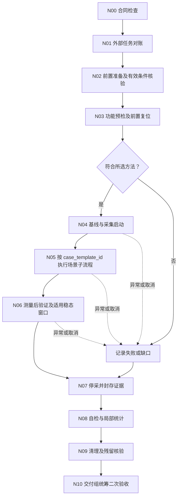
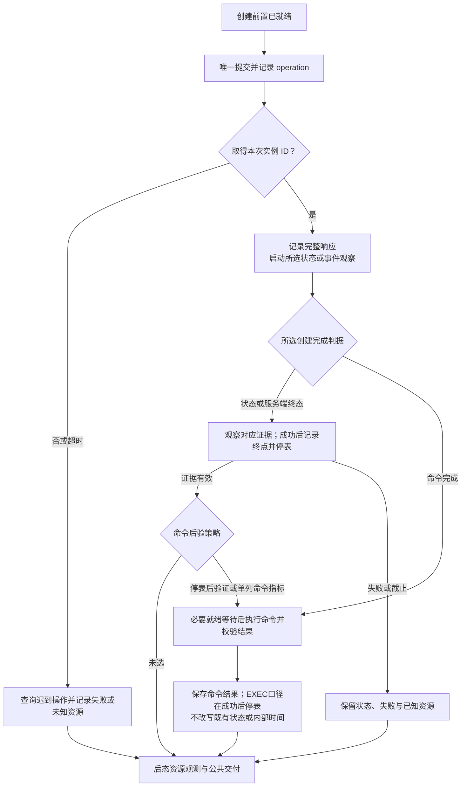
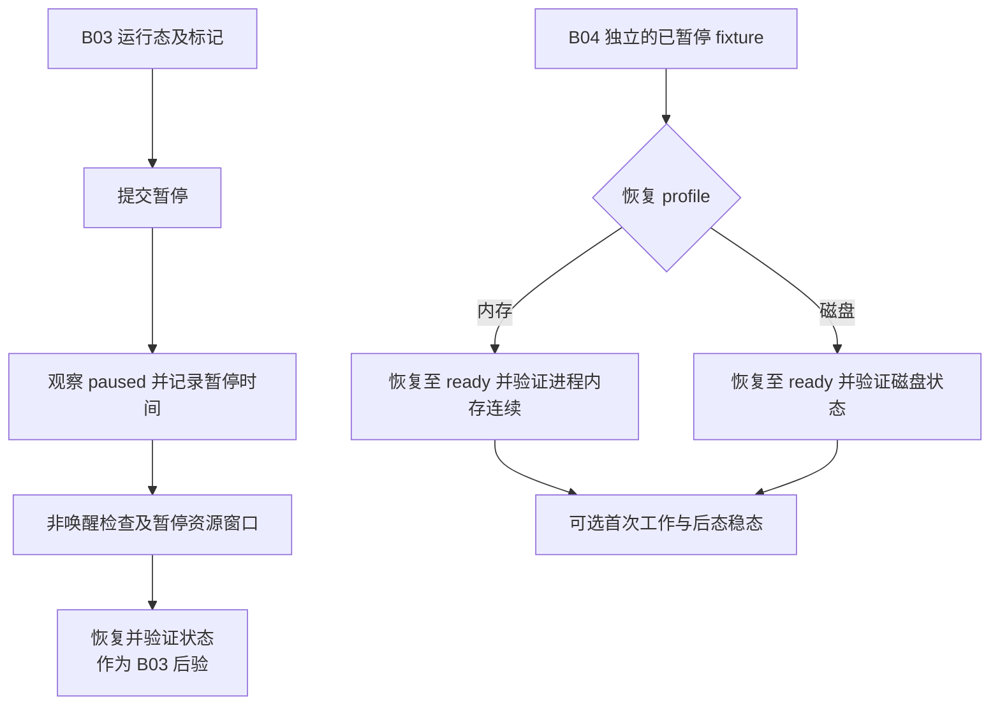
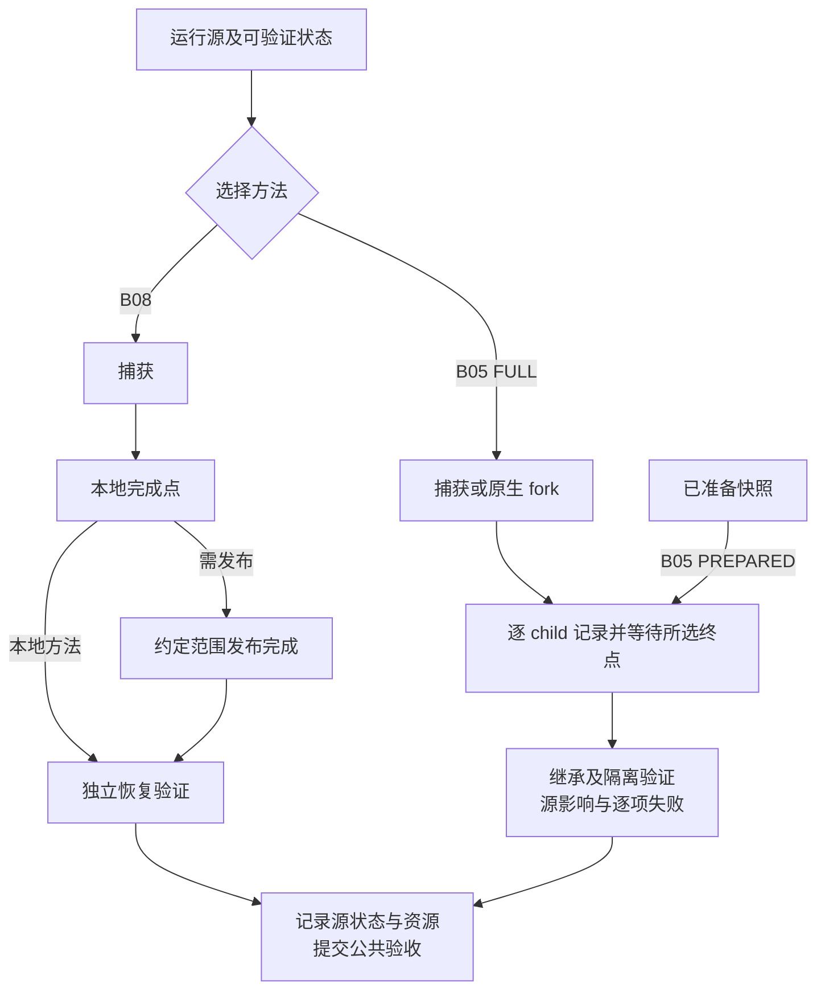
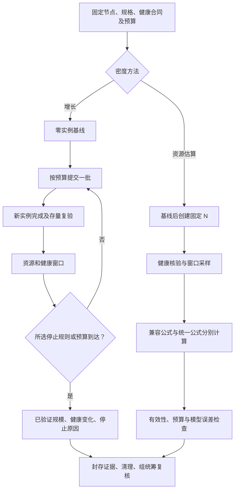
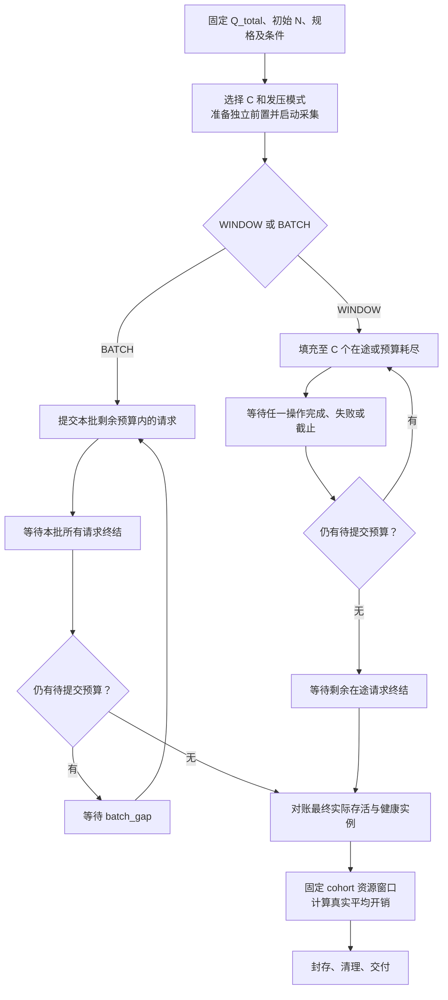

# 指标测试用例节点设计

状态：待审阅的节点合同与 Mermaid 设计，2026-10-21。没有调度实现或真实性能结果。本文展开 [主设计](design.md) 的 T0–T8、W0–W8 与 M1–M8；实现顺序仍为确认图和合同，再实现 LangGraph，最后接入脚本。

逐工作节点及每种用例的脚本／模型／人工职责、planned/draft 实现状态见 [node-automation.md](node-automation.md)，完整节点内部 Mermaid 见 [node-workflows.md](node-workflows.md)。本文中的请求、采样、状态观察、已定义断言及计算均目标脚本化；新语义解释和未明确业务选择分别交模型／人工，不能据流程已写出认定脚本已完成。

## 1. 依据、范围与最新修正

源码版本和官方方法索引见 [跨候选审计](../../../docs/source-audit/alignment.md)，产品细节见 [CubeSandbox](../../../docs/source-audit/cubesandbox.md)、[Kuasar](../../../docs/source-audit/kuasar.md)、[AgentENV](../../../docs/source-audit/agentenv.md)。以下是测试设计，源码支持不等于目标环境已经验证。

覆盖 B00–B10 全部基础场景及 E01–E06 低优先级扩展。扩展仅定义节点骨架、输入和验收；未审计的产品适配保持待验证，不自动纳入基础计划。

**用户本轮修正：创建完成不强制以命令成功为唯一判据。** API 返回、状态就绪、内部完成事件、命令完成分别建模。可以用经源码核验的状态判定创建完成；日志可提供独立的内部耗时。命令功能检查可以在创建停表后执行，首次命令耗时可以另选。此前审计中的“统一主指标必须到 exec”是早期方案，本文与更新后的 RT-22 优先。

原审计还有一处表述差异：Cube 原密度停止规则是**连续两批列表存量净增长不足阈值**，不是“本批创建成功数不足阈值”。Kuasar、AgentENV 旧审计中的新增成功停止建议属于另一方法，不能叫 Cube 原算法。本文分别编号保留。

## 2. 工作节点、用例与样本

图节点定义是可复用步骤；用例模板定义一种实验方法；工作实例是该方法在一组环境、一个条件组合及一个重复轮次下的执行。不得把每条 HTTP 请求或资源采样点变成模型调用。

建议工作身份：

`work_id = (plan_version, group_id, case_template_id, method_version, condition_id, repeat_id)`

上式是早期业务组合标识。代码详细设计在 [D04](orchestration-design.md) 中将其拆成不可变 WorkKey、持久 work_id、plan 关联及 measurement_generation；跨计划复用只建立引用，不改写旧样本身份。编排本身的验证见 [orchestration-test-design.md](orchestration-test-design.md)，不与本文的沙箱性能测试混同。

每次重试增加 `attempt_id`，每次外部操作另有 `operation_id`；源实例、子实例和采样记录都关联工作身份。产品内部 `run_id` 与本工程 `run_id` 使用不同字段保存，不能混用。

每个持久图节点有明确负责 agent；组统筹下的工作 agent 仅加载自己的合同、必要输入引用及状态摘要。脚本完成批次发压、轮询、日志解析、采集、计算和断言；agent 在节点边界看护，组统筹二次验收。具体运行时是否复用同一 agent 执行多个节点，留给调度实现，必须保持节点责任与上下文边界。

### 2.1 公共节点合同

| 节点 ID             | 输入                    | 脚本动作与输出                        | 验收及恢复                           |
| ----------------- | --------------------- | ------------------------------ | ------------------------------- |
| N00 CONTRACT      | 计划切片、方法版本、适配及证据引用     | 检查字段、完成判据、数据域和能力状态，输出合同摘要      | 缺合同是 blocked；不支持是能力缺口；均不伪造样本    |
| N01 RECONCILE     | 工作身份、资源清单、外部操作记录      | 对账正在运行或已完成的任务、源产物及残留，确定可恢复位置   | 未知副作用先查询；不能因客户端超时再次创建           |
| N02 FIXTURE       | 规格、来源、目标节点、缓存、TTL、工作集 | 准备并核验当前实验前置，输出 fixture 清单和实际条件 | 与目标不符阻塞该用例；准备动作不自动成为其他场景性能测试    |
| N03 FUNCTION      | 场景功能合同和 fixture       | 运行适配器预检与功能样例，记录状态、内容和结果        | 功能失败阻止对应性能结论；预检消耗的 fixture 需重置  |
| N04 OBSERVE_START | 节点角色／组件映射、采样合同        | 获取基线，启动资源和事件采集，确认采集就绪          | 缺必需观测阻塞对应指标；可选指标缺失显式标记          |
| N05 MEASURE       | 有限样本计划、对应 B/E 方法节点    | 脚本执行整个测量批次，记录每个操作的事件和结果        | 单个样本失败仍保留其他样本；停止规则和 deadline 有界 |
| N06 POSTCHECK     | 操作结果、场景不变量、稳态合同       | 内容／状态复核，适用的后态稳态与回收观测           | 创建停表后命令失败单列，不能删掉已记录状态耗时         |
| N07 SEAL          | 采集任务与原始数据位置           | 停止采集、刷新日志、冻结原始证据清单             | 采集不完整保留缺口；封存证据不代表测试通过           |
| N08 VALIDATE      | 原始证据、指标合同             | 检查完整性、计数和时间边界，脚本计算局部摘要         | 原始数据有效则仅重算，不能挑选“好看”样本           |
| N09 CLEANUP       | 本次所有权清单、共享产物引用        | 清理本次资源、核验残留、记录恢复动作及证据          | 失败／取消也执行；共享源不误删；失败资源留证后按合同处置    |
| N10 DELIVER       | 分离状态、数据和清理清单          | 交付本节点清单、摘要、缺口与恢复入口             | 组统筹验收失败只返工具体部分；失败证据也可形成有效交付     |

图示成功路径之外，N00–N03、N07–N09 的异常也必须进入有界的证据收集与清理协调；清理失败提交 `cleanup=incomplete/unknown` 后交付，不能无限循环。观察创建／暂停后的稳态与删除资源回收时先保持采集，再停采；N09 清理另存事件和核验结果，需要时另开清理采样窗口，不把测试结束后清理混入 N05 指标。

### 2.2 必填合同与交付结构

| 字段组   | 必须表达的内容                                                      |
| ----- | ------------------------------------------------------------ |
| 身份与版本 | 图、计划、方法、适配、脚本、产品提交及实际二进制／配置版本；环境组、目标节点、工作和操作身份               |
| 语义    | 源状态、目标状态、身份连续性、内存／磁盘／持久卷范围、完成判据、实现路径及副作用                     |
| 条件    | 请求与生效规格、N/C/λ、源 digest、缓存各层状态、负载、工作集、数据位置、TTL／续租、warmup、重复轮次 |
| 事件    | 事件定义、采集方式、起止边界、时钟域、误差、关联键；客户端计划发起与实际发起均保留                    |
| 观测    | 宿主与管理／数据节点组件映射、采样周期、缺失处理、峰值与稳态窗口、判稳及等待上限                     |
| 执行    | 请求、观察与清理预算，重试类型，资源锁，停止规则，前置复用条件                              |
| 判断    | 功能、数据有效性、覆盖、性能阈值分别判定；无业务阈值可交付测量，不宣称性能通过                      |

交付以 `case_manifest`、`operations`、`events`、`resource_series`、`assertions`、`summary`、`cleanup_ledger` 的逻辑集合组织；实际 JSON/JSONL/Parquet 文件格式尚未冻结。每项都有证据引用、版本、完整性摘要和生成方式。大日志独立保存，不能把全量文件塞进 agent 上下文。

### 2.3 所有场景共同的测量规则

* 单操作客户端时延使用同一客户端单调时钟。`t_scheduled`、`t_submit`、`t_headers`、`t_body`、对应完成观察时刻分别记录。发压器排队／漏发与服务耗时分开。

* 闭环 C 持有至**所选完成终点**，不能 Kuasar 收到 201 就释放并发槽而其他产品等到 running。开环 λ 保留实际发起速率、队列、漏发和完成数。

* warmup 与正式样本分开；warmup 残留实例计入真实 N 或清理。预检和恢复验证造成的缓存预热必须复位或标注，不能继续标“冷”。

* API 成功、状态就绪、功能验证、超时、拒绝、迟到完成及清理状态独立计数。接口／状态数据不会因后续清理失败被删除。超时样本是截止观测，不能当作恰好等于截止时间的真实完成时延混入成功分位数。

* 批次墙钟与逐请求分布分别计算；成功吞吐说明分子终点及窗口，批次完成速率与固定稳态窗口速率分开。不得把 `batch_wall/N` 叫单请求延迟，不平均各组 P99。

* 操作过渡峰值、操作前后稳定状态、持续约定负载窗口分别报告。有限瞬时批次未形成负载稳态时标不适用／未验证，不制造稳态结论。

* 同一共享宿主、控制面、存储或网络上的性能实验按冲突锁调度。并行 agent 不意味着实验可以互不干扰；发压器与采样器的负载和饱和迹象需记录。

* 所有 B 场景均采集适用的宿主、管理节点管理组件、数据节点管理组件、沙箱运行时的 CPU 时间／核占用、内存、I/O 和网络峰值及稳态；FD/PID、PSI、OOM 等按可用性补充。层级重叠不求和，CPU 百分比分母、RSS/PSS/cgroup/宿主可用内存不可混用。

### 2.4 密度与底噪共用的 PSS／CPU 采集节点

用户进一步要求：密度过程中同步测各角色／组件资源，最终用**实际拉起并仍存活的实例数量**计算适用平均开销；底噪以 PSS 为基础，剔除 Guest OS。该要求纳入基础范围。

N04 展开 `RESOURCE_INVENTORY → BASELINE_PSS_CPU → START_SAMPLERS`；N05 测量批次伴随 `TRACK_LIVE_INSTANCES + SAMPLE_COMPONENTS`；N06 展开 `FINAL_COHORT → ALIGNED_RESOURCE_WINDOW → COMPUTE_PER_SANDBOX`。采集是脚本后台任务，不为每次采样创建 agent。B09 可复用相同采集代码和格式，但不同窗口／前置不能自动复用为同一实验。

| 观测对象         | 必备指标                                      | 身份和范围                                        |
| ------------ | ----------------------------------------- | -------------------------------------------- |
| 管理节点管理组件     | PSS、CPU user/system/total 时间增量、采样峰值及稳态核占用 | 环境组、node、角色、component、进程／cgroup 启动身份         |
| 数据节点管理组件     | 同上                                        | 同时承担管理角色时仍按组件分组；一个进程只归属一次，可多角色标注             |
| 数据节点沙箱运行时    | 同上，尽可能逐实例分解                               | sandbox ID、runtime generation、完整进程组；共享守护进程另列 |
| 存储／网络等共享辅助服务 | 同上，按实际部署列入                                | 共享范围和角色明确；不能无依据平摊成某个实例直接开销                   |
| 宿主整体         | CPU 与可用内存等独立观测                            | 宿主内存不是所有进程 PSS 的简单替代；供资源外推及背景变化解释            |

**PSS 采集定义。** 进程总量使用 `/proc/<pid>/smaps_rollup` 的 Pss，需按映射分解时使用 `smaps`；PSS 按共享比例计量驻留页。PID 与进程启动身份一起使用，避免复用 PID；线程不重复当独立地址空间求和。采样记录开始／结束和读取失败，窗口对齐允许误差要有合同。读取较重，测量并记录采样器自身开销，不能对每个请求高频全量扫描。[Linux proc 文档](https://cdn.kernel.org/doc/html/latest/filesystems/proc.html)

PSS 是这里指定的进程内存指标，不覆盖一切宿主内存成本；未映射缓存、内核对象及其他未覆盖项需单列，不能叫“整机真实总内存”。缺 PSS 权限或进程在读前退出时标缺测，RSS 只能作为明确命名的辅助值，不能顶替 PSS。

**CPU 采集定义。** 进程 CPU 时间取 `/proc/<pid>/stat` 的 user/system ticks 并按实际 clock ticks 单位换算，或取去重 cgroup 的 `cpu.stat` usage/user/system 时间；两域不能重复相加。进程生命周期内的计数器重置、退出和采样遗漏要处理，cgroup 父子范围重叠要去重。cgroup v2 使用微秒计数。[Linux proc 文档](https://cdn.kernel.org/doc/html/latest/filesystems/proc.html)、[cgroup v2 文档](https://cdn.kernel.org/doc/html/latest/admin-guide/cgroup-v2.html)

同一窗口 Δt 秒：

* `cpu_seconds = counter_end - counter_start`（换算成秒）；增长期、最终稳态、清理期分别计算。

* `cpu_cores = cpu_seconds / Δt`；以 1 核为 100% 时 `cpu_percent = 100 × cpu_cores`，宿主归一化百分比另列并注明核数。

* `cpu_peak_cores = max(各采样间隔 cpu_cores)`，是采样分辨率下峰值，不声称捕获所有瞬态尖峰；PSS 峰值同理。

* 总体峰值先在相同时间轴聚合组件瞬时序列再求峰值，不能相加各组件各自最大值。

**真实分母和均值。** 每个观测窗口保存 requested、accepted、实际运行存活、状态健康、可选业务健康、暂停、丢失及未知数量和身份。实际存活由适配的 runtime／状态证据和归属共同核验；未知不能凑进已确认数量。最终报告冻结最终稳定 cohort，不能把全程累计创建成功数当最终存活数。

设固定最终运行 cohort 有 `N_live>0`，直接归属该 cohort 的沙箱进程 PSS 之和为 `P_direct`，同范围平台组件 PSS 总量为 `P_scope`，同配置零实例基线为 `P_base`。B09.PAUSED 使用满足暂停合同的 `N_paused` cohort，并对应命名其资源分子，不能套用运行态数量；统称 `N_cohort`：

* **沙箱直接平均 PSS**：`P_direct / N_live`，同时给逐实例分布、总量及身份覆盖。

* **平台含共享成本摊销 PSS**：`P_scope / N_live`，说明包含哪些管理／数据／辅助组件。

* **相对基线增量摊销 PSS**：`(P_scope - P_base) / N_live`，保留基线变化和不确定性；负增量标异常或噪声，不裁剪成正收益。

* **稳态平均 CPU**：固定 cohort 和窗口下，直接进程 CPU 秒之和除以 `N_live × Δt`，单位核／沙箱；`CPU秒/N_live` 另称该窗口每沙箱 CPU 时间。

失败或仍 starting 的资源不并入“存活沙箱直接平均”，单列失败／未就绪开销；若平台总量含这些对象，摊销视图明确说明。只有状态健康数或业务健康数作分母时，名称与资源归属也须一致。

管理节点没有本地 sandbox，仍采集其总量；需要按组摊销时用该服务范围内实际存活总数，不能除以管理节点本地的零实例数，也不能对每个数据节点重复分摊整份控制面。

若窗口内实例数变化，优先分段或等待固定 cohort 再计算最终均值；辅助动态均值可采用 `积分(P_direct(t) dt)/积分(N_live(t) dt)`，明确是实例时间加权均值。增长全过程 CPU 秒除最终 N 只能叫“每个最终存活实例分摊的增长成本”，其中失败成本单列，不能称稳态平均。

总体平均必须具备完整 cohort 的对应资源覆盖，不能只求已采到的 PSS／CPU 再除完整实例数。若仅子集可观测，只能用相同子集的资源与数量计算，标明覆盖率及可能偏差；共享组件缺测也不能当零补齐平台总量。暂停合同允许 runtime 卸载时，只有生命周期与宿主对账证明该进程／映射已正常不存在，才能记该项 PSS 为零；权限错误、读取竞态或未知退出均为缺测。

## 3. 创建完成判据与日志事件

### 3.1 四种不同终点

| 口径 ID           | 起点 → 终点                       | 可以说明什么           | 不代表什么                 |
| --------------- | ----------------------------- | ---------------- | --------------------- |
| API_COMPLETE    | 客户端发起 → 完整响应及 ID 校验           | 调用返回耗时；异步接口是接纳耗时 | 不能统一称创建成功耗时           |
| STATE_READY     | 客户端发起 → 首次查询确认本次实例达到合同状态      | 客户端观测到状态就绪的创建耗时  | 不等于精确内部状态转变时间或已执行用户命令 |
| SERVER_TERMINAL | 经核验的服务端起点 → 完成事件／服务端 duration | 该内部边界的创建耗时和阶段诊断  | 不自动包含客户端、网络和起点之前的准入   |
| EXEC_COMPLETE   | 客户端创建发起 → 首次标记命令完整成功          | 创建到首次有效命令的完整路径   | 不能重命名成纯创建耗时           |
| GUEST_READY     | 创建发起 → 同机进程内就绪信号（`control_ready→ready`） | guest runtime 就绪的白盒时刻 | 白盒；早于 STATE_READY，不能与黑盒端点同列 |

建议基础创建比较先使用 STATE_READY；三产品需要分别证明状态对应何种 runtime／初始化承诺，再判断是可比或条件受限。若改选 SERVER_TERMINAL 为主指标，三者必须具备等价起点和终点，不能一者内部耗时、一者轮询耗时放同列。`completion_contract`、`observation_method` 与 `validation_policy` 是不同字段：终点是什么、如何观察、功能验证放在哪里分别配置。

创建入口的**拓扑与同步/异步语义是独立于端点的条件**：经管理面/ingress（router）入口在 Kuasar 同步到 running（`API_COMPLETE` 即 `STATE_READY`）；仅有数据面时 node API 异步返回 `starting`，须轮询到 running；测试器与节点同机时可注入 `--ready-fd`（`GUEST_READY`）直接取 guest runtime 就绪时刻，但它是**白盒**端点，早于状态就绪，禁止与黑盒 `STATE_READY` 并入同列。请求 router 前须先核验部署含管理面/ingress 角色与组件，否则只能走数据面入口。详见 [alignment.md §9](../../../docs/source-audit/alignment.md)、[benchmark-design.md](benchmark-design.md) BCD-13。

状态查询只读且不得触发自动恢复。统一查询节奏、总 deadline、单次 timeout 和观察位置；保存每次请求的起止、状态及身份。轮询响应时间包含观察延迟；在状态单调、查询一致性等前提得到验证时才能报告最后未就绪至首次就绪的时间区间，不能机械减去半个轮询周期。稳定性复核不改写首次观察时间。

命令检查可以为预检、停表后逐实例检查或单独 EXEC_COMPLETE 用例；策略与覆盖数量必须记录。若创建状态成功但命令失败，保留 `state_ready=true` 与 `exec_validation=failed`，该结果不能被解释成业务可执行已通过。B07 和明确要求业务完成的用例仍需要真实命令断言。

### 3.2 Kuasar 新核验的源码证据

本地 orchestrator 版本沿用审计 SHA `c14da165ecc14de0e5c0afbfba2e1b737d64ee7c`，不是线上环境实证。

| 证据                                    | 实际语义                                                                                                               | 设计用途                                            |
| ------------------------------------- | ------------------------------------------------------------------------------------------------------------------ | ----------------------------------------------- |
| orch.go:342 SetAcceptedAt(time.Now()) | 创建 starting 记录持久化后打点，位于后续路由 barrier 与异步 launch 之前                                                                  | starting_total_duration 起点；不包含此前请求与部分准入处理       |
| orch.go:491 runLaunch                 | launchSandbox 返回后打印 sandbox launch terminal，带 sid/run_id/kind/profile/result/failure_stage/starting_total_duration | 仅 kind=create,result=success 对应创建成功；resume 独立分组 |
| sandbox_task_prepare.go:265           | artifact 路径先等待 runtime readiness，再 E2B envd init，再提交 Running 和发布观测                                                 | running／成功 terminal 具有比 HTTP 201 更强的完成含义        |
| orch.go:681                           | 非 artifact 路径同样等待 readiness、init、Running 提交和发布                                                                     | 两条路径均需按实际来源绑定，不以单一路径推断全部                        |
| orch.go:477 sandbox launch phase      | 输出 runner、prepare、runtime ready、envd init 等局部 duration                                                             | 阶段诊断；有嵌套／重叠，不直接相加替代 total                       |
| api.go:1356                           | GET detail 返回 state；startedAt 来自 CreatedUnix                                                                       | startedAt 是创建记录时间，不是 Running 完成时间               |

terminal 日志在成功返回附近打点，可能略晚于状态提交；不能叫精确的数据库提交时间。失败日志是在回滚处理之后生成，失败 duration 可能含回滚，需与失败阶段分别解释。只有缺少 AcceptedAt 的异常回退才把起点设为当前时间，不能把这种近零值当正常成功样本；需有接纳链证据。

日志采集保存原始记录、来源节点／进程启动身份、解析器与源码版本、sid、产品 run_id、kind、结果和工程 operation 的映射。重复日志去重，日志缺失／关联歧义标为不可用，不填零。优先使用已核实的进程内 duration；跨主机 wall-clock 相减需时间同步误差证据，否则只分域展示。日志写出、收集到达时间不能当完成事件时间。

记录服务端 `terminal_event` 与客户端／采集器 `terminal_observed` 两类时间。内部 duration 可用于内部计时，闭环并发槽只能在实际观察到完成后释放；采集延迟和队列会影响实际负载，需要单列。不能用回溯日志时间倒推并发槽已提前释放或伪造客户端吞吐。

Cube 创建链同步等待但 probe 和 envd init 有配置条件；AgentENV 等待 ready 后提交 Running 并发布路由。两者内部日志 duration 还没有完成等价起点审计，因此先提供 STATE_READY 路径，内部耗时标待适配，不能编造与 Kuasar 等价的日志字段。

三产品创建入口同步／异步（源码核验，详见 [alignment.md §9](../../../docs/source-audit/alignment.md)）：Kuasar router `internal/router/router.go` L339 `handleCreate`→L360 `routeLinkReserve`→L378 201，registry `internal/registry/registry.go` L469 `reserveCreate`→L1485 `waitReserveCall` park（默认 30s，L197–210）直到 L1140 `applyRoute` 收到 `StateRunning`（L1111 忽略 `StateStarting`）——**router 同步到 running**；Kuasar 数据面 `internal/orch/create.go` L196 `StateStarting` 后 `acceptFreshLaunch`（orch.go L282）即返回——**node API 异步**；Cube（CubeMaster 阻塞到 Cubelet 建好含 probe）与 AgentENV（orchestrator 注释 "only returns after fully ready"，`service.rs` L421）**同步**。Kuasar `--ready-fd` 由 `internal/sandboxproc/start.go` L45 注入、`sandboxer/cmd/sandbox-ctl/readiness.go` 写 `control_ready/ready`，读取端为 node 自身 `internal/configsock/readiness.go`，不对外暴露，不能经 HTTP 注入。

选 EXEC_COMPLETE 时 C4 直接进入必要就绪等待和命令执行，成功后才关闭该方法计时和并发槽，不能先等待命令完成再执行命令；选 STATE_READY 时 C5 关闭创建计时，后验不挤占创建并发槽。后验仍会占用环境资源：纯创建实验采用批后验证或单列验证批次，流式后验必须标注干扰和预算，三候选一致。

## 4. B00–B02：来源产物构建与创建节点

### B00 构建来源产物

来源产物构建是与创建分开的独立场景：衡量构建产物本身的一次性成本，不创建待测实例。

| 用例模板 | 测量节点链 | 完成判据 | 输出 |
| --- | --- | --- | --- |
| B00.TEMPLATE_BUILD | VERIFY_INPUT_ARTIFACT → BUILD_SUBMIT → WAIT_BUILD_TERMINAL | 构建作业 ready／error；产物 ID 持久化 | 构建提交→就绪时延 P50/P95、构建吞吐、构建期 CPU／内存峰值、产物大小与新增存储、冷／热缓存分列 |
| B00.SNAPSHOT_BUILD | VERIFY_INPUT_ARTIFACT → BUILD_SUBMIT → WAIT_BUILD_TERMINAL | 快照产物 ready／error | 同上；标明与 B08 从运行源捕获的边界 |

边界：B00 的构建成本只计一次，不计入 B01／B02 创建时延；B02.FULL 的镜像准备阶段若与 B00 重复，须按 `B02.FULL` 或 `B00` 其中之一归属并在合同中声明；B08 从运行实例捕获快照属不同方法，不并入 B00.SNAPSHOT_BUILD。

候选映射：Cube `POST /templates` → build job（building/ready/error）；Kuasar `POST /v3/templates` → `POST /v2/templates/{tid}/builds/{bid}`(fromImage) → status ready 取持久 `e2b-img`；AgentENV 跑 `template_builder` sandbox 再 `publish_captured` 产新 SnapshotId。三者构建路径未适配时 B00 标待适配。

### B01 从模板／快照创建

创建方法的身份由**来源产物 kind × 启动路径**决定，不由接口参数名称决定。同一候选把多条路径都命名为“模板”时，必须按实际 kind 与启动路径拆开，不得合并为单一方法身份。

| 用例模板 | 测量节点链 | 输入与断言 | 输出 |
| --- | --- | --- | --- |
| B01.TEMPLATE | CREATE_SUBMIT → WAIT_SELECTED_COMPLETION → POSTCHECK | 固定 `artifact_kind`（IMAGE_ARTIFACT／SANDBOX_ARTIFACT／SNAPSHOT_MANIFEST）与 digest，并记录解析出的启动路径（冷启／内存）；请求显式规格；新实例 ID；按选定状态／事件逐实例判成功 | API、状态、内部日志和可选命令耗时分别输出；相应吞吐、失败、阶段峰值及创建后稳态；带 `artifact_kind` 与 launch path 标签 |
| B01.SNAPSHOT.DISK | 同上，绑定磁盘快照内容合同 | 启动路径=磁盘冷恢复；预置文件 hash、应用版本；允许进程重启但不声称内存连续 | 同上，另列快照读取量、共享／懒加载与磁盘状态继承证据 |
| B01.SNAPSHOT.MEMORY | 同上，绑定内存快照内容合同 | 启动路径=内存恢复；进程内 token 与内存内容连续、文件 hash 正确 | 同上，另列内存继承证据与恢复期峰值 |

公共参数：N、C 或 λ、总操作数或测量窗口、warmup、缓存、预创建池、存储位置、规格、TTL。缓存冷热是来源各层的属性，不是仅凭“第一次请求”命名。模板／快照制作成本不计入 B01，但关联准备产物（B00）。

候选映射：Cube 公共模板 create（模板与快照同命名空间，均以 `template_id` 创建，须按实际产物 kind 归类）；AgentENV “模板 create” 实际为 snapshot 恢复，规格继承快照，不得当作模板来源；Kuasar 同一“模板”按 kind 分 `img`(冷启)/`sbx`(冷启)/`snp`(内存恢复) 三条路径，201 后继续等待选定完成证据。不能给 AgentENV 未定义的顶层资源字段或 Kuasar 被忽略的 cpuCount/memoryMB 后假设规格已覆盖。源码入口见三份审计及第 3 节。

失败与重入：未拿到 ID 先对账；拿到 ID 不重复创建；历史已有实例只能用于恢复观察／后验，不能凭恢复后的当前时间补造原始创建时延。缺失起点使该时延无效，原始创建事实仍保留。

### B02 从镜像创建

| 用例模板         | 测量节点链                                                                                      | 起止边界                                                | 验收与指标                                  |
| ------------ | ------------------------------------------------------------------------------------------ | --------------------------------------------------- | -------------------------------------- |
| B02.FULL     | IMAGE_PREPARE → BUILD_OR_CONVERT → PUBLISH_IF_REQUIRED → CREATE → WAIT_SELECTED_COMPLETION | 固定 OCI digest 已知但候选所需派生产物尚未准备；首次必需准备动作之前起表，到所选实例完成点 | 内容／规格符合；准备、拉取、构建、发布、启动及总时延分列，缺少阶段观测不猜值 |
| B02.PREPARED | VERIFY_PREPARED_ARTIFACT → CREATE → WAIT_SELECTED_COMPLETION                               | 合法镜像派生产物已存在，计实例启动路径                                 | 命名为“已准备镜像产物启动”；不能替代 FULL 的完整路径结果       |

Cube：`POST /templates` → job `building/ready/error` → sandbox create。AgentENV：`/sandboxes-cold`，镜像解析在该调用中。Kuasar：OCI → 合法 Image artifact 准备／发布 → `e2b-img` 创建；公共 builder 准备路径已补查（benchmark-design BCD-05），实际适配／部署未验证时 B02.FULL 为待适配，不能用预制产物结果顶替。`e2b-img` 后缀不能直接编码 Docker 镜像名。

并发的单位需明确：独立“镜像准备＋一个实例”作业，或“一次共享构建＋K 个实例”的批次。后二者是不同条件；共享构建成本只计一次，同时报告批次完整耗时和每实例启动耗时，不能既重复算构建又称独立创建。每轮准备产物复用和缓存复位都有证据。

失败与重入：按 build/job/artifact ID 对账；恢复接着等待同一 job。为了重测 FULL 而复用已完成构建，会改变前置条件，须新建条件／重复轮次而非当原实验重试。

## 5. B03–B04：暂停与恢复节点

### B03 暂停

用例模板 `B03.PAUSE`，语义 profile 显式区分保留内存检查点、磁盘保留冷恢复、仅冻结且保留进程内存。只为候选真实支持的 profile 绑定路径，不假设三者都提供纯 freeze。

链：`PREPARE_RUNNING_STATE → RECORD_PROGRESS_MARKERS → PAUSE_SUBMIT → WAIT_PAUSED → OBSERVE_STOP_AND_RESOURCES → VERIFY_RESUMABILITY`。

* 前置：运行态、明确负载／dirty 工作集、文件 hash、仅存于原进程内存的 token；记录实例及进程身份。预检与测量实例隔离或复位。

* 计时：请求→暂停完成状态观察；API 返回单列。执行停止与资源释放分别观测，不能把“不响应”当已暂停，把网络故障当执行停止。无进程推进的证据应来自非唤醒观测；无法获得则标 unknown。

* 后态：暂停状态 CPU、保留内存、磁盘占用及释放量／释放观察时延；同源恢复验证属于本用例后验，不是 B04 性能矩阵。

* 映射：Cube pause 后需查 paused；AgentENV await pause 后仍核验；Kuasar `memory=true` 捕获并暂停，`memory=false` 磁盘语义分组。源是否卸载、写入哪些状态按实证报告。

* 重入：已 paused 不再提交 pause 并产出虚假的近零时延；可继续资源观测／恢复检查。原始计时缺失则该样本不完整。

### B04 恢复

| 用例模板       | 前置与链                                                                 | 主要终点                    | 断言                                             |
| ---------- | -------------------------------------------------------------------- | ----------------------- | ---------------------------------------------- |
| B04.MEMORY | 已暂停且有内存状态 → RESUME_SUBMIT → WAIT_READY → VERIFY_STATE → FIRST_WORK   | 请求→状态就绪；按选择另报到命令／首次工作完成 | 同一实例身份；原进程 token 和内存内容连续，文件 hash 正确；仅 PID 相同不够 |
| B04.DISK   | 已暂停且只有磁盘恢复合同 → RESUME_SUBMIT → WAIT_READY → VERIFY_DISK → FIRST_WORK | 同上，独立于 MEMORY 分组        | 磁盘状态恢复，允许进程重启；不能声称内存连续                         |

两者记录业务不可用窗口、runtime／envd 阶段、懒加载带来的首次工作成本、过渡峰值和恢复后的稳态。FIRST_WORK 的工作集／输出 hash 固定；没测就不能声称工作集全部就绪。

Cube connect/resume、AgentENV resume/connect、Kuasar connect 的实际端点与 memory 参数列入适配合同。Kuasar connect 返回不等于 ready。TTL 续期作为条件保存，不能让早期实例到期污染本轮恢复。

重入：同一个原始恢复操作查询状态；已恢复不重新执行并作为新样本。要再测需重新暂停并建立新的重复轮次及一致的缓存条件。

图中 B03→恢复后验和 B04 独立工作实例不互相强制依赖；只选 B04 时准备暂停实例即可。

## 6. B05–B08：克隆、删除、命令与快照

### B05 克隆

| 用例模板         | 计时链                                            | 统一语义与指标                                                      |
| ------------ | ---------------------------------------------- | ------------------------------------------------------------ |
| B05.FULL     | 从运行源发起 → 捕获／发布（如需）→ K 个子实例创建 → 各子实例达所选完成点 → 后验 | 源准备完成但未预制本次快照；总时延、每 child 从父操作起的就绪时间、fan-out 启动时间、批次成功率和部分失败 |
| B05.PREPARED | 本次来源快照已可用 → K 个子实例创建 → 就绪 → 后验                 | 排除捕获／发布成本，引用快照来源；不能与 FULL 混排                                 |
| B05.NATIVE   | 原生 fork 请求 → 逐项结果 → child 就绪 → 后验              | 原生专项视图；符合 FULL 相同前置和结果语义时可参与对应比较，路径标签保留                      |

共同断言：子实例各有新 ID；初始内存／磁盘内容符合所选继承范围；在可写且声明隔离的区域对每个 child 写唯一值，验证源与兄弟不变。共享只读数据、外部共享卷独立声明，不能要求本来共享的卷自动隔离。源停顿、源最终状态、恢复源的耗时分别记录；若方法要求“结束后源继续运行”，恢复成本计入该方法的完整结束点。

Cube native fork 与 SDK snapshot+create 分列，SDK 会在部分失败时清理成功兄弟；为了保留事实须取得逐 child 原始结果及清理记录。AgentENV fork HTTP201 数组逐项可能失败。Kuasar 组合为 pause→export(toTemplate=true,keepSource=true)→create，源处于 paused；要求源继续运行则增加 source resume。不能将该路径直接称零停顿原生 fork。

K 为子实例数量、C 为尚未完成子创建并发、N 为既有存量，三者分开；一个 fork HTTP 请求可能产生 K 个 child，API吞吐与 child 吞吐分列。共享父操作的 child 样本有关联，重复轮次统计需保留批次层次。

重入：先枚举已返回／迟到的 child 与快照；不能重放整个 fork 导致倍增。只有部分 child 成功是有效的部分失败数据，不能被 HTTP201 或 SDK 清理掩盖。

### B06 删除

模板 `B06.RUNNING`、`B06.PAUSED`；相同规格与来源，按删除前状态分别运行。

链：`VERIFY_OWNED_TARGET → DELETE_SUBMIT → OBSERVE_LOGICAL_END → OBSERVE_RESOURCE_RELEASE → RESIDUE_CHECK`。

三个终点：完整 API 返回；逻辑删除／不可访问；约定资源释放。资源释放按实例关联的 runtime 进程、cgroup、挂载、网络／端口、临时存储分别验收；共享模板／引用保留不算泄漏。宿主内存没有恢复某个数值不单独证明泄漏。

计数包括成功终止、成功回收、回收超时、残留及未知。确认“不可执行”的探针需有身份和认证控制，不能把无权限或网络故障当删除成功；可能自动唤醒的端点不得作为暂停实例删除前置探针。原始创建结果与删除结果独立保存。

重入：目标已消失可完成清理核验，但若首次删除事件缺失，不以第二次 DELETE 的短响应冒充首次删除时延。进程或资源共享关系未知时保留 unknown。

### B07 命令执行

| 用例模板       | 固定条件／动作                        | 验收与输出                                 |
| ---------- | ------------------------------ | ------------------------------------- |
| B07.FIRST  | 已就绪实例上首条命令；连接新建策略明确            | 请求→start 事件观察、首输出、完整 end 分列；首次连接／执行开销 |
| B07.STEADY | 固定 N、每实例并发及全局 C/λ、连接复用；重复确定性命令 | 命令完成时延、成功吞吐、排队和组件稳态开销                 |
| B07.OUTPUT | 固定输出大小、stdout/stderr 比例与内容     | 完整输出 hash／字节数／退出码；首字节和完整传输时间、有效字节率    |
| B07.ERROR  | 预期非零退出、超时／取消分别作为功能子用例          | 正确报告错误、子进程终止与残留；不把预期错误算成基础成功命令吞吐      |

命令、用户、cwd、env、stdin、PTY、输出缓冲策略和协议版本必须一致。三者优先各自已核验的 envd 客户端链路；编码不同可注明传输差异，不假设 AgentENV JSON codec 已支持。Kuasar native exec 与 envd 为独立协议方法，不混为同一接口开销。

server stream 收到 start/PID、HTTP200 或流断开都不等于成功；必须解析完整 end、退出状态和内容。无法获得实际 guest 开始时间时标为“客户端观察到 start”，不用跨时钟相减伪造执行启动时延。

若 B01 后验已在该实例执行命令，此实例不能继续冒充 B07.FIRST；应独立准备或明确“首条被测命令”而非实例首次命令。超时命令可能仍在运行，重入先查任务与进程，不能盲目重发。

### B08 快照

| 用例模板          | 计时链                                                  | 完成／后验                            |
| ------------- | ---------------------------------------------------- | -------------------------------- |
| B08.LOCAL     | 源运行、工作集准备 → CAPTURE → LOCAL_ARTIFACT_READY           | 本地捕获的明确完成点；随后在声明可访问节点恢复并验证状态     |
| B08.PUBLISHED | 源运行、工作集准备 → CAPTURE → PUBLISH → DECLARED_SCOPE_READY | 约定存储／节点范围内发布完成；独立恢复证明可用，捕获与发布分别记 |

前置：工作集实际触页、脏页量、文件数据、仅存在进程内存的 token、快照链深度与存储后端；不能只申请虚拟地址却称相同内存工作集。恢复核验输出 hash，且验证源保留、运行／暂停和可恢复位置。

两种样本均报告 API、捕获、发布、验证用恢复时间，以及逻辑大小、实际新增存储量、读写／网络、源中断窗口。已确认的发布时间与“通过恢复验证时刻”分别列出；后验恢复耗时不悄悄并入快照发布时延。没有独立捕获打点时 LOCAL 耗时不可拆，保留可观测总量。

Cube snapshot READY 和 remoteStatus 分开；远端保证需另查。AgentENV API await capture+publish，源恢复运行；底层 benchmark 名为 snapshot_creation 但实际 pause，不代表本节点。Kuasar pause(memory=true)+export 为组合，export result 才是模板引用，keepSource 必须明确；源 paused 与源恢复成本单列。

重入：按 snapshot/job/source 关联对账；不可因日志缺失再次 capture 并覆盖第一次时间。删除验证实例不删除共享源；源删除后可恢复性的验证只针对本次拥有且合同允许处置的源。

## 7. B09–B10：底噪与密度

### B09 底噪

| 用例模板         | 节点链                                                             | 输出与边界                            |
| ------------ | --------------------------------------------------------------- | -------------------------------- |
| B09.PLATFORM | ZERO_TEST_INSTANCES → SERVICES_ON → WAIT_STABLE → SAMPLE_WINDOW | 平台服务常驻基线；不是所有服务关闭的空宿主            |
| B09.IDLE     | BASELINE → PREPARE_N_RUNNING → IDLE_STABLE → SAMPLE_WINDOW      | 固定 N 空闲实例的宿主／组件总量与增量；单实例摊销明确共享成本 |
| B09.PAUSED   | BASELINE → PREPARE_N_PAUSED → PAUSED_STABLE → SAMPLE_WINDOW     | 暂停后的保留资源与常驻维护开销，按暂停语义分组          |

N 为已选有限档位，1 是可选的单实例档，不在此冻结规模。基本负载下稳态随其他 B 场景观测，不要把有业务负载结果称空闲底噪。

本场景主要内存指标为第 2.4 节定义的 PSS。底噪交付同时保留 `raw_pss`、`guest_deduction`、`net_overhead_pss`、扣除方法／版本／置信范围及可用性，不能只留扣除后数字。平台无实例基线、沙箱直接底噪和平台共享摊销分别报告。

**Guest OS 扣除边界待用户确认：** 仅扣 Guest 内核／系统服务，还是扣全部 Guest 内存以得到宿主运行时额外开销。这两者不是同一指标，在得到答复前不冻结减项。宿主 `smaps` 能给映射的 PSS，但不自动标明页属于 Guest OS 还是 Guest 应用；匿名映射也不能直接都认作 Guest 内存。

候选方法需逐 runtime 验证：若能以 runtime 内存区域及 backing 证据定位 Guest RAM 对应宿主映射，可计算同域 Guest backing PSS，服务于“扣全部 Guest 内存”视图；仅扣 Guest OS 还需要 Guest OS 页／系统服务到宿主驻留份额的可靠归属。Guest `/proc/meminfo` 的 used、配置 2G、虚拟映射 Size 都不能直接从宿主 PSS 相减。

差分“同配置最小 Guest OS 基线”最多是估计方法，需处理共享页比例、COW、缓存和驻留变化，不能无条件从每个实例扣一个常数并称真实净值。Kuasar、AgentENV、Cube 的具体分离适配均未在现有审计中证明；无法分离时 raw PSS 可交付，净底噪标待验证。暂停实例未映射但仍占磁盘的检查点也单列，PSS 变小不代表所有资源消失。

基线与 N 实例窗口保持配置、角色、后台任务、缓存及采样口径可追溯；实例在窗口内存活且状态符合。AgentENV 的 allocatedMemoryBytes 是额度，不能当 RSS；Kuasar 清理后 post_per_sb 不是存活 idle 成本；Cube 单次 used-memory 不等于稳态窗口。

重入时旧基线需检验配置与环境变化；进程重启、背景负载变化会使旧基线失效。采样中断不直接拼成一个连续稳态窗口；记录窗口分段并重新判稳。

### B10 单节点密度

所有密度工作先取得目标数据节点的独占实验条件与 placement 证据。集群组内可以固定某一数据节点；无法确认归属则不得输出单节点密度。管理组件共置或外置、共享控制面预算都需注明。

**各类密度实验的创建过程都同时采集创建吞吐。** N04 启动创建事件收集，N05 保存请求／接纳／所选成功终点，N08 确定性计算：

- 从首个正式提交 `t0` 开始，使用同一客户端单调时钟，以 `[t0+k秒,t0+(k+1)秒)` 固定窗口统计每秒成功创建数；最后不足1秒的桶保留实际时长，输出数量和按实际时长计算的速率。
- `create_success_qps = 本窗口首次达到所选成功终点的唯一创建操作数 / 窗口秒数`；另外输出 offered_qps、accepted_qps、失败／超时／迟到数。状态完成不强制命令验证；若合同选择命令终点，则保持独立方法标签。
- 全轮吞吐为截止内成功数除以明确的创建测量总时长；固定预算批次包含批间等待，活动吞吐另列，最终稳态观测与清理不塞进创建耗时。增长兼容方法的创建窗口和尾部等待按版本合同保存。
- 计数按 operation／实例运行代次去重，不因重复轮询、重复日志或重试事件重复计数。日志法同时保存内部时间和采集观察时间：客户端每秒速率按实际获知完成的时刻统计；若另报服务端事件速率，须有可比较时钟域并另命名，不能用 duration 反推吞吐曲线。
- 批间等待无创建完成时为真实零值；日志／事件缺失时是缺测，不能补零或当无创建。超时后到达的完成单列，不自动进入截止内成功吞吐。
- 创建成功后实例退出不抹掉历史创建计数，最终密度另按存活 cohort 统计。创建吞吐的分母是时间，平均资源的分母是相同范围的真实实例数，两者不能混用。
- B10.PROJECTION/SLO_VERIFY 的前置实际创建同样记录，但标为该方法准备阶段创建吞吐，不当成受控发压能力结论；复用已有实例且本轮没有创建时写“未发生／不适用”，不输出创建性能为零。

用例模板：

| ID                        | 方法                 | 停止／输出                             | 适用范围                      |
| ------------------------- | ------------------ | --------------------------------- | ------------------------- |
| B10.GROWTH_LIST           | Cube 原规则移植         | 按列表存量净增长连续不足阈值停止；另输出状态健康数及可选业务健康数 | 三者均设计相同增长实验；保留原口径标签       |
| B10.GROWTH_READY          | 健康新增增长             | 按本批新增达到选定健康合同的数量判停，复验旧实例          | 独立方法，不能叫 Cube 原算法         |
| B10.PROJECTION            | Kuasar 固定 N 资源估算移植 | 同一批原始观测生成原公式兼容视图与统一修正视图           | 三者均设计；仅模型估计，不是实测最大容量      |
| B10.SLO_VERIFY            | 指定容量验证             | 指定 N 和有限负载下验证延迟／成功率／资源合同          | 阈值明确后可选；不自动扩展为长期运行或二分寻峰   |
| B10.FIXED_REQUESTS.WINDOW | 固定总请求数、滑动并发窗口      | 每档 C 消耗相同总请求预算，完成一个补一个，保留成功实例     | 比较并发对最终存活密度、性能及角色／组件资源的影响 |
| B10.FIXED_REQUESTS.BATCH  | 固定总请求数、分批间歇创建      | 每批全部请求终结后等待指定间隔，再启动下一批            | 与 WINDOW 配对比较；不直接声称达到容量上限 |

增长链：`BASELINE → SUBMIT_BATCH → WAIT_RESULTS → RECONCILE_NEW_AND_OLD → OBSERVE_WINDOW → EVALUATE_STOP → 下一批或交付`。

这条链是增强测量方法。B10.GROWTH_LIST 的原协议兼容模式必须另行固定取数顺序：原 create-only 批次返回 → 原约定等待 → 列表计数并判停。状态／业务健康复核和最终稳态不能插到原列表计数之前却仍宣称原协议。若采用状态完成批次、每批健康复核／稳态等待，再扩容，则明确生成增强 method_version；同一版本跨候选执行。后台资源采集持续进行，其开销另记，不改变计数终点定义。

每批记录 attempts、API accepted、new_running、new_health_ok、listed_owned、healthy_owned、old_lost、late_unknown、当前资源与配额。健康合同可用经核验的状态，或进一步要求业务正确性，二者结果分别命名；只有状态时称“状态健康实例密度”，不推导业务承载。业务功能抽检覆盖率和检查带来的负载需记录；声明所有实例业务健康则必须按合同覆盖全体。

Cube 原参数参考为 batch=100、C=50、min_growth=10、连续2批、sleep=2s、max_batches=200、max_total=2000。它们是原方法证据，不是用户批准本轮跑该规模。兼容规则 `listed_i-listed_(i-1)<min_growth`；列表完整性需与已知 ID 核对。以 run 所有权代替原脚本全环境列表属于移植的域变化，必须标注。安全预算先于追加批次校验；与原脚本批后检查上限的偏差也记录。

统一健康数在明确窗口内报告最小值、最大值和变化；声称“已验证 N 持续存活”需该窗口内 N 个身份均满足合同。瞬时最大数不能当可持续密度。达到实验预算只报告下界／已验证规模；从未成功时区分前置／配额／适配问题，不能称物理密度为零。旧实例到期、续租失败与新创建失败分开。

每批与最终固定 cohort 均输出第 2.4 节的按角色／组件 PSS、CPU 秒、采样 CPU 峰值及稳态占用；最后展示“实际拉起多少、最后还活着多少、多少符合健康合同”，并基于对应真实集合计算平均沙箱开销。PSS用于组件归属和摊销，宿主 MemAvailable 用于原容量公式，两种结果并列而不相互替换。密度保留包含 Guest 的原始资源成本；B09 的 Guest OS 扣除净值不是容量模型的全部物理成本。

资源估算链：`ZERO_BASELINE → PREPARE_FIXED_N → VERIFY_ALL_N → OBSERVE_SELECTED_WINDOW → CALCULATE_COMPAT_AND_UNIFIED → CHECK_MODEL_LIMITS`。

记 A0 为服务全开且零测试实例时宿主可用内存，Amin 为指定窗口最小可用内存；Nrequested 与 Nhealthy 分开，R 为事先声明的同单位预留。

原兼容视图：

`d_original = round((A0 - Amin) / Nrequested, 1)`； `original_projected = floor(Amin / d_original)`，仅 d_original > 0.5 MiB 时定义。

统一视图：

`cost = (A0 - Amin) / Nhealthy`； `estimated_total = max(0, floor((A0 - R) / cost))`； `estimated_additional = max(0, estimated_total - Nhealthy)`。

原式输出应注明更接近**剩余可增加量**，不是总容量。统一值要求全部目标实例达到选定健康合同、同域采样有效、N>0、cost>0、A0>R；不满足则估算无效，不换分母凑数。估计总量小于实际 N 时报告预算／模型冲突。

过渡峰值窗口与存活稳态窗口分别估算，不能用同一个未标注的 Amin。Kuasar 原脚本在底层 sandbox-ctl 发压、5秒采样，其请求分母、采样窗口和测试层次完整保留；在 E2B 上移植同一公式是新实验层次，不能声称复现了原底层性能。

多个 N 档位可追加边际成本拟合，但它是单独 model_version，需要足够数据及残差；非线性共享页／COW／balloon 不允许无界线性外推。CPU、磁盘、FD/PID 等只有存在有效预算和成本时才给对应预测，取有效约束的最小值仍叫估计。未观测资源不虚构容量。

增长与外推原则上独立 fixture／基线，避免先增长填满缓存再把外推标成冷态。可共享原始观测生成多个统计视图，但如果停止规则改变未来发压轨迹，不能用已停止的数据宣称跑完另一种增长方法。恢复密度测试先对账存量、TTL 和连续窗口；中断后可续工作，不能把中断前后拼成无中断承载证明。

### B10 固定总请求数 × 并发档位 × 发压模式

这是用户追加的基础测试类型。它回答“同样多的创建请求，在不同并发和节奏下，最终拉起多少，以及耗时／资源成本如何变化”，不是无限增长找封顶，也不是创建后立即删除的吞吐循环。创建成功的实例保留到本轮最终资源窗口结束。

公共输入：

| 字段                  | 定义                                                    |
| ------------------- | ----------------------------------------------------- |
| Q_total             | 本轮计划首次提交的创建操作总数；每个 C 与模式采用相同 Q_total                  |
| C_levels            | 有限并发档位；C 是尚未达到所选完成终点或失败／截止的创建操作上限                     |
| dispatch_mode       | WINDOW 或 BATCH；这里的窗口指 in-flight 创建上限，不是功能预检 preflight |
| B、batch_gap         | BATCH 的批大小和批间等待；纯整批并发模式建议 B=C，若 B>C 则显式标为批内限流组合方法     |
| N_initial           | 开始前存量及其状态；跨 C／模式保持同一合同，新增实例与初始存量分别记账                  |
| completion_contract | 何时算创建完成、释放槽位；默认建议状态就绪，API 接纳不能冒充异步创建完成                |
| request_budget      | deadline、失败处理、测量后窗口、实例保留与 TTL；未定数值不得从官方默认自动套入         |

N02 为每个 `(mode,C,repeat)` 建立独立且可比的前置，N04 从同一条件基线开始采集。不得把 C=20 的存活实例无声明带入 C=40，导致真实 N 不一致；也不能全局清空别人的实例。缓存／后台负载无法复位时记录差异，并按预先计划的顺序／分块或重复实验控制影响。

**WINDOW：** 先提交 `min(C,Q_total)` 个；任何操作达到所选完成证据、明确失败或超时后释放一个槽，只要预算未耗尽且无停止原因，立即补一个。脚本调度，不等一批全部成功，不经模型逐请求派发。记录补槽间隙和实际在途序列；网络或发压器瓶颈导致窗口未满时，不声称实际一直维持 C。

**BATCH：** 提交最多 B 个，批内实际未完成数不超过 C；等待本批所有请求成功／失败／截止后，若仍有预算则等待 `batch_gap`，再提交下一批。有失败不能无限等到“全部成功”，也不自动补足 B 个成功数。最后不足一批时只提交剩余预算，最后一批后不计一个不存在的批间等待。B=C 时才是纯粹“同时 C 个，全部结束后等待”。

**固定请求数与重试：** 一个首次提交消耗一个 Q_total 名额，不因失败而自动补发直到达到成功数。查询状态和读取日志不属于新增创建名额，但计入观测流量／开销。发送前失败、明确拒绝、超时未知副作用分别记录；计划数、实际发起数和被服务接纳数均保留。会再次提交创建的重试必须另有显式方法合同及请求计数，不能在比较中隐藏。内部服务重试则记录可观测证据。

**共同输出：**

* 每请求 API／状态／所选日志耗时及可选命令结果、P50/P95/P99 与失败／超时；实际发起、接纳、成功速率及在途数量曲线。

* 计划请求 Q_total、实际发起、未发起、成功创建、迟到／未知、最终运行存活、健康实例、初始与新增实例数。

* 整轮耗时从首个提交到最后计划操作终结，BATCH 包含中间等待；另报测量活动区间、累计等待和每批完成时间。最终判稳／后验与清理另列，不混入创建批次时间。

* 含批间等待的整轮完成吞吐用于节奏效果比较；剔除等待的活动吞吐是另一指标，不能拿它与 WINDOW 的整轮吞吐直接排名。

* 从基线、逐批／滑窗增长到最终固定 cohort 的角色／组件 PSS、CPU 秒、CPU 峰值和稳态；第 2.4 节的真实数量分母及直接／摊销／增量均值。

* 全部请求消耗完仅报告“Q_total 请求下最终验证 N”，不称最大密度。预算或资源约束提前停止时标实际发起数和停止原因，不与完整 Q_total 实验无条件混排。

无论哪种模式，取消／资源预算停止都走公共封存、对账和清理，不继续补槽。重入保存已消耗预算、每个操作状态、在途身份、当前批与等待截止；先对账后派发剩余，不能重置 Q_total。执行中断已改变压力轨迹，恢复可完成资源处置及工作记录；需要完整性能比较时新建重复轮次，不把断续执行标为连续滑窗。

## 8. E01–E06 低优先级节点

下面均为可选节点合同；具体产品适配未完成源码审计，`capability_status=unverified`，不推断支持或不支持。它们复用 N00–N10，但不成为 B00–B10 的默认依赖。

| 场景／用例模板          | 测量节点链                                                                          | 统一条件与断言                                                   | 主要指标和恢复                                     |
| ---------------- | ------------------------------------------------------------------------------ | --------------------------------------------------------- | ------------------------------------------- |
| E01.WORKLOAD     | PREPARE_DATA → RUN_FIXED_WORK → VERIFY_OUTPUT                                  | CPU、内存、磁盘、网络分别 profile；工具版本／参数／数据规模一致，固定工作量和 hash；空命令链路另测 | 任务完成时间、有效吞吐、IOPS／带宽／时延及资源；断点任务不可直接与完整一次任务混排 |
| E02.RESET        | CAPTURE_BASELINE → MUTATE_STATE → RESET → VERIFY_BASELINE                      | 明确同实例回滚或销毁重建；内存／磁盘范围、身份、外部副作用不同不混排                        | 回滚／重建到就绪、首次工作、中断窗口；重入按 generation 对账，避免重复回滚 |
| E03.MIXED_SOAK   | SEED_INITIAL_STATE → REPLAY_MIX → PERIODIC_AUDIT → DRAIN                       | 固定随机种子、操作比例、N 轨迹、期限及持续时间；生命周期前置合法，逐操作结果可追溯                | 分窗口成功吞吐、尾延迟、资源斜率、积压及残留；中断分段，不能冒充连续长稳        |
| E04.PRESSURE     | BASELINE → APPLY_PRESSURE_LEVEL → RUN_WORK → REMOVE_PRESSURE → VERIFY_RECOVERY | 压力种类、阶梯、活跃比例、资源策略及预算明确；guest OOM 与 host OOM 分列            | 准入、排队、有效任务、OOM、回收／恢复时延；恢复先解除已登记压力           |
| E05.INTERFERENCE | VICTIM_BASELINE → COLOCATE_AGGRESSOR → RUN_PAIRED_WINDOWS → REMOVE_AGGRESSOR   | 固定受害／干扰负载、同节点证据、资源限额、隔离策略和运行顺序                            | 相对基线延迟／吞吐变化及资源竞争；基线为零不算比例；重入核验两类进程          |
| E06.RECOVERY     | HEALTHY_BASELINE → INJECT_DECLARED_FAULT → OBSERVE → RESTORE → VERIFY_WORK     | 故障对象、方式、持续期、恢复方式和作用域须明确；服务进程与节点故障分组，逐任务身份防重复              | 不可用窗口、恢复到健康、工作丢失／重复、积压清空；副作用对账后恢复，不盲目重复注入   |

E04/E06 的动作必须处于本轮明确范围和预算内。不能因基础失败而自动扩大为压力／故障实验。E02 同实例状态回滚与从快照创建新实例是不同承诺，缺前者时保留能力差异。

## 9. 官方方法保留与跨候选覆盖

| 已审计官方方法                                 | 对应统一节点                               | 保留内容及对三候选的迁移方式                                             |
| --------------------------------------- | ------------------------------------ | ---------------------------------------------------------- |
| Cube `POST /templates` build job           | B00.TEMPLATE_BUILD                   | 保留构建 job 的 building/ready/error 与 `tpl-` 产物；构建成本不计入创建时延        |
| Kuasar builder 注册／触发／status               | B00.TEMPLATE_BUILD                   | 保留 fromImage→持久 `e2b-img` templateID；与 B02.FULL 镜像准备边界须声明        |
| AgentENV `template_builder` + publish   | B00.SNAPSHOT_BUILD                   | 构建模板即跑 builder sandbox 再 publish；与 B08 运行源捕获分列                  |
| Cube HTTP 响应头创建／删除                      | B01、B02、B06                          | 原 headers 耗时单列，补 body 与状态终点；三者均可记录客户端事件                    |
| Cube 并发创建、暂停／恢复                         | B01、B03、B04                          | 保留批次 wall 与摊销视图，新增逐操作事件，不从摊销反推分位数                          |
| Cube SDK clone、dirty 快照                 | B05.FULL/PREPARED、B08                | 捕获／发布／fan-out 分段，移植真实触页和内容检查；源副作用分组                        |
| Cube 连续两批净增长停止                          | B10.GROWTH_LIST                      | 三者实施同一停止协议与独立健康统计，原列表域及移植变更明示                              |
| Kuasar 固定 N 资源公式                        | B10.PROJECTION                       | 三者均输出兼容和统一视图，保留底层／E2B层次及窗口差异                               |
| Kuasar idle/cycles/pareto 工作集           | B09.IDLE、B10 的负载 profile；完整负载性能归 E01 | 相同 guest 工作量和活跃比例，基础资源窗口不强制启用完整 E01                        |
| Kuasar manifest restore 到首 TICK         | B04 的底层参考 profile                    | 保留首业务输出方法；三者只在相应后端有适配时执行，不能同 E2B 状态时间混排                    |
| AgentENV backend pause／hot-cold restore | B03/B04 的底层参考 profile                | snapshot_creation 实际测 pause；其“cold”不代表 OCI 冷启动。无等价后端入口标待适配 |
| AgentENV 模板到首 run_code                  | B01 的首次工作 profile                    | 保留真实模板来源和工作量；不归 B02 镜像创建                                   |
| Kuasar agent-density checker            | E01/E03 或 B10 活跃负载的验证合同              | 原工具需要外部 launcher 与证据；可移植结果完整性检查，不复用历史数字当本次测量               |

同一方法在所选候选上均有计划状态：待适配、可执行待运行、已执行、能力缺口等，不能只在原作者产品运行后称已横向对齐。“所有口径都测”指保留并实现适用实验协议，不照抄全局 reset、错误吞没或测量漏洞；修正处形成新方法／兼容视图并记录差异。

底层参考方法作为明确可选分层，不混入默认端到端主指标。实际选择服从版本化计划；只选一个方法不会暗中运行整个目录。

## 10. 图接入、验收与待定参数

T0 绑定源码和方法；RP/T1 将场景选择展开为本文用例模板及有限条件；T2 对适配与完成语义预检；T4 取得资源锁后派发 N00–N10，N05 路由到 B/E 子流程；N10 交 T6 组级二次验收；A1–A4 按同方法、同完成判据、同条件统一计算与比较。

组统筹检查：计划用例是否完整记账、数据和失败是否保留、事件是否可关联、预检／warmup是否影响缓存、规格与 placement 是否有效、清理是否闭合。主 agent 收到摘要、交付引用和待决项，不接收所有源码或子 agent 会话。原始数值和比较均脚本化；模型负责源码解释、异常诊断与有证据的结论，人工处理确实未定义的测试取舍。

节点验收不等于性能通过。明确区分执行状态、功能断言、数据有效性、组复核、性能阈值与清理；例如方法真实失败的数据可以有效，资源采样缺失也可能只使资源指标无效，而非删掉有效时延。

还需逐项冻结但不妨碍本轮节点设计的内容：

* 规格档位及 GB/GiB、N/C/λ、样本量／重复数／warmup，所选方法与缓存 profile。

* 创建／恢复使用的主完成判据、状态语义比较范围、日志或轮询策略、功能后验覆盖。

* 状态观察节奏、各 deadline、采样周期、稳态判据／窗口与等待上限。

* 内存／磁盘／持久卷的状态保证；克隆／快照源最终状态；本地或远端发布承诺。

* 密度的 batch／停止阈值／预算／预留、健康判据和可选 SLO；共享环境隔离及实验顺序。

* 底噪剔除 Guest OS 的确切范围、三套 runtime 的同域分离证据及允许的估计方法；PSS/CPU 的采样频率和对齐误差。

以上数值未确认时标为缺少合同输入，不由模型静默填成实测条件。设计不预设这些节点已实现或实际通过。

## 11. 节点内自动化与恢复补充

| 节点范围 | 脚本化 | 不交给脚本自行决定 |
|---|---|---|
| N00–N03 | 合同、对账、来源／规格／缓存／TTL／placement、功能预检及复位 | 新接口语义由模型核验；用户意图／比较目标未定时人工明确 |
| N04–N06、B/E 方法 | 采集与每秒吞吐、有限发压、已定义状态／日志／内容断言、后验和稳态 | 新 runtime 映射及未知异常需模型；参数与 Guest OS 扣除范围缺失不能猜 |
| N07–N10 | 封存、数据质量、统计、资源清理、交付与分离状态 | 未定义的统计取舍和超范围动作不能自行批准 |
| T6/T8、A1–A7 | 组复核、局部及全局计算、可比层分组、已定义差异与 Excel | 因果解释／新语义比较需要模型，业务偏好需要人工 |

需要零实例／初始存量增量基线的方法，N02 仅准备源产物和环境条件，N03 探测 fixture 清理复位；N04 获取该基线后，才在 N05 创建待测 cohort。不能先创建目标实例再将采样标为零实例基线。

缺合同、未知副作用或缺采集权限只能进入对应缺口分支，不能无条件继续测量。模型诊断／人工等待前执行有界停采、停止发压和已确定的撤压／恢复；保留实例、后台任务及冲突锁需有所有者、期限、预算与到期处置。中断改变实验轨迹时，恢复记录不能冒充连续运行性能样本。

## 执行代码与代码契约入口

本节点的执行模块、算法及恢复合同见 [benchmark-design.md](benchmark-design.md)；测试这些代码的独立断言、夹具与工程测试见 [benchmark-contract-design.md](benchmark-contract-design.md)，任务见 [tasks.md](tasks.md) 15–27组。运行时参数缺失只阻塞对应真实用例，不阻止严格合同和算法实现。Kuasar B02.FULL 已补查公共builder路径（BCD-05）；目标部署可用性及实际适配另行验收。
